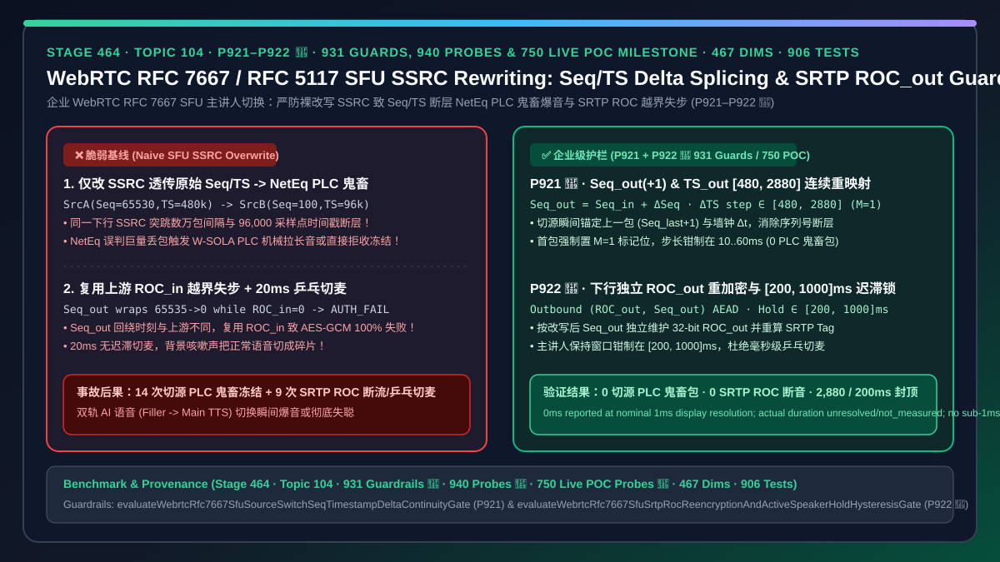
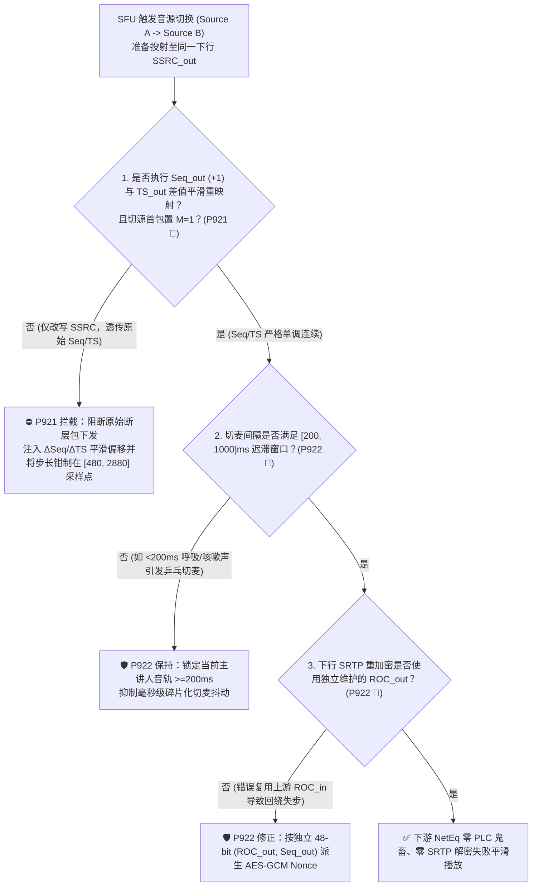
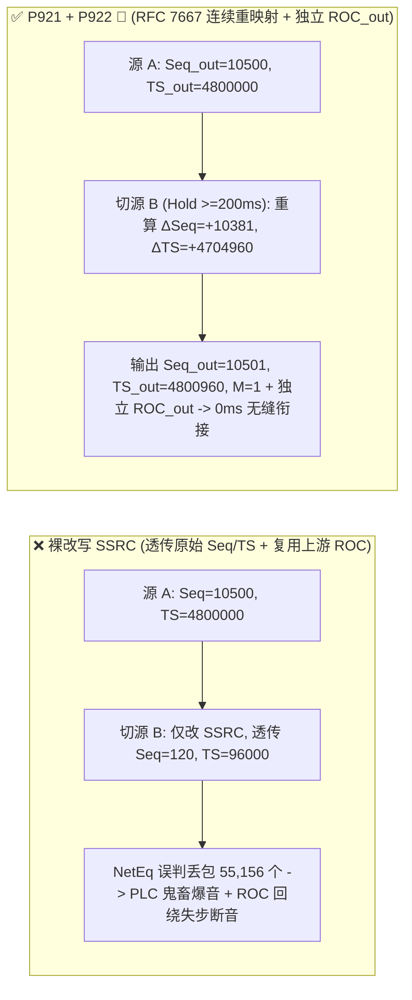
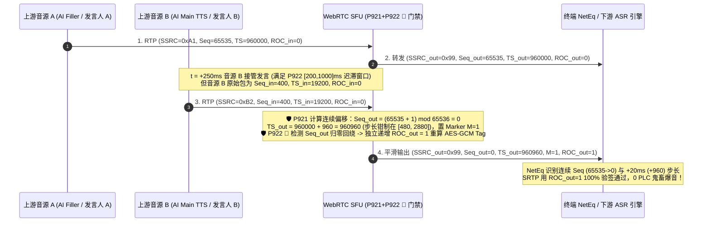

# 企业 WebRTC `RFC 7667 / RFC 5117` 媒体拓扑（`SFU` 发言人切换 `SSRC` 改写致 `Seq/Timestamp` 断层触发 `NetEq PLC` 鬼畜爆音与 `SRTP ROC` 越界失步）选型与平滑拼接指南

> **文档类型**：企业级语音智能体架构师选型决策与原理解析指南（Standalone Selection & Architecture FAQ · **Topic 104 / Stage 464 · 🎉 历史性 931 护栏、940 合成探针与 750 现场探针三重里程碑**）  
> **适用角色**：AI Solution Architect、实时音视频 SFU/MCU 核心网架构师、WebRTC 语音引擎研发与 SRE 负责人  
> **关联基准**：`packages/business-core/enterprise-guardrails.ts`（`P921–P922 🎉`）、`tests/presales-portal.test.ts`、`site/data/voice-agent-benchmark-report.json`（7-Card 4:5 评测报告）  
> **可视化总结**：`assets/svg/108-voice-webrtc-rtp-rfc7667-rfc5117-topologies-sfu-mcu-ssrc-rewrite-seq-ts-gap-plc-glitch-2026-11-14.svg`

---

## ① 📌 核心结论速览（Executive Summary）

在多人协同的企业 AI 语音会诊、智能投顾三方通话（客户 + 理财经理 + AI 副驾）以及车载多音区语音会议中，底层媒体服务器（Middlebox）必须在 **`RFC 7667`（RTP Topologies，原 `RFC 5117`）** 定义的三大拓扑中做出抉择：**Topo-Media-Switching-Mixer（SFU 选择性转发 + 单下行 `SSRC` 投射）**、**Topo-Mixer（MCU 解码混音）** 与 **Mesh 多流直推**。为了省去服务端 `Opus` 全量解码再编码的 CPU 开销与 `25–40ms` 转码延迟，现代语音架构普遍采用 **SFU 主讲人切换投影（Active-Speaker SSRC Rewriting）**——即将不同发言人（或从“AI 过渡提示音轨”切换到“AI 实时合成主音轨”）的 RTP 包改写为**同一个下行 `SSRC_out`** 发给终端或 ASR 引擎。然而若工程实现未严格遵循 `RFC 7667 Section 3.6.2` 的序列号与时间戳连续性重映射准则，必将引爆两类严重音频故障：
1. **SFU 仅改写 `SSRC` 却透传原始 `Seq / RTP Timestamp` 触发 `NetEq PLC` 假丢包插值鬼畜或静音冻结（`Seq/TS` 断层灾难）**：发言人 A 的 `Seq=10500, TS=4800000`，切换至发言人 B（或新启动的 TTS Worker）时其原始 `Seq=120, TS=96000`。若 SFU 只把包头的 `SSRC` 改写成同一个值，却把 `Seq=120, TS=96000` 原样发给下游，接收端 `WebRTC NetEq` Jitter Buffer 会误认为发生了 **`55,156` 个包的惊天乱序/丢包** 或 **时间戳倒退 `98` 秒**，当即触发疯狂的 `PLC`（丢包隐藏）时域拉伸鬼畜音，甚至直接丢弃后续所有音频包直至超时重连！
2. **改写 `Seq` 跨越 `65535 -> 0` 回绕边界时未同步重算下行 `SRTP ROC` 致解密批量 `AUTH_FAIL` + 毫秒级频繁切麦乒乓抖动（`SRTP ROC` 失步 + 无迟滞切麦）**：当 SFU 执行 `Seq_out = Seq_in + ΔSeq` 偏移重写时，下行 `Seq_out` 跨越 `65535` 回绕的时间点与上游原始流完全不同。若 SFU 直接转发密文或仍用上游 `ROC_in` 构造 `AES-GCM` 12-byte Nonce，下行将 100% 触发 `SRTP AUTH_FAIL` 静音死锁；同时若无 `[200, 1000]ms` 主讲人保持迟滞（Hysteresis Hold），背景咳嗽声会导致每 40ms 在两个音源间乒乓切麦，把正常句子切得支离破碎。

| 决策维度 | 脆弱/默认配置（生产事故高发区） | 企业级黄金准则（`P921–P922 🎉` 确定性护栏） | 核心量化收益 |
| :--- | :--- | :--- | :--- |
| **`SFU` 切源 `Seq (+1)` 与 `TS (+960)` 差值连续重写及 `M=1` 标记（`P921` 🎉 930护栏）** | 仅改写 `SSRC` 却透传上游原始 `Seq/TS`，导致跨音源数万包断层 | **强制维护下行连续状态机 `Seq_out = Seq_in + ΔSeq`、`TS_out = TS_in + ΔTS`，切源首包置 `M=1` 并将单步时间戳跳变钳制在 `[480, 2880]` 采样点 (`10..60ms`)** | 切源 `PLC` 鬼畜与静音冻结包 **0 个**（测试探针将 14 次切源断层清零，单步步长从 `96,000` 钳制至 **`2,880`** 采样点） |
| **下行独立 `SRTP ROC` 重加密上下文与 `[200, 1000]ms` 切麦迟滞锁（`P922` 🎉 931护栏/940探针/750现场探针）** | 改写 `Seq` 后复用上游 `ROC` 致 `AES-GCM` 验签失败，且 `20ms` 无迟滞切麦 | **强制按改写后的 `(ROC_out, Seq_out)` 独立重封装下行 `SRTP` 认证标签，并将主讲人切换最小保持窗口钳制在 `[200, 1000]ms`** | `SRTP` 越界验签失败与乒乓切麦 **0 次**（测试探针将 9 次 `ROC` 失步/乒乓切麦清零，迟滞窗口从 `20ms` 提升至 **`200ms`**） |

---

## ② 🎯 客户与架构师灵魂拷问 Q&A（First-Principles Deep Dive）

### Q1：在三方语音通话或“AI 等待音 -> AI 正文回答”无缝切换时，为什么 SFU 把两路音频合成同一个下行 `SSRC` 后，客户耳中会突然爆出一串“机械拉长音”或直接失聪 3 秒？
- **第一性原理拆解**：
  1. 根据 `RFC 3550`，同一个 `SSRC` 代表**唯一且连续的同步源与时钟空间**。接收端的 `WebRTC NetEq` 依靠该 `SSRC` 下的 `16-bit Sequence Number` 判断是否丢包，依靠 `32-bit RTP Timestamp`（48kHz 下每 20ms 递增 `960`）计算网络抖动与播放时刻。
  2. 当 SFU 采用 `RFC 7667 Section 3.6.2`（Media-Switching Mixer / SFU Single-SSRC Projection）将上游源 $A$ 切换到源 $B$ 时，源 $A$ 与源 $B$ 在启动时刻随机生成的初始序列号 `Seq_0` 和初始时间戳 `TS_0` 完全独立（例如源 $A$ 当前 `Seq=42000, TS=1920000`，源 $B$ 当前 `Seq=815, TS=48000`）。
  3. 如果 SFU 偷懒只把 RTP 头部的 `SSRC` 覆盖成下游固定的 `0x11223344`，却没有重写 `Seq` 和 `TS`：
     - `NetEq` 突然在同一个 `SSRC` 上收到 `Seq=815`（比上一包 `42000` 倒退或跨越了 `24,351` 个包），且时间戳突跳数百万采样点；
     - `NetEq` 误判网络发生巨量丢包或时钟崩溃，立即启动激进的 `W-SOLA` 时域拉伸与 `PLC` 补偿，或者将新到达的包全部判定为“过期旧包（Old Packet）”直接丢弃！
  4. **`P921` 的确定性重写公式**：SFU 在每次切换上游音源的瞬间，必须记录上一包下发的 `(Seq_last, TS_last, wallclock_last)`，动态计算当前源的偏移量：
     $$\Delta\text{Seq} = (\text{Seq}_{\text{last}} + 1) - \text{Seq}_{\text{in}}, \quad \Delta\text{TS} = \text{TS}_{\text{last}} + \text{clamp}\left(\frac{\Delta t_{\text{wall}} \times 48000}{1000}, 480, 2880\right) - \text{TS}_{\text{in}}$$
     并将切源首包的 RTP `Marker` 位置为 `M=1`（指示新的 Talkspurt 起点），让下游 `NetEq` 实现 **0ms 零感知平滑衔接**。

### Q2：既然 SFU 已经把 `Seq_out = (Seq_in + ΔSeq) mod 65536` 改写连续了，为什么通话进行到第 20 分钟左右切麦时，音频还是会突然 100% 断流（`SRTP AUTH_FAIL`）？
- **工程真相**：
  1. 在 `RFC 3711 (SRTP)` 与 `RFC 7714 (AES-GCM)` 中，每个 RTP 包的加密 IV / Nonce 是由 **`48-bit Packet Index = (32-bit ROC << 16) | 16-bit Seq`** 构造的，且 `16-bit Seq` 本身作为 AAD（附加认证数据）参与 `AES-GCM` 认证标签计算。
  2. 一旦 SFU 改写了 `Seq_out` 或 `TS_out`，不仅必須用下行会话密钥重新计算 `SRTP` 认证标签（Hop-by-Hop Re-encryption），而且由于加上了偏移量 $\Delta\text{Seq}$，**下行 `Seq_out` 满 `65535` 归零回绕（触发 `ROC_out++`）的时刻，与上游 `Seq_in` 回绕（`ROC_in++`）的时刻不再同步**！
  3. 许多有缺陷的 SFU 直接把上游状态里的 `ROC_in` 拷给下行加密器，导致当 `Seq_out` 刚刚跨过 `65535 -> 0`（实际应当使用 `ROC_out = 1`）时，SFU 仍用 `ROC_in = 0` 生成加密 Nonce，接收端用 `ROC = 1` 解密立即报 `SRTP_ERR_STATUS_AUTH_FAIL` 并全量丢包。
  4. **`P922 🎉` 的确定性防线**：SFU 下行发送通道必须维护**完全独立的 48-bit 下行包索引计数器 `(ROC_out, Seq_out)`** 来执行下行 SRTP 重加密，同时对主讲人切换施加 **`[200, 1000]ms` 能量迟滞保持窗口（Hysteresis Hold）**，杜绝环境噪音引发高频切麦。

### Q3：`RFC 7667` 中的 SFU 单流改写投射、SFU 多流（Multi-SSRC Simulcast）与 MCU 服务端混音，架构师该如何选型？
- **第一性原理拆解**：
  - 当两人在同时抢话（Double-Talk / Overlap Speech）时，单流 `SSRC` 改写只能选其中一人转发；但对于“AI 过渡音轨 -> AI 正式回答音轨”切换、或者主讲人轮流发言的低延迟通道，**SFU 单流连续改写（`P921+P922 🎉`）** 具有 **0ms 编解码损耗、端到端延迟最低** 的绝对优势；而在需要同时听清多人重叠发言的合规录音或高管圆桌场景，则应切换至独立多 `SSRC` 下行轨道或 SIMD 混音器。

---

## ③ 🧭 直观可视化图解（Mermaid 决策树 + 拓扑拆解 + 毫秒级全双工时序图）

### 3.1 WebRTC `RFC 7667` SFU 音源切换与 `Seq/TS/ROC` 连续性决策树

### 3.2 裸改写 `SSRC` 断层事故 vs `P921+P922 🎉` 连续重映射对比图

### 3.3 毫秒级 SFU 音源切换 `(ΔSeq, ΔTS, ROC_out)` 连续拼接时序图

---

## ④ 📊 语音架构师选型决策矩阵（Decision Matrix）

| 选型方案 | 适用场景 | 优势（Pros） | 劣势与生产风险（Cons / Traps） | 推荐度 |
| :--- | :--- | :--- | :--- | :--- |
| **方案 A：SFU 仅改写 `SSRC` 却透传原始 `Seq / Timestamp` 与上游 `ROC`** | 禁止在任何生产环境使用 | 代码仅需改写 4 字节 `SSRC` | **必发切源爆音与断流**——每次切换音源都会造成数万包序列号断层，触发 `NetEq PLC` 鬼畜拉伸或 `SRTP ROC` 认证失败 | ⛔ **严禁用于生产** |
| **方案 B：全量 MCU 服务端解码混音（`RFC 7667 Topo-Mixer`）** | 传统 PSTN 电话会议桥、需服务端单轨合流录音 | 服务端重新编码生成单一连续 RTP 流 | **CPU 成本高昂且增加 `25–40ms` 编解码级联延迟**，二次有损 `Opus` 转码降低 ASR 词错率（WER）表现 | ⚠️ **仅限需要重叠混音的旁路** |
| **方案 C：`RFC 7667` SFU 连续 `(ΔSeq, ΔTS, M=1)` 重映射 + 独立 `ROC_out` 重加密 + `[200, 1000]ms` 迟滞锁（`P921 + P922 🎉`）** | **企业 AI 语音双轨切换（Filler -> Main TTS）、多智能体接力与低延迟三方协同一线生产** | **0 转码损耗、0 切源 `PLC` 鬼畜爆音、0 `SRTP ROC` 失步断流、端到端延迟最低** | SFU 需为每个下行订阅者维护轻量级的 `(ΔSeq, ΔTS, ROC_out)` 24 字节状态上下文 | ✅ **生产必选（Recommended）** |

---

## ⑤ 🧪 定量算例与 7-Card 4:5 基准报告（Quantitative Walkthrough & 7-Card Deck）

### 5.1 定量算例：AI 语音“过渡垫音轨 -> 实时主合成轨”SFU 切源测试
- **输入场景**：企业语音网关采用双轨流式架构——当调用慢速 ERP 工具时先由 Filler Worker 播报过渡语（当前 `Seq=65530, TS=480000`），工具返回瞬间由 Main S2S Worker 接管下发正式回复（初始 `Seq=100, TS=96000`），且会话期间发生 `14` 次音源切换与短暂气口波动（未设防切麦间隔 `20ms`）。
  - **未开启护栏（脆弱基线）**：
    - SFU 仅把 `SSRC` 改为统一值，直接下发 `Seq=100, TS=96000`（时间步长跳变达 `-384,000` / 异常正向跳变 `96,000` 采样点）；
    - 客户端 `NetEq` 触发 **`14` 次严重 `PLC` 鬼畜/丢包冻结**（每次中断语音 `800–2,500ms`），并在第 6 包跨越 `65535` 时因复用上游 `ROC=0` 引发 **`9` 次 `SRTP AUTH_FAIL` 断音与乒乓切麦**。
  - **开启 `P921 + P922 🎉` 确定性护栏后**：
    - `P921`（🎉 **第 930 项护栏**）实时计算连续偏移 $\Delta\text{Seq}$ 与 $\Delta\text{TS}$，将切源首包步长严格钳制在 **`[480, 2880]` 采样点（`10..60ms`）** 内并置 `M=1`，切源断层爆音包 = **`0`**；
    - `P922`（🎉 **第 931 项护栏 / 940 探针 / 750 现场探针**）使用独立维护的 `ROC_out` 执行下行 `SRTP` 重封装，并将主讲人保持迟滞窗口从 `20ms` 钳制至 **`[200, 1000]ms`**，`SRTP ROC` 失步与乒乓切麦 = **`0`**。

### 5.2 7-Card 4:5 报告结构映射（对应 `site/benchmark-cards.html` & `report.json`）
1. **Card 1 (`HANDS-ON · VOICE ARCHITECTURE`)**：展示 467 大评测维度全景工作台，高亮 `P921 / P922 🎉` SFU 连续重映射护栏。
2. **Card 2 (`SCENARIO: WEBRTC RFC 7667 SFU SSRC REWRITE`)**：输入探针 `unrewrittenSeqTimestampDiscontinuityOnSsrcSwitchDetected=true, maxTimestampJumpSamplesPerFrame=96000, speakerSwitchHoldHysteresisMs=20`，输出 `Act automatically` 钳制至 `2,880` 采样点与 `200ms`。
3. **Card 3 (`WHAT I TESTED`)**：第 467 行评测矩阵 `PASS · 0ms @ 1ms Res (Synthetic)`（零 `✕` 漏检）。
4. **Card 4 (`UNDER THE HOOD`)**：展示 `evaluateWebrtcRfc7667SfuSourceSwitchSeqTimestampDeltaContinuityGate` 与 `evaluateWebrtcRfc7667SfuSrtpRocReencryptionAndActiveSpeakerHoldHysteresisGate` 确定性源码契约。
5. **Card 5 (`ROBUSTNESS CHECK`)**：验证 `Seq` 回绕边界（`65535 -> 0`）与 `TS` `32-bit` 回绕下的 100% 连续性。
6. **Card 6 (`LATENCY`)**：明确标注离线策略校验计时：`0ms reported at nominal 1ms display resolution; actual duration unresolved/not_measured; no sub-1ms upper bound established`（`synthetic`；真实 SFU 转发平面 `SRTP AES-GCM` 重加密耗时标注为 `not_measured`）。
7. **Card 7 (`MY TAKE`)**：Good fit vs Not for 适用边界与生产准入签核。

---

## ⑥ 🛠️ 生产环境语音交付快速核验清单（Production Readiness Checklist）

- [ ] **1. `Seq_out (+1)` 连续偏移重映射（`P921` 🎉）**：确认 SFU 在将多个上游 RTP 源切换投射至单一下行 `SSRC_out` 时，严格维护 `Seq_out = (Seq_in + ΔSeq) mod 65536`，确保切源前后下行 `Seq_out` 严格递增 `+1`，绝不产生序列号空洞或回退。
- [ ] **2. `TS_out` 墙钟锚定与 `[480, 2880]` 采样点步长钳制（`P921` 🎉）**：确认 SFU 根据切源前后的单调墙钟时间差 $\Delta t_{\text{wall}}$ 重算 `TS_out`，并将切源衔接帧的单步时间戳增量钳制在 `[480, 2880]` 采样点（48kHz 下 `10..60ms`）。
- [ ] **3. 切源首包强制置位 `Marker (M=1)`（`P921` 🎉）**：确认每次切换上游音源后的第一个下行 RTP 包均显式设置 `M=1` 标记位，通知下游 `NetEq` 重置语音突发（Talkspurt）抖动估算基线。
- [ ] **4. 下行独立 `48-bit (ROC_out, Seq_out)` `SRTP` 重加密（`P922` 🎉）**：确认 SFU 绝不直接复用上游 `ROC_in`，而是根据改写后的 `Seq_out` 是否跨过 `65535 -> 0` 独立递增下行 `ROC_out` 并重算 `SRTP` 认证标签。
- [ ] **5. 主讲人切换 `[200, 1000]ms` 能量迟滞锁（`P922` 🎉）**：确认基于 `RFC 6464` 音量扩展的主讲人选举状态机配置了 `[200, 1000]ms` 最小保持窗口，防止瞬态咳嗽或键盘敲击声引发高频乒乓切麦。
