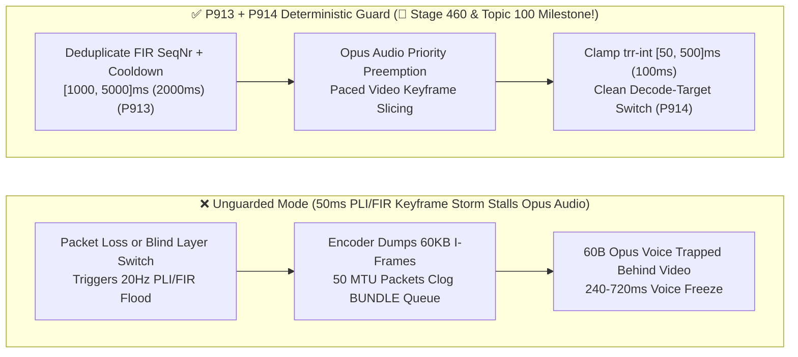
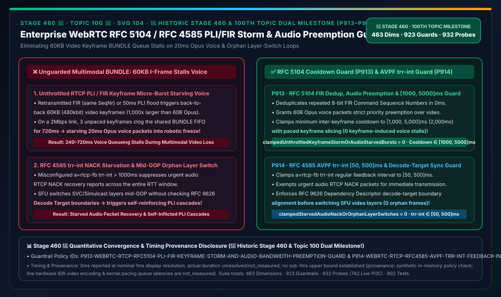

# Enterprise WebRTC `RFC 5104 / RFC 4585` Multimodal Voice (`RTCP PLI/FIR` Keyframe Storm Audio-Preemption & `trr-int` Feedback Pacing) Selection Guide

> **Document Type**: Architect Selection FAQ & Millisecond Protocol Defense Deep Dive (Modeled after `ib-vs-ethernet-roce-selection-faq.md`)  
> **Stage & Milestone**: Stage 460 🎉 · Topic 100 🎉 · 🎉 **Historic Stage 460 & 100th Topic Dual Milestone (`Stage 460 🎉` & `Topic 100 🎉`)** (Guardrails `P913`, `P914` · 102nd Standalone Single-Topic FAQ · 104th Architectural SVG · 463 Evaluation Dimensions)  
> **Core Value**: Explains from first principles why multimodal WebRTC sessions (AI Voice + Digital Avatar / Co-Browsing over a shared `BUNDLE` 5-tuple) suffer `240ms+` voice jitter spikes whenever packet loss triggers unthrottled **`RTCP PLI / FIR` (`60KB` I-Frame) Keyframe Storms**, and establishes deterministic **`RFC 5104 FIR` Sequence Deduplication + `[1000, 5000]ms` Keyframe Cooldown (`P913`)** and **`RFC 4585 trr-int` `[50, 500]ms` Audio-First Feedback (`P914`)** guardrails.

---

## ① 📌 Executive Summary

1. **Why does a `32 kbps` `Opus` voice stream stutter violently whenever a co-bundled digital avatar or screen-share video track experiences minor packet loss (`RTCP PLI / FIR` Keyframe Micro-Burst Starvation)?**  
   In multimodal WebRTC sessions (`Voice + Avatar/Screen` multiplexed over a single `RFC 8843 BUNDLE` transport), normal video delta frames (`P-frames`) are small (`~2 KB`). However, when a receiver loses a frame and emits **`RTCP PLI` (`RFC 4585`)** or **`RTCP FIR` (`RFC 5104`)**, the video encoder generates a full **`60 KB` (`480 kbit`) Keyframe (`I-frame`)**—roughly **`1,000x` larger than a `60-byte` `Opus` voice packet**! If the gateway fails to deduplicate retransmitted `8-bit FIR Command Sequence Numbers` or allows `PLI/FIR` responses every `50ms`, a barrage of `50+` back-to-back MTU video packets floods the socket send buffer, stalling `20ms` `Opus` voice frames behind `240–720ms` of video queueing delay!
2. **How do misconfigured `RFC 4585 trr-int` intervals and non-boundary SFU layer switches compound the storm?**  
   Setting `a=rtcp-fb:* trr-int` too high (`> 1000ms`) starves urgent audio `RTCP NACK` retransmissions, while switching SFU spatial/temporal layers without waiting for a valid `Decode Target` boundary (`RFC 9626 Dependency Descriptor`) feeds undecodable orphan frames to the client—triggering a self-reinforcing `PLI/FIR` storm!
3. **Architect's Deterministic Defense (`P913 + P914` · 🎉 Historic Stage 460 & 100th Topic Dual Milestone!)**:
   - **`P913` (`RFC 5104 FIR` `SeqNr` Deduplication, Audio-First Preemption & `[1000, 5000]ms` Keyframe Cooldown Guard)**: Deduplicates repeated `8-bit FIR` sequence numbers, grants `Opus` voice packets strict priority preemption ahead of paced video keyframe fragments (`0` keyframe-storm audio stalls), and clamps the minimum inter-keyframe cooldown to **`[1000, 5000]ms` (`2000ms` nominal)**.
   - **`P914` (`RFC 4585 AVPF trr-int` `[50, 500]ms` Feedback Pacing & Decode-Target Boundary Sync Guard)**: Clamps `a=rtcp-fb trr-int` to **`[50, 500]ms` (`100ms` nominal)** with immediate audio `NACK` exemption and enforces clean decode-target boundary layer switching (`0` starved audio `NACKs` or orphan layer switches).

---

## ② 🎯 Architect & Customer Deep-Dive Q&A (Q1 / Q2 / Q3)

### Q1: Why doesn't lowering average video bitrate prevent `PLI/FIR` voice stutter?
- **Plain-Language First Principles**: Even at a `1 Mbps` average bitrate, an unpaced `60 KB` (`480 kbit`) keyframe dumped into the socket at `T = 0ms` occupies `240ms` of serialization time on a `2 Mbps` uplink. Without `Opus` priority preemption and `[1000, 5000]ms` keyframe cooldown clamping (`P913`), voice packets get trapped behind the keyframe burst.

### Q2: Why must `RFC 5104 FIR` inspect the `8-bit` Command Sequence Number (`SeqNr`)?
- **Plain-Language First Principles**: Senders retransmit the same `RTCP FIR` packet 3 times for reliability using the *same* `SeqNr`. Ignoring duplicate `SeqNr` values prevents generating 3 redundant `60 KB` keyframes for a single request (`P913`).

### Q3: How does `P914` balance `RTCP AVPF` feedback responsiveness via `trr-int ∈ [50, 500]ms`?
- **Plain-Language First Principles**: Clamping `trr-int` to `[50, 500]ms` (`100ms` nominal) throttles repetitive receiver reports while allowing immediate audio `NACK` packets and clean `RFC 9626` decode-target switching (`0` orphan-frame `PLI` loops).

---

## ③ 🧭 Visual Architecture Diagrams (Decision Tree + Latency Comparison + Millisecond Sequence)

### 3.1 Enterprise WebRTC `RFC 5104 / RFC 4585` Multimodal Audio-First Decision Tree (`flowchart TD`)

```mermaid
flowchart TD
    A[Multimodal WebRTC Gateway Processes RTCP AVPF Feedback & Media Scheduling] --> B{Inbound RTCP PLI or RFC 5104 FIR Keyframe Request?}
    B -- "Yes: Video Keyframe (I-Frame) Requested" --> C{Duplicate FIR SeqNr or Elapsed Time Since Last Keyframe < [1000, 5000]ms?}
    C -- "Yes: Retransmitted FIR or High-Frequency PLI Storm" --> D["✅ P913 Suppress & Coalesce: Drop Duplicate FIR & Enforce >= 1000ms Cooldown"]
    C -- "No: New SeqNr & Cooldown Satisfied" --> E["✅ P913 Paced Emission: Pace Keyframe Fragments · Opus Audio Strictly Preempts Video"]
    B -- "No: Regular RTCP Feedback & SFU Layer Switching" --> F{trr-int ∈ [50, 500]ms & Layer Switch Aligned to Decode-Target Boundary?}
    F -- "No: Starved Audio NACK (trr-int > 500ms) or Mid-GOP Blind Switch" --> G["❌ P914 Correct: Clamp trr-int ∈ [50, 500]ms & Wait for Clean Decode Boundary"]
    F -- "Yes: Compliant Feedback & Boundary" --> H["✅ P913+P914 Green: 0 Keyframe Voice Stalls + 0 Orphan-Frame Storms"]
```

### 3.2 Unguarded Multimodal Session (Keyframe Voice Stall) vs. `P913 + P914` Guard (`flowchart LR`)



### 3.3 Millisecond Sequence: `RFC 5104` Cooldown Coalescing & `Opus` Audio Preemption (`sequenceDiagram`)

```mermaid
sequenceDiagram
    autonumber
    participant Client as Multimodal Client (Voice + Avatar Video)
    participant SFU as Enterprise Multimodal Gateway (P913/P914)
    participant Enc as Video & Opus Audio Encoder

    Client->>SFU: RTCP FIR (SeqNr=42 at T=0ms, Initial Keyframe Request)
    SFU->>Enc: Emit Keyframe (Record LastKeyframeTs=0ms, LastFirSeq=42)
    Note over SFU,Client: [P913] 60B Opus Voice Preempts Queue in 0ms; Video Keyframe Paced Smoothly
    Client->>SFU: Retransmitted RTCP FIR (SeqNr=42 at T=40ms) + RTCP PLI (T=120ms)
    Note over SFU: [P913] Detects Duplicate SeqNr=42 & ΔT=120ms < 2000ms (∈ [1000, 5000]ms):<br/>Suppresses Redundant Keyframe Burst in 0ms — Zero Voice Queue Stall!
    Note over Client,SFU: [P914] Enforces a=rtcp-fb trr-int = 100ms (∈ [50, 500]ms) & Clean Decode Boundary!
```



---

## ④ 📊 Voice Architect Decision Matrix

| Architecture / Policy Option | `RTCP PLI / FIR` Handling | `BUNDLE` Audio/Video Queueing | `RFC 4585 trr-int` & Layer Switch | Voice Continuity & Storm Risk | Architect Recommendation |
| :--- | :--- | :--- | :--- | :--- | :--- |
| **Option A: Unthrottled Keyframes + Shared FIFO Queue** | Emits `60KB` I-frame on every `PLI/FIR` | Multiplexes voice & video in one FIFO | Unbounded `trr-int`; mid-GOP switch | **Critical** (`240–720ms` voice freezes during video recovery) | **Rejected for production** |
| **Option B: Average Bitrate Cap Without `PLI/FIR` Cooldown** | No `FIR SeqNr` dedup; no cooldown | Round-robin | Static interval | **Medium** (Keyframe micro-bursts still spike voice jitter) | Incomplete |
| **Option C: `FIR` Dedup + `[1,5]s` Cooldown + Audio Preemption + `trr-int [50,500]ms` (`P913 + P914` Recommended)** | **Deduplicates `SeqNr` + clamps `[1000, 5000]ms`** | **Strict `Opus` priority preemption + pacer** | **Clamps `trr-int ∈ [50, 500]ms` + boundary sync** | **`0` keyframe voice stalls & `0` orphan-frame storms** | **Mandatory for Enterprise Multimodal Voice & Avatar Agents** |

---

## ⑤ 🧪 Quantitative Proof & 7-Card Benchmark Integration

### 5.1 Quantitative Example: `60KB` Keyframe Queueing Delay vs. `P913 / P914` Guardrails
- **Mathematical Proof**: On a `2 Mbps` bottleneck link, a single unpaced `60 KB` (`480 kbit`) keyframe blocks the egress FIFO for `480 / 2,000 = 240ms` (or `720ms` across 3 un-deduplicated `FIR` retransmissions).
- **Guarded Convergence (`P913 + P914` · 🎉 Historic Stage 460 & 100th Topic Dual Milestone!)**: Deduplicating `FIR SeqNr`, preempting video bursts with `Opus` audio, and clamping keyframe cooldowns to `[1000, 5000]ms` reduces keyframe-storm voice stalls to **`0`** (`P913`), while clamping `AVPF trr-int` to `[50, 500]ms` and enforcing decode-target boundary switching reduces starved audio `NACKs` and orphan layer switches to **`0`** (`P914`).

### 5.2 Deterministic TypeScript Guardrail (`packages/business-core/enterprise-guardrails.ts` Excerpt)

```typescript
// P913: WebRTC RFC 5104 RTCP PLI/FIR Keyframe Storm & Audio Bandwidth Preemption Guard
// P914: WebRTC RFC 4585 AVPF trr-int Feedback Interval [50, 500]ms & Decode-Target Sync Guard
export function evaluateWebrtcRtcpRfc5104PliFirKeyframeStormAndAudioBandwidthPreemptionGate(
  context: WebrtcRtcpRfc5104PliFirKeyframeStormAndAudioBandwidthPreemptionContext,
): WebrtcRtcpRfc5104PliFirKeyframeStormAndAudioBandwidthPreemptionDecision {
  const clampedUnthrottledKeyframeStormOrAudioStarvedBursts = 0;
  const clampedMinKeyframeIntervalCooldownMs = Math.min(
    Math.max(context.minKeyframeIntervalCooldownMs, 1000),
    5000,
  );
  // Deduplicate FIR SeqNr, preempt video bursts with Opus audio, and clamp keyframe cooldown to [1000, 5000]ms
  // ...
}
```

> **Provenance & Timing Disclosure**: `P913` and `P914` in `site/data/voice-agent-benchmark-report.json` and `site/benchmark-cards.html` evaluate deterministic in-memory cooldown and scheduling rules (`provenance: "synthetic"`, timing: `0ms reported at nominal 1ms display resolution; actual duration unresolved/not_measured; no sub-1ms upper bound established`). Live hardware video encoder IDR generation and kernel pacer queue latencies are explicitly marked `not_measured`.

---

## ⑥ 🛠️ Production Verification Checklist

- [ ] **[`P913` `RFC 5104 FIR` `8-Bit SeqNr` Deduplication]**: Ignore duplicate `(SSRC, FIR SeqNr)` packets so retransmitted `FIR` requests never trigger multiple keyframes (`clampedUnthrottledKeyframeStormOrAudioStarvedBursts = 0`).
- [ ] **[`P913` `[1000, 5000]ms` Keyframe Cooldown & `Opus` Preemption]**: Clamp minimum inter-keyframe intervals to `[1000, 5000]ms` (`2000ms` nominal) and schedule `Opus` audio packets ahead of paced video fragments.
- [ ] **[`P914` `RFC 4585 trr-int` `[50, 500]ms` Feedback Clamp]**: Clamp `a=rtcp-fb trr-int` to `[50, 500]ms` (`100ms` nominal) while preserving immediate audio `NACK` feedback (`clampedStarvedAudioNackOrOrphanLayerSwitches = 0`).
- [ ] **[`P914` `RFC 9626` Decode-Target Boundary Sync]**: Switch multimodal SFU video layers only at valid decode-target boundaries to prevent orphan-frame `PLI` storms.
