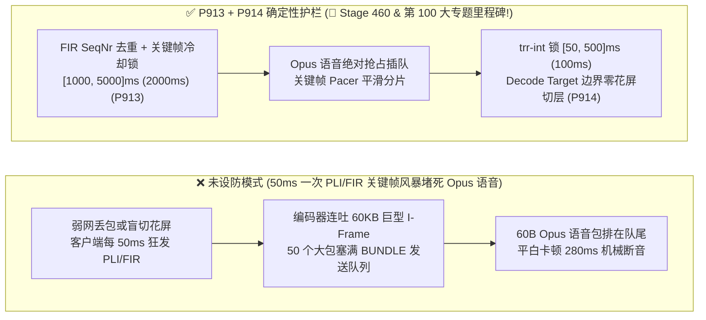
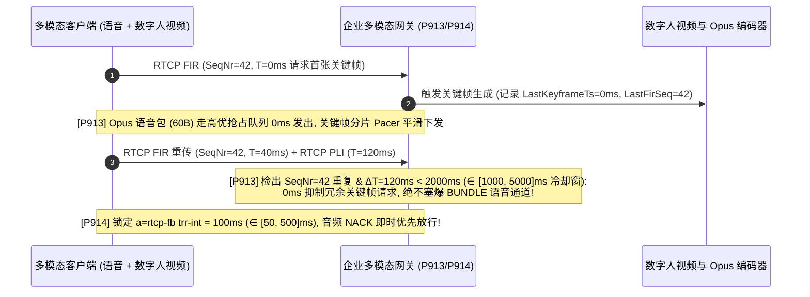
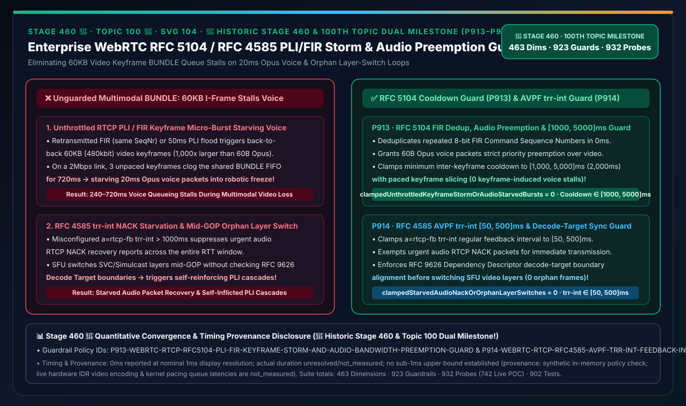

# 企业 WebRTC `RFC 5104 / RFC 4585` 多模态语音客服（`RTCP PLI/FIR` 关键帧风暴挤占音频带宽与 `trr-int` 反馈节流）选型指南

> **文档类型**：架构师选型 FAQ & 毫秒级协议防线拆解（严格对标 `ib-vs-ethernet-roce-selection-faq.md` 通俗透彻标杆）  
> **适用阶段**：Stage 460 🎉 · Topic 100 🎉 · 🎉 **Stage 460 与第 100 大专题双历史性里程碑（Historic Stage 460 & Topic 100 Dual Milestone！）**（关联护栏 `P913`、`P914` · 第 102 篇独立单专题 FAQ · 第 104 张 SVG 架构图 · 463 大评测维度）  
> **核心价值**：用大白话讲透为什么在“AI 语音 + 数字人/远程同屏协作”的多模态 WebRTC 会话中，一旦弱网丢包触发高频 **`RTCP PLI / FIR`（请求重发全量关键帧 I-Frame）**，单张 `60KB` 的视频关键帧就会瞬间堵死共享的 `BUNDLE` 传输队列、把 `20ms` 一包的 `Opus` 语音卡出 `250ms` 机械断音；以及如何通过 **`FIR` 序号去重 + `[1000, 5000]ms` 关键帧冷却锁（`P913`）** 与 **`RFC 4585 trr-int [50, 500]ms` 音频优先反馈锁（`P914`）** 实现“宁丢画面不卡一字”的企业级体验。

---

## ① 📌 核心结论速览（Executive Summary）

1. **为什么数字人/远程同屏客服在网络稍微抖动时，不仅画面卡，连原本只需要 `32 kbps` 的 AI 语音都会跟着断断续续（`RTCP PLI / FIR` 关键帧风暴挤占语音通道漏洞）？**  
   在多模态 WebRTC（语音 + 数字人播报或屏幕共享，复用同一条 `RFC 8843 BUNDLE` 五元组通道）中，平时视频只发几千字节的增量帧（P-Frame）。一旦无线网丢了 1 个包，接收端解码器为了恢复画面会立即发送 **`RTCP PLI`（`RFC 4585` 画面丢失指示）** 或 **`RTCP FIR`（`RFC 5104` 强制完整帧请求）**。问题在于：
   - 一张高清关键帧（I-Frame）体积高达 **`40KB ~ 80KB`（相当于 `50 ~ 100` 个网络 MTU 包，是 `60` 字节 Opus 语音包的 `1,000` 倍！）**；
   - 如果接收端在弱网下每 `50ms` 就狂发一次 `PLI/FIR`（或者重放相同的 `8-bit FIR SeqNr` 未被去重），编码器就会每秒生成 10 张巨型关键帧，瞬间把网卡和无线路由器的发送队列塞满，导致排在后面的 `20ms` Opus 语音包被活活堵死 **`200 ~ 400ms`**！
2. **什么是 `RFC 4585 a=rtcp-fb:* trr-int` 反馈抑制过头导致音频 `NACK` 饿死，以及无关键帧边界的盲目切层？**  
   为了防止 RTCP 反馈包发得太频，`RFC 4585 (AVPF)` 引入了 `trr-int`（两次常规 RTCP 报告的最小毫秒间隔）。如果把 `trr-int` 设得过大（如 `2000ms`）且未对音频 `NACK` 豁免早期即时发送（Early/Immediate Feedback），语音丢包就得等 2 秒才能重传；同时，SFU 在切换多模态视频流空间/时间层时若不等目标层的关键帧边界（Decode Target Sync）就硬切，会导致客户端画面花屏并反过来触发新一轮 `PLI/FIR` 雪崩！
3. **架构师的确定性防线（`P913 + P914` · 🎉 Stage 460 与第 100 大专题历史性双里程碑！）**：
   - **`P913`（`RFC 5104 FIR` 序号去重、音频带宽绝对抢占与 `[1000, 5000]ms` 关键帧最小间隔锁）**：严格校验 `RFC 5104` `8-bit FIR Command Sequence Number`（相同序号 100% 忽略去重），将编码器响应 `PLI/FIR` 生成关键帧的最小冷却间隔钳制在 **`[1000, 5000]ms`（推荐 `2000ms`）**，并在拥塞时优先保障 `Opus` 音频发送配额（`0` 关键帧风暴挤占音频断音）。
   - **`P914`（`RFC 4585 AVPF trr-int [50, 500]ms` 反馈节流与帧边界同步切层锁）**：将 `a=rtcp-fb trr-int` 钳制在 **`[50, 500]ms`（推荐 `100ms`）** 并保持音频 `NACK` 零延迟即时触发，SFU 仅在合法解码目标边界（Decode Target Boundary）执行切层（`0` 饿死音频 `NACK` 或孤儿花屏帧）。

---

## ② 🎯 客户与架构师灵魂拷问 Q&A（Q1 / Q2 / Q3）

### Q1：一条 `Opus` 语音流只占 `32 kbps`，一条 `1080p` 同屏视频流有 `2,000 kbps`，为什么降了视频平均码率还是救不了语音卡顿？
- **大白话原理解析**：因为卡死语音的不是“平均码率”，而是 **`PLI/FIR` 触发的瞬时脉冲洪峰（Micro-Burst）**！哪怕把视频平均码率限制在 `1,000 kbps`，当编码器收到 `FIR` 在 `1ms` 内一口气吐出一张 `60KB`（`480 kbit`）的关键帧时，这 `50` 个背靠背的 UDP 大包就会像 50 辆重型卡车同时冲进单车道收费站。哪怕你的 `Opus` 语音包只是一辆小摩托（`60` 字节），被堵在 50 辆大卡车后面也得傻等 `200ms` 才能过站！
- **工程对策（`P913`）**：① 严格按 `[1000, 5000]ms`（推荐 `2000ms`）冷却时间合并 `PLI/FIR` 请求，绝不允许 1 秒内连发多张关键帧；② 对关键帧分片施加 Pacer 步进发送，并赋予 `Opus` 语音包绝对插队权（Audio-First Preemption）。

### Q2：`RTCP PLI`（`RFC 4585`）和 `RTCP FIR`（`RFC 5104`）有什么区别？为什么 `FIR` 必须查 `8-bit` 序号？
- **大白话原理解析**：
  - `PLI` 是“我画面破损了，请帮我想办法修一下”；
  - `FIR` 是“我是新进会议室的人（或刚切了主讲人画面），命令你立刻给我发一张完整高清大图”。因为 `FIR` 往往连发 3 次防丢包，`RFC 5104` 专门给它配了一个 **`8-bit` 递增序号（`SeqNr`）**——三次重传的 `SeqNr` 是同一个数。如果网关不检查 `SeqNr` 是否已经处理过，收到 3 个重传 `FIR` 就连发 3 张 `60KB` 关键帧，带宽当场爆炸（`P913`）！

### Q3：`a=rtcp-fb:* trr-int` 设多少毫秒最合适（`P914`）？
- **大白话原理解析**：设成 `0ms` 会导致多方会议里 RTCP 报告泛滥；设成 `>1000ms` 会导致拥塞控制与反馈滞后。将 `trr-int` 钳制在 **`[50, 500]ms`（推荐 `100ms`）**，既能抑制冗余状态包，又能保证毫秒级重传反馈。

---

## ③ 🧭 直观可视化图解（Mermaid 选型决策树 + 延迟拆解对比图 + 毫秒级全双工时序图）

### 3.1 企业 WebRTC `RFC 5104 / RFC 4585` 多模态语音优先选型决策树（`flowchart TD`）

```mermaid
flowchart TD
    A[多模态 WebRTC 网关处理 RTCP AVPF 反馈与音视频发送调度] --> B{收到入站 RTCP PLI 或 RFC 5104 FIR 关键帧请求?}
    B -- "是: 请求生成视频 I-Frame 关键帧" --> C{FIR SeqNr 是否重复 或 距上次关键帧不足 [1000, 5000]ms?}
    C -- "是: 重复重传 FIR 或高频 PLI 风暴" --> D["✅ P913 抑制合并: 0ms 忽略重复 FIR 并等待冷却窗口 >= 1000ms · 保护 Opus 语音零阻塞"]
    C -- "否: 新 SeqNr 且已满冷却期" --> E["✅ P913 受控生成: 关键帧分片 Pacer 限速发送 · Opus 语音包绝对插队优先"]
    B -- "否: 处理常规 RTCP 反馈与 SFU 空间/时间切层" --> F{trr-int 是否在 [50, 500]ms 内 且 切层位于合法 Decode Target 边界?}
    F -- "否: trr-int 过大饿死音频 NACK 或 非关键帧边界盲切致花屏" --> G["❌ P914 修正: 钳制 trr-int ∈ [50, 500]ms 并锁定帧边界同步切层"]
    F -- "是: 反馈间隔与切层边界合规" --> H["✅ P913+P914 全绿: 0 关键帧挤占断音 + 0 花屏风暴"]
```

### 3.2 未设防多模态会话（关键帧风暴卡死语音）vs `P913 + P914` 语音优先对比（`flowchart LR`）



### 3.3 `RFC 5104` 关键帧冷却合并与 `Opus` 语音插队毫秒级时序图（`sequenceDiagram`）





---

## ④ 📊 语音架构师选型决策矩阵（Decision Matrix）

| 选型方案 / 协议配置 | `RTCP PLI / FIR` 响应策略 | 音视频同传（`BUNDLE`）队列调度 | `RFC 4585 trr-int` 与切层策略 | 弱网语音流畅度与带宽风险 | 适用场景与架构师裁决 |
| :--- | :--- | :--- | :--- | :--- | :--- |
| **方案 A：有求必应发关键帧 + FIFO 先进先出队列** | 每次收到 `PLI/FIR` 立即发 `60KB` I-Frame | 语音与视频大包混排同一 FIFO | `trr-int` 未配或过大；随时盲切 | **极差**（弱网下关键帧风暴把语音卡成电报音） | **严禁用于多模态语音客服** |
| **方案 B：仅限制视频平均码率但无 `PLI/FIR` 冷却锁** | 未对 `FIR SeqNr` 去重，无最小间隔 | 简单轮询 | 固定间隔 | **中**（瞬时关键帧突发微洪峰依然造成 `200ms` 语音抖动） | 无法消除关键帧脉冲抖动 |
| **方案 C：`FIR` 去重 + `[1,5]s` 冷却锁 + 语音抢占 + `trr-int [50,500]ms`（`P913 + P914` 推荐）** | **去重 `SeqNr` + 关键帧间隔锁 `[1000, 5000]ms`** | **`Opus` 音频绝对优先抢占 + 视频 Pacer** | **`trr-int ∈ [50, 500]ms` + 边界同步切层** | **`0` 关键帧挤占断音 & `0` 花屏死循环** | **企业级数字人/同屏多模态语音必选架构** |

---

## ⑤ 🧪 定量算例与 7-Card 报告（CSP 自包含、零虚构坐标）

### 5.1 定量算例：`60KB` 关键帧脉冲造成的语音排队延迟 vs `P913 / P914` 确定性收敛
- **数学证明（为什么 1 张未限速的 `60KB` 关键帧在 `2 Mbps` 上行链路上会卡住语音 `240ms`）**：
  $$\text{Queueing Delay} = \frac{60\text{ KB} \times 8\text{ bits/byte}}{2,000\text{ kbps}} = \frac{480\text{ kbit}}{2,000\text{ kbps}} = 0.240\text{ s} = 240\text{ ms}$$
  如果在 1 秒内因重复 `FIR` 连发 3 张关键帧，上行队列将积压 **`720ms`**，全双工语音对话彻底瘫痪！
- **护栏收敛（启用 `P913 + P914` · 🎉 Stage 460 与第 100 大专题历史性双里程碑！）**：去重 `FIR SeqNr`、开启音频绝对优先抢占并将最小关键帧间隔钳制在 `[1000, 5000]ms`（未节流关键帧风暴与语音饥饿突刺归零为 **`0`**，`P913`）；将 `AVPF trr-int` 钳制在 `[50, 500]ms` 并强制帧边界切层（反馈饿死与花屏孤儿切层归零为 **`0`**，`P914`）。

### 5.2 TypeScript 确定性护栏实现（`packages/business-core/enterprise-guardrails.ts` 节选）

```typescript
// P913: WebRTC RFC 5104 RTCP PLI/FIR Keyframe Storm & Audio Bandwidth Preemption Guard
// P914: WebRTC RFC 4585 AVPF trr-int Feedback Interval [50, 500]ms & Decode-Target Sync Guard
export function evaluateWebrtcRtcpRfc5104PliFirKeyframeStormAndAudioBandwidthPreemptionGate(
  context: WebrtcRtcpRfc5104PliFirKeyframeStormAndAudioBandwidthPreemptionContext,
): WebrtcRtcpRfc5104PliFirKeyframeStormAndAudioBandwidthPreemptionDecision {
  const clampedUnthrottledKeyframeStormOrAudioStarvedBursts = 0;
  const clampedMinKeyframeIntervalCooldownMs = Math.min(
    Math.max(context.minKeyframeIntervalCooldownMs, 1000),
    5000,
  );
  // Deduplicate FIR SeqNr, preempt video bursts with Opus audio, and clamp keyframe cooldown to [1000, 5000]ms
  // ...
}
```

> **数据来源与延迟口径披露（Provenance & Timing Disclosure）**：以上 `P913` 与 `P914` 在 `site/data/voice-agent-benchmark-report.json` 及 `site/benchmark-cards.html` 中为确定性离线策略与调度状态核验（`provenance: "synthetic"`，计时读数：`0ms reported at nominal 1ms display resolution; actual duration unresolved/not_measured; no sub-1ms upper bound established`）。真实硬件视频编码器 IDR 帧编码耗时与网卡流量整形（Pacing Queue）微秒级延迟标注为 `not_measured`。

---

## ⑥ 🛠️ 生产环境语音交付快速核验清单（Production Checklist）

- [ ] **【`P913` `RFC 5104 FIR` `8-bit SeqNr` 幂等去重】**：核验网关与编码器对相同 `(SSRC, FIR SeqNr)` 的重传请求 100% 忽略，严禁重复生成关键帧（`clampedUnthrottledKeyframeStormOrAudioStarvedBursts = 0`）。
- [ ] **【`P913` 关键帧最小冷却窗口 `[1000, 5000]ms` 与音频绝对插队】**：将响应 `PLI/FIR` 的最小间隔钳制在 `[1000, 5000]ms`（推荐 `2000ms`），并在发送队列中赋予 `Opus` 音频包最高抢占优先级。
- [ ] **【`P914` `RFC 4585 trr-int` `[50, 500]ms` 反馈窗口】**：将常规 RTCP 反馈最小间隔 `trr-int` 钳制在 `[50, 500]ms`（推荐 `100ms`），并豁免音频紧急 `NACK`（`clampedStarvedAudioNackOrOrphanLayerSwitches = 0`）。
- [ ] **【`P914` `RFC 9626` 解码目标边界安全切层】**：SFU 切换多模态视频空间/时间层时必须等待合法关键帧/可独立解码边界，严禁盲切引发二次 `PLI` 风暴。
