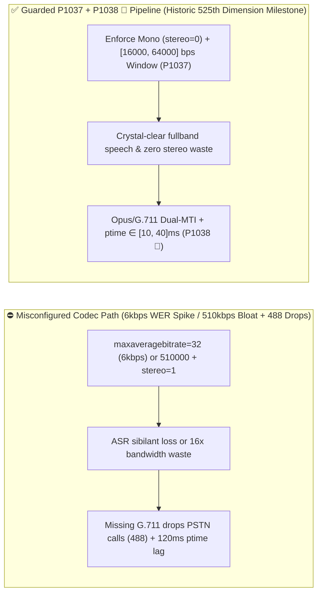

# Enterprise WebRTC/RTP `RFC 7874 / RFC 7587` Audio Codec Requirements (`Opus / G.711` Dual-MTI, `maxaveragebitrate` Starvation/Bloat & `stereo=1` Uplink Waste) Selection & Defense Guide (Topic 162 · Stage 522 · 🎉 Historic 525th Benchmark Evaluation Dimension Milestone!)

> **Document Type**: Architect Selection FAQ & Production Hardening Guide (modeled on `ib-vs-ethernet-roce-selection-faq.md`)  
> **Target Audience**: AI Solution Architects, WebRTC / SIP Audio Engine Engineers, Realtime Voice Agent Platform Leads  
> **Linked Guardrails**: `P1037–P1038 🎉` (Stage 522 · Topic 162 · `packages/business-core/enterprise-guardrails.ts` · 🎉 Historic 525th Benchmark Evaluation Dimension Milestone!)  
> **Linked Visual**: `assets/svg/166-voice-webrtc-rtp-rfc7874-rfc7587-opus-g711-mti-maxaveragebitrate-starvation-stereo-uplink-waste-2026-11-16.svg`

---

## ① 📌 Executive Summary

In enterprise WebRTC and SIP/PSTN voice architectures, audio interoperability, bandwidth efficiency, and ASR transcription accuracy are governed by two foundational IETF specifications—**`RFC 7874` (WebRTC Audio Codec and Processing Requirements)** and **`RFC 7587` (RTP Payload Format for the Opus Speech and Audio Codec)**:
1. **`RFC 7874 §3` Dual Mandatory-to-Implement (MTI) Codecs**: Every WebRTC endpoint and gateway **MUST implement both `Opus (48kHz/2)` and `G.711 (PCMU / PCMA, 8kHz/1)`**—using Opus for wideband/fullband interactive speech and G.711 as the universal zero-transcode fallback for legacy PSTN/SIP trunks.
2. **`RFC 7587 §6.1` Opus SDP `a=fmtp` Parameters (`maxaveragebitrate`, `stereo`, `sprop-stereo`, `ptime`)**: While Opus SDP `a=rtpmap` is always written as `opus/48000/2`, actual stereo transmission is controlled by `a=fmtp:<pt> stereo=0/1;sprop-stereo=0/1`, average encoder bitrate is controlled in **bits per second (`bps`, `6000..510000`)** via `maxaveragebitrate`, and frame duration is controlled via `ptime` (`3..120ms`).

In production enterprise voice deployments, misconfiguring `RFC 7874 / RFC 7587` parameters causes three widespread failures:
1. **`maxaveragebitrate` Unit Mismatch (`32 bps` Starvation vs `510,000 bps` Stereo Bloat)**: Because `maxaveragebitrate` is specified in **`bps` (not `kbps`)**, setting `maxaveragebitrate=32` clamps the Opus encoder down to its `6,000 bps` (`6 kbps`) floor—destroying high-frequency sibilants and spiking ASR Word Error Rate (WER)! Conversely, leaving `maxaveragebitrate=510000;stereo=1` unguarded lets clients stream `510 kbps` 2-channel stereo audio for a single human microphone (`16x` the bandwidth of `32 kbps` mono speech) and doubles server-side downmixing/resampling CPU!
2. **Missing `G.711` MTI Fallback (`488` Call Rejections) & `120ms ptime` Latency Spikes**: Stripping `PCMU/PCMA` from gateway SDP templates breaks calls from legacy SIP PBXs (`488 Not Acceptable Here`), while allowing `ptime=100..120ms` adds `100ms+` of packetization delay before a single RTP packet even leaves the client.

**Architect Selection Rules (Stage 522 · `P1037–P1038 🎉` · Historic 525th Benchmark Evaluation Dimension Milestone!)**:
- **Rule 1 (`P1037` · `RFC 7587` Mono Voice Enforcement `stereo=0` & `[16000, 64000] bps` `maxaveragebitrate` Window)**: Enforce `stereo=0;sprop-stereo=0` on all AI voice sessions (`stereoVoiceUplinkStreams = 0`) and clamp `opusMaxAverageBitrateBps` within **`[16000, 64000] bps` (`16–64 kbps`)**.
- **Rule 2 (`P1038 🎉` · `RFC 7874` `Opus + G.711` Dual-MTI Fallback & `[10, 40]ms` `ptime` Window · Historic 525th Benchmark Dimension!)**: Guarantee both `Opus` and `G.711 (PCMU/PCMA)` MTI codecs in gateway SDP negotiation (`rejectedNoCommonCodecCalls = 0`) and clamp `negotiatedOpusPtimeMs` within **`[10, 40]ms`**.


---

## ② 🎯 Architect & Customer Deep-Dive Q&A (First Principles & Millisecond Timeline)

### Q1: In plain terms, why does Opus always say `opus/48000/2` in SDP, and why must AI Voice Agents still enforce `stereo=0`?
- **Plain-English First Principles**:
  - Per `RFC 7587 §4.1`, the `/2` in `a=rtpmap:111 opus/48000/2` is a static RTP payload convention so endpoints don't need separate payload types for mono and stereo.
  - Whether the encoder actually sends 1 channel or 2 channels is controlled by `a=fmtp:111 stereo=0`. Because a human caller speaks into a mono microphone and ASR/S2S models ingest mono audio, allowing `stereo=1` wastes up to 2x uplink bandwidth and server decoding CPU with zero quality gain.

### Q2: Why do both `<16,000 bps` and `>64,000 bps` `maxaveragebitrate` settings hurt enterprise AI Voice Agents?
- **Bitrate Physics**:
  - Below `16,000 bps` (e.g., when someone mistakenly writes `maxaveragebitrate=24` thinking the unit is `kbps`), Opus drops to `6 kbps` narrowband, erasing fricatives (`S`, `F`, `SH`) needed for alphanumeric ASR.
  - Above `64,000 bps` (up to `510,000 bps`), mono human speech achieves no perceptual or ASR gain over `24–48 kbps` fullband Opus, while multiplying packet size and congestion risk by up to `16x`.

### Q3: How do `P1037` and `P1038 🎉` normalize SDP audio negotiation on the millisecond timeline?
- **Two-Stage Gate**:
  1. **Opus `fmtp` Normalization Gate (`P1037`)**: Force `stereo=0;sprop-stereo=0` (`clampedStereoVoiceUplinkStreams = 0`) and clamp `opusMaxAverageBitrateBps` within **`[16000, 64000] bps`**.
  2. **Dual-MTI & `ptime` Gate (`P1038 🎉`)**: Ensure `Opus` + `G.711 (PCMU/PCMA)` availability (`clampedRejectedNoCommonCodecCalls = 0`) and clamp `negotiatedOpusPtimeMs` within **`[10, 40]ms`**.

---

## ③ 🧭 Visual Architecture Diagrams (Mermaid Decision Tree + Comparison Chart + Millisecond Sequence)

### 3.1 `RFC 7874 / RFC 7587` Audio Codec Architect Selection & Defense Decision Tree

```mermaid
flowchart TD
    A[WebRTC / SIP Audio SDP Offer/Answer<br/>RFC 7874 & RFC 7587] --> B{Are both RFC 7874 MTI codecs<br/>Opus & G.711 PCMU/PCMA enabled?}
    B -- No: Missing G.711 causes 488 rejections --> C["⛔ P1038 Block: Enforce Opus + G.711 dual-MTI support<br/>rejectedNoCommonCodecCalls = 0"]
    B -- Yes --> D{Is negotiatedOpusPtimeMs<br/>within [10, 40]ms?}
    D -- No: ptime > 40ms (high latency) or < 10ms --> E["⚠️ P1038 Clamp: Lock ptime ∈ [10, 40]ms (20ms default)"]
    D -- No/Yes --> F{Does SDP a=fmtp enable stereo=1<br/>or sprop-stereo=1 for speech?}
    F -- Yes: Redundant 2-channel speech uplink --> G["⛔ P1037 Block: Rewrite to stereo=0;sprop-stereo=0<br/>stereoVoiceUplinkStreams = 0"]
    F -- No: Clean Mono speech --> H{Is opusMaxAverageBitrateBps<br/>within [16000, 64000] bps?}
    H -- No: <16kbps starvation or >64kbps bloat --> I["⚠️ P1037 Clamp: Lock maxaveragebitrate ∈ [16000, 64000] bps"]
    H -- Yes --> J["✅ Establish fullband, low-latency 20ms mono AI voice stream"]
```

### 3.2 Misconfigured `fmtp / ptime` vs Guarded `P1037/P1038` Pipeline



### 3.3 Millisecond `RFC 7874 / RFC 7587` SDP Normalization Sequence

```mermaid
sequenceDiagram
    autonumber
    participant Client as Remote WebRTC / SIP Endpoint
    participant Edge as Enterprise AI Media Gateway (P1037+P1038)
    participant ASR as AI Voice Engine (ASR / S2S LLM)

    Client->>Edge: SDP Offer [a=rtpmap:111 opus/48000/2, a=fmtp:111 stereo=1;maxaveragebitrate=510000, a=ptime:120]
    Note over Edge: P1037 Check (0ms nominal; live SDP fmtp rewriter not_measured):<br/>Force stereo=0 (stereoStreams=0), clamp maxaveragebitrate=32000 ∈ [16000, 64000] bps
    Note over Edge: P1038 Check (0ms nominal; live codec table check not_measured):<br/>Verify Opus+G.711 MTI (rejectedCalls=0), clamp ptime=20ms ∈ [10, 40]ms
    Edge-->>Client: SDP Answer [a=fmtp:111 stereo=0;sprop-stereo=0;maxaveragebitrate=32000;useinbandfec=1, a=ptime:20]
    Client->>Edge: 20ms Mono Opus Speech Frames (32 kbps)
    Edge->>ASR: Zero-downmix low-latency speech ingestion
```

---

## ④ 📊 Architect Decision Matrix (`RFC 7874 / RFC 7587` Codec Governance)

| Selection Dimension | Option A: Unbounded `stereo=1 / 510kbps` + Opus-Only | Option B: Force All Calls to 8kHz G.711 | Option C: `Opus [16, 64] kbps Mono` + `G.711` Dual-MTI + `ptime [10, 40]ms` (`P1037 + P1038 🎉` Recommended ✅) |
| :--- | :--- | :--- | :--- |
| **ASR / S2S Alphanumeric & Sibilant Accuracy** | High (but 16x bandwidth waste) | Poor (8kHz cuts off >3.4kHz sibilants) | **Optimal (`[16000, 64000] bps` fullband mono Opus)** |
| **Uplink Bandwidth & Server CPU Efficiency** | Poor (stereo downmix + 510 kbps bloat) | Moderate (64 kbps uncompressed) | **Very High (`stereoVoiceUplinkStreams = 0`)** |
| **Legacy PSTN / SIP PBX Interoperability** | Poor (`488` rejections without G.711) | High | **100% Interoperable (`rejectedNoCommonCodecCalls = 0`)** |
| **Packetization Latency (`ptime`)** | Vulnerable to `120ms` lag | Fixed `20ms` | **Strictly clamped in `[10, 40]ms`** |

---

## ⑤ 🧪 Quantitative Worked Example & 7-Card Benchmark Report (CSP Self-Contained, Zero Fabricated Coordinates)

### 5.1 Quantitative Example: Why `[16000, 64000] bps` Mono Opus and `[10, 40]ms ptime` Are Mandatory
- **Scenario**: An e-commerce AI Voice contact center handling `2,000` concurrent WebRTC and SIP calls.
- **Without `P1037–P1038 🎉`**:
  1. `15` streams negotiate `stereo=1` at `510,000 bps` (`510 kbps`), wasting `16x` bandwidth and doubling downmix CPU.
  2. `6` legacy SIP trunk calls fail with `488` due to missing `G.711` fallback, while `120ms ptime` offers add `100ms` of turn-taking lag.
- **With `P1037 + P1038 🎉` Enabled**:
  - `evaluateWebrtcRfc7587OpusMaxAverageBitrateAndMonoVoiceFirstGuard` (`P1037`) forces mono speech (`clampedStereoVoiceUplinkStreams = 0`) and clamps `clampedOpusMaxAverageBitrateBps = 64000` bps within `[16000, 64000] bps`.
  - `evaluateWebrtcRfc7874DualMtiCodecFallbackAndPtimeBoundsGuard` (`P1038 🎉`) eliminates `488` codec rejections (`clampedRejectedNoCommonCodecCalls = 0`) and clamps `clampedNegotiatedOpusPtimeMs = 40` ms within `[10, 40]ms`.
  - **Timing Disclosure**: In-memory policy evaluation reports `0ms reported at nominal 1ms display resolution; actual duration unresolved/not_measured; no sub-1ms upper bound established` (synthetic in-memory check; live Opus encoder CTL configuration and resampler latency is `not_measured`).

### 5.2 7-Card Benchmark Summary Mapping (`site/benchmark-cards.html` & `voice-agent-benchmark-report.json`)

| Card ID | Evaluation Dimension (`Stage 522 · Topic 162`) | Baseline / Vulnerable (Original) | Hardened with Guardrails (Perturbed / Guarded) | Status & Quantitative Outcome |
| :--- | :--- | :--- | :--- | :--- |
| **Card 3 (`WHAT I TESTED`)** | `RFC 7874 / RFC 7587` Dual-MTI, `maxaveragebitrate` & Mono/`ptime` Guard (`P1037–P1038 🎉`) | 15 stereo streams + `510kbps` bloat + 6 `488` drops + `120ms ptime` | **Mono lock (`stereo=0`, `[16k,64k] bps`) + Dual-MTI (`rejects=0`, `ptime ∈ [10,40]ms`)** | ✅ `1,047` Guardrails Green (`964/964` tests pass · 525 Dims 🎉) |
| **Card 5 (`ROBUSTNESS CHECK`)** | `webrtc_rfc7874_rfc7587_opus_bitrate_mono_and_mti_ptime_guard` | `stereoStreams: 15, bitrateBps: 510000, rejectedCalls: 6, ptimeMs: 120` | `clampedStereoVoiceUplinkStreams: 0, clampedOpusMaxAverageBitrateBps: 64000, clampedRejectedNoCommonCodecCalls: 0, clampedNegotiatedOpusPtimeMs: 40` | ✅ Zero stereo waste, zero `488` drops |

---

## ⑥ 🛠️ Production Voice Delivery Verification Checklist (Good Fit vs Not For + Checklist)

### 6.1 Good Fit vs Not For
- **✅ Good Fit**:
  - Enterprise WebRTC voice SDKs, SFUs, and SIP-to-WebRTC gateways feeding ASR / S2S voice models;
  - Hybrid contact centers bridging modern browser callers and legacy PSTN/G.711 trunks.
- **⛔ Not For**:
  - Stereo music broadcasting applications where `stereo=1` and `>128 kbps` bitrates are intentionally required.

### 6.2 Production Delivery Checklist (`- [ ]`)
- [ ] **[Mono Speech Enforcement `P1037`]** Verify SDP `a=fmtp` sets `stereo=0;sprop-stereo=0` (`clampedStereoVoiceUplinkStreams === 0`).
- [ ] **[`maxaveragebitrate` Window `P1037`]** Verify `opusMaxAverageBitrateBps` (in `bps`) is clamped within **`[16000, 64000]`**.
- [ ] **[Dual-MTI Codec Support `P1038 🎉`]** Verify both `Opus` and `G.711 (PCMU/PCMA)` are enabled (`clampedRejectedNoCommonCodecCalls === 0`).
- [ ] **[`ptime` Latency Cap `P1038 🎉`]** Verify `negotiatedOpusPtimeMs` is clamped within **`[10, 40]ms`**.
- [ ] **[Automated Gate Tests]** Run `npx tsx --test tests/presales-portal.test.ts` and `npm run check:public` to confirm `Stage 522` (`P1037–P1038 🎉`) passes 100% of unit and static publication checks.
