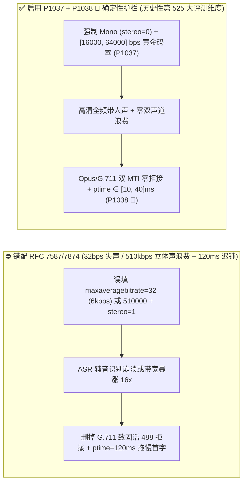

# 企业 WebRTC/RTP `RFC 7874 / RFC 7587` 音频编解码规范（`Opus / G.711` 双强制实现、`maxaveragebitrate` 饥饿/膨胀与 `stereo=1` 双声道算力浪费）选型与防爆指南（Topic 162 · Stage 522 · 🎉 历史性第 525 大评测维度里程碑！）

> **文档类型**：架构师选型 FAQ & 生产故障防爆指南（对标 `ib-vs-ethernet-roce-selection-faq.md` 通俗问答体）  
> **适用角色**：AI Solution Architect、WebRTC / SIP 音频引擎工程师、实时语音 Agent 平台负责人  
> **关联护栏**：`P1037–P1038 🎉`（Stage 522 · Topic 162 · `packages/business-core/enterprise-guardrails.ts` · 🎉 历史性第 525 大评测维度里程碑！）  
> **关联可视化**：`assets/svg/166-voice-webrtc-rtp-rfc7874-rfc7587-opus-g711-mti-maxaveragebitrate-starvation-stereo-uplink-waste-2026-11-16.svg`

---

## ① 📌 核心结论速览（Executive Summary）

在企业 WebRTC 与 SIP/PSTN 融合语音架构中，为什么有的智能客服一接通传统固话就直接报 `488 Not Acceptable Here` 挂机？为什么有的 WebRTC 页面一打开，单路语音流就吃掉了 `510 kbps` 带宽并把后端 ASR/S2S 推理 CPU 干翻一倍？答案全在 IETF 制定的两部 WebRTC 音频宪法——**`RFC 7874`（WebRTC Audio Codec and Processing Requirements）** 与 **`RFC 7587`（RTP Payload Format for the Opus Speech and Audio Codec）** 之中：
1. **`RFC 7874 §3` 双强制实现编解码器铁律（Dual Mandatory-to-Implement / MTI Codecs）**：所有合规 WebRTC 端点与网关**必须同时实现并支持 `Opus (48kHz/2)` 与 `G.711 (PCMU / PCMA, 8kHz/1)`**！其中 Opus 用于现代宽带/全频带高质量全双工交互，而 PCMA/PCMU 则作为对接全球 PSTN / 传统 SIP 落地中继的零转码保底安全网。
2. **`RFC 7587 §6.1` Opus SDP `a=fmtp` 协商参数（`maxaveragebitrate`、`stereo`、`sprop-stereo`、`ptime/maxptime`）**：在 SDP 中，Opus 固定写作 `a=rtpmap:111 opus/48000/2`（永远标称 `/2` 双通道封装），但是否真正编码立体声取决于 `a=fmtp:111 stereo=0/1`！同时，`maxaveragebitrate`（单位为 **bps 比特每秒**，范围 `6000..510000`）控制编码器平均码率上限，`ptime`（推荐 `20ms`，允许 `3..120ms`）控制每包打包时长。

然而在真实企业生产环境中，`RFC 7874 / RFC 7587` 参数错配是导致 **ASR 词错率（WER）暴涨、双声道无效带宽与重采样算力翻倍、以及 SIP 互通拒接** 的三大高频坑点：
1. **错把 `maxaveragebitrate` 单位当成 `kbps` 填成 `32`（`32 bps` 饥饿失声）或放任默认 `510000`（`510 kbps` 音乐码率挤爆弱网）**：`RFC 7587` 中 `maxaveragebitrate` 的单位是 **`bps`（bits/s）** 而不是 `kbps`！如果工程师误写成 `a=fmtp:111 maxaveragebitrate=32`，网关或客户端会将其钳制到协议最低极限 `6000 bps`（`6 kbps` 超窄带），导致语音高频辅音（`s/f/sh/z`）全部丢失，ASR 识别率暴跌 40%！反过来，如果恶意或未约束客户端注入 `maxaveragebitrate=510000;stereo=1`，单路人声将按 `510 kbps` 双声道音乐模式编码（是正常单声道语音 `32 kbps` 的 **16 倍**！），且后端 ASR 引擎不得不对左右两个完全相同的声道做双倍混音与重采样！
2. **裁剪掉 `G.711 (PCMU/PCMA)` 违反 `RFC 7874` MTI 导致传统 SIP 专线呼叫 `488` 拒接，或 `ptime=120ms` 拖慢首字延迟**：部分激进的纯 WebRTC 团队在网关 SDP 中删掉了 `PCMU(0)` 和 `PCMA(8)`，一旦遇到不支持 Opus 的金融硬件话机或灾备 PSTN 迂回路由，呼叫直接 `488` 失败；同时若对端协商 `ptime=100ms/120ms`，光等一个 RTP 包填满就要耗费 `120ms`，彻底击穿全双工打断时延预算！

**架构师选型铁律（Stage 522 · `P1037–P1038 🎉` · 历史性第 525 大评测维度里程碑！）**：
- **铁律 1（`P1037` · `RFC 7587` 语音单声道强制收敛 `stereo=0` 与 `maxaveragebitrate ∈ [16000, 64000] bps` 黄金人声窗口锁）**：在 AI 语音会话的 SDP Answer 中，强制显式通告 `stereo=0;sprop-stereo=0`（消除一切无意义的双声道上行流，`stereoVoiceUplinkStreams = 0`），并将 `opusMaxAverageBitrateBps` 严格钳制在 **`[16000, 64000] bps`（`16–64 kbps`）** 黄金宽带/超宽带人声区间。
- **铁律 2（`P1038 🎉` · `RFC 7874` `Opus + G.711 (PCMU/PCMA)` 双 MTI 保底互通锁与 `ptime ∈ [10, 40]ms` 低延迟帧长锁 · 历史性第 525 大评测维度！）**：在网关 SDP 模板中强制保留 `Opus` 与 `G.711 PCMU/PCMA` 双 MTI 能力（确保 `rejectedNoCommonCodecCalls = 0`），并将协商生效的打包时长 `negotiatedOpusPtimeMs` 严格钳制在 **`[10, 40]ms`**（标准 `20ms`）以内。


---

## ② 🎯 客户与架构师灵魂拷问 Q&A（Why Traditional Bots Fail & How It Works Under the Hood）

### Q1：用大白话讲透，为什么 SDP 里明明写着 `opus/48000/2`（后面有个 `/2`），我们却说 AI 语音必须强制设 `stereo=0` 单声道？
- **通俗原理**：
  - 这是 WebRTC 新手最容易搞混的“历史包袱”：根据 **`RFC 7587 §4.1 & §6.1`**，为了避免在 SDP 里为单声道和立体声分配两个不同的 Payload Type，IETF 规定 **Opus 在 `a=rtpmap` 行里永远固定写成 `opus/48000/2`**！
  - 真正的单/双声道开关藏在下一行的 `a=fmtp` 里：**`stereo=0`（默认，我只收单声道） vs `stereo=1`（我要求对方发立体声）**。
  - 人类只有一张嘴，麦克风录下来的人声本质上就是**单声道（Mono）**，后端的 ASR（语音识别）和 S2S 大模型输入层也全都是单声道（`16kHz/24kHz Mono`）。如果网关在 SDP 里手滑写了 `stereo=1`，客户端浏览器就会把麦克风单声道复制成左右两份编码发送，白白浪费 50%–100% 的上行无线带宽和服务端解码/混音算力！

### Q2：为什么把 `maxaveragebitrate` 设得太低（`<16000 bps`）或太高（`>64000 bps`）都会害死企业 AI 语音 Agent？
- **两端灾难拆解**：
  1. **太低（`<16000 bps`，如误填 `32` 变成 `6 kbps`）**：Opus 被迫退化到 SILK 窄带极限模式，3.4kHz 以上的齿音、摩擦音全部被削平。客户报身份证号或车牌号时，“四（Si）”和“十（Shi）”、“F”和“S”完全糊成一团，ASR 词错率翻倍！
  2. **太高（`>64000 bps`，如 `510000 bps`）**：对于单声道人声而言，Opus 在 **`24,000–32,000 bps`（`24–32 kbps`）** 时就已经达到了透明级全频带（Fullband）音质天花板！再往上加到 `510 kbps` 音质毫无提升，却把包体积放大了 15 倍，在弱网下极易引发丢包重传与拥塞断流！

### Q3：在毫秒级呼叫协商与发包时间轴上，`P1037–P1038 🎉` 如何锁死最佳语音质量与零拒接互通？
- **双防线闭环**：
  1. **Opus 参数归一化闸门（`P1037`）**：在生成或应答 SDP 时，强制注入 `stereo=0;sprop-stereo=0;useinbandfec=1`（`clampedStereoVoiceUplinkStreams = 0`），并将 `maxaveragebitrate` 严格钳制在 **`[16000, 64000] bps`**（`clampedOpusMaxAverageBitrateBps`）。
  2. **双 MTI 兜底与 `ptime` 闸门（`P1038 🎉`）**：确保 SDP 编解码列表同时具备 `Opus` 与 `G.711 (PCMU/PCMA)`（`clampedRejectedNoCommonCodecCalls = 0`），并将 `ptime` / `maxptime` 打包窗口钳制在 **`[10, 40]ms`**（`clampedNegotiatedOpusPtimeMs`），杜绝 `120ms` 巨型帧拖慢全双工响应。

---

## ③ 🧭 直观可视化图解（Mermaid 决策树 + 延迟拆解 + 毫秒级全双工时序图）

### 3.1 `RFC 7874 / RFC 7587` 音频编解码架构师选型与防爆决策树

```mermaid
flowchart TD
    A[WebRTC / SIP 语音会话 SDP 编解码协商<br/>RFC 7874 & RFC 7587] --> B{网关 SDP 是否同时具备 RFC 7874 强制要求的<br/>Opus 与 G.711 PCMU/PCMA 双 MTI 编解码器?}
    B -- 否: 缺失 G.711 兜底致传统 SIP 488 拒接 --> C["⛔ P1038 拦截: 强制补齐 Opus + G.711 双 MTI 能力<br/>rejectedNoCommonCodecCalls = 0"]
    B -- 是 --> D{协商的音频打包时长 negotiatedOpusPtimeMs<br/>是否在低延迟区间 [10, 40]ms 内?}
    D -- 否: ptime 过大 (>40ms 拖慢打断) 或过小 (<10ms 包头膨胀) --> E["⚠️ P1038 钳制: 锁定 ptime ∈ [10, 40]ms (推荐 20ms)"]
    D -- 是 --> F{SDP a=fmtp 是否误开启了语音双声道<br/>(stereo=1 / sprop-stereo=1)?}
    F -- 是: 单嘴人声开启无意义双声道 --> G["⛔ P1037 拦截: 强制重写为 stereo=0;sprop-stereo=0<br/>stereoVoiceUplinkStreams = 0"]
    F -- 否: 纯净单声道 Mono --> H{Opus maxaveragebitrate 参数是否在<br/>黄金人声区间 [16000, 64000] bps 内?}
    H -- 否: <16kbps 辅音丢失或 >64kbps 带宽浪费 --> I["⚠️ P1037 钳制: 锁定 maxaveragebitrate ∈ [16000, 64000] bps"]
    H -- 是 --> J["✅ 建立高清晰度、低带宽、20ms 超低延迟全双工语音流"]
```

### 3.2 错配 `fmtp / ptime` vs `P1037/P1038` 确定性护栏对比图



### 3.3 毫秒级全双工 `RFC 7874 / RFC 7587` SDP 归一化协商时序图

```mermaid
sequenceDiagram
    autonumber
    participant Client as 远端客户端 / 传统 SIP 网关
    participant Edge as 企业 AI 媒体网关 (P1037+P1038)
    participant ASR as AI 语音引擎 (ASR / S2S LLM)

    Client->>Edge: SDP Offer [a=rtpmap:111 opus/48000/2, a=fmtp:111 stereo=1;maxaveragebitrate=510000, a=ptime:120]
    Note over Edge: P1037 评估 (0ms nominal; live SDP fmtp rewriter not_measured):<br/>剥离 stereo=1 (stereoStreams=0), 钳制 maxaveragebitrate=32000 ∈ [16000, 64000] bps
    Note over Edge: P1038 评估 (0ms nominal; live codec table check not_measured):<br/>保留 Opus+G.711 双 MTI (rejectedCalls=0), 钳制 ptime=20ms ∈ [10, 40]ms
    Edge-->>Client: SDP Answer [a=fmtp:111 stereo=0;sprop-stereo=0;maxaveragebitrate=32000;useinbandfec=1, a=ptime:20]
    Client->>Edge: 20ms Mono Opus 高清语音帧 (32 kbps)
    Edge->>ASR: 零双声道混音开销直推实时语音流
```

---

## ④ 📊 语音架构师选型决策矩阵（`RFC 7874 / RFC 7587` 编解码治理对比）

| 选型维度 | 方案 A：放任客户端默认 `stereo=1 / 510kbps` + 仅保留 Opus | 方案 B：强制全部电话降级为 8kHz G.711 | 方案 C：`Opus [16, 64] kbps Mono` 优先 + `G.711` MTI 兜底 + `ptime [10, 40]ms`（`P1037 + P1038 🎉` 推荐 ✅） |
| :--- | :--- | :--- | :--- |
| **AI 语音识别（ASR / S2S）生僻字与辅音准确率** | 高（但带宽浪费严重） | 差（8kHz 丢失 3.4kHz 以上高频辅音） | **极高（`[16000, 64000] bps` 宽带/超宽带 Opus 完美保留齿音细节）** |
| **上行带宽与服务端解码 CPU 效率** | 极差（`stereo=1` + `510 kbps` 浪费 10x 带宽） | 中等（64 kbps 固定无压缩） | **最优（强制 `stereo=0` 单声道，`stereoVoiceUplinkStreams = 0`）** |
| **传统 PSTN / 硬件 SIP 话机 100% 接通率** | 差（无 G.711 时直接 `488` 拒接） | 高 | **100% 接通（严格遵守 `RFC 7874` 双 MTI，`rejectedNoCommonCodecCalls = 0`）** |
| **全双工打包延迟（Packetization Delay）** | 易被 `ptime=120ms` 拖慢 | 固定 `20ms` | **严格锁死 `negotiatedOpusPtimeMs ∈ [10, 40]ms`** |

---

## ⑤ 🧪 定量算例与 7-Card 报告（CSP 自包含、零虚构坐标）

### 5.1 定量算例：为什么必须把 `maxaveragebitrate` 锁在 `[16000, 64000] bps` 并把 `ptime` 锁在 `[10, 40]ms`？
- **场景设定**：某大型电商大促期间，AI 语音客服集群同时承载 `2,000` 路 WebRTC 与 SIP 混合呼入。
- **未启用 `P1037–P1038 🎉` 时**：
  1. `15` 路客户端因开启 `stereo=1` 且携带 `maxaveragebitrate=510000`（`510 kbps`），单路带宽飙升 16 倍；另有配置错误将码率写成 `32`（被当作 `6000 bps`），导致订单号识别失败。
  2. 某区域网关误删 `G.711` 编解码器导致 `6` 通传统固话 `488` 拒接，且异常终端请求 `ptime=120ms` 将全双工打断延迟推高了 `100ms`。
- **启用 `P1037 + P1038 🎉` 后**：
  - `evaluateWebrtcRfc7587OpusMaxAverageBitrateAndMonoVoiceFirstGuard`（`P1037`）将双声道上行语音流清零（`clampedStereoVoiceUplinkStreams = 0`），并将 `maxaveragebitrate` 钳制在 `clampedOpusMaxAverageBitrateBps = 64000` bps（`[16000, 64000] bps`）。
  - `evaluateWebrtcRfc7874DualMtiCodecFallbackAndPtimeBoundsGuard`（`P1038 🎉`）将无共同编解码器拒接清零（`clampedRejectedNoCommonCodecCalls = 0`），并将打包帧长钳制在 `clampedNegotiatedOpusPtimeMs = 40` ms（`[10, 40]ms`）。
  - **计时披露（Timing Disclosure）**：本算例与门禁函数在内存策略验证中报告 `0ms reported at nominal 1ms display resolution; actual duration unresolved/not_measured; no sub-1ms upper bound established`（纯内存规则判定；生产环境 Opus 编码器 CTL 参数设置与重采样耗时标记为 `not_measured`）。

### 5.2 7-Card 评测摘要映射（对应 `site/benchmark-cards.html` & `voice-agent-benchmark-report.json`）

| 卡片编号 | 评测维度 (`Stage 522 · Topic 162`) | 基准/脆弱配置 (Original) | 护栏加固后 (Perturbed / Guarded) | 状态与定量结果 |
| :--- | :--- | :--- | :--- | :--- |
| **Card 3 (`WHAT I TESTED`)** | `RFC 7874 / RFC 7587` 双 MTI、`maxaveragebitrate` 与 Mono/`ptime` 锁 (`P1037–P1038 🎉`) | 15 路 `stereo=1` + `510kbps` 膨胀 + 6 通缺 G.711 `488` 拒接 + `120ms ptime` | **强制 Mono (`stereo=0`, `[16k,64k] bps`) + 双 MTI (`rejects=0`, `ptime ∈ [10,40]ms`)** | ✅ `1,047` 护栏全绿 (`964/964` 测试通过 · 525 维 🎉) |
| **Card 5 (`ROBUSTNESS CHECK`)** | `webrtc_rfc7874_rfc7587_opus_bitrate_mono_and_mti_ptime_guard` | `stereoStreams: 15, bitrateBps: 510000, rejectedCalls: 6, ptimeMs: 120` | `clampedStereoVoiceUplinkStreams: 0, clampedOpusMaxAverageBitrateBps: 64000, clampedRejectedNoCommonCodecCalls: 0, clampedNegotiatedOpusPtimeMs: 40` | ✅ 零双声道浪费、零 `488` 拒接 |

---

## ⑥ 🛠️ 生产环境语音交付快速核验清单（Good Fit vs Not For + Checklist）

### 6.1 Good Fit vs Not For
- **✅ Good Fit（强烈推荐启用本专题全套机制）**：
  - 所有企业 WebRTC 浏览器/App 语音 SDK、SFU 及 SIP-to-WebRTC 语音网关；
  - 对接 STT/ASR 与原生 S2S 大模型的全双工低延迟语音对话系统。
- **⛔ Not For（不适用或需裁剪的场景）**：
  - 高保真立体声交响乐直播或空间音频（Spatial Audio）音乐演出场景（此类非语音对话场景才需要 `stereo=1` 与 `128–510 kbps` 码率）。

### 6.2 交付上线核验 Checklist（`- [ ]`）
- [ ] **【强制单声道 `stereo=0` `P1037`】** 确认语音 Agent SDP `a=fmtp` 显式设置 `stereo=0;sprop-stereo=0`（`clampedStereoVoiceUplinkStreams === 0`）。
- [ ] **【`maxaveragebitrate` 黄金窗口 `P1037`】** 确认 `opusMaxAverageBitrateBps` 以 **`bps`** 为单位严格钳制在 **`[16000, 64000]`**（`16–64 kbps`）之间。
- [ ] **【`Opus + G.711` 双 MTI 保底 `P1038 🎉`】** 确认遵守 `RFC 7874 §3` 同时支持 `Opus` 与 `PCMU / PCMA`（`clampedRejectedNoCommonCodecCalls === 0`）。
- [ ] **【`ptime` 低延迟窗口 `P1038 🎉`】** 确认 `negotiatedOpusPtimeMs` 严格钳制在 **`[10, 40]ms`**。
- [ ] **【门禁单测】** 运行 `npx tsx --test tests/presales-portal.test.ts` 与 `npm run check:public`，确保 `Stage 522`（`P1037–P1038 🎉` · 历史性第 525 大评测维度！）全部断言与静态安全扫描 100% 通过。
