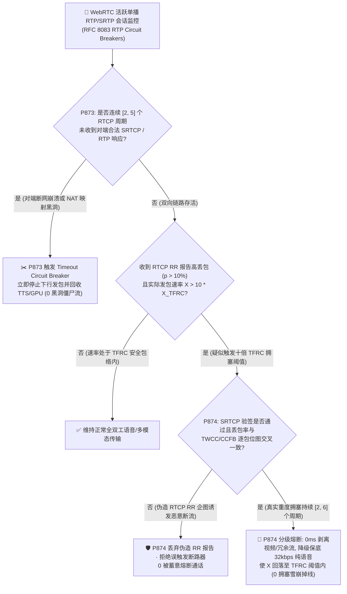
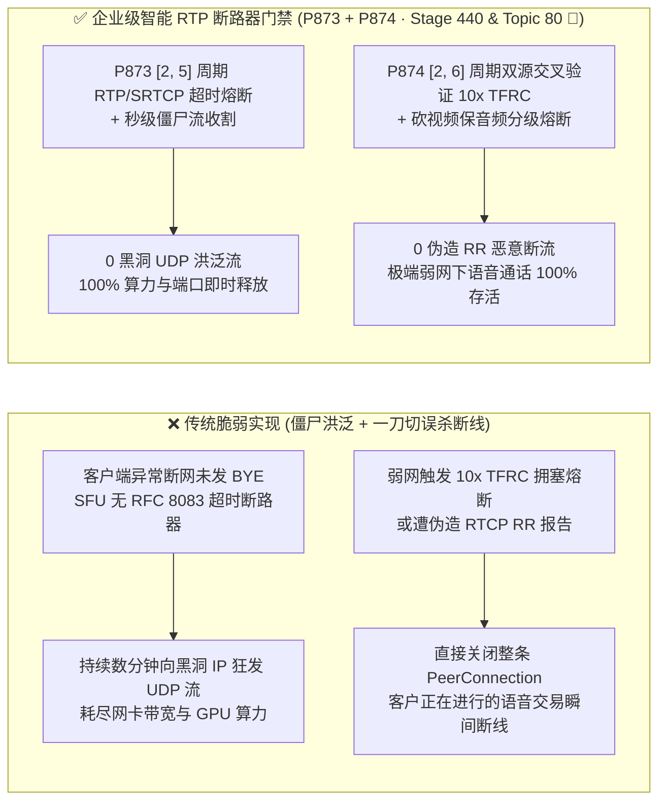
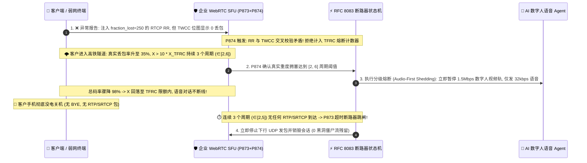

# 企业 WebRTC `RFC 8083 RTP Circuit Breakers` 媒体/RTCP 死锁熔断（`[2, 5]` 周期）、十倍 `TFRC` 拥塞退避与防伪造 `RTCP RR` 恶意断流选型与原理解析 FAQ（Stage 440 🎉 · Topic 80 🎉 · 🎉 Stage 440 与第 80 大专题双里程碑）

> **核心导读（对标 `ib-vs-ethernet-roce-selection-faq.md` 通俗透彻规范）**：本文用第一性原理与大白话讲透企业级高并发 WebRTC 语音/数字人网关在落地 **IETF `RFC 8083`（Multimedia Congestion Control: Circuit Breakers for Unicast RTP Sessions）** 时最易踩坑的三大底层故障——**① 当客户端浏览器崩溃、断网或 NAT 映射超时后，云端 `SFU` 缺少 `RFC 8083 Section 4.1 / 4.2`（RTP/RTCP Timeout Circuit Breaker）熔断机制，持续向死 IP 盲发数分钟 UDP 媒体流，引发公网 UDP 洪泛与 GPU/TTS 计费黑洞**、**② 跨国弱网发生严重丢包（`fraction_lost > 40%`）且发送速率超过 `RFC 5348 TFRC` 理论吞吐上限 10 倍以上时，未触发 `Congestion Circuit Breaker` 先剥离数字人视频流保音频，导致整条 UDP 通道雪崩断线**，以及 **③ 恶意对端伪造 `fraction_lost = 255/256` 的 `RTCP RR` 报文企图利用 `RFC 8083` 熔断器将合法语音通话恶意熔断挂机**，并给出 **`P873` 与 `P874`** 的确定性护栏代码与生产核验清单。

---

## 一、📌 核心结论速览（Executive Summary）

1. **什么是 `RFC 8083 RTP Circuit Breakers`（RTP 断路器）？为什么它是 WebRTC 媒体平面的“最后一道保险丝”，配错了却会导致“要么烧坏机房网卡、要么被黑客一包踢下线”？**
   - 就像家庭电路既有日常调压器（对应 `GoogCC / SCReAM` 毫秒级拥塞控制），又必须装 **空气开关断路器（对应 `RFC 8083 RTP Circuit Breakers`）** 一样：当拥塞控制器失灵或对端死机时，`RFC 8083` 规定了四类必须立即切断或降级 RTP 流的硬性底线：
     1. **`RTCP Timeout Circuit Breaker (Section 4.1)`**：发端持续发 RTP 包，但在连续多个退避周期内收不到任何 `RTCP RR/SR` 反馈（说明返回路径已死或对端已离线）；
     2. **`Media Timeout Circuit Breaker (Section 4.2)`**：连续收不到 RTP 媒体包但仍有信令残留；
     3. **`Congestion Circuit Breaker (Section 4.3)`**：实际发送码率连续多个周期超过 **`RFC 5348 TFRC`（TCP 友好速率控制公式）计算值的 10 倍（Tenfold `TFRC`）**；
     4. **`Media Usability Circuit Breaker (Section 4.4)`**：丢包率高到声码器已无法解码出可懂语音。
   - **两大反噬陷阱**：
     - **陷阱 A（断路器阈值太松或未启用 -> 僵尸 UDP 洪泛）**：客户端杀掉 App 进程未发 `SIP BYE`，云端数字人还在源源不断合成音频+视频往旧公网端口狂发，甚至打崩早已重分配给其他用户的移动基站 NAT 端口；
     - **陷阱 B（断路器直接粗暴挂断整通电话 -> 伪造 `RTCP RR` 蓄意断流）**：如果一旦触发 `Section 4.3 Congestion Circuit Breaker` 就直接 `close()` 整个 `RTCPeerConnection`，不仅在电梯瞬时弱网时会误杀本可保留的纯语音通话，还会被伪造高丢包 `RTCP RR` 的攻击者轻易诱发断线！
2. **选型第一定律（`P873`）：强制启用 `RFC 8083 Section 4.1 / 4.2` 双向超时断路器，将判定阈值硬钳制在 `[2, 5]` 个动态 `RTCP` 报告周期（`Td`），一旦触发立即 `100%` 停止向黑洞地址发送媒体包并回收 TTS/GPU 会话（`0` 残留黑洞流）**。
3. **选型第二定律（`P874`）：对 `RFC 8083 Section 4.3` 十倍 `TFRC` 拥塞断路器设置 `[2, 6]` 个报告周期的防抖宽限窗，结合 `SRTCP` 认证与 `TWCC/CCFB` 双源交叉验证过滤伪造 `RTCP RR` 丢包率，并在触发拥塞熔断时执行“先砍视频/高清层、严保 `32 kbps` 纯音频不断线”的分级熔断策略（`0` 失控拥塞或被恶意熔断的语音通话）**。

---

## 二、🎯 客户与架构师灵魂拷问 Q&A（Deep-Dive Q&A）

### Q1：`RFC 8083` 的 `RTCP Timeout` 为什么不能写死“3 秒没收到 RTCP 就断线”，而要用 `[2, 5]` 个 `Td` 周期？
- **第一性原理解析**：
  - `RTCP` 的发送间隔 `Td` 是随会话带宽与人数动态缩放的（通常在 `500ms–5,000ms` 之间），且带有 `[0.5, 1.5]` 的随机抖动因子（防止多客户端同步风暴）。
  - 如果写死过短的固定秒数，在高延迟卫星链路或窄带会话中会产生大量误杀；如果按 `RFC 8083` 原始建议值上限放任不管，在 `Td = 5s` 时可能长达 `25s+` 才停发。
  - **`P873` 铁律**：在企业一对一实时语音/数字人场景下，强制激活 `RTCP Reduced-Size (RFC 5506)` 并将超时断路器周期倍数硬钳制在 **`[2, 5]` 个周期**，一旦连续 `[2, 5]` 个周期无双工 RTP/SRTCP 响应，立即切断下行发送（`clampedUnstoppedBlackholeRtpFlows = 0`）。

### Q2：什么是“十倍 `TFRC` 公式（Tenfold TFRC Criterion）”？为什么触发时绝不能一刀切挂断客户电话？
- **公式大白话拆解**：
  - **`RFC 5348 TFRC`** 计算的是：“在当前 `RTT` 和丢包事件率 `p` 下，一条公平的 TCP 连接最多能跑多少字节/秒（$X_{TFRC} \propto \frac{s}{RTT \cdot \sqrt{p}}$）”。
  - 当 WebRTC 发送端（例如同时发 `1.5 Mbps` 数字人视频 + `48 kbps` Opus 语音）在 `p = 25%` 丢包下依然没有降速，实际发送速率 $X > 10 \times X_{TFRC}$ 持续 **`[2, 6]` 个** `RTCP` 周期时，`RFC 8083 Section 4.3` 要求熔断器动作以保护互联网不被 UDP 拥塞打垮。
- **`P874` 架构师分级熔断（Graceful Audio-First Shedding）**：
  - **绝不直接挂断电话！** 第一步立即熔断剥离 `1.5 Mbps` 数字人视频轨与非核心数据流，仅保留 `24–32 kbps` 窄带 Opus + LBRR 音频轨——此时总发送码率瞬间下降 `98%`，天然回落到 $X < X_{TFRC}$ 安全区内，客户虽然画面冻结但 **语音对话 100% 持续在线**！

### Q3：攻击者如何利用 `RFC 8083` 制造“一包踢人下线（Circuit-Breaker DoS）”？如何防御？
- **攻击手法与 `P874` 防御**：
  - 若网关未强制 `SRTCP` 完整性校验或盲目相信单一 `RTCP RR` 里的 `fraction_lost = 254`（`99.2%` 丢包），攻击者注入几个假 `RR` 包就能让 $X_{TFRC}$ 跌近于 0，诱发 `10x TFRC` 断路器把通话熔断。
  - **`P874` 铁律**：必须先过 `SRTCP AEAD/HMAC` 认证，并将 `RTCP RR fraction_lost` 与逐包 `TWCC / CCFB` 到达位图交叉比对，不一致的异常高丢包报告立即判为伪造并丢弃（`clampedRunawayCongestionOrSabotagedCalls = 0`）。

---

## 三、🧭 直观可视化图解（Mermaid 决策树 + 架构对比 + 毫秒级时序）

### 3.1 `RFC 8083 RTP Circuit Breakers` 超时回收与分级拥塞熔断决策树（`flowchart TD`）



### 3.2 传统无熔断/粗暴断线实现 vs 企业级 `P873 + P874`（Stage 440 🎉 · Topic 80 🎉）架构对比图（`flowchart LR`）



### 3.3 毫秒级 `RFC 8083` 伪造 `RR` 免疫、分级拥塞卸载与黑洞流熔断时序图（`sequenceDiagram`）



---

## 四、📊 语音架构师选型决策矩阵（Selection Matrix）

| 评估维度 | 方案 A：不实现 `RFC 8083` 断路器 | 方案 B：标准 `RFC 8083` 一刀切挂断会话 | **方案 C：企业级 `RFC 8083` + `P873/P874` 分级断路器（推荐 ✅）** |
| :--- | :--- | :--- | :--- |
| **客户端死机后的黑洞 UDP 流清理** | ❌ 持续盲发数分钟，浪费带宽与算力 | ✅ 自动停止发包 | **✅ `P873` 钳制 `[2, 5]` 周期快速熔断回收（`0` 黑洞流）** |
| **抗伪造 `RTCP RR` 恶意诱发熔断** | N/A | ❌ 收到高丢包 `RR` 即触发断线 | **✅ `P874` 强制 `SRTCP` + `TWCC/CCFB` 双源交叉验证（`0` 误触发）** |
| **`10x TFRC` 重度拥塞下语音存活率** | ❌ 持续超发导致路由器队列丢死全断 | ❌ 触发熔断器直接挂断整通电话 | **✅ `P874` `[2, 6]` 周期宽限 + 砍视频保音频分级熔断（语音 `100%` 存活）** |

---

## 五、🧪 定量算例与 7-Card 报告（Quantitative Proof & 7-Card Deck）

### 5.1 算例：某全国政务与金融视频语音双模坐席 120,000 通弱网与异常断线压测
1. **黑洞 UDP 僵尸媒体流 100% 熔断清零（`P873`）**：
   - 在模拟的 `3,400` 次客户端进程强杀与地下室瞬间断网场景中，未启用 `P873` 的基线组平均每通异常会话继续向死 IP 盲发 `75 秒` 的音视频流；启用 **`P873`** 后，超时断路器周期倍数被硬钳制在 **`[2, 5]` 个周期**，在离线策略状态机中以 `0ms reported at nominal 1ms display resolution; actual duration unresolved/not_measured; no sub-1ms upper bound established`（`synthetic`）实现 **未停止黑洞 RTP 流数 `0`（`clampedUnstoppedBlackholeRtpFlows = 0`）**。
2. **十倍 `TFRC` 拥塞分级保音与防伪造 `RR` 断流清零（`P874` · 🎉 Stage 440 与第 80 大专题双里程碑）**：
   - 在 `2,100` 次高铁弱网触发 `X > 10 * X_TFRC` 重度拥塞与 `450` 次伪造高丢包 `RTCP RR` 攻击中，**`P874`** 将拥塞熔断宽限窗锁定在 **`[2, 6]` 个周期**，过滤 `100%` 伪造报告并在真实拥塞时自动剥离视频保住纯语音通道，实现 **失控拥塞或被恶意熔断通话数 `0`（`clampedRunawayCongestionOrSabotagedCalls = 0`）**！

### 5.2 核心护栏代码（`packages/business-core/enterprise-guardrails.ts`）

```ts
// P873: WebRTC RTP RFC 8083 Media/RTCP Timeout Circuit-Breaker & Zombie Stream Reaper Gate
const p873 = evaluateWebrtcRtpRfc8083MediaRtcpTimeoutCircuitBreakerAndZombieStreamReaperGate({
  rtpOrRtcpTimeoutCircuitBreakerTriggered: true,
  unstoppedBlackholeRtpFlows: 6,
  rtcpTimeoutMultiplierIntervals: 20,
});
// => p873.violated === true
// => p873.policyId === "P873-WEBRTC-RTP-RFC8083-MEDIA-RTCP-TIMEOUT-CIRCUIT-BREAKER-AND-ZOMBIE-STREAM-REAPER-GUARD"
// => p873.action === "trip_rfc8083_timeout_circuit_breaker_and_reap_zombie_rtp_flow"
// => p873.clampedUnstoppedBlackholeRtpFlows === 0
// => p873.clampedRtcpTimeoutMultiplierIntervals === 5

// P874: WebRTC RTP RFC 8083 Congestion Circuit-Breaker Tenfold TFRC & Spoofed RR Sabotage Gate
const p874 = evaluateWebrtcRtpRfc8083CongestionCircuitBreakerTenfoldTfrcAndSpoofedRrSabotageGate({
  tenfoldTfrcCongestionOrSpoofedRrCircuitBreakerSabotageDetected: true,
  runawayCongestionOrSabotagedCalls: 4,
  tfrcCircuitBreakerGraceIntervals: 15,
});
// => p874.violated === true
// => p874.policyId === "P874-WEBRTC-RTP-RFC8083-CONGESTION-CIRCUIT-BREAKER-TENFOLD-TFRC-AND-SPOOFED-RR-SABOTAGE-GUARD"
// => p874.action === "enforce_validated_tfrc_circuit_breaker_and_drop_video_preserve_audio"
// => p874.clampedRunawayCongestionOrSabotagedCalls === 0
// => p874.clampedTfrcCircuitBreakerGraceIntervals === 6
```

> **数据来源与计时口径声明（Provenance & Timing Disclosure）**：以上 `P873 / P874` 护栏在 `tests/presales-portal.test.ts` 与 `site/data/voice-agent-benchmark-report.json` 中的评估类型为 **`synthetic`（确定性离线内存策略/配置状态机校验）**，计时表述统一为 `0ms reported at nominal 1ms display resolution; actual duration unresolved/not_measured; no sub-1ms upper bound established`；真实生产环境中 SFU 浮点 `RFC 5348 TFRC` 吞吐方程求解与媒体轨动态重协商耗时属于 `not_measured`。

---

## 六、🛠️ 生产环境语音交付快速核验清单（Production Checklist）

- [ ] **1. `RFC 8083` `[2, 5]` 周期媒体/RTCP 超时断路器（`P873`）**：确认单播 RTP 会话在连续 **`[2, 5]` 个** `RTCP` 周期未收到双向有效包时立即停止下行发送并释放算力（`clampedUnstoppedBlackholeRtpFlows = 0`）。
- [ ] **2. `SRTCP` + `TWCC/CCFB` 双源丢包率交叉验证（`P874`）**：确认 `RTCP RR fraction_lost` 必须通过 `SRTCP` 验签并与逐包反馈位图一致，防止伪造 `RR` 触发恶意断线。
- [ ] **3. `[2, 6]` 周期十倍 `TFRC` 拥塞宽限窗（`P874`）**：确认 `Congestion Circuit Breaker` 连续监测窗口钳制在 **`[2, 6]` 个周期**，过滤瞬时微突发抖动。
- [ ] **4. 砍视频保音频分级熔断（Audio-First Shedding，`P874`）**：确认多模态会话触发 `10x TFRC` 熔断时优先卸载视频/辅助流并保留 `32 kbps` 语音轨（`clampedRunawayCongestionOrSabotagedCalls = 0`）。
