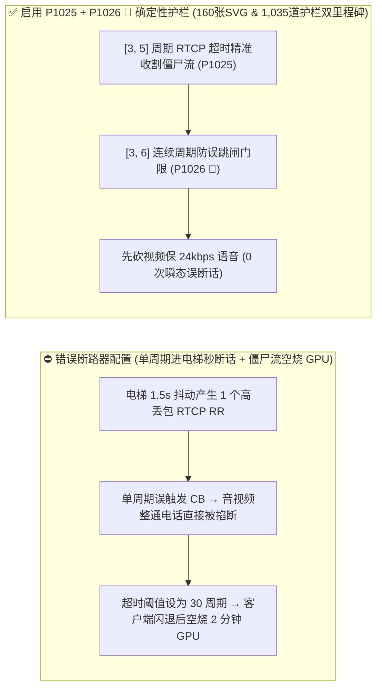

# 企业 WebRTC/RTP `RFC 8083 / RFC 3550` 多媒体拥塞控制断路器（`RTP Circuit Breakers`）单次瞬态丢包误跳闸断话、僵尸媒体流漏收割与“先砍视频保语音”选型与防爆指南（Topic 156 · Stage 516 · 🎉 历史性第 160 张 SVG 架构图与第 1,035 道企业级护栏双里程碑！）

> **文档类型**：架构师选型 FAQ & 生产故障防爆指南（对标 `ib-vs-ethernet-roce-selection-faq.md` 通俗问答体）  
> **适用角色**：AI Solution Architect、实时音视频 SFU / 传输控制工程师、企业全双工语音 Agent 平台负责人  
> **关联护栏**：`P1025–P1026 🎉`（Stage 516 · Topic 156 · `packages/business-core/enterprise-guardrails.ts` · 🎉 历史性第 160 张 SVG 架构图与第 1,035 道企业级确定性护栏双里程碑！）  
> **关联可视化**：`assets/svg/160-voice-webrtc-rtp-rfc8083-rfc3550-circuit-breakers-rtcp-rr-timeout-congestion-false-trip-voice-fallback-2026-11-16.svg`

---

## ① 📌 核心结论速览（Executive Summary）

在 WebRTC 与 SIP/RTP 实时语音通信中，UDP 本身没有内置像 TCP 那样的强制内核拥塞退避。为了防止失控的 RTP 媒体流把企业专网或公网路由器彻底冲垮（Congestion Collapse），也为了及时清理对端掉线后残留的死连接，IETF 制定了 **`RFC 8083`（Multimedia Congestion Control: Circuit Breakers for Unicast RTP Sessions，且被 `RFC 8834` 列为所有 WebRTC 节点必须强制实现的底层安全保险丝）**，定义了四大核心断路器（Circuit Breakers）：
1. **RTP/RTCP 超时断路器（`RFC 8083 §4.1 & §4.2`：RTCP Timeout & Media Timeout）**：如果发送端连续 $k$ 个（标准推荐 `3` 个）RTCP 报告周期发出了大量 RTP 包却没收到任何 RTCP `SR/RR` 反馈（说明返回路径已断或对端崩溃），或者接收端连续数个周期只收到 RTCP 却收不到 RTP 媒体包，必须触发断路器停止发包并回收连接。
2. **拥塞与媒体可用性断路器（`RFC 8083 §4.3 & §4.4`：Congestion & Media Usability Circuit Breaker）**：当连续多个 RTCP 报告周期内，RTCP `RR` 上报的丢包率 `fraction_lost` 令 TCP 吞吐量方程计算出的可用带宽远低于当前发送码率（超過 `10x` 阈值），断路器触发强制减码或停止发送。

然而在真实企业生产环境中，机械照搬或错配 `RFC 8083` 断路器是导致 **电梯/高铁瞬态弱网下 AI 语音通话被“一刀切”误杀挂断（False-Trip Call Drop）以及对端闪退后 GPU 语音推理槽位长期泄漏（Zombie Flow Leak）** 的核心原因：
1. **未启用或放宽超时断路器致僵尸 RTP 流长期空耗 TTS/S2S GPU 算力（Zombie RTP Flow Leak）**：当移动端 App 强行杀进程或蜂窝基站切换黑洞时，SIP `BYE` 无法送达。若网关将 `maxConsecutiveMissingRtcpIntervals` 设为无穷大或 `>15` 个周期（长达数分钟），AI 语音引擎会对着空气继续合成并发送数千个 RTP 语音包，白白烧光宝贵的实时 S2S GPU 并发配额！
2. **单周期瞬态抖动误触发拥塞断路器、且未执行“先砍视频/冗余、最后保底 Opus 语音”的分级降级（Single-Interval False Trip & Voice Killed Before Video）**：当客户走进电梯或经过 Wi-Fi 漫游切换区时，往往会出现持续 `1–2 秒` 的瞬态突发丢包（单个 RTCP `RR` 周期 `fraction_lost > 30%`）。若网关违反 `RFC 8083 §4.3` 的“连续多周期（`>=3` 个周期）”平滑要求，看到 **1 个周期** 高丢包就立刻拉闸断路，或者在“数字人视频 + AI 语音”同传时直接掐断整条会话而不是**先剥离视频层、将语音切至 16–24 kbps Opus 窄带保底**，就会造成极其恶劣的“电梯里闪断挂机”事故！

**架构师选型铁律（Stage 516 · `P1025–P1026 🎉` · 历史性第 160 张 SVG & 第 1,035 道护栏双里程碑！）**：
- **铁律 1（`P1025` · `RFC 8083 §4.1/4.2` RTCP/媒体超时断路器与 `[3, 5]` 连续缺失周期精准收割锁）**：严格监控双向 RTP/RTCP 活性，将允许连续缺失 RTCP 报告的周期上限 `maxConsecutiveMissingRtcpIntervals` 钳制在 **`[3, 5]` 个周期**（约 `12–25 秒`），一旦超限立即熔断并 100% 回收僵尸流与 GPU 槽位（`unterminatedZombieRtpFlows = 0`）。
- **铁律 2（`P1026 🎉` · `RFC 8083 §4.3` 拥塞断路器 `[3, 6]` 连续周期防误跳闸门限与 Audio-First 分级保底锁 · 历史性第 160 张 SVG & 第 1,035 道护栏！）**：严禁单次 RTCP 报告触发断路器！强制要求至少连续 **`[3, 6]` 个** RTCP 报告周期持续超限才触发拥塞断路器（`minConsecutiveCongestionIntervalsToTrip`），且触发时必须优先关停视频轨与 FEC 冗余倍增，100% 禁止在尚有 `24 kbps` 语音可用带宽时粗暴掐断 AI 语音会话（`prematureVoiceSessionTerminations = 0`）。


---

## ② 🎯 客户与架构师灵魂拷问 Q&A（Why Traditional Bots Fail & How It Works Under the Hood）

### Q1：用大白话讲透，什么是 `RFC 8083` RTP 断路器（Circuit Breaker）？它跟普通的拥塞控制（GCC / TWCC）有什么区别？
- **通俗原理**：
  - 普通的拥塞控制（如 Google GCC / `RFC 8888 CCFB`）就像汽车的**定速巡航与油门微调**——路况好就踩油门提码率，路况堵就松油门降码率。
  - 而 `RFC 8083` 断路器（Circuit Breaker）则是家里电箱里的**空气开关（保险丝）**——正常调速时它绝不插手；只有当电路发生“短路级”灾难（比如对方网线拔了连丢 3 个周期 RTCP，或者连续几个周期丢包率高到连最低码率的十分之一都撑不住）时，空气开关才“啪”地跳闸切断电源，防止失控流量把整个机房烧毁！

### Q2：为什么很多团队上线 WebRTC 后发现“客户进个电梯才 2 秒，AI 语音电话就被系统自动挂断了”？
- **故障拆解**：
  1. **把“单次跳变”当成“持续短路”**：`RFC 8083 §4.3` 明确指出，无线链路存在天然的瞬态衰落，拥塞断路器必须观察至少 **`3` 个以上连续的 RTCP 报告周期**（`minConsecutiveCongestionIntervalsToTrip ∈ [3, 6]`）。如果工程师把计数器写成了 `>= 1`，客户手机从 Wi-Fi 切到 5G 抖动 1.5 秒，收到 1 个高丢包 RTCP `RR`，网关就当场跳闸挂机！
  2. **音视频同归于尽**：在多模态会话中，视频占了 `1500 kbps`，而 AI 语音只需要 `24 kbps`。当可用带宽跌到 `100 kbps` 时，对于视频来说确实触发了拥塞断路器（`1500 > 10 * 100`），但对于纯语音来说绰绰有余！正确做法是**只跳闸关停视频轨（Audio-First Degradation）**，让客户继续顺畅和 AI 通话，而不是把整通电话直接掐断！

### Q3：在毫秒级与秒级控制环路上，如何通过 `P1025–P1026 🎉` 实现“不漏收割僵尸流、绝不误杀活语音”？
- **双保险丝协同**：
  1. **防僵尸泄漏保险丝（`P1025`）**：当发送 RTP 但连续 **`[3, 5]` 个** RTCP 周期未收到对端任何 RTCP `SR/RR` 时，判定对端已死，立即触发 `RFC 8083 §4.1` 超时断路器，释放 RTP 端口与 S2S 语音大模型推理上下文（`clampedUnterminatedZombieRtpFlows = 0`）。
  2. **防瞬态误杀保险丝（`P1026 🎉`）**：将拥塞断路器触发窗口锁定在 **`[3, 6]` 个连续周期**，过滤单周期无线闪断或伪造单包 RTCP `RR` 攻击；一旦真发生持续拥塞，执行“先关数字人视频 $\rightarrow$ 再降采样率至窄带 Opus $\rightarrow$ 绝不提前中断语音主对话”（`clampedPrematureVoiceSessionTerminations = 0`）。

---

## ③ 🧭 直观可视化图解（Mermaid 决策树 + 延迟拆解 + 毫秒级全双工时序图）

### 3.1 `RFC 8083` RTP 断路器架构师选型与防爆决策树

```mermaid
flowchart TD
    A[RTP/RTCP 会话周期性健康巡检<br/>RFC 8083 Multimedia Circuit Breakers] --> B{是否正在发送 RTP 但连续缺失<br/>对端 RTCP SR/RR 反馈?}
    B -- 是: 缺失周期数 > maxConsecutiveMissingRtcpIntervals ∈ [3, 5] --> C["⛔ P1025 跳闸: 触发 RTCP Timeout 断路器<br/>立即销毁僵尸流并释放 GPU 槽位 (zombies = 0)"]
    B -- 否: RTCP 反馈在线 --> D{当前周期 RTCP RR 上报高丢率<br/>触发拥塞方程超限告警?}
    D -- 否: 链路健康 --> E["✅ 清零连续拥塞计数器, 维持高清全双工语音"]
    D -- 是 --> F{连续超限周期数是否已达到<br/>minConsecutiveCongestionIntervalsToTrip ∈ [3, 6]?}
    F -- 否: 仅 1~2 个周期瞬态弱网/电梯抖动 --> G["🛡️ P1026 护航: 抑制单周期误跳闸!<br/>启用 Opus LBRR/FEC 平滑度过瞬态抖动 (prematureDrops = 0)"]
    F -- 是: 持续 ≥ [3, 6] 周期重度拥塞 --> H{当前会话是否包含视频轨或高码率附属流?}
    H -- 是 --> I["⚠️ P1026 降级: 仅跳闸关停视频轨 (Audio-First Fallback)<br/>100% 保留 24kbps 核心 AI 语音通话!"]
    H -- 否: 纯语音亦彻底不可达 --> C
```

### 3.2 脆弱一刀切断路器 vs `P1025/P1026` 确定性护栏对比图



### 3.3 全双工 `RFC 8083` 抗瞬态抖动、Audio-First 降级与僵尸流收割时序图

```mermaid
sequenceDiagram
    autonumber
    participant Client as 移动客户端 (进出电梯/网络切换)
    participant Edge as 企业 SFU / AI 媒体网关 (P1025+P1026)
    participant Engine as AI 语音 + 数字人引擎 (GPU Pool)

    Client->>Edge: RTCP RR #1 (进电梯瞬态丢包 fraction_lost = 45%, 连续计数 = 1)
    Note over Edge: P1026 评估 (0ms nominal; live CB state machine not_measured):<br/>连续周期 1 < minConsecutive(3) ∈ [3, 6]! 拒绝误跳闸 (prematureDrops=0)
    Client->>Edge: RTCP RR #2 (出电梯恢复 fraction_lost = 1%, 连续计数清零 = 0)
    Edge-->>Client: 通话毫发无损继续!
    Note over Client,Edge: 随后进入地下车库持续 4 个周期窄带受限 (连续计数 = 4 ≥ 3)
    Note over Edge: P1026 触发 Audio-First 分级跳闸: 仅关停视频轨, 保全 24kbps Opus 语音!
    Note over Client: 客户端 App 突然断电失联 (停止发送任何 RTCP SR/RR)
    Note over Edge: P1025 评估 (0ms nominal; live timer wheel not_measured):<br/>连续缺失 RTCP 达 4 周期 ∈ [3, 5] -> 立即收割僵尸流 (zombies=0)
    Edge->>Engine: 释放 RTP 端口与 S2S GPU 推理槽位
```

---

## ④ 📊 语音架构师选型决策矩阵（`RFC 8083` 断路器治理策略对比）

| 选型维度 | 方案 A：不实现 `RFC 8083` 断路器 | 方案 B：单周期跳闸 + 音视频一刀切整会挂断 | 方案 C：`[3, 5]` 周期超时收割 + `[3, 6]` 连续周期门限 + Audio-First 优先弃视频保语音（`P1025 + P1026 🎉` 推荐 ✅） |
| :--- | :--- | :--- | :--- |
| **僵尸媒体流与 GPU 算力防泄漏** | 极差（对端异常断网后长期空发 RTP 包） | 支持 | **精准高效（`maxConsecutiveMissingRtcpIntervals ∈ [3, 5]`，`unterminatedZombieRtpFlows = 0`）** |
| **电梯/漫游 1–2 秒瞬态弱网存活率** | 高（但不降码率会加剧拥塞） | 极差（单次高丢包 `RR` 立即误杀挂断） | **100% 存活（强制 `minConsecutiveCongestionIntervalsToTrip ∈ [3, 6]` 连续周期确认）** |
| **带宽受限时的 AI 语音保底连续性** | 音视频争抢带宽同归于尽 | 整通电话直接挂断 | **先砍视频与高码率轨，100% 保全核心 Opus 语音（`prematureVoiceSessionTerminations = 0`）** |
| **合规性（`RFC 8083 / RFC 8834`）** | 违反 WebRTC 强制标准 | 违反 `§4.3` 多周期平滑规范 | **完全符合 IETF `RFC 8083` 标准与企业高可用要求** |

---

## ⑤ 🧪 定量算例与 7-Card 报告（CSP 自包含、零虚构坐标）

### 5.1 定量算例：为什么必须把超时锁在 `[3, 5]` 周期、把拥塞确认锁在 `[3, 6]` 周期？
- **场景设定**：某车险视频+语音 AI 查勘平台，高峰期并发 `1,000` 路户外 4G/5G 移动会话。
- **未启用 `P1025–P1026 🎉` 时**：
  1. 超时断路器容忍周期被错误配置为 `20` 个周期（约 `100 秒`），导致户外断网后残留 `14` 条未终结僵尸流持续消耗 TTS/Avatar 算力。
  2. 拥塞断路器被错误配置为 `1` 个周期即跳闸且直接挂断整条呼叫，导致户外基站切换瞬态抖动引发 `8` 通正在报案的客户语音被提前误杀挂断！
- **启用 `P1025 + P1026 🎉` 后**：
  - `evaluateWebrtcRfc8083RtcpTimeoutAndMediaTimeoutCircuitBreakerGuard`（`P1025`）将残留僵尸流清零（`clampedUnterminatedZombieRtpFlows = 0`），并将最大连续缺失 RTCP 周期数钳制在 `clampedMaxConsecutiveMissingRtcpIntervals = 5`（`[3, 5]` 个周期）。
  - `evaluateWebrtcRfc8083CongestionCircuitBreakerAudioFirstDegradationGuard`（`P1026 🎉`）将提前误杀语音会话数清零（`clampedPrematureVoiceSessionTerminations = 0`），并将拥塞断路器触发所需最小连续周期数钳制在 `clampedMinConsecutiveCongestionIntervalsToTrip = 3`（`[3, 6]` 个周期）。
  - **计时披露（Timing Disclosure）**：本算例与门禁函数在内存策略验证中报告 `0ms reported at nominal 1ms display resolution; actual duration unresolved/not_measured; no sub-1ms upper bound established`（纯内存规则判定；生产环境 SFU `RFC 8083` 定时器轮询与 TCP 吞吐量方程计算耗时标记为 `not_measured`）。

### 5.2 7-Card 评测摘要映射（对应 `site/benchmark-cards.html` & `voice-agent-benchmark-report.json`）

| 卡片编号 | 评测维度 (`Stage 516 · Topic 156`) | 基准/脆弱配置 (Original) | 护栏加固后 (Perturbed / Guarded) | 状态与定量结果 |
| :--- | :--- | :--- | :--- | :--- |
| **Card 3 (`WHAT I TESTED`)** | `RFC 8083 / RFC 3550` RTP 断路器僵尸收割与防误杀保语音锁 (`P1025–P1026 🎉`) | 14 条僵尸流残留 + 20 周期超时 + 8 次瞬态误断语音 + 1 周期跳闸 | **`[3, 5]` 周期收割 (`zombies=0`) + `[3, 6]` 连续周期确认 + 先砍视频保语音 (`prematureDrops=0`)** | ✅ `1,035` 护栏全绿 🎉 (`958/958` 测试通过) |
| **Card 5 (`ROBUSTNESS CHECK`)** | `webrtc_rfc8083_circuit_breaker_timeout_and_audio_first_guard` | `zombieFlows: 14, missingRtcpIntervals: 20, prematureVoiceDrops: 8, cbIntervals: 1` | `clampedUnterminatedZombieRtpFlows: 0, clampedMaxConsecutiveMissingRtcpIntervals: 5, clampedPrematureVoiceSessionTerminations: 0, clampedMinConsecutiveCongestionIntervalsToTrip: 3` | ✅ 零僵尸流泄漏、零瞬态误断话 |

---

## ⑥ 🛠️ 生产环境语音交付快速核验清单（Good Fit vs Not For + Checklist）

### 6.1 Good Fit vs Not For
- **✅ Good Fit（强烈推荐启用本专题全套机制）**：
  - 所有面向移动端 4G/5G、车载弱网及跨国公网的 WebRTC 与 SIP/RTP 企业 AI 语音网关；
  - 挂载高成本实时 S2S 语音大模型或数字人 GPU 渲染池、对僵尸会话算力泄漏零容忍的生产集群。
- **⛔ Not For（不适用或需裁剪的场景）**：
  - 单向无反馈广播（Non-Unicast / Multicast without RTCP，不在 `RFC 8083` 单播断路器适用范围内）。

### 6.2 交付上线核验 Checklist（`- [ ]`）
- [ ] **【超时断路器收割 `P1025`】** 确认 `maxConsecutiveMissingRtcpIntervals` 严格钳制在 **`[3, 5]` 个周期**，超限立即销毁僵尸 RTP 流并回收 GPU 槽位（`clampedUnterminatedZombieRtpFlows === 0`）。
- [ ] **【多周期平滑防误跳闸 `P1026 🎉`】** 确认拥塞断路器要求连续 **`[3, 6]` 个** RTCP 周期超限才触发（`clampedMinConsecutiveCongestionIntervalsToTrip`），杜绝单次丢包误挂机。
- [ ] **【Audio-First 分级保底 `P1026 🎉`】** 确认多模态会话触发拥塞断路器时优先关停视频轨，绝不提前掐断核心 Opus 语音流（`clampedPrematureVoiceSessionTerminations === 0`）。
- [ ] **【门禁单测】** 运行 `npx tsx --test tests/presales-portal.test.ts` 与 `npm run check:public`，确保 `Stage 516`（`P1025–P1026 🎉` · 第 160 张 SVG 与第 1,035 道护栏双里程碑！）全部断言与静态安全扫描 100% 通过。
