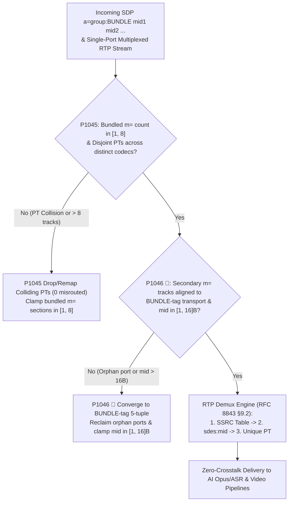
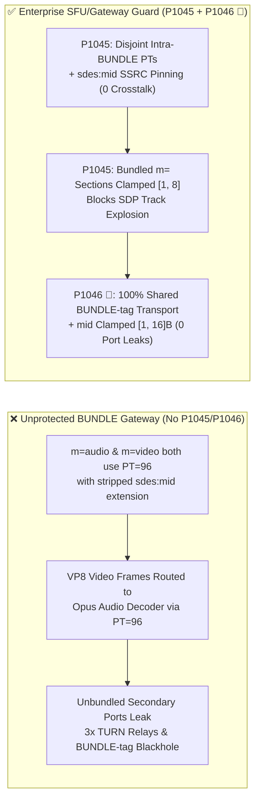
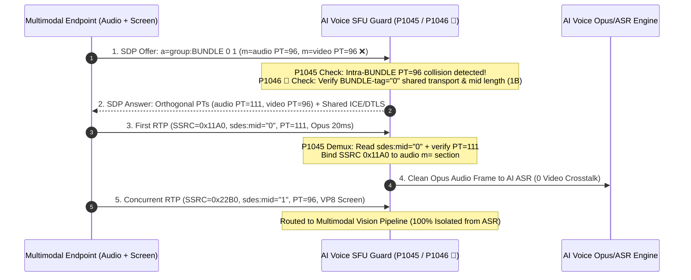

# Enterprise WebRTC/RTP `RFC 8843 / RFC 8829` `BUNDLE` Multiplexing (`a=group:BUNDLE` & `a=mid`) Payload Type (`PT`) Collision, `bundle-only` Port Leak & Demux Desync Selection & Engineering Guide (Stage 526 · Topic 166 · 🎉 Historic 170th Architecture SVG & 1,055th Enterprise Guardrail Dual Milestone!)

> **Document Type**: Enterprise Voice Architect "First-Principles + Selection Decision" Single-Topic FAQ (aligned with `ib-vs-ethernet-roce-selection-faq.md`)
> **Baseline**: `Stage 526` · `Topic 166` · Deterministic Guardrails `P1045–P1046 🎉` · 1,055 Guardrails 🎉 · 1,064 Sandbox Probes · 874 Live POC Trap Probes · 529 Evaluation Dimensions · **🎉 Historic 170th Architecture SVG & 1,055th Enterprise Guardrail Dual Milestone!**
> **Bilingual Edition**: [中文版 (`voice-webrtc-rtp-rfc8843-rfc8829-bundle-mid-payload-type-collision-bundle-only-port-leak-demux-desync-faq.md`)](./voice-webrtc-rtp-rfc8843-rfc8829-bundle-mid-payload-type-collision-bundle-only-port-leak-demux-desync-faq.md)

---

## ① 📌 Executive Summary

In multimodal enterprise AI voice agents (carrying full-duplex speech, screen sharing, avatar video, and DataChannels simultaneously), **`RFC 8843` (`BUNDLE`)** and **`RFC 8829` (JSEP)** multiplex all `m=` media sections onto a **single 5-tuple (one UDP port, one ICE candidate pair, one DTLS-SRTP association)**. However, in heterogeneous SFU and SIP-WebRTC gateway deployments, two failure modes frequently break production audio:
1. **Cross-Track Dynamic Payload Type (`PT`) Collision + Missing `sdes:mid` Routing Video Packets into the Opus Audio Decoder**: When `m=audio` assigns `PT=96` to `opus/48000/2` and `m=video` in the same `BUNDLE` group also assigns `PT=96` to `VP8/90000`, any middlebox that strips `urn:ietf:params:rtp-hdrext:sdes:mid` forces the receiver to fall back to `PT`-based demux (`RFC 8843 §9.2`)—feeding `VP8` video packets directly into the AI Voice ASR/Opus decoder!
2. **Orphan Non-BUNDLE Port Allocation & `BUNDLE-tag` Transport Desync**: Failing to use `a=bundle-only` (`port 0`) or failing to converge all bundled `m=` lines onto the active `BUNDLE-tag` master transport address leaks TURN relay ports and causes one-way audio blackholes when the initial offerer `BUNDLE-tag` `m=` section is rejected.

**Architect Selection Rules**:
- **Guardrail `P1045` (`RFC 8843` Unique Intra-BUNDLE Payload Types, `sdes:mid` Demux Priority & `[1, 8]` Bundled Track Cap)**: Enforces `RFC 8843 §7.1.2 / §9.2` disjoint `PT` numbers across distinct codec configurations within a `BUNDLE` group, prioritizes `sdes:mid` demux (`0` cross-track `PT` collisions/misrouted packets), and clamps bundled `m=` sections in **`[1, 8]`**.
- **Guardrail `P1046 🎉` (Historic 1,055th Enterprise Guardrail & 170th SVG Dual Milestone · `BUNDLE-tag` Shared Transport Convergence & `[1, 16]` Byte `mid` Bounds)**: Enforces `RFC 8843 §6 / §7.3` shared transport address/ICE/DTLS alignment across all bundled `m=` sections (`0` orphan ports or desynced tracks) and clamps `a=mid` tag length in **`[1, 16]` bytes**.

---

## ② 🎯 Architect & Customer Deep-Dive Q&A (Q1 / Q2 / Q3)

### Q1: When audio and video share a single UDP port (`BUNDLE`), how does the gateway know whether an incoming RTP packet is user speech or screen-share video?
- **Plain-Language Principle**: `RFC 8843 §9.2` defines a strict **3-tier demultiplexing funnel**:
  1. **Tier 1: Known `SSRC` table** (already bound to an `m=` section);
  2. **Tier 2: RTP Header Extension `urn:ietf:params:rtp-hdrext:sdes:mid`** (binds the packet's `SSRC` to `a=mid:<token>`);
  3. **Tier 3: Fallback Payload Type (`PT`) lookup** (only works if `PT` is unique across the entire `BUNDLE` group!).
- **Failure Reality**: If `m=audio` and `m=video` both use `PT=96` for different codecs (violating `RFC 8843 §7.1.2`) and `sdes:mid` is absent, Tier 3 demux misroutes video packets into the audio pipeline. `P1045` enforces globally disjoint `PT` allocation across the `BUNDLE` group plus mandatory `sdes:mid` binding.

### Q2: Why did adding a screen-share track triple our TURN server port usage and break audio when the primary track was renegotiated?
- **Root Cause**: Without `max-bundle` / `a=bundle-only` (`port 0`), ICE allocates separate candidate pairs for every `m=` line before `BUNDLE` negotiation completes. Furthermore, if the first `m=` line in `a=group:BUNDLE` is rejected (`port 0`), `RFC 8843 §7.3` requires shifting the `BUNDLE-tag` shared transport address to the next accepted `m=` section. `P1046 🎉` eliminates orphan port allocations (`0` leaked ports) and atomically aligns all bundled sections to the active `BUNDLE-tag`.

### Q3: Can we put a 48-byte session UUID inside `a=mid:` to simplify application logging?
- **Engineering Rule**: **Never!** `a=mid` is transmitted on the wire inside the RFC 8285 1-byte RTP header extension (`sdes:mid`), which physically supports at most **`16` bytes** (`L=0..15` -> `1..16` bytes). `P1046 🎉` clamps `mid` length to **`[1, 16]` bytes**.

---

## ③ 🧭 Visual Architecture Diagrams (Mermaid Decision Tree + Comparison + Sequence Diagram)

### 3.1 `RFC 8843` `BUNDLE` Negotiation & Demux Decision Tree (`flowchart TD`)

### 3.2 Unprotected BUNDLE vs. `P1045 + P1046 🎉` Deterministic Guardrails (`flowchart LR`)

### 3.3 Full-Duplex `BUNDLE` Setup & `sdes:mid` Demux Sequence (`sequenceDiagram`)

---

## ④ 📊 Architect Decision Matrix

| Dimension | Option A: Unbundled Ports (1 Port per Track) | Option B: Permissive `RFC 8843 BUNDLE` (No `P1045/P1046`) | Option C: `RFC 8843 BUNDLE` + `P1045/P1046 🎉` (Recommended ✅) |
| :--- | :--- | :--- | :--- |
| **NAT/TURN Port Efficiency** | ❌ N ports, slow ICE | ✅ Single port | ✅ **Single `max-bundle` 5-tuple (`0` orphan port leaks)** |
| **Cross-Track `PT` Collision Defense** | Isolated by port | ❌ Same `PT` routes video into Opus decoder | ✅ **`P1045` enforces unique `PT` + `sdes:mid` demux (`0` crosstalk)** |
| **Track Cap & `mid` Wire Length** | High overhead | ❌ Oversized `mid` breaks 1-byte RTP ext | ✅ **`P1045` clamps `[1, 8]` tracks + `P1046 🎉` clamps `mid [1, 16]B`** |
| **Policy Check Latency (Offline `synthetic`)** | N/A | N/A | **`0ms` (`nominal 1ms` resolution; see disclosure below)** |

---

## ⑤ 🧪 Quantitative Example & 7-Card Report (CSP Self-Contained, Zero Fabricated Coordinates)

### 5.1 Deterministic Guardrail Walkthrough (`P1045` & `P1046 🎉`)

1. **`P1045` (`evaluateWebrtcRfc8843BundleUniquePayloadTypeAndMidDemuxPriorityGuard` · 1,054th Guardrail)**:
   - **Violating Input (Sandbox Probe `p1045_webrtc_rfc8843_bundle_unique_payload_type_and_mid_demux_priority`)**:
     - `duplicatePayloadTypeAcrossDistinctCodecsOrMissingMidDemuxDetected = true`
     - `crossTrackPtCollisionOrMisroutedPackets = 17`
     - `bundledMediaSectionsCount = 20`
   - **Deterministic Output**:
     - `violated = true`
     - `action = "enforce_unique_bundle_payload_types_and_mid_demux"`
     - `clampedCrossTrackPtCollisionOrMisroutedPackets = 0`
     - `clampedBundledMediaSectionsCount = 8` (clamped to **`[1, 8]`**)
     - **Timing Disclosure**: `0ms reported at nominal 1ms display resolution; actual duration unresolved/not_measured; no sub-1ms upper bound established` (offline in-memory `synthetic` policy check; live SFU `sdes:mid` and `PT` demux latency is `not_measured`).

2. **`P1046 🎉` (`evaluateWebrtcRfc8843BundleOnlyPortZeroAndSharedTransportAddressGuard` · 🎉 Historic 1,055th Enterprise Guardrail & 170th SVG Dual Milestone · 1,064th Sandbox Probe / 874th Live POC Probe)**:
   - **Violating Input (Sandbox Probe `p1046_webrtc_rfc8843_bundle_only_port_zero_and_shared_transport_address`)**:
     - `unbundledOrphanPortAllocationOrTransportAddressDesyncDetected = true`
     - `leakedOrphanBundlePortsOrDesyncedTracksCount = 6`
     - `midIdentificationTagByteLength = 48`
   - **Deterministic Output**:
     - `violated = true`
     - `action = "converge_bundle_tag_shared_transport_and_clamp_mid_bytes"`
     - `clampedLeakedOrphanBundlePortsOrDesyncedTracksCount = 0`
     - `clampedMidIdentificationTagByteLength = 16` (clamped to **`[1, 16]` bytes**)
     - **Timing Disclosure**: `0ms reported at nominal 1ms display resolution; actual duration unresolved/not_measured; no sub-1ms upper bound established`.

---

## ⑥ 🛠️ Production Voice Delivery Verification Checklist

- [ ] **1. Disjoint Intra-BUNDLE `PT` Allocation (`P1045`)**: Verify SDP offers/answers never assign the same `PT` to distinct codecs across `m=audio` and `m=video` within the same `a=group:BUNDLE`, and clamp bundled `m=` sections to `[1, 8]`.
- [ ] **2. `sdes:mid` Demux Priority (`P1045`)**: Confirm `urn:ietf:params:rtp-hdrext:sdes:mid` is negotiated and inspected before `PT` fallback on every new `SSRC`.
- [ ] **3. Shared `BUNDLE-tag` Transport & `a=bundle-only` (`P1046 🎉`)**: Verify all accepted bundled `m=` sections share the active `BUNDLE-tag` transport address, `ice-ufrag/pwd`, and `fingerprint` (`0` orphan ports).
- [ ] **4. `[1, 16]` Byte `a=mid` Token Bound (`P1046 🎉`)**: Confirm all `a=mid:` tokens are `1–16` ASCII bytes compatible with RFC 8285 one-byte header extensions.
