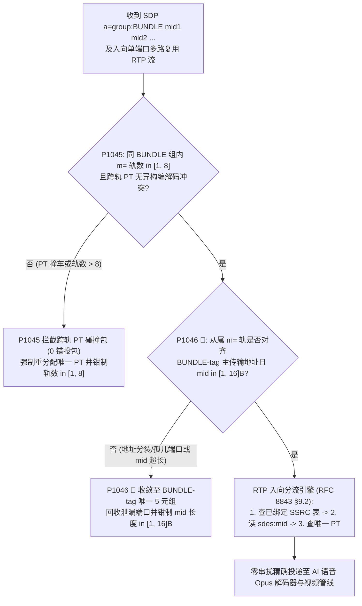
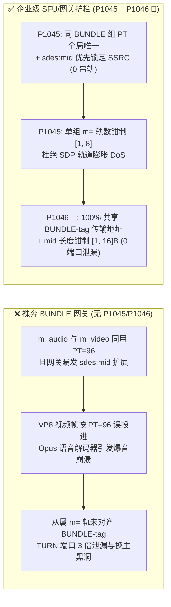
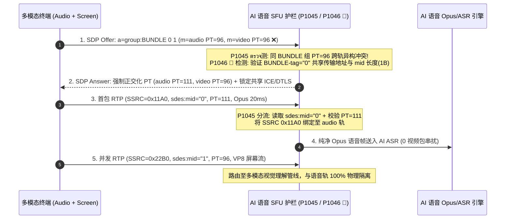

# 企业 WebRTC/RTP `RFC 8843 / RFC 8829` `BUNDLE` 多路复用（`a=group:BUNDLE` 与 `a=mid`）载荷类型（`PT`）碰撞、`bundle-only` 端口泄漏与解复用失步选型与工程指南（Stage 526 · Topic 166 · 🎉 历史性第 170 张架构 SVG 图谱与第 1,055 道企业级护栏双重里程碑！）

> **文档类型**：企业语音架构师“第一性原理 + 选型决策”单专题 FAQ（对标 `ib-vs-ethernet-roce-selection-faq.md` 通俗透彻规范）
> **关联基准**：`Stage 526` · `Topic 166` · 确定性护栏 `P1045–P1046 🎉` · 1,055 道企业护栏 🎉 · 1,064 个沙盒探针 · 874 个现场 POC 探针 · 529 大评测维度 · **🎉 历史性第 170 张架构 SVG 图谱与第 1,055 道企业级护栏双重里程碑！**
> **双语版本**：[English Version (`voice-webrtc-rtp-rfc8843-rfc8829-bundle-mid-payload-type-collision-bundle-only-port-leak-demux-desync-faq.en.md`)](./voice-webrtc-rtp-rfc8843-rfc8829-bundle-mid-payload-type-collision-bundle-only-port-leak-demux-desync-faq.en.md)

---

## ① 📌 核心结论速览（Executive Summary）

在企业级多模态 AI 语音助手（同时承载全双工语音流、屏幕共享视频流、数字人渲染视频流与 DataChannel）中，**`RFC 8843`（Negotiating Media Multiplexing Using the Session Description Protocol / `BUNDLE`）** 与 **`RFC 8829`（JSEP）** 将所有 `m=` 媒体块合并到**同一个 5 元组（单一 UDP 端口、单一 ICE 候选对、单一 DTLS-SRTP 关联）**上传输，避免了为每条媒体轨单独打洞导致的 NAT 端口耗尽与建连慢问题。然而在异构 SFU 与 SIP-WebRTC 媒体网关互通时，极易引爆两大生产级灾难：
1. **同 `BUNDLE` 组内跨轨动态 Payload Type (`PT`) 撞车 + 缺失 `a=mid` 导致“视频包灌入 Opus 语音解码器”**：当 `m=audio` 将 `PT=96` 分配给 `opus/48000/2`，而同一 `BUNDLE` 组内的 `m=video` 又将 `PT=96` 分配给 `VP8/90000`；一旦网络或网关剥离了 RTP 头扩展 `urn:ietf:params:rtp-hdrext:sdes:mid`（`RFC 8843 §15`），接收端按 `RFC 8843 §9.2` 退化到基于 `PT` 查表分流时，会把 `VP8` 视频包直接塞进 AI 语音 ASR/Opus 解码器，瞬间爆发出刺耳白噪音并冲毁 VAD 状态机！
2. **从属轨未设 `bundle-only / port 0` 触发冗余 ICE 打洞风暴，或 Answer 后未对齐主轨（`BUNDLE-tag`）传输地址导致音频黑洞**：在 `max-bundle` 策略下，若次级 `m=` 行未标记 `a=bundle-only` 且分配了独立非零端口，或者协商成功后各 `m=` 行的 `c=` / `ice-ufrag` / `fingerprint` 未严格对齐至 `BUNDLE-tag` 首轨，将造成殭尸 UDP 端口泄漏与单通静音。

**架构师选型铁律**：
- **护栏 `P1045`（`RFC 8843` 同 `BUNDLE` 组全局唯一/同参 `PT` 校验、`sdes:mid` 优先解复用与 `[1, 8]` 轨上限锁）**：严格执行 `RFC 8843 §7.1.2 / §9.2`，强制同一 `BUNDLE` 组内不同编码器严禁复用相同 `PT` 号、强制开启 `urn:ietf:params:rtp-hdrext:sdes:mid` 优先分流（将跨轨 `PT` 碰撞与无 `mid` 错投包清零为 `0`），并将单 `BUNDLE` 组捆绑的 `m=` 媒体轨数钳制在 **`[1, 8]` 条**。
- **护栏 `P1046 🎉`（历史性第 1,055 道护栏 & 第 170 张 SVG 双重里程碑 · `a=bundle-only` 端口收敛、`BUNDLE-tag` 主传输地址对齐与 `[1, 16]` 字节 `mid` 长度门禁）**：严格执行 `RFC 8843 §6 / §7.3`，强制次级捆绑轨收敛至 `BUNDLE-tag` 主轨共享传输地址与 ICE/DTLS 上下文（`0` 孤儿端口或地址分裂），并将 `a=mid` 标识符长度钳制在 **`[1, 16]` 字节**。

---

## ② 🎯 客户与架构师灵魂拷问 Q&A（Q1 / Q2 / Q3）

### Q1：既然所有音频轨和视频轨都走同一个 UDP 端口（`BUNDLE`），网关收到一个 RTP 包时，到底靠什么知道它是“客户说话的音频”还是“屏幕共享的视频”？
- **通俗原理**：就像多户人家合用一个信箱（`BUNDLE` 单端口），分拣员必须按严格的**三级优先级漏斗（`RFC 8843 §9.2`）**拆信：
  1. **第一优先级（最权威）：RTP 头扩展里的 `mid` 标签（`sdes:mid`）**——包头直接写着 `mid="audio-0"` 或 `mid="video-screen"`，查表后立刻锁定 `SSRC -> mid` 映射；
  2. **第二优先级：SDP 里预声明的 `a=ssrc:`**——但在 WebRTC 动态重协商或 Simulcast 中经常不预发 `a=ssrc`；
  3. **第三优先级（兜底陷阱）：RTP 包头的 `Payload Type (PT)`**——如果既没有 `mid` 也没命中已知 `SSRC`，只能看 `PT` 是几号！
- **毫秒级故障真相**：如果架构师偷懒，在 `m=audio` 里配了 `a=rtpmap:96 opus/48000/2`，又在 `m=video` 里配了 `a=rtpmap:96 H264/90000`，一旦首个 RTP 包没带 `sdes:mid` 扩展，第三级兜底查表就会直接撞车（`RFC 8843 §7.1.2` 明确禁止不同编解码配置复用同一 `PT`）！`P1045` 从根源上锁死了同组 `PT` 唯一性与 `sdes:mid` 必选核验。

### Q2：为什么有些 WebRTC 语音通话在 SDP 里加了屏幕共享轨后，TURN 服务器配额突然翻了 3 倍，甚至连原本正常的语音也断了？
- **底层原因**：未正确实施 `a=bundle-only` 与 `BUNDLE-tag` 地址收敛（`RFC 8843 §7.3 / §8.3`）。如果在初始 Offer 中有 3 个 `m=` 块（音频、摄像头、屏幕），却没有在后两个 `m=` 块使用 `max-bundle`（即共享主轨地址或 `m=... 0` + `a=bundle-only`），ICE 引擎会老老实实为 3 个 `m=` 块分别向 TURN 服务器申请 Relay 端口（消耗 3 倍配额与 3 倍 STUN 探测包）。更糟的是，如果 Answer 改变了 `BUNDLE-tag`（例如首轨被拒 `m=audio 0`，主轨顺延到第二轨），而网关没有原子迁移共享传输地址，全部媒体就会发往已关闭的死端口。`P1046 🎉` 强制所有捆绑轨严格对齐当前活跃 `BUNDLE-tag` 的唯一传输地址。

### Q3：`a=mid` 字符串可以用长 UUID 或任意业务 JSON 塞进去传参吗？
- **工程铁律**：**绝对禁止！** 根据 `RFC 8843 §15` 与 `RFC 8285`，`mid` 不仅出现在 SDP 文本里，还会作为**每个媒体流首包/关键帧的 RTP 头扩展（`sdes:mid`）**在实时媒体面高频发送！如果把 `a=mid:` 设成 128 字节的业务 JSON，不仅违反单字节 RTP 扩展头 `1–16` 字节限制，还会挤占 MTU 引发 IP 分片丢包。因此 `P1046 🎉` 将 `mid` 令牌长度严格钳制在 **`[1, 16]` 字节**（推荐 `"0"`, `"1"`, `"audio"`, `"video"` 等超短枚举）。

---

## ③ 🧭 直观可视化图解（Mermaid 选型决策树 + 延迟/资源拆解对比图 + 毫秒级全双工时序图）

### 3.1 `RFC 8843` `BUNDLE` 协商与 RTP 分流选型决策树（`flowchart TD`）

### 3.2 裸奔多轨复用 vs `P1045 + P1046 🎉` 确定性 `BUNDLE` 护栏对比图（`flowchart LR`）

### 3.3 毫秒级全双工 `BUNDLE` 建连与 `sdes:mid` 分流时序图（`sequenceDiagram`）

---

## ④ 📊 语音架构师选型决策矩阵（Architect Decision Matrix）

| 选型维度 | 方案 A：非 `BUNDLE` 独立端口（每轨 1 个端口） | 方案 B：宽松 `RFC 8843 BUNDLE`（无 `P1045/P1046`） | 方案 C：`RFC 8843 BUNDLE` + `P1045/P1046 🎉` 护栏（推荐 ✅） |
| :--- | :--- | :--- | :--- |
| **NAT/TURN 端口消耗与建连速度** | ❌ 每轨独立 ICE/DTLS，端口翻倍、建连慢 | ✅ 单端口复用 | ✅ **单端口 `max-bundle` 复用，`0` 孤儿 TURN 端口泄漏** |
| **跨轨 `PT` 撞车与音视频串轨风险** | 物理端口隔离 | ❌ 缺失 `mid` 时同 `PT` 视频包灌坏语音解码器 | ✅ **`P1045` 强制组内 `PT` 正交 + `sdes:mid` 优先锁定（`0` 串轨）** |
| **单组 `m=` 轨道膨胀与 `mid` 长度边界** | 高开销 | ❌ 超长 `mid` 撑爆单字节 RTP 扩展头 | ✅ **`P1045` 钳制 `[1, 8]` 轨 + `P1046 🎉` 钳制 `mid [1, 16]` 字节** |
| **`BUNDLE-tag` 主轨切换容灾** | N/A | ❌ 首轨被拒后传输地址分裂导致静音 | ✅ **`P1046 🎉` 原子对齐活跃 `BUNDLE-tag` 共享传输上下文** |
| **策略判定耗时（离线 `synthetic`）** | N/A | N/A | **`0ms`（`nominal 1ms` 分辨率；见下方披露）** |

---

## ⑤ 🧪 定量算例与 7-Card 报告（CSP 自包含、零虚构坐标）

### 5.1 确定性护栏定量算例（`P1045` & `P1046 🎉`）

1. **`P1045`（`evaluateWebrtcRfc8843BundleUniquePayloadTypeAndMidDemuxPriorityGuard` · 第 1,054 道护栏）**：
   - **异常输入（沙盒探针 `p1045_webrtc_rfc8843_bundle_unique_payload_type_and_mid_demux_priority`）**：
     - `duplicatePayloadTypeAcrossDistinctCodecsOrMissingMidDemuxDetected = true`
     - `crossTrackPtCollisionOrMisroutedPackets = 17`（检测到 `17` 个因跨轨 `PT` 撞车或缺失 `sdes:mid` 误投的媒体包）
     - `bundledMediaSectionsCount = 20`（单 `BUNDLE` 组捆绑了 `20` 个 `m=` 块，超出安全上限 `8`）
   - **确定性输出**：
     - `violated = true`
     - `action = "enforce_unique_bundle_payload_types_and_mid_demux"`
     - `clampedCrossTrackPtCollisionOrMisroutedPackets = 0`（100% 拦截跨轨 `PT` 碰撞与误投包）
     - `clampedBundledMediaSectionsCount = 8`（自动钳制回 **`[1, 8]` 条** `m=` 媒体块上限）
     - **计时语义披露**：`0ms reported at nominal 1ms display resolution; actual duration unresolved/not_measured; no sub-1ms upper bound established`（离线内存 `synthetic` 策略检查；真实 SFU `sdes:mid` 与 `PT` 解复用查表耗时为 `not_measured`）。

2. **`P1046 🎉`（`evaluateWebrtcRfc8843BundleOnlyPortZeroAndSharedTransportAddressGuard` · 🎉 历史性第 1,055 道企业级护栏与第 170 张架构 SVG 双重里程碑 · 第 1,064 沙盒探针 / 第 874 现场探针）**：
   - **异常输入（沙盒探针 `p1046_webrtc_rfc8843_bundle_only_port_zero_and_shared_transport_address`）**：
     - `unbundledOrphanPortAllocationOrTransportAddressDesyncDetected = true`
     - `leakedOrphanBundlePortsOrDesyncedTracksCount = 6`（检测到 `6` 个未对齐 `BUNDLE-tag` 的泄漏端口或失步轨道）
     - `midIdentificationTagByteLength = 48`（`a=mid` 标签长达 `48` 字节，超出 `RFC 8285` 单字节扩展头 `16` 字节上限）
   - **确定性输出**：
     - `violated = true`
     - `action = "converge_bundle_tag_shared_transport_and_clamp_mid_bytes"`
     - `clampedLeakedOrphanBundlePortsOrDesyncedTracksCount = 0`（`0` 泄漏端口与 `0` 地址分裂轨道）
     - `clampedMidIdentificationTagByteLength = 16`（强制钳制在 **`[1, 16]` 字节**合规区间）
     - **计时语义披露**：`0ms reported at nominal 1ms display resolution; actual duration unresolved/not_measured; no sub-1ms upper bound established`。

---

## ⑥ 🛠️ 生产环境语音交付快速核验清单（Checklist）

- [ ] **1. 同 `BUNDLE` 组全局 `PT` 正交核验（`P1045`）**：检查 SDP 生成器，确保同一 `a=group:BUNDLE` 下的 `m=audio` 与 `m=video` 绝不为不同编解码器分配相同动态 `PT`（如音频固定 `111/103/104`，视频使用 `96–102`），且单组 `m=` 块数量控制在 `[1, 8]` 内。
- [ ] **2. `urn:ietf:params:rtp-hdrext:sdes:mid` 必选协商与首包绑定核验（`P1045`）**：抓包验证每个新 `SSRC` 的前若干个 RTP 包均携带 `sdes:mid` 扩展，且 SFU 解复用严格遵循 `SSRC 表 -> sdes:mid -> 唯一 PT` 顺序。
- [ ] **3. `max-bundle / a=bundle-only` 与 `BUNDLE-tag` 共享地址核验（`P1046 🎉`）**：确认 Answer 中所有入组 `m=` 行的端口、`c=` IP、`a=ice-ufrag`、`a=ice-pwd` 与 `a=fingerprint` 100% 与当前活跃 `BUNDLE-tag` 主轨一致。
- [ ] **4. `a=mid` 令牌 `[1, 16]` 字节长度核验（`P1046 🎉`）**：确认所有 `a=mid:` 值均为 `[1, 16]` 字节的紧凑 ASCII Token（如 `"0"`, `"1"`, `"audio"`），严禁塞入长业务 UUID。
