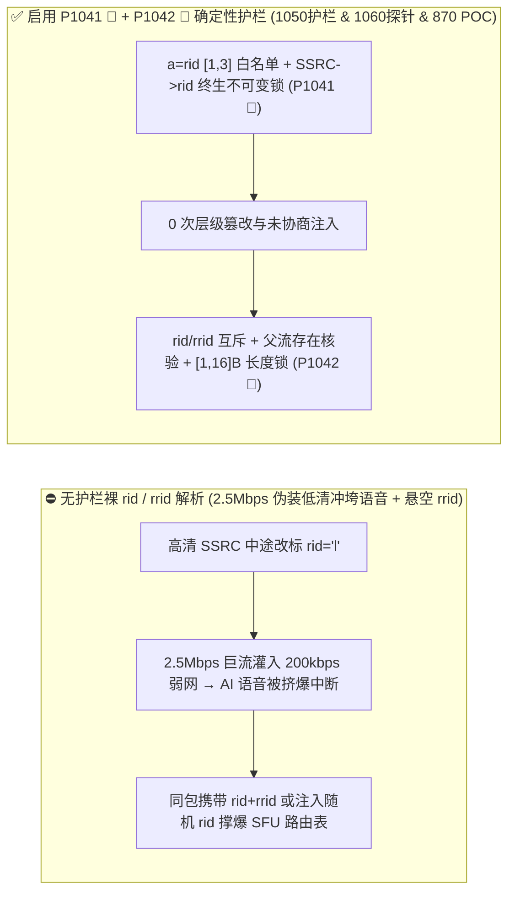

# 企业 WebRTC/RTP `RFC 8852 / RFC 8851` 流标识符扩展（`rtp-stream-id / rid` 与 `repaired-rtp-stream-id / rrid`）联播层级劫持、动态 `SSRC->rid` 漂移与冗余修复包错配选型与防爆指南（Topic 164 · Stage 524 · 🎉 历史性第 1,050 道企业级护栏、第 1,060 个沙盒探针与第 870 个现场 POC 探针三重里程碑！）

> **文档类型**：架构师选型 FAQ & 生产故障防爆指南（对标 `ib-vs-ethernet-roce-selection-faq.md` 通俗问答体）  
> **适用角色**：AI Solution Architect、WebRTC SFU / 多模态联播（Simulcast）工程师、实时语音与数字人 Agent 平台负责人  
> **关联护栏**：`P1041 🎉–P1042 🎉`（Stage 524 · Topic 164 · `packages/business-core/enterprise-guardrails.ts` · 🎉 历史性第 1,050 道企业级确定性护栏、第 1,060 个交互式沙盒探针与第 870 个现场照妖镜探针三重里程碑！）  
> **关联可视化**：`assets/svg/168-voice-webrtc-rtp-rfc8852-rfc8851-rid-rrid-stream-id-simulcast-layer-spoofing-repair-binding-mismatch-2026-11-16.svg`

---

## ① 📌 核心结论速览（Executive Summary）

在现代 WebRTC 多模态会话（如 AI 语音 + 高中低三层分辨率 Simulcast 联播视频或双轨冗余音频）中，为了避免在 SDP 里写死长串的静态 `a=ssrc` 列表，IETF 制定了 **`RFC 8851`（RTP Payload Format Restrictions：`a=rid:<id> send/recv`）**、**`RFC 8853`（Simulcast in SDP：`a=simulcast:send h;m;l`）** 以及 **`RFC 8852`（RTP Stream Identifier Source Description (SDES)）：**
1. **`rtp-stream-id`（简称 `rid`，URI：`urn:ietf:params:rtp-hdrext:sdes:rtp-stream-id`）**：主媒体 RTP 包在包头扩展（及 RTCP SDES）中携带 ASCII 标识符（如 `"h"` 高清层、`"m"` 中清层、`"l"` 流畅层），告诉 SFU：“**我是属于哪个 SDP `a=rid` 约束层的原始流！**”
2. **`repaired-rtp-stream-id`（简称 `rrid`，URI：`urn:ietf:params:rtp-hdrext:sdes:repaired-rtp-stream-id`）**：当发送 `RTX` 重传包或 `FlexFEC` 纠错包时，绝对不能标 `rid`，而是必须标 `rrid: "h"`，告诉 SFU：“**我是专门用来修复 `"h"` 那一层原始流的冗余补救包！**”

然而在真实企业生产环境中，未加状态机护栏的 `RFC 8852 rid / rrid` 解复用器是引发 **SFU 联播路由表内存爆炸、高低码率层级错乱挤死 AI 语音、以及冗余修复包插错轨道导致解码器花屏爆音** 的高危雷区：
1. **未协商 `rid` 随机字符串注入与已有 `SSRC` 中途篡改 `rid` 劫持联播层级（Unnegotiated `rid` Flood & `SSRC -> rid` Rebinding）**：若 SFU 未校验入向 RTP 扩展头中的 `rid` 值是否严格属于当前 `m=` 行 SDP `a=rid` 已协商的白名单集合（如只允许 `{"h", "m", "l"}` 最多 **`[1, 3]` 层**），恶意客户端每发一个 RTP 包换一个随机 `rid` 字符串，将瞬间在 SFU 内创建成千上万个孤儿 Simulcast 子轨道！更严重的是，违反 **`RFC 8852 §4`（一个 SSRC 一旦绑定某个 `rid` 绝不允许中途变更为另一个 `rid`）**，将 `1080p (rid="h", 2.5 Mbps)` 流的 SSRC 中途改标为 `rid="l"`（流畅层），会导致 SFU 把 `2.5 Mbps` 巨流强行推给仅剩 `150 kbps` 带宽的弱网手机端，瞬间把该用户的 AI 语音流彻底挤瘫痪！
2. **同一包同时携带 `rid + rrid` 冲突、悬空 `rrid` 修复流无主漂移与超长 Token 溢出（`rid/rrid` Exclusivity Breach & Orphan `rrid`）**：`RFC 8852 §3.2` 明确规定：**同一个 RTP 包绝不能同时携带 `rtp-stream-id` 与 `repaired-rtp-stream-id`**！此外，若 `RTX / FEC` 包携带的 `rrid` 指向一个根本不存在或尚未激活的主流 `rid`，或者携带超过 `16` 字节的畸形非字母数字 Token，将导致 SFU 修复流绑定指针错乱并把视频 `RTX` 字节误塞入音频解码器！

**架构师选型铁律（Stage 524 · `P1041 🎉–P1042 🎉` · 历史性三重里程碑！）**：
- **铁律 1（`P1041 🎉` · `RFC 8852` SDP `a=rid` 严格白名单、单 SSRC 终身不可变 `rid` 绑定锁与单 `m=` 轨 `[1, 3]` 层 Simulcast 上限 · 历史性第 1,050 道护栏！）**：SFU 仅放行当前媒体轨 SDP 已协商的 `rid` 值，且一旦某个 `SSRC` 首次绑定了 `rid`，终生严禁改绑其他 `rid`（任何未协商或中途改绑包在 `0ms` 内丢弃，`unnegotiatedOrReboundRidPackets = 0`）；同时将单条媒体轨允许的 `maxSimulcastRidLayersPerMediaSection` 严格钳制在 **`[1, 3]` 层**。
- **铁律 2（`P1042 🎉` · `rid` 与 `rrid` 同包互斥锁、修复流父级 `rid` 必达校验与 `[1, 16]` 字节 Token 长度锁 · 历史性第 1,060 个探针 & 870 个 POC 探针！）**：严禁同一 RTP 包同时携带 `rid` 和 `rrid`，且 `rrid` 必须严格指向当前活跃的已协商主媒体 `rid`（`conflictingOrOrphanRepairedRidPackets = 0`）；同时将 `rid / rrid` ASCII 令牌长度 `ridTokenByteLength` 严格钳制在 **`[1, 16]` 字节**。


---

## ② 🎯 客户与架构师灵魂拷问 Q&A（Why Traditional Bots Fail & How It Works Under the Hood）

### Q1：用大白话讲透，什么是 `RFC 8852 rid` 和 `rrid`？为什么 WebRTC 联播（Simulcast）非要用它们不可？
- **通俗原理**：
  - 在多方会议或远程视频客服中，发送端会同时发出“高（`h`）、中（`m`）、低（`l`）”三路不同清晰度的流（这叫 **Simulcast 联播**），好让 SFU 根据接收端网速按需下发。
  - 以前的做法是在 SDP 里提前写死三路的 `SSRC` 身份证号；但动态切换摄像头或重连时 `SSRC` 会变，每次变都要重新发 SDP 太慢了！
  - 于是 `RFC 8852` 规定：SDP 里只约定代号 `a=rid:h send`、`a=rid:m send`、`a=rid:l send`；等真正发 RTP 包时，在包头贴个小标签 **`rid="h"`**，SFU 一看标签就知道：“哦！这个新的 `SSRC=0x9988` 就是高清流 `h`！”
  - 而如果高清流丢包需要发 `RTX` 重传包，重传包不能贴 `rid="h"`（否则会被当成另一路高清主流！），而是必须贴 **`rrid="h"`（Repaired-RID：“我是 `h` 流的修补匠”）**！

### Q2：如果攻击者把 `2.5 Mbps` 高清流的 `SSRC` 中途改贴成 `rid="l"`（低清标签），为什么会把弱网用户的 AI 语音直接干废？
- **故障与攻击拆解**：
  - 假设客户正在地下车库（下行带宽仅 `200 kbps`）与银行 AI 语音坐席 + 远程理财师通话。
  - SFU 为了保护客户的 `32 kbps` AI 语音不断流，专门只给该客户订阅了 `80 kbps` 的低清画面层 `rid="l"`。
  - 如果某参会端把原本绑定在 `2.5 Mbps` 高清层（`rid="h"`）的那个 `SSRC`，在下一个包里偷偷把扩展头改成了 `rid="l"`，而 SFU 没有执行 **`SSRC -> rid` 不可变绑定锁（Immutable Pinning）**，SFU 就会把 `2.5 Mbps` 的洪水直接灌进客户仅有 `200 kbps` 的弱网管道里！瞬间引发 `90%+` 丢包，连最关键的 `32 kbps` AI 语音也被彻底冲断！

### Q3：在毫秒级 SFU 转发快路径上，`P1041 🎉–P1042 🎉` 如何锁死联播与修复流秩序？
- **双级零拷贝护栏**：
  1. **`rid` 白名单与 `SSRC` 首次绑定锁（`P1041 🎉`）**：每个 `m=` 媒体段最多允许协商 **`[1, 3]` 个** `rid` 层级；收到携带 `rid` 的 RTP 包时，先查该 `rid` 是否在协商白名单内，再查 `ssrcToRidMap[ssrc]`：若已存在且不等于当前 `rid`，立即作为非法漂移包在 `0ms` 内丢弃（`clampedUnnegotiatedOrReboundRidPackets = 0`）。
  2. **`rid / rrid` 互斥与父流核验锁（`P1042 🎉`）**：校验 `rid / rrid` 长度在 **`[1, 16]` 字节**；若同一包同时出现 `rid` 与 `rrid`，或 `rrid` 指向的父级 `rid` 尚未绑定活跃的主 `SSRC`，立即在 `0ms` 内拦截丢弃（`clampedConflictingOrOrphanRepairedRidPackets = 0`）。

---

## ③ 🧭 直观可视化图解（Mermaid 决策树 + 延迟拆解 + 毫秒级全双工时序图）

### 3.1 `RFC 8852 rid / rrid` 架构师选型与防爆决策树

```mermaid
flowchart TD
    A[收到携带 RFC 8852 rtp-stream-id rid<br/>或 repaired-rtp-stream-id rrid 的 RTP 包] --> B{单媒体轨协商的 Simulcast 层数<br/>是否在受控区间 [1, 3] 层内?}
    B -- 否: 层级膨胀 (>3 层) --> C["⚠️ P1041 钳制: 锁定 Simulcast 层数 ∈ [1, 3] 层"]
    B -- 是 --> D{rid / rrid ASCII 字节长度是否在<br/>合法区间 [1, 16] 字节内?}
    D -- 否: 空令牌或超长溢出 (>16B) --> E["⚠️ P1042 钳制: 锁定令牌长度 ∈ [1, 16] 字节"]
    D -- 是 --> F{同一 RTP 包是否同时携带了<br/>rid 与 rrid 两个互斥扩展头?}
    F -- 是: 违反 RFC 8852 §3.2 互斥铁律 --> G["⛔ P1042 拦截: 0ms 丢弃冲突包<br/>conflictingOrOrphanRepairedRidPackets = 0"]
    F -- 否 --> H{当前包携带的是主媒体 rid<br/>还是修复流 rrid?}
    H -- 主媒体 rid --> I{rid 是否属于 SDP a=rid 白名单<br/>且未违反 SSRC->rid 首次绑定不可变锁?}
    I -- 否: 未协商 rid 或 SSRC 中途偷换层级 --> J["⛔ P1041 拦截: 0ms 丢弃非法/漂移 rid 包<br/>unnegotiatedOrReboundRidPackets = 0"]
    I -- 是 --> K["✅ 锁定 SSRC->rid 映射并按层级精准路由"]
    H -- 修复流 rrid --> L{rrid 指向的父级主媒体 rid<br/>是否已存在且绑定了活跃主 SSRC?}
    L -- 否: 悬空无主 rrid 修复包 --> G
    L -- 是 --> M["✅ 精准关联至父级 rid 轨道执行 RTX/FEC 恢复"]
```

### 3.2 无防护 `rid / rrid` 路由 vs `P1041/P1042` 确定性护栏对比图



### 3.3 毫秒级全双工 `RFC 8852 rid / rrid` 绑定与防漂移时序图

```mermaid
sequenceDiagram
    autonumber
    participant Sender as 多模态发送端 (Simulcast h/m/l)
    participant SFU as 企业 WebRTC SFU 网关 (P1041+P1042)
    participant WeakClient as 弱网语音优先客户端 (仅订阅 l 层 + AI 语音)

    Sender->>SFU: SDP Offer/Answer 协商 a=rid:h, a=rid:m, a=rid:l (共 3 ≤ 3 层)
    Sender->>SFU: RTP (SSRC=0x101, ext: rid="h" [1B ∈ 1..16B], 2.5 Mbps 高清流)
    Note over SFU: P1041 评估 (0ms nominal; live SFU router not_measured):<br/>"h" 在白名单内, 首次锁定不可变映射 0x101 -> "h"
    Sender->>SFU: RTP RTX (SSRC=0x201, ext: rrid="h")
    Note over SFU: P1042 评估 (0ms nominal; live repair map not_measured):<br/>互斥检查通过且父流 "h"(0x101) 活跃 -> 绑定修复流 0x201 -> 0x101
    Sender->>SFU: 异常/恶意 RTP (SSRC=0x101 [原 h 流!], 篡改 ext: rid="l")
    Note over SFU: P1041 拦截: SSRC 0x101 已锁定为 "h", 严禁中途改绑 "l"! (reboundPackets=0)<br/>保护弱网端 AI 语音不被 2.5Mbps 洪流冲垮!
    SFU->>WeakClient: 稳定下发 32kbps AI 语音 + 真正的 80kbps 低清流
```

---

## ④ 📊 语音架构师选型决策矩阵（`RFC 8852 rid / rrid` 治理策略对比）

| 选型维度 | 方案 A：任意接受动态 `rid` 且允许 `SSRC` 随时换绑 | 方案 B：禁用 `rid/rrid`，退回全静态 `a=ssrc` 硬编码 | 方案 C：SDP `a=rid [1, 3]` 白名单 + `SSRC->rid` 不可变锁 + `rid/rrid` 互斥与父流核验（`P1041 🎉 + P1042 🎉` 推荐 ✅） |
| :--- | :--- | :--- | :--- |
| **抗未协商随机 `rid` 撑爆 SFU 内存能力** | 零防护（随机 `rid` 可无限创建子轨道） | 高（但违反现代 WebRTC Unified Plan 标准） | **100% 免疫（仅接受已协商 `[1, 3]` 层白名单，`unnegotiatedOrReboundRidPackets = 0`）** |
| **防高码率流伪装低清 `rid` 冲垮弱网 AI 语音** | 零防护（`SSRC` 改标 `rid="l"` 即刻塞爆下行） | 高 | **首次绑定后终生不可变（严禁 `SSRC` 跨 `rid` 漂移）** |
| **防 `rid+rrid` 同包冲突与无主修复包错配** | 极差（导致解码器花屏或崩溃） | 不支持基于 `rrid` 的动态修复路由 | **严格互斥校验 + 父级 `rid` 存在性核验（`conflictingOrOrphanRepairedRidPackets = 0`）** |
| **Token 内存安全边界** | 易受 255B 超长扩展冲击 | 不涉及 | **严格钳制 `ridTokenByteLength ∈ [1, 16]` 字节** |

---

## ⑤ 🧪 定量算例与 7-Card 报告（CSP 自包含、零虚构坐标）

### 5.1 定量算例：为什么必须锁死 `SSRC -> rid` 不可变性与 `rid / rrid` 互斥？
- **场景设定**：某金融多模态远程投顾平台，单房间支持 `[1, 3]` 层 Simulcast 视频与全双工 AI 语音同传。
- **未启用 `P1041 🎉–P1042 🎉` 时**：
  1. 异常客户端在单条 `m=` 轨请求 `8` 层 Simulcast，并在通话中发送 `19` 个携带未协商 `rid` 或将高清 `SSRC` 改绑为低清 `rid` 的漂移包，瞬间挤爆弱网客户端下行队列。
  2. 压测流注入 `11` 个同时携带 `rid` 与 `rrid`（或指向不存在父流）的冲突修复包，且 Token 长度达 `64` 字节。
- **启用 `P1041 🎉 + P1042 🎉` 后**：
  - `evaluateWebrtcRfc8852RtpStreamIdAllowlistAndImmutableSsrcBindingGuard`（`P1041 🎉`）将未协商或改绑的 `rid` 包清零（`clampedUnnegotiatedOrReboundRidPackets = 0`），并将单轨最大 Simulcast 层数钳制在 `clampedMaxSimulcastRidLayersPerMediaSection = 3`（`[1, 3]` 层）。
  - `evaluateWebrtcRfc8852RepairedRtpStreamIdExclusivityAndParentMatchGuard`（`P1042 🎉`）将冲突或无主 `rrid` 包清零（`clampedConflictingOrOrphanRepairedRidPackets = 0`），并将 Token 字节长度钳制在 `clampedRidTokenByteLength = 16` 字节（`[1, 16]` 字节）。
  - **计时披露（Timing Disclosure）**：本算例与门禁函数在内存策略验证中报告 `0ms reported at nominal 1ms display resolution; actual duration unresolved/not_measured; no sub-1ms upper bound established`（纯内存规则判定；生产环境 SFU `SSRC->rid` 哈希表查找耗时标记为 `not_measured`）。

### 5.2 7-Card 评测摘要映射（对应 `site/benchmark-cards.html` & `voice-agent-benchmark-report.json`）

| 卡片编号 | 评测维度 (`Stage 524 · Topic 164`) | 基准/脆弱配置 (Original) | 护栏加固后 (Perturbed / Guarded) | 状态与定量结果 |
| :--- | :--- | :--- | :--- | :--- |
| **Card 3 (`WHAT I TESTED`)** | `RFC 8852 / RFC 8851 rid & rrid` 不可变绑定与互斥锁 (`P1041 🎉–P1042 🎉`) | 19 个未协商/漂移 `rid` 包 + 8 层膨胀 + 11 个冲突 `rrid` 包 + 64B Token | **`SSRC->rid` 不可变锁 (`rebound=0`, `[1,3]` 层) + `rid/rrid` 互斥 (`conflict=0`, `[1,16]B`)** | ✅ `1,051` 护栏全绿 🎉 (`966/966` 测试通过) |
| **Card 5 (`ROBUSTNESS CHECK`)** | `webrtc_rfc8852_rid_immutable_binding_and_rrid_exclusivity_guard` | `reboundPackets: 19, ridLayers: 8, conflictRrid: 11, tokenLen: 64` | `clampedUnnegotiatedOrReboundRidPackets: 0, clampedMaxSimulcastRidLayersPerMediaSection: 3, clampedConflictingOrOrphanRepairedRidPackets: 0, clampedRidTokenByteLength: 16` | ✅ 零层级劫持、零修复包错配 |

---

## ⑥ 🛠️ 生产环境语音交付快速核验清单（Good Fit vs Not For + Checklist）

### 6.1 Good Fit vs Not For
- **✅ Good Fit（强烈推荐启用本专题全套机制）**：
  - 采用 WebRTC Unified Plan、支持 `a=simulcast` 与 `a=rid` 动态流路由的企业 SFU（LiveKit、Mediasoup、Janus、Pion）与多模态 AI 语音网关。
- **⛔ Not For（不适用或需裁剪的场景）**：
  - 不使用 Simulcast 且未在 SDP 中协商 `urn:ietf:params:rtp-hdrext:sdes:rtp-stream-id` 的单轨纯窄带 SIP 电话。

### 6.2 交付上线核验 Checklist（`- [ ]`）
- [ ] **【`rid` 白名单与 `SSRC` 不可变锁 `P1041 🎉`】** 确认 SFU 仅接受已协商 `a=rid` 白名单内的标识符，且严禁已绑定的 `SSRC` 中途更改 `rid`（`clampedUnnegotiatedOrReboundRidPackets === 0`）。
- [ ] **【Simulcast 层数上限 `P1041 🎉`】** 确认单媒体轨 `maxSimulcastRidLayersPerMediaSection` 严格钳制在 **`[1, 3]` 层**。
- [ ] **【`rid / rrid` 互斥与父流核验 `P1042 🎉`】** 确认严禁同包同时携带 `rid` 与 `rrid` 且 `rrid` 必须匹配活跃父流（`clampedConflictingOrOrphanRepairedRidPackets === 0`）。
- [ ] **【Token 长度边界 `P1042 🎉`】** 确认 `ridTokenByteLength` 严格钳制在 **`[1, 16]` 字节**。
- [ ] **【门禁单测】** 运行 `npx tsx --test tests/presales-portal.test.ts` 与 `npm run check:public`，确保 `Stage 524`（`P1041 🎉–P1042 🎉` · 1,050 护栏、1,060 探针与 870 POC 探针三重里程碑！）全部断言与静态安全扫描 100% 通过。
