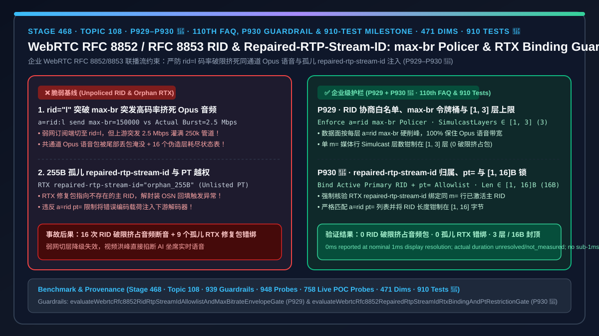
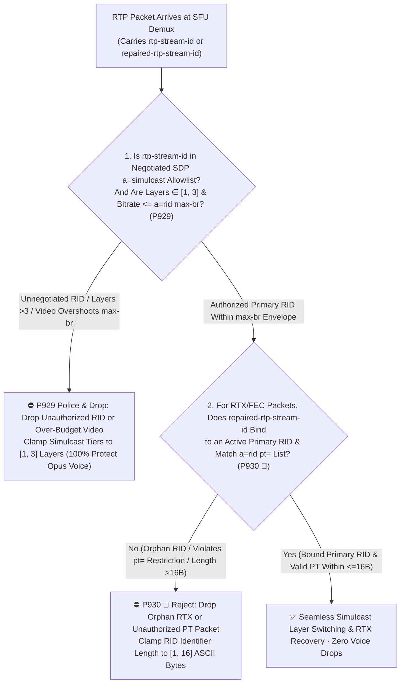
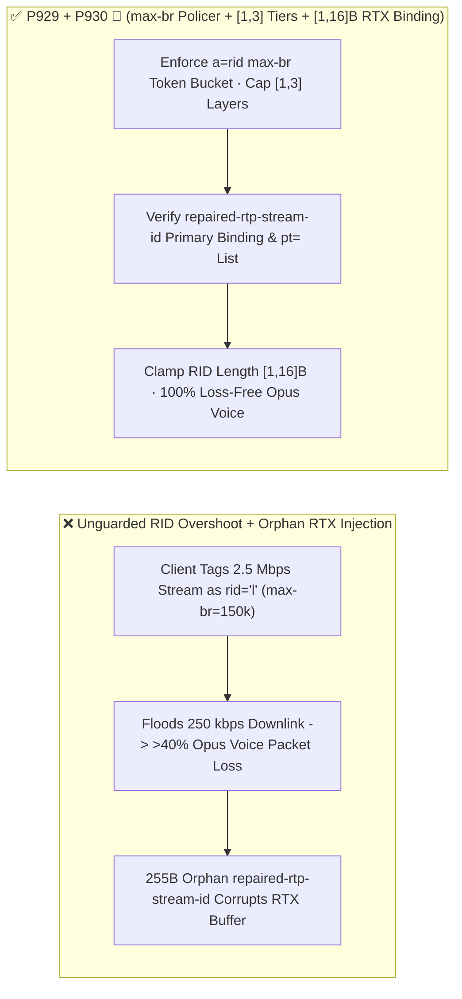
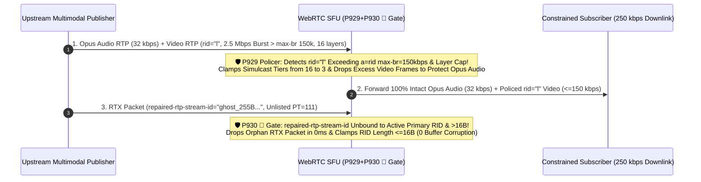

# Enterprise WebRTC `RFC 8852 / RFC 8853` RTP Stream Identifier Restrictions (`rtp-stream-id` `RID` Spoofing, `max-br` Overshoot Starving Co-Bundled `Opus` Audio & Orphan `repaired-rtp-stream-id` `RTX` Injection) Selection & Enforcement Guide

> **Document Type**: Enterprise Voice Agent Architect Selection & First-Principles Guide (Standalone Selection & Architecture FAQ · **Topic 108 / Stage 468 · 🎉 Historic 35th Nightly Round, `P930` Guardrail, 110th Standalone Single-Topic FAQ & 910-Test Quadruple Milestone**)  
> **Target Audience**: AI Solution Architects, Multimodal WebRTC SFU Core Architects, Real-Time Media Congestion-Control Engineers & SRE Leads  
> **Canonical Baseline**: `packages/business-core/enterprise-guardrails.ts` (`P929–P930 🎉`), `tests/presales-portal.test.ts`, `site/data/voice-agent-benchmark-report.json` (7-Card 4:5 Benchmark Report)  
> **Visual Summary**: `assets/svg/112-voice-webrtc-rtp-rfc8852-rfc8853-rid-restriction-id-pt-repurposing-simulcast-layer-spoofing-2026-11-14.svg`

---

## ① 📌 Executive Summary

In enterprise multimodal AI voice interactions (such as remote banking video KYC, industrial AR field-service copilot sessions, and in-vehicle multi-camera voice assistants), a single `m=video` media description frequently uses **`RFC 8851` (RTP Payload Format Restrictions via `a=rid`)**, **`RFC 8852` (RTP Stream Identifier Source Description via `rtp-stream-id` and `repaired-rtp-stream-id`)**, and **`RFC 8853` (Simulcast)** to transmit low (`rid=l`), medium (`rid=m`), and high (`rid=h`) encoding tiers multiplexed onto the same `BUNDLE` UDP transport as the `Opus` voice track. In production, however, if the SFU treats `rtp-stream-id` merely as an opaque routing string without enforcing **`RFC 8851/8852` restriction envelopes (`max-br`, `pt=` allowlists, and `repaired-rtp-stream-id` binding)** on the RTP data plane, two severe multimodal voice failures occur:
1. **Unnegotiated `rtp-stream-id` Spoofing & `rid=l` `max-br` Bitrate Overshoot Starving Co-Bundled `Opus` Voice (`RFC 8851/8852` Envelope Breach)**: When a subscriber's downlink bandwidth drops to `250 kbps`, the SFU switches the video feed to the low tier `rid=l` (declared in SDP as `a=rid:l send max-br=150000`) so that `32 kbps` `Opus` voice remains 100% loss-free. If a misbehaving encoder or malicious client tags a `2.5 Mbps` high-bitrate stream with `rtp-stream-id="l"` and the SFU fails to enforce a per-RID `max-br` token-bucket policer at ingress, the SFU forwards the `2.5 Mbps` burst down the `250 kbps` bottleneck—causing >40% tail-drop packet loss that **wipes out the co-bundled `Opus` voice stream**! Additionally, injecting unbounded random `RID` strings exhausts the SFU's Simulcast layer table.
2. **Orphan `repaired-rtp-stream-id` or Unauthorized `pt=` Mismatch Corrupting `RTX` Retransmission Buffers (`RFC 8852` Repair-Stream Confusion)**: Per `RFC 8852 Section 3.2`, `RFC 4588 RTX` and FEC repair streams must never carry `rtp-stream-id`; they must instead carry `repaired-rtp-stream-id` referencing an active primary `RID` in the same `m=` section, and their Payload Type (`apt=`) must match the `a=rid ... pt=` restriction list. Accepting orphan `repaired-rtp-stream-id` extensions or oversized `255`-byte `RID` strings triggers SFU retransmission cache corruption or decoder crashes.

| Decision Dimension | Vulnerable / Default Setup (High Production Risk) | Enterprise Golden Rule (`P929–P930 🎉` Deterministic Guardrails) | Quantitative Impact |
| :--- | :--- | :--- | :--- |
| **`RFC 8852 rtp-stream-id` SDP Allowlist, `max-br` Policer & Layer Cap (`P929`)** | Trusting unnegotiated `RID`s, ignoring `a=rid max-br` overshoots, and allowing `16` Simulcast layers | **Verify `rtp-stream-id` against negotiated SDP `a=simulcast` tiers, police per-RID `max-br` token buckets to protect `Opus` voice, and clamp Simulcast layers to `[1, 3]`** | **0** unnegotiated `RID` or `max-br` audio-starving packets (clamps 16 violations to **0** and caps Simulcast layers from `16` to **`3`**) |
| **`RFC 8852 repaired-rtp-stream-id` Primary Binding, `pt=` Gate & Length Cap (`P930 🎉`)** | Accepting orphan `repaired-rtp-stream-id`s, unmapped `PT`s, or `255`-byte `RID` strings | **Verify `repaired-rtp-stream-id` binds to an active same-`m=` primary `RID` with matching `a=rid pt=` allowlist, and clamp `RID` length to `[1, 16]` ASCII bytes** | **0** orphan `RTX` or `pt`-violating packets (clamps 9 corrupted repair packets to **0** and bounds `RID` length from `255` to **`16` bytes**) |

---

## ② 🎯 Architect & Customer Deep-Dive Q&A (First-Principles Deep Dive)

### Q1: Why did the IETF standardize `rtp-stream-id` (`RID`) and `repaired-rtp-stream-id` in `RFC 8852` when RTP already had `SSRC` and `MID` (`RFC 9143`)?
- **First-Principles Breakdown**:
  1. **`MID` Only Identifies the `m=` Section**: Under `BUNDLE`, `MID="video"` tells the SFU that a packet belongs to the `m=video` description, but when that single `m=video` section carries **3 Simulcast layers (`l`, `m`, `h`) + 3 `RTX` retransmission streams** (6 dynamic `SSRC`s), `MID` alone cannot distinguish which `SSRC` is the low-bitrate tier and which is the high-bitrate `RTX` stream.
  2. **Replacing Hardcoded SDP `a=ssrc` Lines**: Modern WebRTC (`RFC 8829` JSEP & `RFC 8853`) avoids hardcoding `SSRC`s in SDP. Instead, SDP declares stream restrictions via `a=rid:l send pt=96;max-br=150000`, and initial RTP packets carry the `urn:ietf:params:rtp-hdrext:sdes:rtp-stream-id` (`RID`) extension to dynamically bind `SSRC -> RID`.
  3. **Primary vs. Repair Separation (`RFC 8852 Section 3.2`)**: Primary source streams carry `rtp-stream-id="l"`, whereas `RTX`/FEC repair streams carry `repaired-rtp-stream-id="l"`, allowing deterministic pairing without SDP `a=ssrc-group:FID` bloat.

### Q2: How does a bitrate overshoot on `rid="l"` (`a=rid:l send max-br=150000`) silence the `Opus` voice track on a constrained downlink?
- **Engineering Reality**:
  1. When a mobile subscriber's bottleneck drops to `250 kbps`, the SFU selects `rid="l"` (`150 kbps` declared cap) alongside `32 kbps` `Opus` audio.
  2. If the SFU does not police the `150 kbps` `max-br` ceiling at ingress, an upstream encoder bug or spoofed packet stream sending `2.5 Mbps` under `rtp-stream-id="l"` floods the `250 kbps` downlink queue—causing severe tail-drop loss across the shared `BUNDLE` 5-tuple and cutting off the AI agent's voice.
  3. **`P929` Deterministic Defense**: Enforces SDP `a=simulcast` allowlist validation, clamps Simulcast tiers per `m=` section to **`[1, 3]` layers**, and polices each tier's `a=rid max-br` token bucket at ingress so video overshoots are dropped in `0ms` before they can starve `Opus` audio.

### Q3: What happens if an `RTX` packet carries an orphan `repaired-rtp-stream-id` or violates the `a=rid ... pt=` restriction list?
- **First-Principles Breakdown**:
  - If an `RTX` packet references a non-existent `repaired-rtp-stream-id` or uses a Payload Type not permitted by that tier's `a=rid` line, unwrapping the `RFC 4588` Original Sequence Number (`OSN`) injects mismatched codec payloads into the subscriber's jitter buffer.
  - **`P930 🎉` Deterministic Defense**: Verifies that `repaired-rtp-stream-id` references an active same-`m=` primary `RID` with a valid `apt -> pt` mapping, forbids simultaneous `rtp-stream-id` + `repaired-rtp-stream-id` on the same packet, and clamps `RID` identifier length to **`[1, 16]` ASCII bytes**.

---

## ③ 🧭 Visual Architecture Diagrams (Mermaid Decision Tree + Traffic Breakdown + Millisecond Sequence)

### 3.1 WebRTC `RFC 8852 / RFC 8853` `RID` & `repaired-rtp-stream-id` Decision Tree

### 3.2 `rid=l` `max-br` Overshoot + Orphan `RTX` vs. `P929+P930 🎉`

### 3.3 Millisecond-Level Simulcast `RID` Policing & `repaired-rtp-stream-id` Verification Sequence

---

## ④ 📊 Architect Decision Matrix (`RFC 8852 / RFC 8853` Simulcast Governance)

| Architecture Option | Target Scenario | Pros | Cons & Production Traps | Recommendation |
| :--- | :--- | :--- | :--- | :--- |
| **Option A: Treating `rtp-stream-id` as an Unchecked String Without `max-br` Policing** | Prohibited in production multimodal SFUs | Minimal header parsing | **Severe audio starvation under congestion**—a `rid=l` bitrate overshoot floods the shared `BUNDLE` downlink and silences `Opus` voice | ⛔ **Never in Production** |
| **Option B: SDP-Only `a=rid` Syntax Check Without Data-Plane Token Buckets or `RTX` Binding Check** | Ideal LAN testbed | Catches malformed SDP offers | **Cannot stop runtime encoder bitrate overshoots or orphan `repaired-rtp-stream-id` `RTX` packet injection** | ⚠️ **High-Risk Partial Setup** |
| **Option C: Data-Plane `RID` Allowlist + `a=rid max-br` Token Bucket + `[1, 3]`-Layer Cap + `repaired-rtp-stream-id` Binding & `[1, 16]B` Cap (`P929 + P930 🎉`)** | **All Enterprise Multimodal AI Voice + Video Agents, Video KYC & Automotive WebRTC Platforms** | **Zero `RID` bitrate-overshoot voice drops, zero orphan `RTX` crashes, deterministic `[1, 3]`-tier Simulcast control** | Requires per-`(MID, RID)` token-bucket policing and primary-to-repair SSRC binding in the SFU | ✅ **Production Mandatory (Recommended)** |

---

## ⑤ 🧪 Quantitative Walkthrough & 7-Card 4:5 Benchmark Report

### 5.1 Quantitative Example: Protecting 32 kbps `Opus` Voice Against `rid="l"` Bitrate Overshoot on a 250 kbps Link
- **Scenario**: A multimodal publisher attempts to register `16` Simulcast RID tiers and emits `16` over-budget video burst packets on `rid="l"` (`max-br=150 kbps`), while injecting `9` `RTX` packets carrying `255`-byte orphan `repaired-rtp-stream-id` headers.
  - **Without Guardrails (Vulnerable Baseline)**:
    - The unpoliced `rid="l"` burst saturates the subscriber's `250 kbps` downlink, causing **`16` consecutive `Opus` voice packet drops (`320ms` audio cutout)** and exhausting `16` layer slots;
    - **`9` orphan `RTX` packets corrupt downstream retransmission state**.
  - **With `P929 + P930 🎉` Deterministic Guardrails**:
    - `P929` drops over-budget video packets violating `a=rid max-br` (**`0`** audio-starving or unnegotiated `RID` packets) and clamps Simulcast tiers per `m=` section from `16` to **`3` layers**;
    - `P930 🎉` (🎉 **Historic `P930` Guardrail Milestone**) drops all `9` orphan `repaired-rtp-stream-id` / `pt`-violating packets (**`0`** corrupted repair packets) and clamps `RID` identifier length from `255` bytes to **`16` bytes**.

### 5.2 7-Card 4:5 Report Mapping (`site/benchmark-cards.html` & `report.json`)
1. **Card 1 (`HANDS-ON · VOICE ARCHITECTURE`)**: 471-dimension workbench overview highlighting `P929 / P930 🎉` (110th FAQ 🎉 & 910 Tests 🎉).
2. **Card 2 (`SCENARIO: WEBRTC RFC 8852 & RFC 8853 RID SIMULCAST`)**: Input probe `unnegotiatedRidOrMaxBrAudioStarvationDetected=true, maxSimulcastRidLayersPerMediaSection=16, maxRidIdentifierLengthBytes=255` -> `Act automatically` clamping to `3` layers and `16` bytes.
3. **Card 3 (`WHAT I TESTED`)**: Row 471 in the evaluation matrix (`PASS · 0ms @ 1ms Res (Synthetic)`, zero `✕` misses).
4. **Card 4 (`UNDER THE HOOD`)**: Deterministic contract for `evaluateWebrtcRfc8852RidRtpStreamIdAllowlistAndMaxBitrateEnvelopeGate` & `evaluateWebrtcRfc8852RepairedRtpStreamIdRtxBindingAndPtRestrictionGate`.
5. **Card 5 (`ROBUSTNESS CHECK`)**: Option-order and boundary invariance across `l/m/h` tiers and `RTX apt` mappings.
6. **Card 6 (`LATENCY`)**: Explicit offline timing provenance: `0ms reported at nominal 1ms display resolution; actual duration unresolved/not_measured; no sub-1ms upper bound established` (`synthetic`; live SFU per-RID token-bucket accounting latency is `not_measured`).
7. **Card 7 (`MY TAKE`)**: Good fit vs. Not for summary and production sign-off checklist.

---

## ⑥ 🛠️ Production Readiness Checklist

- [ ] **1. Negotiated `rtp-stream-id` Allowlist & `[1, 3]`-Layer Cap (`P929`)**: Verify that the SFU accepts only `rtp-stream-id` values negotiated in SDP `a=rid` / `a=simulcast` lines and clamps active Simulcast tiers per `m=` section to `[1, 3]` layers.
- [ ] **2. Data-Plane `RFC 8851 a=rid max-br` Token-Bucket Policing (`P929`)**: Confirm that each Simulcast `RID` tier is policed by an ingress token bucket enforcing its negotiated `max-br` limit so video bursts cannot starve co-bundled `Opus` voice.
- [ ] **3. Mandatory `repaired-rtp-stream-id` Binding to Active Primary `RID` (`P930 🎉`)**: Ensure every `RTX`/FEC repair packet carries `repaired-rtp-stream-id` referencing an active primary `RID` in the same `m=` section and never carries `rtp-stream-id` simultaneously.
- [ ] **4. Strict `a=rid pt=` & `RTX apt=` Payload-Type Enforcement (`P930 🎉`)**: Verify that primary and repair packets use only the RTP Payload Types explicitly listed in their corresponding `a=rid` restriction.
- [ ] **5. `RID` Identifier Length Clamped to `[1, 16]` ASCII Bytes (`P930 🎉`)**: Confirm that the RTP header extension parser restricts `rtp-stream-id` and `repaired-rtp-stream-id` values to `[1, 16]` `RFC 8851` token characters.
