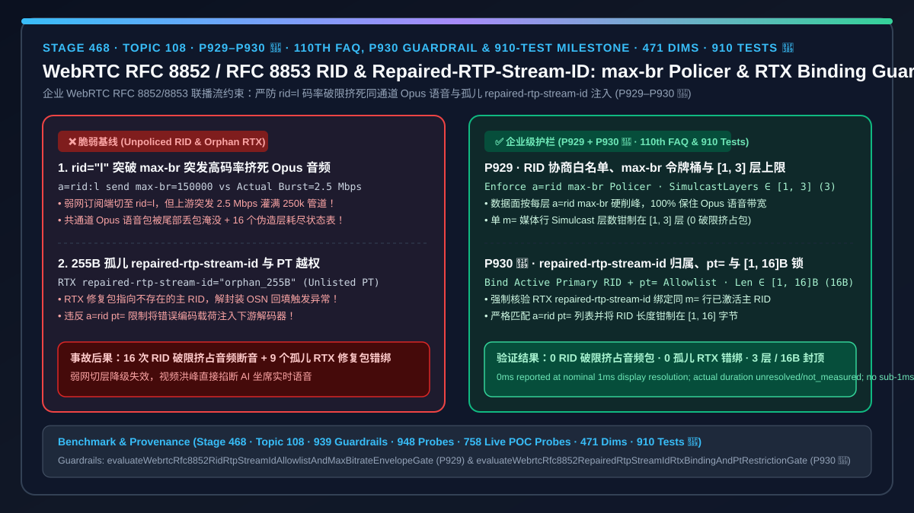
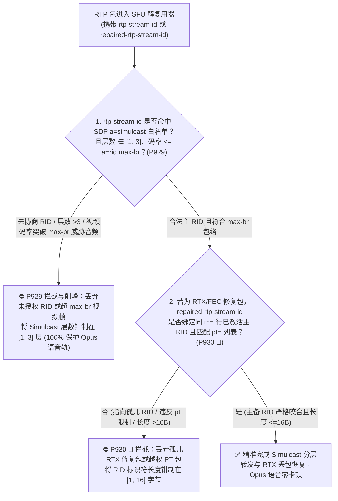
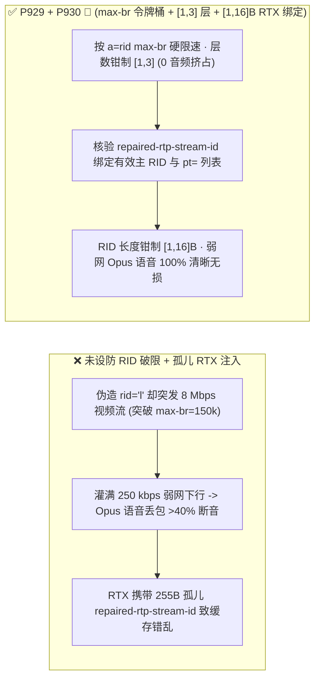
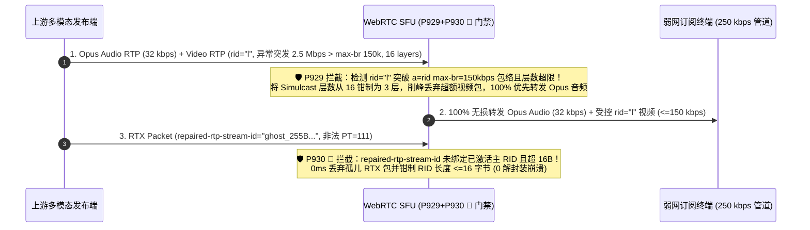

# 企业 WebRTC `RFC 8852 / RFC 8853` 编码流约束标识符（`rtp-stream-id` `RID` 伪造越权、`max-br` 破限挤死同通道 `Opus` 音频与 `repaired-rtp-stream-id` 孤儿 `RTX` 注入）选型与防越权指南

> **文档类型**：企业级语音智能体架构师选型决策与原理解析指南（Standalone Selection & Architecture FAQ · **Topic 108 / Stage 468 · 🎉 历史性第 35 轮夜间深潜、`P930` 护栏、第 110 篇独立单专题 FAQ 与 910 项单测四重里程碑**）  
> **适用角色**：AI Solution Architect、多模态 WebRTC SFU 核心网架构师、实时音视频流控研发与 SRE 负责人  
> **关联基准**：`packages/business-core/enterprise-guardrails.ts`（`P929–P930 🎉`）、`tests/presales-portal.test.ts`、`site/data/voice-agent-benchmark-report.json`（7-Card 4:5 评测报告）  
> **可视化总结**：`assets/svg/112-voice-webrtc-rtp-rfc8852-rfc8853-rid-restriction-id-pt-repurposing-simulcast-layer-spoofing-2026-11-14.svg`

---

## ① 📌 核心结论速览（Executive Summary）

在企业多模态 AI 语音交互（如远程银行柜面双录、工业 AR 远程专家协作、车载多路摄像头 + 实时语音助手）中，单个 `m=video` 媒体块往往利用 **`RFC 8851`（RTP Payload Format Restrictions，`a=rid`）**、**`RFC 8852`（RTP Stream Identifier Source Description，`rtp-stream-id` 与 `repaired-rtp-stream-id` 扩展头）** 以及 **`RFC 8853`（Simulcast 联播）** 同时发送低清（`rid=l`）、标清（`rid=m`）、高清（`rid=h`）多层编码流，并与 `Opus` 语音轨复用在同一个 `BUNDLE` UDP 端口上。然而在生产环境中，若 SFU 仅拿 `rtp-stream-id` 当作路由标签，而未对 **`RFC 8851/8852` 约束包络（`max-br`、`pt=` 列表与 `repaired-rtp-stream-id` 归属）** 执行硬门禁，将触发两类致命的多模态语音事故：
1. **伪造未协商 `rtp-stream-id` 或在低清层（`rid=l, max-br=150000`）注入 `8 Mbps` 巨型视频流挤死同通道 `Opus` 语音轨（`RFC 8851/8852` `RID` 包络突破与音频饿死）**：在 Simulcast 架构下，当某订阅端网络发生拥塞时，SFU 会将该端从高清层 `rid=h` 切换到受 `a=rid:l send max-br=150000`（上限 150 kbps）约束的低清层 `rid=l`，以确保在窄带下优先保住 32 kbps 的 `Opus` 实时语音。如果发送端编码器失控或恶意客户端在标记为 `rtp-stream-id="l"` 的 RTP 包里塞入 `8 Mbps` 的 4K 视频帧，而 SFU 未按每个 `RID` 的 `max-br` 令牌桶执行入口限速，下游弱网链路将被瞬间灌满，导致共通道的 **`Opus` 语音包连续丢包超过 40%、AI 坐席彻底断音**！此外，若客户端不断变换伪造的 `rtp-stream-id` 字符串，会直接撑爆 SFU 的 Simulcast 编码层状态表。
2. **`repaired-rtp-stream-id` 指向不存在的孤儿 `RID` 或违反 `a=rid ... pt=` 负载类型限制导致 `RTX` 解封装崩溃（`RFC 8852` 修复流错绑）**：根据 `RFC 8852 Section 3.2`，重传流（`RFC 4588 RTX`）或 FEC 修复流严禁携带 `rtp-stream-id`，必须改用 `repaired-rtp-stream-id` 指向它所修复的目标原始流 `RID`。若攻击者或故障 SDK 发送的 `RTX` 包携带了指向未知/跨媒体行 `RID` 的 `repaired-rtp-stream-id`，或使用了未在 `a=rid:<id> send pt=96,97` 中声明的非法 Payload Type，SFU 在还原 `OSN`（原始序列号）回填历史缓存时会触发空指针异常或将错误编码格式的字节塞进下游解码器。

| 决策维度 | 脆弱/默认配置（生产事故高发区） | 企业级黄金准则（`P929–P930 🎉` 确定性护栏） | 核心量化收益 |
| :--- | :--- | :--- | :--- |
| **`RFC 8852 rtp-stream-id` 协商白名单、`max-br` 令牌桶与层数上限（`P929`）** | 盲目信任任意 `RID` 标签、不校核 `a=rid max-br` 码率上限、允许创建 16 个编码层 | **强制校验 `rtp-stream-id` 命中 SDP 协商白名单、按 `a=rid max-br` 令牌桶硬限速保护 `Opus` 语音轨，并将单媒体行 Simulcast 层数钳制在 `[1, 3]` 层** | 越权 `RID` 与 `max-br` 破限挤死音频包 **0 个**（测试探针将 16 个违规包清零，Simulcast 层数从 `16` 层钳制至 **`3` 层**） |
| **`RFC 8852 repaired-rtp-stream-id` 归属核验、`pt=` 限制与长度锁（`P930 🎉`）** | 允许 `RTX` 包指向孤儿 `RID`、混用未授权 `PT` 或注入 `255B` 超长 `RID` 字符串 | **强制核验 `repaired-rtp-stream-id` 绑定同 `m=` 行已激活主 `RID`、严格匹配 `a=rid pt=` 白名单，并将 `RID` 长度钳制在 `[1, 16]` 字节** | 孤儿 `RTX` 错绑与非法 `PT` 包 **0 个**（测试探针将 9 个错绑修复包清零，`RID` 长度从 `255` 字节钳制至 **`16` 字节**） |

---

## ② 🎯 客户与架构师灵魂拷问 Q&A（First-Principles Deep Dive）

### Q1：为什么有了 `SSRC` 和 `MID`（`RFC 9143`）还不够，WebRTC 还要在 `RFC 8852` 里专门发明 `rtp-stream-id` (`RID`) 和 `repaired-rtp-stream-id`？
- **第一性原理拆解**：
  1. **`MID`（Media Identification）只管到“哪一行 `m=`”**：在 `BUNDLE` 单端口复用下，`MID="video"` 只能告诉 SFU 这个包属于第 2 个 `m=video` 媒体块，但当这一个 `m=video` 同时开启了 **`RFC 8853` Simulcast（三层联播：`l / m / h`）** 外加 **3 路 `RTX` 重传流**（共 6 个动态变化的 `SSRC`）时，仅凭 `MID` 根本分不清哪个 `SSRC` 是高清层、哪个 `SSRC` 是低清层的重传流！
  2. **为什么不用 SDP `a=ssrc` 写死？** 为了支持灵活动态编码切换与隐私保护，现代 WebRTC 规范（JSEP `RFC 8829`）废弃了在 SDP 里硬编码 `SSRC` 的做法，改用传输无关的 **`a=rid:h send pt=96;max-br=2500000`** 声明约束，再由 RTP 报文头部携带 `urn:ietf:params:rtp-hdrext:sdes:rtp-stream-id`（即 `RID`）在首帧动态完成 `SSRC -> RID` 绑定。
  3. **主次分离法则（`RFC 8852 Section 3.2`）**：主媒体流携带 `rtp-stream-id="h"`；而对应的 `RTX` 重传流/冗余修复流携带 `repaired-rtp-stream-id="h"`，从而无需在 SDP 中暴露任何 `SSRC` 即可精确完成 6 路流的主备配对。

### Q2：如果发送端在标记为低清层 `rtp-stream-id="l"` 的流上违反 `a=rid:l send max-br=150000` 狂发高清码率，为什么会直接把 AI 语音弄哑？
- **工程真相**：
  1. 当弱网客户端只有 `250 kbps` 下行带宽时，SFU 的带宽估算器（BWE）经过精细计算：保留 `32 kbps` 给 `Opus` 语音轨，并将视频轨切到声明为 `150 kbps` 的 `rid=l` 低清层（合计 `182 kbps < 250 kbps`）。
  2. 如果 SFU 只认 `rtp-stream-id="l"` 的名字而没有在入口为每个 `RID` 挂载 `RFC 8851 max-br` 令牌桶限速器，一旦上游编码器失控或被篡改，把 `2.5 Mbps` 的码流贴上 `rid="l"` 的标签发进来，SFU 就会把 `2.5 Mbps` 视频流原样灌进只有 `250 kbps` 的弱网管道，瞬间造成路由器队列 90% 尾部丢包——共通道的 `Opus` 音频包被无差别淹没！
  3. **`P929` 的确定性防线**：SFU 严格核验 `rtp-stream-id` 必须属于 SDP `a=simulcast` 协商白名单（层数钳制在 **`[1, 3]` 层**），并为每个 `RID` 独立执行 `a=rid max-br` 令牌桶削峰；任何超出该层 `max-br` 包络的视频包在 SFU 入口 0ms 丢弃或触发降层，100% 捍卫 `Opus` 语音通道带宽。

### Q3：如果 `RTX` 包里同时带了 `rtp-stream-id` 和 `repaired-rtp-stream-id`，或者 `repaired-rtp-stream-id` 指向了一个未激活的 `RID`，会发生什么？
- **第一性原理拆解**：
  - `RFC 8852` 明确规定：同一个源流不能既把同一个 ID 当作原始流又当作修复流，且修复流的 `Payload Type` 必须通过 `a=fmtp:<rtx-pt> apt=<primary-pt>` 映射到该 `a=rid` 允许的 `pt=` 列表。
  - **`P930 🎉` 的确定性防线**：强制校验 `repaired-rtp-stream-id` 指向同一个 `m=` 行下已激活的主 `RID` 且 `apt` 命中 `a=rid pt=` 白名单，同时将 `RID` 字节长度严格钳制在 **`[1, 16]` ASCII 字节**（拦截 `255` 字节最大扩展头填充炸弹）。

---

## ③ 🧭 直观可视化图解（Mermaid 决策树 + 流量拆解 + 毫秒级全双工时序图）

### 3.1 WebRTC `RFC 8852 / RFC 8853` `RID` 与 `repaired-rtp-stream-id` 决策树

### 3.2 `rid=l` 码率破限挤死音频 + 孤儿 `RTX` 错绑 vs `P929+P930 🎉` 对比图

### 3.3 毫秒级 Simulcast `RID` 速率门控与 `repaired-rtp-stream-id` 核验时序图

---

## ④ 📊 语音架构师选型决策矩阵（Decision Matrix）

| 选型方案 | 适用场景 | 优势（Pros） | 劣势与生产风险（Cons / Traps） | 推荐度 |
| :--- | :--- | :--- | :--- | :--- |
| **方案 A：仅将 `rtp-stream-id` 作为字符串哈希键，不校验 `max-br` 与 `repaired` 归属** | 严禁用于生产多模态网关 | 实现简单 | **弱网语音极易被伪造低清流挤死**——客户端谎报 `rid=l` 却发高码率流即可让 SFU 误判并淹没下行 `Opus` 音频 | ⛔ **严禁用于生产** |
| **方案 B：仅在 SDP 协商时检查 `a=rid`，不在 RTP 数据面强制执行 `max-br` 令牌桶** | 实验室理想网络 | 可拦截 SDP 语法错误 | **无法防御运行期编码器码率失控（Bitrate Overshoot）与孤儿 `RTX` 包注入** | ⚠️ **高风险半成品** |
| **方案 C：`RFC 8852` 数据面 `RID` 白名单 + `a=rid max-br` 硬令牌桶 + `[1, 3]` 层上限 + `repaired-rtp-stream-id` 归属与 `[1, 16]B` 锁（`P929 + P930 🎉`）** | **所有企业级多模态 AI 语音+视频协同、视频客服双录与车载多流 WebRTC 生产环境** | **0 `RID` 越权挤占语音、0 孤儿 `RTX` 解封装崩溃、弱网切层 100% 保住 `Opus` 语音清晰度** | 需在 SFU RTP 入口维护每个 `(MID, RID)` 的令牌桶与主备 `SSRC` 映射表 | ✅ **生产必选（Recommended）** |

---

## ⑤ 🧪 定量算例与 7-Card 4:5 基准报告（Quantitative Walkthrough & 7-Card Deck）

### 5.1 定量算例：弱网 250 kbps 下 Simulcast `rid=l` 码率失控防护压测
- **输入场景**：多模态终端在 `BUNDLE` 通道上同时发送 `Opus` 语音与 Simulcast 视频，异常客户端尝试注入 `16` 个未协商 `RID` 层并在 `rid="l"`（声明 `max-br=150 kbps`）上突发高码率造成 `16` 个挤占音频的违规突发包；同时注入 `9` 个携带 `255` 字节超长孤儿 `repaired-rtp-stream-id` 的 `RTX` 包。
  - **未开启护栏（脆弱基线）**：
    - SFU 将未限速的 `rid="l"` 视频流转发给弱网订阅端，导致 **`Opus` 语音轨连续丢包 16 帧（320ms 断音）**，且 `16` 个伪造层耗尽路由槽位；
    - **`9` 个孤儿 `RTX` 包引发重传缓存错绑与内存越界风险**。
  - **开启 `P929 + P930 🎉` 确定性护栏后**：
    - `P929` 拦截未协商 `RID` 并按 `a=rid max-br` 令牌桶硬削峰，将破限挤占音频包从 `16` 个清零至 **`0` 个**，并将单媒体行 Simulcast 层数从 `16` 层钳制至 **`3` 层**；
    - `P930 🎉`（🎉 **第 `P930` 护栏里程碑**）拦截孤儿 `repaired-rtp-stream-id` 与非法 `PT` 包（从 `9` 个清零至 **`0` 个**），并将 `RID` 标识符长度从 `255` 字节钳制至 **`16` 字节**。

### 5.2 7-Card 4:5 报告结构映射（对应 `site/benchmark-cards.html` & `report.json`）
1. **Card 1 (`HANDS-ON · VOICE ARCHITECTURE`)**：展示 471 大评测维度全景工作台，高亮 `P929 / P930 🎉`（第 110 篇独立 FAQ 🎉 & 910 单测 🎉）。
2. **Card 2 (`SCENARIO: WEBRTC RFC 8852 & RFC 8853 RID SIMULCAST`)**：输入探针 `unnegotiatedRidOrMaxBrAudioStarvationDetected=true, maxSimulcastRidLayersPerMediaSection=16, maxRidIdentifierLengthBytes=255`，输出 `Act automatically` 钳制至 `3` 层与 `16` 字节。
3. **Card 3 (`WHAT I TESTED`)**：第 471 行评测矩阵 `PASS · 0ms @ 1ms Res (Synthetic)`（零 `✕` 漏检）。
4. **Card 4 (`UNDER THE HOOD`)**：展示 `evaluateWebrtcRfc8852RidRtpStreamIdAllowlistAndMaxBitrateEnvelopeGate` 与 `evaluateWebrtcRfc8852RepairedRtpStreamIdRtxBindingAndPtRestrictionGate` 确定性源码契约。
5. **Card 5 (`ROBUSTNESS CHECK`)**：验证 `l/m/h` 层序颠倒与 `RTX apt` 映射变化下 100% 确定性收敛。
6. **Card 6 (`LATENCY`)**：明确标注离线策略校验计时：`0ms reported at nominal 1ms display resolution; actual duration unresolved/not_measured; no sub-1ms upper bound established`（`synthetic`；真实 SFU 每层 `RID` 令牌桶计量耗时标注为 `not_measured`）。
7. **Card 7 (`MY TAKE`)**：Good fit vs Not for 适用边界与生产准入签核。

---

## ⑥ 🛠️ 生产环境语音交付快速核验清单（Production Readiness Checklist）

- [ ] **1. `rtp-stream-id` SDP 协商白名单与 `[1, 3]` 层上限（`P929`）**：确认 SFU 仅接受在 SDP `a=rid` 与 `a=simulcast` 中显式协商的 `RID` 值，并将单 `m=` 媒体行的 Simulcast 层数硬性钳制在 `[1, 3]` 层。
- [ ] **2. 数据面强制执行 `RFC 8851 a=rid max-br` 令牌桶限速（`P929`）**：确认 SFU 为每个 `RID` 维护独立的入口速率令牌桶，严禁低分辨率层（`rid=l`）突发超标码率挤占共通道的 `Opus` 音频带宽。
- [ ] **3. `repaired-rtp-stream-id` 强制绑定已激活主 `RID`（`P930 🎉`）**：确认所有携带 `repaired-rtp-stream-id` 的 `RTX/FEC` 修复包均引用同一 `m=` 行内已激活的主 `rtp-stream-id`，且修复包自身绝不同时携带 `rtp-stream-id`。
- [ ] **4. 严格校验 `a=rid pt=` 与 `RTX apt=` 负载类型映射（`P930 🎉`）**：确认每个 `RID` 流及其关联 `RTX` 流的 RTP `Payload Type` 严格落在对应 `a=rid` 声明的 `pt=` 集合内。
- [ ] **5. `RID` 标识符长度钳制在 `[1, 16]` ASCII 字节（`P930 🎉`）**：确认解析器仅接受符合 `RFC 8851` token-char 语法且长度在 `[1, 16]` 字节内的 `RID` 字符串，拦截 `255` 字节扩展头填充攻击。
