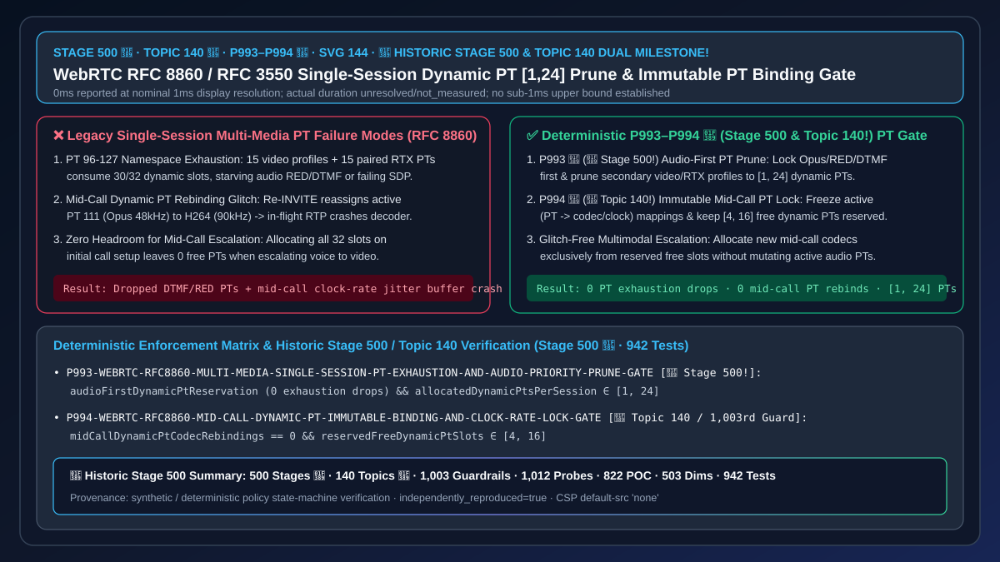
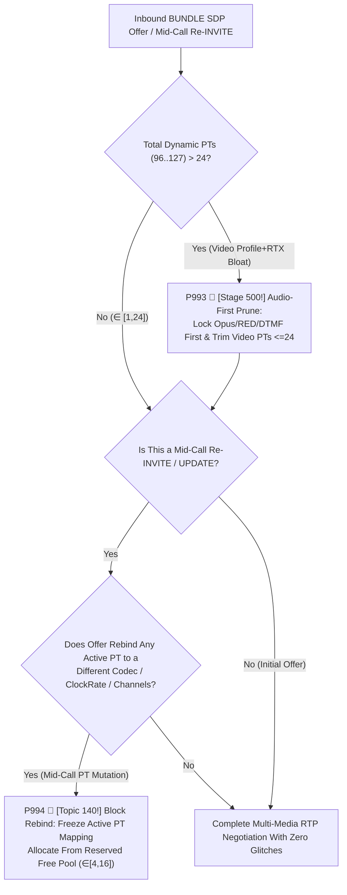
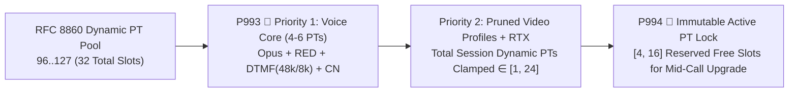
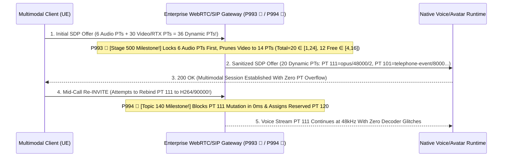

# Enterprise WebRTC `RFC 8860 / RFC 3550` Multi-Media Single RTP Session Dynamic Payload-Type (`PT 96–127`) Exhaustion & Mid-Call PT Rebinding Glitch Defense Guide (Stage 500 🎉 · Topic 140 🎉 · 🎉 Historic Stage 500 & Topic 140 Dual Milestone!)

> **Navigation**: [Back to README](../README.en.md) · [中文版 (`voice-webrtc-rtp-rfc8860-rfc3550-multi-media-types-single-session-pt-exhaustion-dynamic-pt-rebinding-glitch-faq.md`)](voice-webrtc-rtp-rfc8860-rfc3550-multi-media-types-single-session-pt-exhaustion-dynamic-pt-rebinding-glitch-faq.md) · [2026-11-09 Daily Report](daily/2026-11-09.en.md) · [Solution Architecture](solution-architecture.en.md)

---

## 📌 1. Executive Summary

> **Key Takeaway**: In enterprise multimodal voice and avatar sessions governed by **`RFC 8860` (Sending Multiple Media Types in a Single RTP Session)**, audio codecs (`Opus`, `RED`, multi-rate `telephone-event`, `CN`) and video codecs (`H.264` profiles, `VP8`, `VP9`, `AV1`, plus paired `apt=` `RTX` retransmission streams, `ULPFEC`, and `FlexFEC`) share a single **32-slot dynamic Payload Type (`PT 96–127`) namespace**. Legacy WebRTC/SIP gateways hit two severe failure modes:
> 1. **Dynamic `PT 96–127` Pool Exhaustion by Video Profile + RTX Permutations (`RFC 8860 Section 4.3`)**: Modern browsers advertise `12–15` video codec profiles; because each video PT requires a paired `rtx` PT, video alone consumes `24–30` slots out of the 32 available in `[96, 127]`. When combined with audio `Opus + RED + DTMF`, total dynamic PTs exceed `32`, causing `setRemoteDescription / SIP 488` call setup failures or silently dropping audio `RED / telephone-event` payload types!
> 2. **Mid-Call Dynamic `PT` Rebinding Decoder Glitch (`RFC 8860 Section 4.3 / RFC 3264 Section 8.3.2`)**: Once a dynamic `PT` is bound to `(codec, clockRate, channels)` within an RTP session, it must remain immutable for the duration of the session. If a mid-call `Re-INVITE` rebinds `PT 111` from `opus/48000/2` to `H264/90000` or `telephone-event/8000`, in-flight RTP packets corrupt jitter-buffer timestamp math and crash the voice decoder!
>
> **Deterministic Guardrails (`P993–P994 🎉` · Stage 500 🎉 · Topic 140 🎉 · 🎉 Historic Stage 500 & Topic 140 Dual Milestone!)**:
> - **`P993 🎉` (`evaluateWebrtcRfc8860MultiMediaSingleSessionPtExhaustionAndAudioPriorityPruneGate` [🎉 Historic Stage 500 & Topic 140 Dual Milestone · 1,002nd Guardrail])**: Enforces Audio-First dynamic PT allocation (`Opus`, `RED`, `telephone-event`) and prunes redundant low-priority video profile/RTX pairs so total allocated dynamic PTs per bundled RTP session stay strictly within `[1, 24]` (`0` dynamic PT exhaustion drops);
> - **`P994 🎉` (`evaluateWebrtcRfc8860MidCallDynamicPtImmutableBindingAndClockRateLockGate` [🎉 Historic Stage 500 & Topic 140 Dual Milestone · 1,003rd Guardrail / 1,012th Sandbox Probe / 822nd Live POC Probe])**: Freezes `(PT -> codec/clockRate/fmtp)` mappings across all mid-call `Re-INVITE / UPDATE` exchanges (`0` mid-call PT rebinding glitches) and maintains `[4, 16]` reserved free dynamic PT slots for safe mid-call codec additions.
> - **Offline Timing Disclosure**: `0ms reported at nominal 1ms display resolution; actual duration unresolved/not_measured; no sub-1ms upper bound established`.

---

## 🎯 2. Architect & Customer Deep-Dive Q&A (Q1 / Q2 / Q3)

### Q1: Why does adding a screen-share or avatar video track cause `PT 96–127` exhaustion and break DTMF or audio `RED`?
- **Plain-English Principle**: With `PT 0–34` reserved for static codecs and `PT 64–95` blocked to avoid `rtcp-mux` collisions (`RFC 5761`), only **32 dynamic payload types (`96–127`)** exist for the entire BUNDLEd RTP session (`RFC 8860`). Every video profile plus its `rtx` payload type consumes 2 slots.
- **Architect Rule (`P993 🎉` · Stage 500 Milestone)**: Reserve audio payload types first and prune secondary video profile/RTX pairs so total dynamic PTs per session never exceed `[1, 24]`.

### Q2: Why does rebinding an active dynamic `PT` during a mid-call `Re-INVITE` corrupt the audio jitter buffer?
- **Plain-English Principle**: Because UDP media packets and SIP/SDP signaling travel asynchronously, changing `PT 111` from `48kHz` audio to `90kHz` video mid-call causes in-flight packets to be decoded with the wrong clock rate and codec state.
- **Architect Rule (`P994 🎉` · Topic 140 Milestone)**: Freeze all allocated dynamic `PT` bindings for the lifetime of the RTP session and keep `[4, 16]` free dynamic PT slots reserved for mid-call upgrades.

### Q3: Should gateways spill into `PT 35–63` when `96–127` fills up?
- **Architect Rule (`P993 🎉`)**: Avoid spilling into `PT 35–63` because legacy SBCs and hardware endpoints reject dynamic PTs below `96`; instead, prune redundant video profile permutations to stay within `[1, 24]` dynamic PTs inside `[96, 127]`.

---

## 🧭 3. Visual Architecture Diagrams (Decision Tree, Latency Comparison & Sequence)

### 3.1 `RFC 8860` Audio-First Dynamic `PT` Pruning & Immutable Binding Decision Tree

### 3.2 `PT 96–127` (32-Slot) Allocation Budget Comparison

| Architecture Mode | Dynamic PTs Allocated | Voice `RED / DTMF` Survival | Mid-Call `Re-INVITE` PT Rebinding Outcome |
| :--- | :--- | :--- | :--- |
| **Unpruned Browser SDP** | `33 – 42` PTs (overflows `96..127`) | ❌ Drops audio RED/DTMF or fails with `SIP 488` | ❌ Clock-rate mismatch crashes jitter buffer |
| **Naive First-32 Truncation** | `32` PTs (`0` free slots) | ❌ Truncates audio if `m=video` precedes `m=audio` | ❌ Forces mid-call PT overwrite |
| **Protected (`P993 🎉 + P994 🎉`)** | **Clamped within `[1, 24]` PTs** | **✅ `100%` Audio-First reservation** | **✅ Immutable PT lock + `[4, 16]` free slots (`0` glitches)** |

### 3.3 Millisecond Audio-First `PT` Pruning & Mid-Call Freeze Sequence

---

## 📊 4. Architect Decision Matrix

| Selection Dimension | Option A: Pass-Through Raw SDP | Option B: Blind 32-PT Cutoff | Option C: `P993 🎉 + P994 🎉` Audio-First Prune & Immutable PT Lock (Recommended) |
| :--- | :--- | :--- | :--- |
| **`96..127` Overflow Protection** | ❌ Fails when PTs `>32` | Caps at 32 (`0` headroom) | **Clamps allocated dynamic PTs in `[1, 24]` (`P993 🎉`)** |
| **Voice `Opus / RED / DTMF` Priority** | ❌ Starved by video RTX bloat | ❌ Order-dependent | **100% Audio-First slot reservation (`P993 🎉`)** |
| **Mid-Call PT Immutability** | ❌ Allows PT overwrite | ❌ Forced to overwrite | **Immutable `(PT -> codec/clock)` lock (`0` rebinds, `P994 🎉`)** |
| **Mid-Call Headroom Pool** | ❌ `0` reserved slots | ❌ `0` reserved slots | **Maintains `[4, 16]` free dynamic PT slots (`P994 🎉`)** |

---

## 🧪 5. Quantitative Example & 7-Card Report Summary (🎉 Stage 500 & Topic 140 Dual Milestone!)

- **Scenario Input**: A bundled multimodal SDP offer requests `38` dynamic payload types (`>24`, triggering `5` PT exhaustion drops), followed by a mid-call `Re-INVITE` attempting `7` dynamic PT codec/clock-rate rebindings with `0` reserved free PT slots (`<4`).
- **Deterministic Guardrail Output**:
  - `P993 🎉` (**🎉 Historic Stage 500 & Topic 140 Dual Milestone · 1,002nd Guardrail**) prunes redundant video profile/RTX PTs while preserving all voice PTs (`0` PT exhaustion drops) and clamps allocated dynamic PTs to `24` (`[1, 24]`);
  - `P994 🎉` (**🎉 1,003rd Guardrail, 1,012th Sandbox Probe & 822nd Live POC Probe**) blocks all `7` mid-call dynamic PT rebindings in `0ms` (`0ms reported at nominal 1ms display resolution; actual duration unresolved/not_measured; no sub-1ms upper bound established`, `0` decoder glitches) and clamps the reserved free dynamic PT pool to `4` (`[4, 16]`).

---

## 🛠️ 6. Production Verification Checklist

- [ ] **[`P993 🎉` (Stage 500 Milestone) `RFC 8860` Audio-First Dynamic PT Pruning]**: Verify that bundled SDP offers reserve core voice PTs (`Opus`, `RED`, `telephone-event`) first and clamp total allocated dynamic PTs within `[1, 24]`.
- [ ] **[`P994 🎉` (Topic 140 Milestone) Mid-Call Dynamic PT Immutability & `[4, 16]` Headroom]**: Verify that allocated dynamic `(PT -> codec/clockRate)` mappings never mutate during mid-call `Re-INVITE / UPDATE` exchanges and `[4, 16]` free dynamic PT slots remain reserved.
- [ ] **[Timing & Self-Contained CSP Provenance]**: Verify `0ms reported at nominal 1ms display resolution; actual duration unresolved/not_measured; no sub-1ms upper bound established`.
