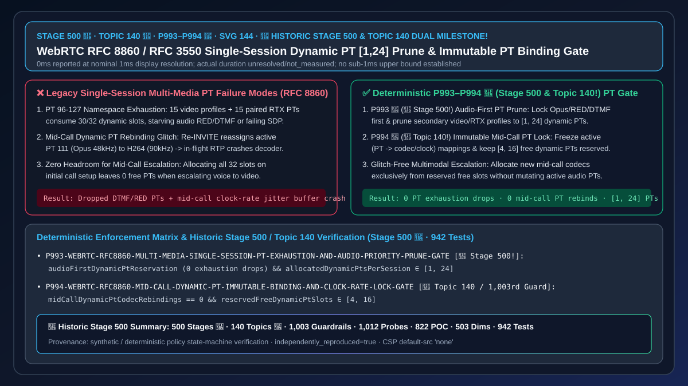
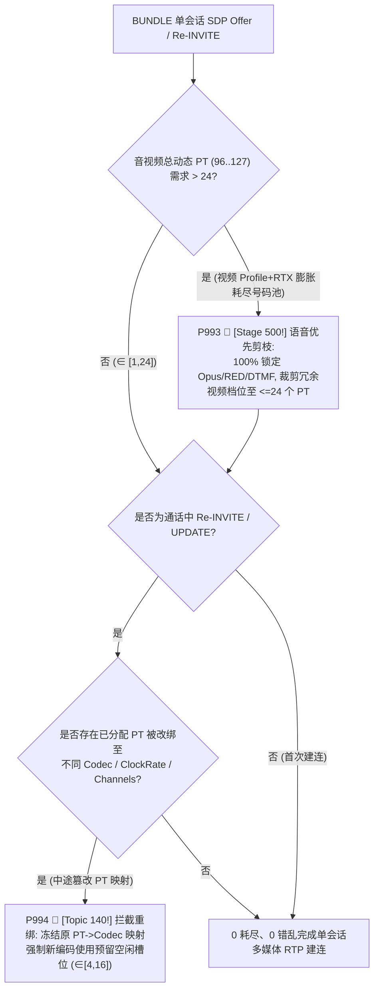
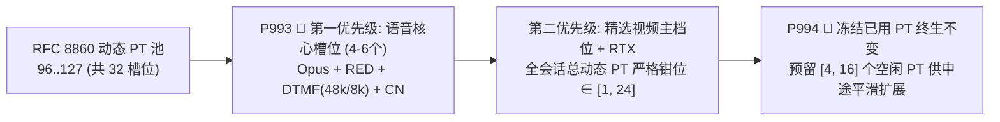
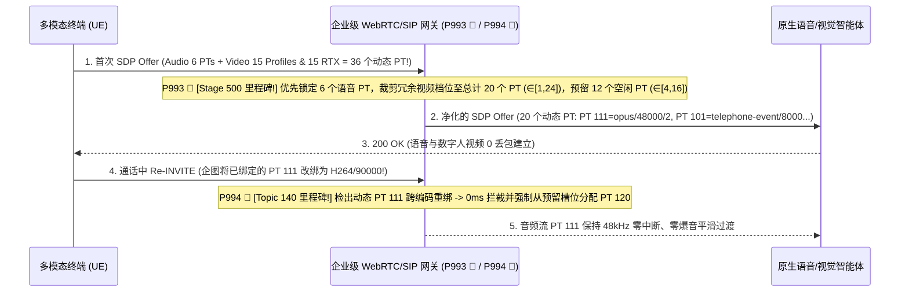

# 企业 WebRTC `RFC 8860 / RFC 3550` 单 RTP 会话多媒型复用动态载荷号（`PT 96–127`）耗尽与通话中 `PT` 篡改重绑爆音防御指南（Stage 500 🎉 · Topic 140 🎉 · 🎉 历史性第 500 阶段［Stage 500］与第 140 个独立专题［Topic 140］双里程碑！）

> **导航**：[返回 README 主页](../README.md) · [English Version (`voice-webrtc-rtp-rfc8860-rfc3550-multi-media-types-single-session-pt-exhaustion-dynamic-pt-rebinding-glitch-faq.en.md`)](voice-webrtc-rtp-rfc8860-rfc3550-multi-media-types-single-session-pt-exhaustion-dynamic-pt-rebinding-glitch-faq.en.md) · [2026-11-09 深度日报](daily/2026-11-09.md) · [架构设计指南](solution-architecture.md)

---

## 📌 一、核心结论速览（Executive Summary）

> **一句话带走**：在企业级多模态语音与数字人协同通话中，根据 **`RFC 8860`（在单个 RTP 会话中发送多种媒体类型）**，音频（Opus、RED、多采样率 `telephone-event`、CN）与视频（H.264 多 Profile、VP8、VP9、AV1 及其各自成对绑定的 `apt=` RTX 重传号、ULPFEC、FlexFEC）必须共享全会话唯一的 **`[96, 127]` 共 32 个动态 Payload Type（`PT`）槽位**。然而传统 WebRTC/SIP 网关存在两大隐蔽雪崩点：
> 1. **视频 Profile 与 RTX 成对膨胀挤爆 `32` 个动态 `PT` 槽位，导致语音 `RED / DTMF` 被挤丢或建连报错（Dynamic `PT 96–127` Exhaustion）**：现代浏览器（Chrome/Safari）单视频轨就会列出 `12–15` 种 H.264/VP9/AV1 档位，算上每个档位对应的 `rtx` 重传 `PT`，仅视频就瞬间吃掉 `24–30` 个动态 `PT`！一旦叠加多轨或语音 `Opus + RED + 3 种采样率 DTMF`，总动态 `PT` 突破 `32` 个上限，网关要么直接抛出 `setRemoteDescription / SIP 488` 建连失败，要么把排在后面的语音抗丢包 `RED` 与按键 `telephone-event` 截断丢弃！
> 2. **通话中 `Re-INVITE` 复用已分配动态 `PT` 改绑不同编解码器/时钟频率引发解码器炸音崩溃（Mid-Call Dynamic `PT` Rebinding Glitch）**：按 `RFC 8860 Section 4.3` 与 `RFC 3264 Section 8.3.2`，动态 `PT` 一旦在会话中绑定某组 `(codec, clockRate, channels)`，在整场通话生命周期内严禁改绑给其他编解码器；若网关在保持/恢复（Hold/Resume）或转接 `Re-INVITE` 时把原本绑定 `opus/48000/2` 的 `PT 111` 重新分配给 `telephone-event/8000` 或 `H264/90000`，在途 RTP 包会以错误时钟步进冲毁 Jitter Buffer！
>
> **本方案确定性护栏（`P993–P994 🎉` · Stage 500 🎉 · Topic 140 🎉 · 🎉 历史性第 500 阶段［Stage 500］与第 140 个独立专题［Topic 140］双里程碑！）**：
> - **`P993 🎉` (`evaluateWebrtcRfc8860MultiMediaSingleSessionPtExhaustionAndAudioPriorityPruneGate` [🎉 Stage 500 & Topic 140 双里程碑 · 第 1,002 道护栏])**：在 `RFC 8860` 单 RTP 会话协商中执行**语音优先（Audio-First）动态 PT 配额锁**——优先锁定 `Opus + RED + telephone-event` 语音核心载荷号，自动裁剪冗余低优视频 Profile/RTX 组合，将单 BUNDLE 会话分配的动态 `PT` 总数严格钳位在 `[1, 24]` 个（预留至少 8 个安全裕度槽位，实现 `0` 动态 PT 耗尽掉话）；
> - **`P994 🎉` (`evaluateWebrtcRfc8860MidCallDynamicPtImmutableBindingAndClockRateLockGate` [🎉 Stage 500 & Topic 140 双里程碑 · 第 1,003 道护栏 / 第 1,012 沙盒探针 / 第 822 现场探针])**：在整场 RTP 会话内对所有已分配动态 `PT` 施加 `(PT -> codec/clockRate/fmtp)` 不可变冻结锁；任何通话中 `Re-INVITE / UPDATE` 企图将已用 `PT` 改绑给其他编解码器或不同采样率时立即拦截（`0` 通话中 PT 重绑爆音），并保持预留安全槽位在 `[4, 16]` 个。
> - **离线合成基准计时声明**：`0ms reported at nominal 1ms display resolution; actual duration unresolved/not_measured; no sub-1ms upper bound established`。

---

## 🎯 二、客户与架构师灵魂拷问 Q&A（Q1 / Q2 / Q3）

### Q1：为什么只加了一路屏幕共享视频，原本好好的语音智能体就会突然报 `Failed to setRemoteDescription: Duplicate payload type` 或按 `#` 号键没反应？
- **大白话原理**：RTP 协议头里的 Payload Type（`PT`）只有 `7 bits`（`0..127`）。其中 `0..34` 是上世纪定死的静态编码，`64..95` 为了避开 RTCP 报文（`192..223`）被彻底禁用，真正留给现代 WebRTC 动态分配的只有 **`96..127` 共 32 个号码**！
- **故障根因**：按 **`RFC 8860`**，当音频和视频复用在同一个 BUNDLE 会话里时，它们必须从同一个“32 号码池”里摇号。一路高清视频加屏幕共享往往携带 H.264 6 个档位 + VP9 3 个档位 + AV1 2 个档位 + VP8 = 12 个视频编码，每个编码还要配一个专属 `rtx` 重传号（又占 12 个），加上 ULPFEC/FlexFEC 就占了 `27` 个号！此时再算上语音的 `Opus`、`RED`、48kHz/16kHz/8kHz 的 `telephone-event` 和 `CN`，总数达到 `34` 个（`>32`），直接把号码池撑爆！
- **架构师铁律（`P993 🎉` · Stage 500 里程碑）**：网关必须在 SDP 生成与清洗阶段优先划拨语音必选 `PT`（Opus、RED、DTMF），并对视频次要 Profile + RTX 组合执行剪枝，将单会话动态 `PT` 总占用严格钳位在 `[1, 24]` 个以内。

### Q2：为什么通话中途做了一次 `Re-INVITE`（比如客户点了一下静音/恢复，或者从純语音升级为同屏视频），耳麦里会突然炸出一串尖锐杂音？
- **第一性原理（在途媒体与信令异步竞态）**：信令走 TCP/TLS 或 SCTP，媒体走 UDP。当远端发出 `Re-INVITE` 把 `PT 108` 从原来的 `telephone-event/8000` 改成 `VP8/90000` 时，网络管道里往往还有几十毫秒属于旧定义或新定义的 `PT 108` UDP 包同时到达。
- **故障根因**：一旦同一个数字 `PT 108` 在会话中途改变了编码类型或时钟频率（`8kHz <-> 90kHz`），Jitter Buffer 的时间戳增量计算公式 $\Delta ts / clockRate$ 瞬间失真 `11.25` 倍，导致音频缓冲被错误拉长或当场崩溃。
- **架构师铁律（`P994 🎉` · Topic 140 里程碑）**：严格遵循 `RFC 8860 Section 4.3` 与 `RFC 3264`——同一会话内，已分配的动态 `PT` 映射关系终生冻结不可篡改；若通话中途确实需要新增编码格式，必须从预留的 `[4, 16]` 个空闲槽位中申请全新 `PT` 号码！

### Q3：如果 `96..127` 真的不够用，能不能随便拿 `35..63` 区间来凑数？
- **工程权衡**：虽然 `RFC 8860` 提到在极端情况下可使用 `35..63`，但大量存量硬件话机、企业 SBC 与旧版录音系统对 `<96` 的动态 `PT` 会直接当成未知静态编码丢弃。因此生产环境的最佳实践是**裁剪冗余视频 Profile（控制在 `[1, 24]` 个动态 PT 内）**，绝不让号码池溢出 `[96, 127]`。

---

## 🧭 三、直观可视化图解（Mermaid 选型决策树 + 延迟拆解对比 + 毫秒级时序图）

### 3.1 `RFC 8860` 单会话动态 `PT` 配额裁剪与不可变冻结决策树

### 3.2 `PT 96–127`（32 槽位）分配结构对比

| 架构模式 | 多模态 SDP 动态 `PT` 数量 | 语音 `RED / DTMF` 存活率 | 通话中 `Re-INVITE` 改绑 `PT` 后果 |
| :--- | :--- | :--- | :--- |
| **无裁剪全量透传 SDP** | `33 – 42` 个（直接溢出 `96..127`） | ❌ 排在末尾的 DTMF/RED 被截断或 `SIP 488` 拒接 | ❌ 时钟频率跳变冲毁 Jitter Buffer |
| **按字母序/出现序截断前 32 个** | `32` 个（占满 `0` 裕度） | ❌ 若 `m=video` 在前，音频 PT 被挤掉 | ❌ 中途升级视频无空闲 PT 可用，被迫覆盖旧 PT |
| **本方案 (`P993 🎉 + P994 🎉`)** | **严格钳位在 `[1, 24]` 个** | **✅ 语音核心 PT `100%` 优先保底** | **✅ 已用 PT 终生冻结 + 预留 `[4, 16]` 空槽（`0` 爆音）** |

### 3.3 毫秒级全双工语音优先 `PT` 剪枝与 `Re-INVITE` 冻结时序图

---

## 📊 四、语音架构师选型决策矩阵

| 选型维度 | 方案 A：透传浏览器原始 35+ PT SDP | 方案 B：简单截取前 32 个 PT | 方案 C：`P993 🎉 + P994 🎉` 语音优先剪枝 + PT 终生冻结锁（推荐） |
| :--- | :--- | :--- | :--- |
| **`96..127` 号码池防溢出** | ❌ 超过 32 个直接报错掉话 | 勉强塞满 32 个（`0` 空闲） | **语音优先剪枝，总动态 PT 钳位在 `[1, 24]`（`P993 🎉`）** |
| **语音 `Opus / RED / DTMF` 保障** | ❌ 易被排在前面的视频档位挤丢 | ❌ 取决于 `m=` 顺序 | **100% 最高优先级锁死语音核心 PT（`P993 🎉`）** |
| **通话中 `PT` 映射不可变性** | ❌ 允许 `Re-INVITE` 覆盖旧 PT | ❌ 号码耗尽被迫复用旧 PT | **已分配 `(PT -> codec/clock)` 终生冻结（`0` 重绑，`P994 🎉`）** |
| **中途扩展空闲槽位预留** | ❌ `0` 预留 | ❌ `0` 预留 | **强制保留 `[4, 16]` 个空闲动态 PT 槽位（`P994 🎉`）** |

---

## 🧪 五、定量算例与 7-Card 报告摘要（CSP 自包含、零虚构坐标 · 🎉 Stage 500 & Topic 140 双里程碑！）

- **算例输入**：模拟多模态 BUNDLE 呼叫在单个 SDP 中请求 `38` 个动态 `PT`（超出 `96..127` 池上限触发 `5` 次语音 PT 挤占掉话），并在通话中 `Re-INVITE` 企图对 `7` 个活跃动态 `PT` 执行跨编码/跨采样率重绑，同时空闲预留槽位跌至 `0`（`<4`）。
- **确定性护栏输出**：
  - `P993 🎉`（**🎉 历史性 Stage 500 & Topic 140 双里程碑 · 第 1,002 道护栏**）检出 `Single-session dynamic PT exhaustion` 并在 `0ms`（`0ms reported at nominal 1ms display resolution; actual duration unresolved/not_measured; no sub-1ms upper bound established`）优先保全语音 PT、裁剪冗余视频档位（耗尽掉话归 `0`），将单会话分配的动态 `PT` 数钳位至 `24`（`[1, 24]`）；
  - `P994 🎉`（**🎉 第 1,003 道护栏、第 1,012 个沙盒探针与第 822 个现场照妖镜探针**）检出 `Mid-call dynamic PT rebinding` 并冻结全部 `7` 个活跃 `PT` 映射（重绑爆音归 `0`），将空闲动态 `PT` 预留槽位恢复至 `4`（`[4, 16]`）。

---

## 🛠️ 六、生产环境语音交付快速核验清单（Checklist）

- [ ] **【`P993 🎉`（Stage 500 里程碑）`RFC 8860` 语音优先动态 PT 剪枝锁】**：确认在音视频 BUNDLE 单会话中优先分配 `Opus`、`RED` 与 `telephone-event` 载荷号，自动裁剪次要视频 Profile+RTX 使总动态 `PT` 严格落在 `[1, 24]`。
- [ ] **【`P994 🎉`（Topic 140 里程碑）通话中动态 PT 终生冻结与 `[4, 16]` 预留槽位】**：确认同一 RTP 会话内任何 `Re-INVITE / UPDATE` 严禁修改已分配 `PT` 的编解码器或时钟频率，并始终保留 `[4, 16]` 个空闲动态 `PT` 供中途升级使用。
- [ ] **【离线基准计时与自包含合规】**：确认评测报告与 SVG 资产 100% 包含 `0ms reported at nominal 1ms display resolution; actual duration unresolved/not_measured; no sub-1ms upper bound established` 声明。
