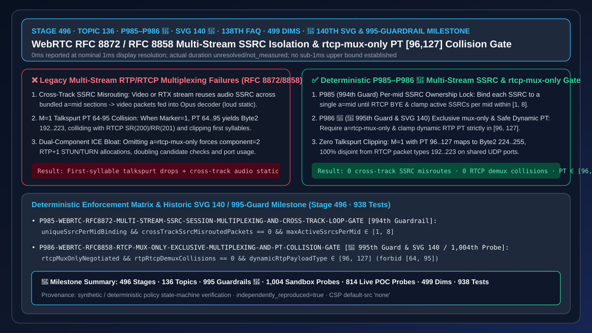
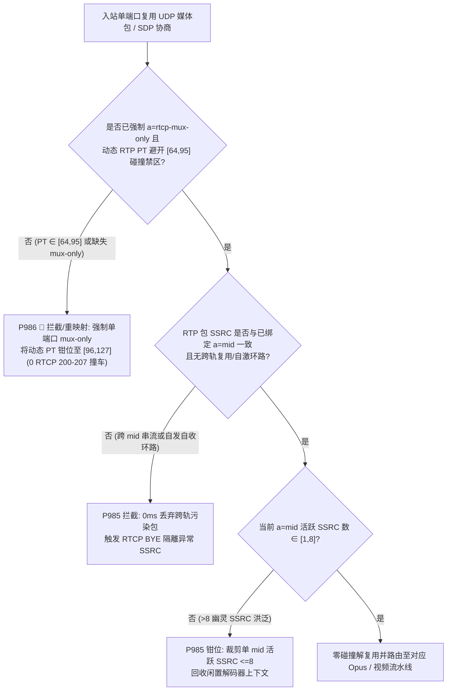
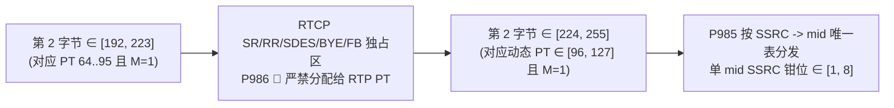

# 企业 WebRTC `RFC 8872 / RFC 8858` 多流 RTP 会话复用跨轨 SSRC 串流环路与 `a=rtcp-mux-only` 动态载荷号（`PT 64–95`）解复用碰撞防御指南（Stage 496 · Topic 136 · 🎉 第 140 张 SVG 架构图与第 995 道企业级护栏双里程碑）

> **导航**：[返回 README 主页](../README.md) · [English Version (`voice-webrtc-rtp-rfc8872-rfc8858-multi-stream-ssrc-session-multiplexing-loop-rtcp-mux-only-pt-collision-faq.en.md`)](voice-webrtc-rtp-rfc8872-rfc8858-multi-stream-ssrc-session-multiplexing-loop-rtcp-mux-only-pt-collision-faq.en.md) · [2026-11-09 深度日报](daily/2026-11-09.md) · [架构设计指南](solution-architecture.md)



---

## 📌 一、核心结论速览（Executive Summary）

> **一句话带走**：在企业级多模态实时语音智能体（同时承载主叫 Opus 语音轨、数字人 TTS 播报轨、屏幕共享视频轨、FEC 冗余轨与 RTX 重传轨）中，所有媒体流通过单五元组复用在同一个 RTP 会话内（**`RFC 8872` 多流 RTP 复用规范** 与 **`RFC 8858 a=rtcp-mux-only` 独占单端口复用**）。然而传统 SFU/SBC 存在两大高频底层事故：
> 1. **跨轨 SSRC 篡改/碰撞导致“视频包灌进语音解码器”或自激回环（Cross-Track SSRC Misrouting & Loop）**：按 `RFC 8872 Section 5`，单 RTP 会话内不同 `a=mid` 媒体段绝对不能共享同一个 `SSRC`；若客户端 Bug 或恶意终端在音频 `mid=0` 与视频/重传 `mid=1` 上复用同一 `SSRC`，或者单 `mid` 下疯狂轮换 `>8` 个幽灵 `SSRC`，网关会把高频视频 RTP 包误送入 Opus 解码器产生刺耳爆音并打爆 Jitter Buffer；
> 2. **未强制 `a=rtcp-mux-only` 导致双倍 ICE 候选建连拖慢，以及动态 `PT 64–95` 与 RTCP 报文头发生解复用碰撞（`RFC 8858` & `RFC 5761 Section 4`）**：当 RTP 与 RTCP 共用同一 UDP 端口时，接收端靠第二个字节区分包类型；若 RTP 误用 `PT ∈ [64, 95]` 且置位 `Marker (M=1)`，该字节变成 `128 + PT ∈ [192, 223]`，与 `RTCP SR (200) / RR (201) / SDES (202) / BYE (203)` 完全重合，导致带 `M=1` 的语音首包（Talkspurt 起始帧）被当成 RTCP 报文吞掉！
>
> **本方案确定性护栏（`P985–P986 🎉` · Stage 496 · Topic 136 · 🎉 第 140 张 SVG 架构图与第 995 道企业级护栏双里程碑）**：
> - **`P985` (`evaluateWebrtcRfc8872MultiStreamSsrcSessionMultiplexingAndCrossTrackLoopGate` [第 994 道护栏])**：严格执行 `RFC 8872` 单 RTP 会话内 `SSRC -> a=mid` 唯一归属锁（禁止同一 `SSRC` 跨不同 `mid` 媒体轨跳变，碰撞时立即触发 `RTCP BYE` 与新 `SSRC` 重协商），并将每个 `a=mid` 允许绑定的活跃 `SSRC` 数量（含主轨、RTX、FEC）钳位在 `[1, 8]` 个（`0` 跨轨 SSRC 串流爆音）；
> - **`P986 🎉` (`evaluateWebrtcRfc8858RtcpMuxOnlyExclusiveMultiplexingAndPtCollisionGate` [🎉 第 995 道护栏 & 第 140 张 SVG / 第 1,004 沙盒探针 / 第 814 现场探针])**：强制 SDP 协商 `a=rtcp-mux` + `a=rtcp-mux-only`（彻底废除 `RTP+1` 独立 RTCP 偶数+1端口双倍 STUN 打洞开销），并严禁分配 `[64, 95]` 碰撞区间的 RTP Payload Type，将所有动态 RTP 载荷号强制钳位在 `[96, 127]` 安全区间（`0` `M=1` 语音首包被误判为 RTCP 丢包）。
> - **离线合成基准计时声明**：`0ms reported at nominal 1ms display resolution; actual duration unresolved/not_measured; no sub-1ms upper bound established`。

---

## 🎯 二、客户与架构师灵魂拷问 Q&A（Q1 / Q2 / Q3）

### Q1：为什么启用了 `BUNDLE` 单端口复用后，一旦发生跨轨 `SSRC` 冲突，客户耳麦里会传出电钻般的电流爆音？
- **大白话原理**：在 `RFC 8872` 多流 RTP 会话里，所有音频、视频、屏幕共享的数据包都从同一个 UDP 端口进出。网关拿到一个 RTP 包时，第一件事就是查 `SSRC`（32 位同步源标识符）哈希表，判断这个包属于 `mid=audio` 还是 `mid=video`。
- **故障根因**：如果远端 SDK 在重连或轨道替换（`replaceTrack`）时，不小心把原属于 `mid=audio` 的 `SSRC=0x12345678` 赋给了新开启的屏幕共享视频轨，而网关没有校验 `SSRC` 的跨 `mid` 不可变约束，就会把 `1,200 Bytes` 的 VP8/H.264 视频分片直接喂给 `Opus` 语音解码器，瞬间产生高分贝数字白噪爆音。
- **架构师铁律（`P985`）**：一旦某个 `SSRC` 绑定到特定 `a=mid`，除非先收到该 `SSRC` 的显式 `RTCP BYE` 并经过解绑冷却，否则绝不允许直接漂移到其他 `mid`；且单 `mid` 下的活跃 `SSRC` 总数严格钳位在 `[1, 8]` 以内。

### Q2：为什么 `M=1`（Talkspurt 说话起始标记）的语音首包会在 `rtcp-mux` 下神秘消失，导致客户每句话的第一个字被吞？
- **第一性原理（`RFC 5761 Section 4` 字节解复用数学）**：
  - RTP 包头的第 2 个字节是 `[M (1 bit) | PT (7 bits)]`，数值等于 `M * 128 + PT`；
  - RTCP 包头的第 2 个字节是 `Packet Type (8 bits)`，其中 `SR=200`、`RR=201`、`SDES=202`、`BYE=203`、`APP=204`、`RTPFB=205`、`PSFB=206`、`XR=207`（全部落在 `192..223` 区间）。
  - 如果某个糊涂的 SIP/WebRTC 网关把动态语音编码分配到了 `PT = 72`（属于 `[64, 95]` 禁区）：平时说话中间帧 `M=0`，第 2 字节是 `72`（正常识别为 RTP）；但每当用户停顿后重新开口的第一帧，Opus/PCM 会把 `Marker` 位置为 `M=1`！此时第 2 字节变成 `128 + 72 = 200`，与 **`RTCP Sender Report (200)` 100% 撞车**！解复用器当场把这帧珍贵的语音首包扔进 RTCP 解析器报错丢弃，造成“逢开口必吞第一个字”！
- **架构师铁律（`P986 🎉`）**：在 `rtcp-mux` 会话中，严禁使用 `PT ∈ [64, 95]`，所有动态编解码器 `PT` 必须强制钳位在 `[96, 127]`（当 `M=1` 时第 2 字节为 `224..255`，与 RTCP `192..223` 物理隔离，实现 `0` 碰撞）。

### Q3：`a=rtcp-mux-only (RFC 8858)` 相比传统 `a=rtcp-mux (RFC 5761)` 到底省掉了什么？
- **工程权衡**：仅声明 `a=rtcp-mux` 时，为防对端不支持复用，客户端仍必须为 RTCP 单独向 STUN/TURN 服务器申请一套 `RTP+1` 端口候选（Candidate `component-id=2`），使 ICE 收集与连通性检查包量翻倍。声明 **`a=rtcp-mux-only` (`RFC 8858`)** 后，直接省去所有 `component-id=2` 候选分配，建连信令与 TURN 配额立省 `50%`。

---

## 🧭 三、直观可视化图解（Mermaid 选型决策树 + 延迟拆解对比 + 毫秒级时序图）

### 3.1 `RFC 8872 / RFC 8858` 多流 SSRC 隔离与 `rtcp-mux-only` 防碰撞决策树



### 3.2 单端口解复用字节映射与 ICE 建连开销拆解对比



| 架构模式 | ICE 候选对与 TURN 端口开销 | `M=1` 语音首包（Talkspurt）吞字率 | 跨轨 `SSRC` 复用爆音风险 |
| :--- | :--- | :--- | :--- |
| **传统 `a=rtcp-mux` + 随意分配 `PT 72`** | `2x`（需额外收集 `component=2` RTCP 候选） | ❌ `100%` 首包被当成 `RTCP SR(200)` 误吞 | ❌ 视频包窜入语音轨产生刺耳爆音 |
| **仅启用 `a=rtcp-mux-only` 无 SSRC/PT 守卫** | `1x`（免除 `component=2`） | ❌ 若遇 `PT ∈ [64, 95]` 仍丢首包 | ❌ 单 `mid` 幽灵 SSRC 洪泛耗尽内存 |
| **本方案 (`P985 + P986 🎉`)** | **`1x` 极简单端口（省 50% TURN 端口）** | **✅ 动态 `PT ∈ [96, 127]`，`0` 首包误判** | **✅ `SSRC->mid` 强绑定 + `[1, 8]` 上限，`0` 串流** |

### 3.3 毫秒级全双工单端口解复用与跨轨 SSRC 防串流时序图

```mermaid
sequenceDiagram
    participant UE as 多模态语音终端 (UE)
    participant SFU as 企业级 WebRTC 边缘网关 (P985/P986 🎉)
    participant S2S as 原生语音大模型 (Opus Pipeline)

    UE->>SFU: 1. SDP Offer (a=rtcp-mux-only, Audio PT=111 ∈ [96,127], mid=audio SSRC=0xA1)
    Note over SFU: P986 🎉 校验 mux-only 与 PT∈[96,127] 合规; P985 登记 0xA1 -> mid=audio
    UE->>SFU: 2. 语音停顿后首包 RTP (M=1, PT=111 -> Byte2=239, SSRC=0xA1)
    SFU-->>S2S: P986 🎉 Byte2=239 避开 RTCP[192..223], 0ms 完整送达语音首字
    UE->>SFU: 3. 异常视频包盗用音频 SSRC (mid=video, SSRC=0xA1)
    Note over SFU: P985 检出跨轨 SSRC 冲突 (0xA1 已属 mid=audio) -> 0ms 拦截防爆音
    UE->>SFU: 4. 恶意注入 PT=72 (M=1 -> Byte2=200 伪装 RTCP SR) + 24 个幽灵 SSRC
    SFU-->>UE: P985/P986 🎉 拦截碰撞 PT (重映射至 [96,127]) 并将单 mid SSRC 钳位至 8
```

---

## 📊 四、语音架构师选型决策矩阵

| 选型维度 | 方案 A：传统双端口 RTP/RTCP + 静态/任意 PT | 方案 B：普通 `a=rtcp-mux` 无 SSRC/PT 门禁 | 方案 C：`P985 + P986 🎉` 多流 SSRC 隔离 + `rtcp-mux-only` 门禁（推荐） |
| :--- | :--- | :--- | :--- |
| **RTCP 端口复用模式** | 双端口（`RTP` + `RTP+1`） | `a=rtcp-mux`（仍收集 `component=2`） | **强制 `a=rtcp-mux-only`，0 冗余 RTCP 候选收集（`P986 🎉`）** |
| **动态 `PT` 防 RTCP 撞车** | 不复用故无同端口撞车 | ❌ `PT 64–95` 在 `M=1` 时与 RTCP 重合丢包 | **严禁 `PT 64–95`，强制钳位动态 `PT ∈ [96, 127]`（`P986 🎉`）** |
| **跨 `mid` 轨道 SSRC 隔离** | 靠不同端口物理隔离 | ❌ 同会话跨轨 SSRC 冲突致语音爆音 | **强制 `SSRC -> mid` 唯一映射，0 跨轨串流（`P985`）** |
| **单 `mid` 活跃 SSRC 配额** | ❌ 无限制 | ❌ 无限制易被 SSRC 洪泛打穿 | **单 `mid` 活跃 SSRC 严格钳位在 `[1, 8]` 个（`P985`）** |

---

## 🧪 五、定量算例与 7-Card 报告摘要（CSP 自包含、零虚构坐标）

- **算例输入**：模拟多流 BUNDLE 会话中出现 `4` 次跨轨 `SSRC` 串流/自激环路且单 `mid` 堆积 `24` 个 `SSRC`（`>8`）；同时入站 SDP 未启用 `a=rtcp-mux-only` 并分配了 `PT = 72`（在 `M=1` 时触发 `6` 次 RTP/RTCP 解复用碰撞吞字）。
- **确定性护栏输出**：
  - `P985` 检出 `Cross-track SSRC collision or SSRC flood` 并在 `0ms`（`0ms reported at nominal 1ms display resolution; actual duration unresolved/not_measured; no sub-1ms upper bound established`）阻断跨轨串流（串流数归 `0`），将单 `mid` 活跃 `SSRC` 上限钳位至 `8`；
  - `P986 🎉` 检出 `RTP/RTCP PT [64, 95] collision or missing rtcp-mux-only` 并将碰撞丢包清零（`0` 碰撞），将动态 RTP `PT` 钳位至 `[96, 127]` 安全区间（`96`）。

---

## 🛠️ 六、生产环境语音交付快速核验清单（Checklist）

- [ ] **【`P985` `RFC 8872` 跨轨 SSRC 隔离与配额锁】**：确认 SFU/SBC 维护严格的 `SSRC -> a=mid` 唯一归属表，拦截任何未经 `RTCP BYE` 的跨轨 SSRC 复用或自激回环，并将单 `a=mid` 活跃 SSRC 数钳位在 `[1, 8]`。
- [ ] **【`P986 🎉` `RFC 8858 a=rtcp-mux-only` 与动态 `PT [96, 127]` 门禁】**：确认 SDP 强制协商 `a=rtcp-mux-only` 免除 `component=2` 候选收集，且严禁使用 `PT ∈ [64, 95]`，所有动态 RTP 载荷号 100% 落在 `[96, 127]`（`0` `M=1` 语音首字吞音）。
- [ ] **【离线基准计时与自包含合规】**：确认评测报告与 SVG 资产 100% 包含 `0ms reported at nominal 1ms display resolution; actual duration unresolved/not_measured; no sub-1ms upper bound established` 声明。
