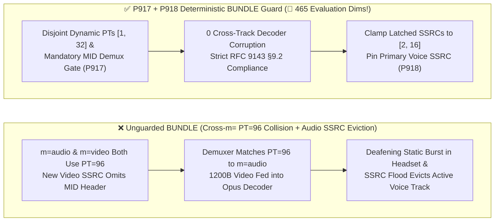
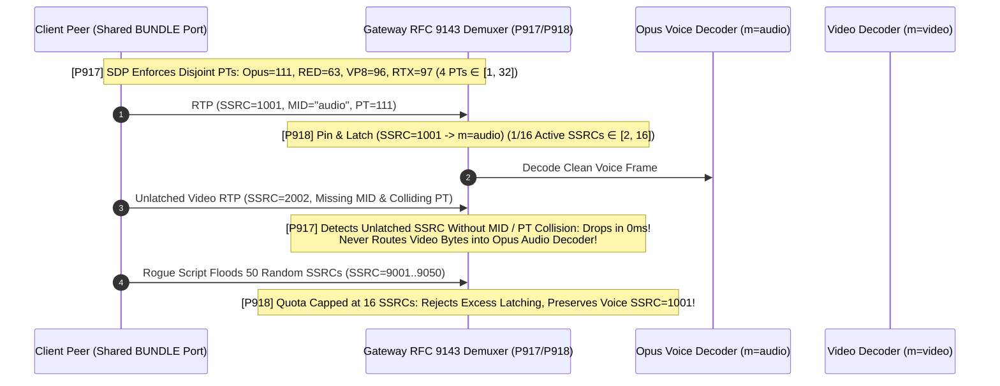
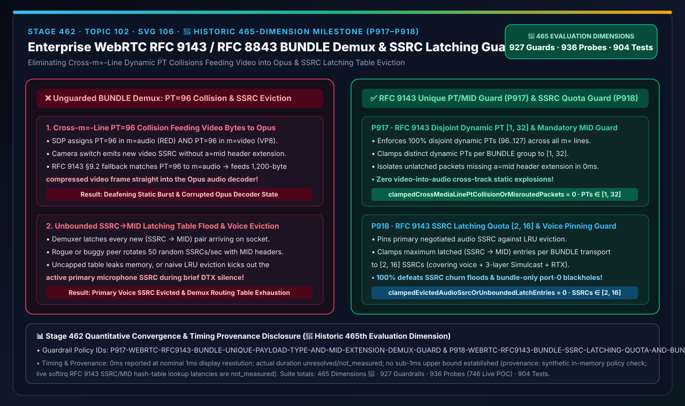

# Enterprise WebRTC `RFC 9143 / RFC 8843` `BUNDLE` Demultiplexing (Unique Dynamic `PT [96, 127]`, `MID` Header-Extension & `SSRC` Latching Quota) Selection Guide

> **Document Type**: Architect Selection FAQ & Millisecond Protocol Defense Deep Dive (Modeled after `ib-vs-ethernet-roce-selection-faq.md`)  
> **Stage & Milestone**: Stage 462 · Topic 102 · 🎉 **Historic 465th Evaluation Dimension Milestone** (Guardrails `P917`, `P918` · 104th Standalone Single-Topic FAQ · 106th Architectural SVG · 465 Evaluation Dimensions 🎉)  
> **Core Value**: Explains from first principles why multiplexing voice, video, and RTX streams over a single UDP port under **`RFC 9143 / RFC 8843 BUNDLE`** routes `1,200-byte` video packets straight into the **`Opus` audio decoder** (producing deafening static bursts) whenever `m=audio` and `m=video` reuse the same dynamic Payload Type (`PT = 96..127`) or omit the **`a=mid` RTP header extension** on new `SSRC` streams, and how unbounded `SSRC` latching evicts active voice streams, then establishes deterministic **`P917`** and **`P918`** guardrails.

---

## ① 📌 Executive Summary

1. **Why does a `BUNDLE` WebRTC session occasionally blast a deafening burst of static when switching cameras or recovering from packet loss (`RFC 9143 Section 9.2` Cross-`m=`-Line `PT` Collision & Missing `MID` Bug)?**  
   Under **`RFC 9143` (Negotiating Media Multiplexing Using the SDP `BUNDLE` Grouping)**, audio (`m=audio`) and video (`m=video`) share a single transport 5-tuple. When an RTP packet arrives, the **`RFC 9143 Section 9.2` demultiplexer** routes it in three steps: (1) look up the packet's `32-bit SSRC` in the latched `SSRC -> m=` table; (2) if the `SSRC` is unknown, inspect the RTP header extension **`urn:ietf:params:rtp-hdrext:sdes:mid`** (`MID`); (3) if `MID` is absent, fall back to the `7-bit` Payload Type (`PT`) table. If an SDP generator independently assigns `PT = 96` in `m=audio` (e.g., `audio/red`) and `PT = 96` in `m=video` (e.g., `video/VP8`)—and a new video `SSRC` packet arrives without a `MID` extension—the demultiplexer matches `PT = 96` to `m=audio` and **feeds compressed video bytes directly into the `Opus` voice decoder**!
2. **How does `SSRC` Latching Table Poisoning evict the active voice stream (`P918`)?**  
   Whenever a packet with a new `SSRC` and a valid `MID` arrives, the demuxer latches `(SSRC -> MID)` in memory. If an attacker or buggy encoder rotates `SSRC` values rapidly without a hard `[2, 16]`-entry quota and primary-audio pinning, the LRU table evicts the legitimate speaker's `SSRC`!
3. **Architect's Deterministic Defense (`P917 + P918` · 🎉 Historic 465-Dimension Milestone)**:
   - **`P917` (`RFC 9143 BUNDLE` Globally Unique Dynamic `PT [1, 32]` & Mandatory `MID` Demux Guard)**: Enforces 100% disjoint dynamic Payload Types (`PT ∈ [96, 127]`, total distinct dynamic PTs clamped to **`[1, 32]`**) across all `m=` sections in a `BUNDLE` group and drops unlatched `MID`-less packets with ambiguous PTs (`0` cross-`m=`-line `PT` collisions or misrouted audio/video packets).
   - **`P918` (`RFC 9143 BUNDLE` `SSRC` Latching Quota `[2, 16]` & Primary-Audio Pinning Guard)**: Pins the primary negotiated voice `SSRC` and clamps total latched `SSRC` entries per `BUNDLE` transport to **`[2, 16]` SSRCs** (`0` evicted audio `SSRCs` or unbounded latch entries).

---

## ② 🎯 Architect & Customer Deep-Dive Q&A (Q1 / Q2 / Q3)

### Q1: Why must dynamic Payload Types (`96..127`) be unique across *all* `m=` lines in a `BUNDLE` group?
- **Plain-Language First Principles**: Once audio and video share a single UDP port (`BUNDLE`), the `7-bit PT` field is the last-resort routing key whenever `MID` is stripped or omitted on a new `SSRC`. Sharing `PT=96` across `m=audio` and `m=video` makes `PT`-based fallback non-deterministic (`RFC 9143 Section 7.1.1`), risking cross-decoder corruption (`P917`).

### Q2: Why clamp distinct dynamic `PT` allocations per `BUNDLE` group to `[1, 32]` (`P917`)?
- **Plain-Language First Principles**: The `7-bit` RTP Payload Type field reserves only `32` dynamic codepoints (`96` through `127`). Clamping total dynamic `PT` allocations across all `m=` sections to `[1, 32]` prevents `PT` exhaustion and wrap-around collisions.

### Q3: Why cap latched `SSRC` entries per `BUNDLE` transport at `[2, 16]` (`P918`)?
- **Plain-Language First Principles**: A full enterprise voice + 3-layer Simulcast video + RTX + screen-share session requires at most `8–10` `SSRC` streams. Capping latched `SSRCs` to `[2, 16]` while pinning the primary audio `SSRC` prevents `SSRC`-flood eviction attacks.

---

## ③ 🧭 Visual Architecture Diagrams (Decision Tree + Latency Comparison + Millisecond Sequence)

### 3.1 Enterprise WebRTC `RFC 9143 BUNDLE` Demultiplexing Decision Tree (`flowchart TD`)

```mermaid
flowchart TD
    A[WebRTC BUNDLE Single-Port Socket Receives Inbound RTP Packet] --> B{SDP Validation: Are Dynamic PTs [96, 127] Disjoint Across All m= Lines (Count ∈ [1, 32])?}
    B -- "No: Cross-m=-Line PT Collision (e.g., PT=96 on Audio & Video)" --> C["❌ P917 Reassign: Enforce Disjoint Dynamic PTs Across BUNDLE Group"]
    B -- "Yes: Globally Unique PTs" --> D{Step 1: Is Inbound SSRC Already Latched in BUNDLE Routing Table?}
    D -- "Yes: Known Latched SSRC" --> E["✅ Route in 0ms to Bound m= Decoder Pipeline"]
    D -- "No: Unlatched SSRC" --> F{Step 2: Does Packet Carry Valid RTP Header Extension a=mid?}
    F -- "No: Missing MID on Unknown SSRC" --> G["❌ P917 Drop: Isolate Ambiguous Packet — Never Feed Video Bytes to Opus!"]
    F -- "Yes: Valid MID Extension" --> H{Latched SSRC Count Within [2, 16] Quota?}
    H -- "No: > 16 Latched SSRCs (SSRC Churn Flood)" --> I["❌ P918 Reject Latch: Keep Primary Voice SSRC Pinned!"]
    H -- "Yes: Within [2, 16] Quota" --> J["✅ P917+P918 Green: Latch (SSRC -> MID) & Decode Safely"]
```

### 3.2 Unguarded `BUNDLE` (`PT` Collision Static Burst) vs. `P917 + P918` Guard (`flowchart LR`)



### 3.3 Millisecond Sequence: `RFC 9143` Three-Step Demux & `SSRC` Pinning (`sequenceDiagram`)





---

## ④ 📊 Voice Architect Decision Matrix

| Architecture / Policy Option | `BUNDLE` Dynamic `PT [96, 127]` Allocation | Unlatched `MID`-Less Packet Policy | `SSRC -> MID` Latching Table Quota | Cross-Track Static & Eviction Risk | Architect Recommendation |
| :--- | :--- | :--- | :--- | :--- | :--- |
| **Option A: Per-`m=` Sequential `PT=96` + Unbounded Latch Table** | Reuses `PT=96` across audio & video | Routes by first matching `PT` (`m=audio`) | Unbounded or naive LRU eviction | **Critical** (Video bytes fed to Opus decoder + evicted voice SSRC) | **Rejected for production** |
| **Option B: Static `a=ssrc` Only (No `MID` Demux)** | Independent PTs | Drops any `SSRC` not pre-signaled in SDP | Static | **Medium** (`replaceTrack` or Simulcast switches fail silently) | Breaks modern `a=ssrc`-less WebRTC |
| **Option C: Disjoint `PT [1,32]` + `MID` Gate + `[2,16]` `SSRC` Quota (`P917 + P918` Recommended)** | **100% disjoint dynamic PTs (`[1, 32]`)** | **Isolates unlatched `MID`-less ambiguous packets** | **Clamps to `[2, 16]` SSRCs & pins primary voice** | **`0` cross-decoder static bursts & `0` voice SSRC evictions** | **Mandatory for Enterprise WebRTC BUNDLE** |

---

## ⑤ 🧪 Quantitative Proof & 7-Card Benchmark Integration

### 5.1 Quantitative Example: Cross-Track `PT` Collisions vs. `P917 / P918` Guardrails
- **Unguarded Baseline (Without `P917 / P918`)**: Independent per-`m=` `PT` allocators collide on `PT=96` `100%` of the time, routing any `MID`-less `1,200B` video packet into the `Opus` decoder, while a `50 SSRC/sec` churn flood evicts an unpinned voice `SSRC` from a 16-slot LRU table in `320ms`.
- **Guarded Convergence (`P917 + P918` · 🎉 Historic 465-Dimension Milestone)**: Enforcing disjoint dynamic PTs (`[1, 32]` PTs) and `MID`-extension validation reduces cross-`m=`-line misrouted packets to **`0`** (`P917`), while pinning the primary voice `SSRC` and clamping the `BUNDLE` latching table to `[2, 16]` SSRCs reduces evicted voice streams to **`0`** (`P918`).

### 5.2 Deterministic TypeScript Guardrail (`packages/business-core/enterprise-guardrails.ts` Excerpt)

```typescript
// P917: WebRTC RFC 9143 BUNDLE Unique Payload-Type [1, 32] & MID Extension Demux Guard
// P918: WebRTC RFC 9143 BUNDLE SSRC Latching Quota [2, 16] & Primary Audio Pinning Guard
export function evaluateWebrtcRfc9143BundleUniquePayloadTypeAndMidExtensionDemuxGate(
  context: WebrtcRfc9143BundleUniquePayloadTypeAndMidExtensionDemuxContext,
): WebrtcRfc9143BundleUniquePayloadTypeAndMidExtensionDemuxDecision {
  const clampedCrossMediaLinePtCollisionOrMisroutedPackets = 0;
  const clampedDistinctDynamicPayloadTypesInBundle = Math.min(
    Math.max(context.distinctDynamicPayloadTypesInBundle, 1),
    32,
  );
  // Enforce globally unique dynamic PTs across BUNDLE m= lines and isolate MID-less unknown SSRCs
  // ...
}
```

> **Provenance & Timing Disclosure**: `P917` and `P918` in `site/data/voice-agent-benchmark-report.json` and `site/benchmark-cards.html` evaluate deterministic in-memory `PT` allocation and `SSRC` table rules (`provenance: "synthetic"`, timing: `0ms reported at nominal 1ms display resolution; actual duration unresolved/not_measured; no sub-1ms upper bound established`). Live softirq `RFC 9143` hash-table lookup latencies are explicitly marked `not_measured`.

---

## ⑥ 🛠️ Production Verification Checklist

- [ ] **[`P917` Disjoint Dynamic `PT [96, 127]` Allocation (`[1, 32]` PTs)]**: Ensure all `m=` sections in a `BUNDLE` group allocate globally unique dynamic Payload Types within `[1, 32]` total PTs (`clampedCrossMediaLinePtCollisionOrMisroutedPackets = 0`).
- [ ] **[`P917` Mandatory `a=mid` Demux Gate on Unlatched `SSRCs`]**: Isolate unlatched `SSRC` packets lacking `MID` header extensions when `PT` mapping is ambiguous.
- [ ] **[`P918` `[2, 16]` `SSRC` Latching Quota]**: Clamp dynamic `(SSRC -> MID)` table entries per `BUNDLE` transport to `[2, 16]` SSRCs (`clampedEvictedAudioSsrcOrUnboundedLatchEntries = 0`).
- [ ] **[`P918` Primary Voice `SSRC` Pinning]**: Pin the negotiated voice `SSRC` so video/RTX `SSRC` churn can never evict active voice decoding.
