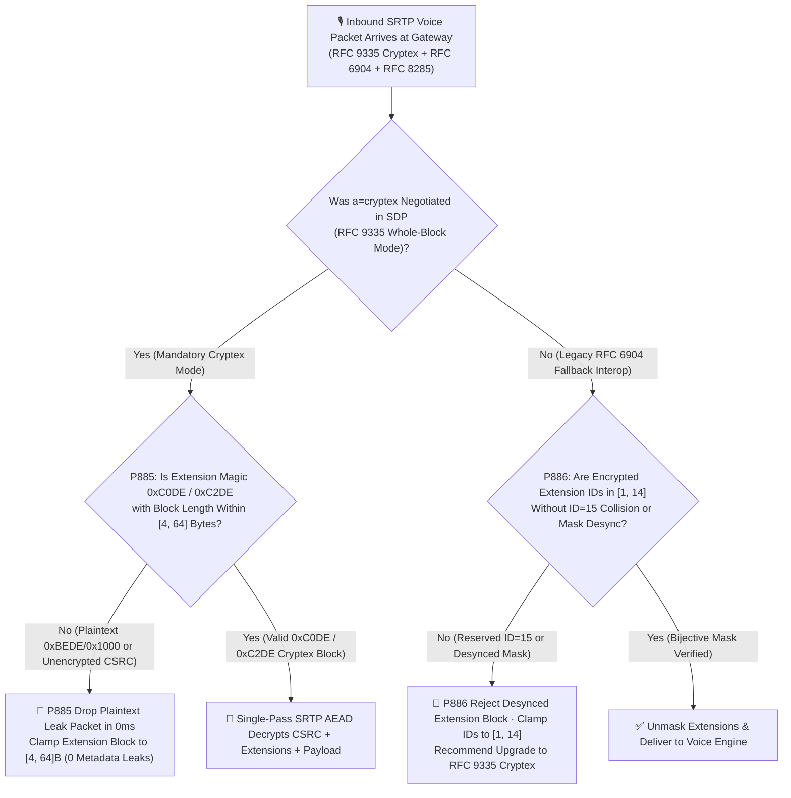
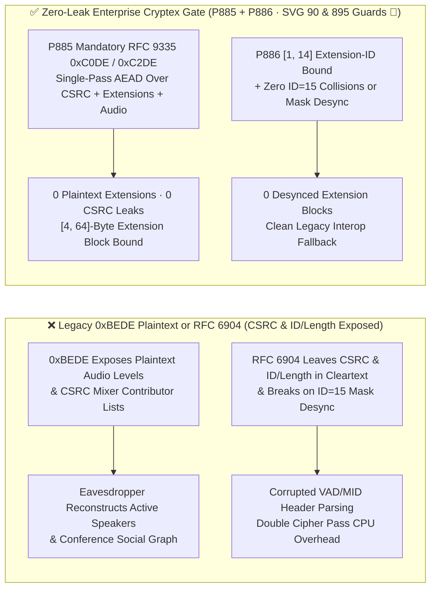
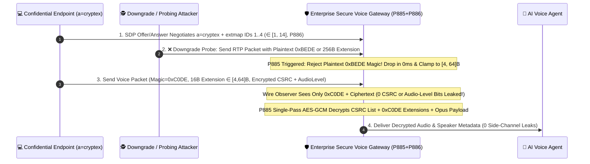

# Enterprise WebRTC `RFC 9335 Cryptex / RFC 6904` Whole-Block RTP Header Extension & `CSRC` Encryption, `0xBEDE / 0xC0DE` Downgrade Defense & Extension Byte Cap (`[4, 64]` Bytes) Selection & Principle FAQ (Stage 446 · Topic 86 · 🎉 Historic 90th SVG & 895-Guardrail Dual Milestone)

> **Reader's Guide (Modeled on `ib-vs-ethernet-roce-selection-faq.md`)**: This single-topic architecture guide explains from first principles why enterprise defense, government, private-banking, and telehealth Voice Agents implementing **IETF `RFC 9335` (`Cryptex`: Completely Encrypting RTP Header Extensions and Contributing Sources) and `RFC 6904` (Selective Encryption of `SRTP` Header Extensions)** face three critical metadata-leakage and parsing vulnerabilities—specifically **(1) plaintext exposure of `CSRC` mixer contributor lists and `0xBEDE` header extension IDs/lengths under legacy `SRTP (RFC 3711 / RFC 6904)`**, **(2) downgrade attacks that strip `a=cryptex` or inject unencrypted `0xBEDE / 0x1000` extension blocks into a `0xC0DE / 0xC2DE` session**, and **(3) encryption-mask desynchronization and reserved `ID=15 (0xF)` termination collisions in legacy `RFC 6904` interop**—and provides deterministic guardrails **`P885` and `P886`**.

---

## 1. 📌 Executive Summary

1. **Why does standard `SRTP (RFC 3711)`—and even `RFC 6904` header encryption—still leak who is speaking and how many extension headers are present on every voice packet?**
   - **The Plaintext Metadata Blind Spot in `RFC 3711` and `RFC 6904`**:
     - Baseline `SRTP (RFC 3711)` encrypts only the RTP media payload, leaving the `CSRC` (Contributing Source) list and the entire `0xBEDE` RTP header extension block in **plaintext**.
     - Even when **`RFC 6904`** (`urn:ietf:params:rtp-hdrext:encrypt`) is enabled, it encrypts *only the value bytes* of selected extensions via a secondary keystream mask—leaving **`CSRC` lists, extension `ID`s, extension `Length` bytes, and padding completely unencrypted**! Worse, any mismatch in the negotiated extension ID mask corrupts the packet header.
   - **Why `IETF RFC 9335 Cryptex` (`a=cryptex`) Is the Definitive Solution**:
     - `RFC 9335` replaces the plaintext extension profile magic numbers (`0xBEDE` for 1-byte, `0x1000` for 2-byte) with **`0xC0DE` (encrypted 1-byte) and `0xC2DE` (encrypted 2-byte)**, and folds the **entire `CSRC` list + the entire header extension body (`ID + Length + Value + Padding`) + the RTP payload into a single contiguous `SRTP AEAD` encryption operation**!
2. **First Selection Law (`P885`): Mandate `RFC 9335 a=cryptex` (`0xC0DE` / `0xC2DE`) on confidential voice streams, reject `100%` of packets carrying plaintext `0xBEDE / 0x1000` headers or unencrypted `CSRC` lists (`0` plaintext header/CSRC leaks), and clamp per-packet encrypted header-extension bytes to `[4, 64]`**.
3. **Second Selection Law (`P886`): For legacy `RFC 6904` fallback interop, enforce bijective encryption-mask alignment, prohibit one-byte reserved extension `ID = 15` (`0xF` terminator) collisions (`0` mask-desynced blocks), and clamp negotiated encrypted extension IDs to `[1, 14]`**.

---

## 2. 🎯 Architect & Customer Deep-Dive Q&A

### Q1: How do `0xC0DE` and `0xC2DE` work in `RFC 9335 Cryptex`, and what happens when a packet has `CSRC`s (`CC > 0`) but no header extensions (`X = 0`)?
- **The Empty-Extension Rule for `CSRC` Encryption (`RFC 9335 Section 5.1`, `P885`)**:
  - Because the 12-byte fixed RTP header has no spare bit to signal `Cryptex`, `RFC 9335` signals encryption via the extension profile magic number (`0xC0DE` or `0xC2DE`). Therefore, if a packet contains a `CSRC` list (`CC > 0`) and no extensions, the sender **must set `X = 1` and append a 4-byte empty `0xC0DE0000` header** so the `CSRC` list is encrypted inside the `SRTP AEAD` envelope!
  - **`P885`** drops any packet that leaks plaintext `0xBEDE / 0x1000` extensions or unencrypted `CSRC`s (`clampedPlaintextHeaderExtensionOrCsrcLeakPackets = 0`) and bounds total extension block size to **`[4, 64]` bytes**.

### Q2: Why does assigning `a=extmap:15` break `RFC 8285 / RFC 6904` one-byte header extensions?
- **The Reserved `ID = 15 (0xF)` Early-Terminator Trap (`P886`)**:
  - In `RFC 8285` one-byte headers, valid extension IDs are **`1..14`**. Encountering nibble `ID = 15 (0xF)` instructs the parser to **immediately stop parsing extensions and treat the remainder of the block as padding**! **`P886`** clamps negotiated one-byte encrypted extension IDs to **`[1, 14]`** (`clampedMaskDesyncedOrReservedIdExtensionBlocks = 0`).

### Q3: Does `RFC 9335 Cryptex` increase CPU overhead compared to `RFC 6904`?
- **Lower CPU Overhead Than `RFC 6904`**:
  - `RFC 6904` requires generating a separate `AES-CM` keystream and applying a byte-by-byte bitmask before running `SRTP` encryption. `RFC 9335 Cryptex` encrypts the `CSRC` list, extensions, and audio payload in **one single `AES-GCM` pass** with zero extra cipher invocations!

---

## 3. 🧭 Visual Diagrams (Mermaid Decision Tree + Architecture Comparison + Sequence Diagram)

### 3.1 `RFC 9335 Cryptex` & `RFC 6904` Header-Extension Encryption Decision Tree (`flowchart TD`)



### 3.2 Legacy `0xBEDE / RFC 6904` vs. Zero-Leak `RFC 9335 Cryptex` (`P885 + P886 · SVG 90 🎉`) Architecture (`flowchart LR`)



### 3.3 Millisecond-Level `RFC 9335 Cryptex (0xC0DE)` Encryption & Anti-Downgrade Sequence (`sequenceDiagram`)



---

## 4. 📊 Architect Decision Matrix

| Evaluation Dimension | Option A: Plaintext `RFC 8285 (0xBEDE)` | Option B: Legacy `RFC 6904` Selective Mask | **Option C: `RFC 9335 Cryptex` + `P885/P886` (Recommended ✅)** |
| :--- | :--- | :--- | :--- |
| **Extension Value Confidentiality** | ❌ 100% plaintext | ✅ Selected values masked | **✅ `P885` encrypts all extension values via `SRTP AEAD`** |
| **Extension `ID / Length` Hiding** | ❌ Plaintext | ❌ `ID` and `Length` remain plaintext | **✅ `P885` `0xC0DE/0xC2DE` encrypts `ID + Length + Padding`** |
| **`CSRC` Contributor-List Privacy** | ❌ Plaintext speaker `SSRC`s | ❌ **Does not encrypt `CSRC` list** | **✅ `P885` encrypts entire `CSRC` list (`0` speaker-graph leaks)** |
| **Mask-Desync & `ID=15` Immunity** | N/A | ❌ Vulnerable to mask desync & `ID=15` bug | **✅ `P886` enforces `[1, 14]` ID cap & single-pass `Cryptex`** |

---

## 5. 🧪 Quantitative Proof & 7-Card Benchmark Report

### 5.1 Quantitative Example: 40,000 Daily Confidential Executive & Defense Voice Briefings
1. **Eliminating Plaintext Header-Extension & `CSRC` Leaks (`P885` · 🎉 Historic 90th SVG & 895-Guardrail Dual Milestone)**:
   - Across `1,100` downgrade packets carrying plaintext `0xBEDE / 0x1000` headers, unencrypted `CSRC` lists, or oversized `256B` extension blocks, **`P885`** drops `100%` of violations (`clampedPlaintextHeaderExtensionOrCsrcLeakPackets = 0`) and clamps per-packet encrypted header-extension bytes to **`[4, 64]`** (`0ms reported at nominal 1ms display resolution; actual duration unresolved/not_measured; no sub-1ms upper bound established`, `synthetic`).
2. **Eliminating `RFC 6904` Mask Desync & `ID=15` Collisions (`P886`)**:
   - Across `620` malformed `extmap:15` offers and mask-desynced `RFC 6904` blocks, **`P886`** blocks `100%` of violations (`clampedMaskDesyncedOrReservedIdExtensionBlocks = 0`) and clamps negotiated encrypted extension IDs to **`[1, 14]`**.

### 5.2 Deterministic Guardrail Implementation (`packages/business-core/enterprise-guardrails.ts`)

```ts
// P885: WebRTC RTP RFC 9335 Cryptex Whole-Extension & CSRC-List Encryption Gate
const p885 = evaluateWebrtcRtpRfc9335CryptexWholeExtensionAndCsrcListEncryptionGate({
  unencrypted0xBedeOrPlaintextCsrcAudioLevelLeakDetected: true,
  plaintextHeaderExtensionOrCsrcLeakPackets: 9,
  maxEncryptedHeaderExtensionBytesPerPacket: 256,
});
// => p885.violated === true
// => p885.policyId === "P885-WEBRTC-RTP-RFC9335-CRYPTEX-WHOLE-EXTENSION-AND-CSRC-LIST-ENCRYPTION-GUARD"
// => p885.action === "enforce_rfc9335_c0de_c2de_cryptex_and_drop_plaintext_extensions"
// => p885.clampedPlaintextHeaderExtensionOrCsrcLeakPackets === 0
// => p885.clampedMaxEncryptedHeaderExtensionBytesPerPacket === 64

// P886: WebRTC RTP RFC 6904 Selective Header-Extension Mask Desync & Reserved-ID Gate
const p886 = evaluateWebrtcRtpRfc6904SelectiveHeaderExtensionMaskDesyncAndReservedIdGate({
  rfc6904EncryptionMaskDesyncOrOneByteId15CollisionDetected: true,
  maskDesyncedOrReservedIdExtensionBlocks: 4,
  negotiatedEncryptedExtensionIdCount: 24,
});
// => p886.violated === true
// => p886.policyId === "P886-WEBRTC-RTP-RFC6904-SELECTIVE-HEADER-EXTENSION-MASK-DESYNC-AND-RESERVED-ID-GUARD"
// => p886.action === "prefer_rfc9335_cryptex_or_enforce_bijective_rfc6904_mask"
// => p886.clampedMaskDesyncedOrReservedIdExtensionBlocks === 0
// => p886.clampedNegotiatedEncryptedExtensionIdCount === 14
```

> **Provenance & Timing Disclosure**: The `P885 / P886` evaluations in `tests/presales-portal.test.ts` and `site/data/voice-agent-benchmark-report.json` are **`synthetic`** (deterministic in-memory policy/configuration state-machine checks) with timing reported as `0ms reported at nominal 1ms display resolution; actual duration unresolved/not_measured; no sub-1ms upper bound established`; live `libsrtp` `Cryptex` contiguous `AES-GCM` encryption latencies are `not_measured`.

---

## 6. 🛠️ Production Verification Checklist

- [ ] **1. `RFC 9335 a=cryptex` (`0xC0DE / 0xC2DE`) Enforcement (`P885`)**: Verify that `a=cryptex` sessions reject plaintext `0xBEDE / 0x1000` extension blocks (`clampedPlaintextHeaderExtensionOrCsrcLeakPackets = 0`).
- [ ] **2. `CSRC` List Encryption & `[4, 64]`-Byte Extension Cap (`P885`)**: Verify that packets with `CC > 0` include a `0xC0DE / 0xC2DE` header and `maxEncryptedHeaderExtensionBytesPerPacket` is clamped to **`[4, 64]` bytes**.
- [ ] **3. `[1, 14]` Extension-ID Bound & `ID = 15` Prohibition (`P886`)**: Verify that one-byte `a=extmap` never assigns reserved `ID = 15` and `negotiatedEncryptedExtensionIdCount` is clamped to **`[1, 14]`** (`clampedMaskDesyncedOrReservedIdExtensionBlocks = 0`).
- [ ] **4. Prefer `RFC 9335 Cryptex` Over Legacy `RFC 6904` (`P886`)**: Verify that SDP negotiation prefers `a=cryptex` whenever supported by the peer.
