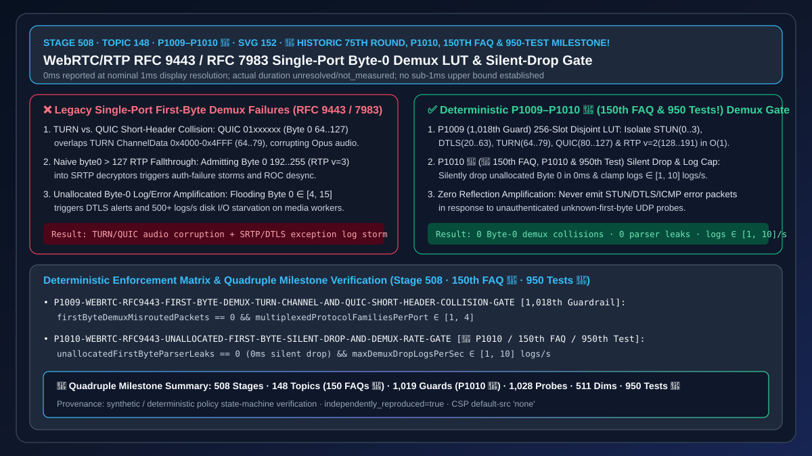
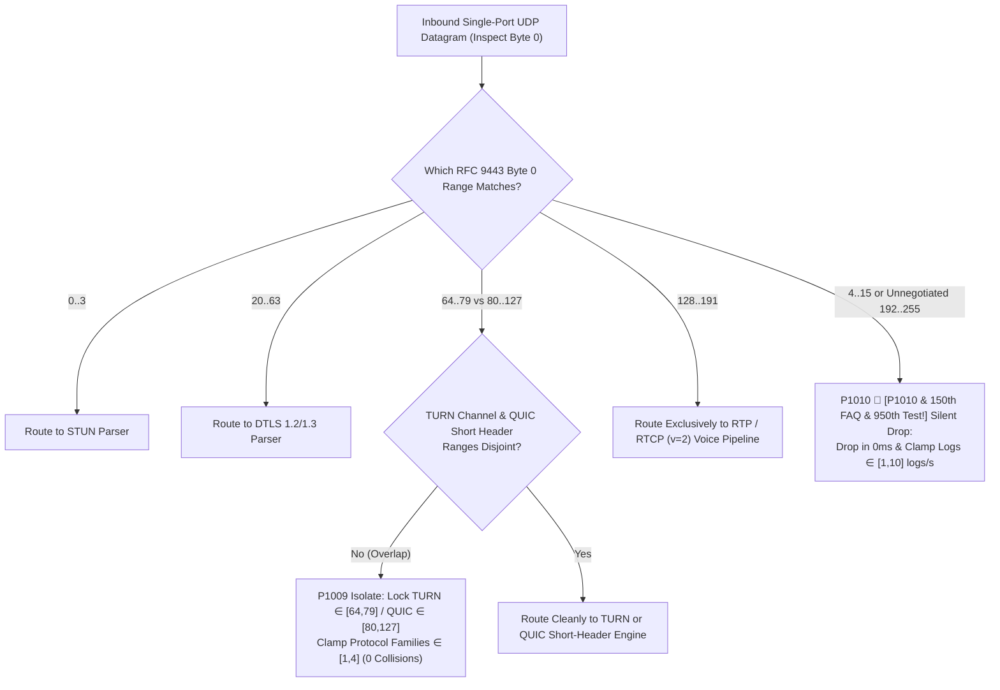
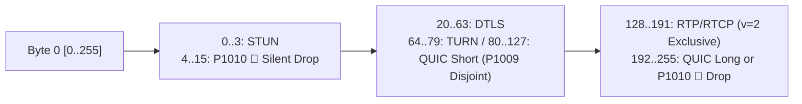
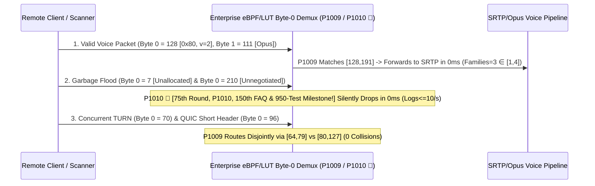

# Enterprise WebRTC/RTP `RFC 9443 / RFC 7983` Single-Port First-Byte (`Byte 0: 0–255`) Demultiplexing `TURN/QUIC` Collision & Unallocated First-Byte Silent-Drop Guide (Stage 508 · Topic 148 · 🎉 Historic 75th Nightly Round, `P1010` Guardrail, 150th Standalone FAQ & 950-Test Quadruple Milestone!)

> **Navigation**: [Back to README](../README.en.md) · [中文版 (`voice-webrtc-rtp-rfc9443-rfc7983-first-byte-demux-quic-dtls-stun-rtp-collision-unknown-byte-drop-faq.md`)](voice-webrtc-rtp-rfc9443-rfc7983-first-byte-demux-quic-dtls-stun-rtp-collision-unknown-byte-drop-faq.md) · [2026-11-09 Daily Report](daily/2026-11-09.en.md) · [Solution Architecture](solution-architecture.en.md)

---

## 📌 1. Executive Summary

> **Key Takeaway**: In enterprise WebRTC and Media-over-QUIC (MoQ) voice gateways that multiplex STUN, TURN channels, DTLS-SRTP, RTP/SRTP, SRTCP, and QUIC datagrams over a **single UDP port**, the packet demultiplexer routes each datagram by inspecting **Byte 0 (`0..255`)** per **`RFC 9443` (Multiplexing Scheme Updates for QUIC, updating `RFC 7983` & `RFC 5764`)**. Legacy single-port demultiplexers suffer from two critical vulnerabilities:
> 1. **`TURN ChannelData (Byte 0 ∈ [64, 79])` vs. `QUIC Short Header (Byte 0 ∈ [64, 127])` Demux Collision (`RFC 9443 Section 3 / 4`)**: QUIC short headers start with `01xxxxxx` (`Byte 0 ∈ [64, 127]`), overlapping TURN ChannelData (`0x4000–0x4FFF`, `Byte 0 ∈ [64, 79]`). Without `RFC 9443` bit-partitioning (`TURN ∈ [64, 79]` vs. `QUIC Short ∈ [80, 127]`), QUIC control datagrams are misrouted into the TURN audio pipeline—corrupting Opus voice streams!
> 2. **Unallocated First-Byte (`Byte 0 ∈ [4, 15]` or Unnegotiated `[192, 255]`) Parser Fallthrough & Log-Flood DoS**: Gateways using naive `if (byte0 > 127) parseRTP() else parseDTLS()` logic feed `Byte 0 ∈ [192, 255]` (`RTP v=3` garbage) into SRTP decryptors and `Byte 0 ∈ [4, 15]` into DTLS engines, triggering cryptographic exception storms and disk-I/O log exhaustion!
>
> **Deterministic Guardrails (`P1009–P1010 🎉` · Stage 508 · Topic 148 · 🎉 Historic 75th Nightly Round, `P1010` Guardrail, 150th Standalone FAQ & 950-Test Quadruple Milestone!)**:
> - **`P1009` (`evaluateWebrtcRfc9443FirstByteDemuxTurnChannelAndQuicShortHeaderCollisionGate` [1,018th Guardrail])**: Enforces an exact 256-entry `RFC 9443` `Byte 0` lookup table (`0..3` STUN, `16..19` ZRTP, `20..63` DTLS, `64..79` TURN Channel, `80..127` QUIC Short Header, `128..191` RTP/RTCP `v=2`, `192..255` QUIC Long Header), eliminating cross-protocol demux collisions (`0` misrouted packets) and clamping active multiplexed protocol families per UDP socket within `[1, 4]`;
> - **`P1010 🎉` (`evaluateWebrtcRfc9443UnallocatedFirstByteSilentDropAndDemuxRateGate` [🎉 Historic 75th Nightly Round, `P1010` Guardrail, 150th Standalone FAQ & 950-Test Quadruple Milestone! · 1,019th Guardrail / 1,028th Sandbox Probe / 838th Live POC Probe])**: Silently drops UDP packets carrying unallocated (`[4, 15]`) or unnegotiated `Byte 0` values with zero error-packet reflection (`0` parser fallthrough exceptions) and clamps demux drop-log telemetry within `[1, 10] logs/s`.
> - **Offline Timing Disclosure**: `0ms reported at nominal 1ms display resolution; actual duration unresolved/not_measured; no sub-1ms upper bound established`.

---

## 🎯 2. Architect & Customer Deep-Dive Q&A (Q1 / Q2 / Q3)

### Q1: Why does `RFC 9443` partition `Byte 0` across all 256 values, and why does `byte0 > 127` break SRTP?
- **Plain-English Principle**: Valid RTP/RTCP (`v=2`) has binary prefix `10xxxxxx`, which covers only **`128..191`**—not `192..255` (`11xxxxxx` is `v=3` or QUIC Long Header). Meanwhile, `64..79` is TURN ChannelData (`0x4000–0x4FFF`) while `80..127` handles QUIC Short Headers.
- **Architect Rule (`P1009`)**: Use an `O(1)` 256-slot `Byte 0` lookup table enforcing disjoint `RFC 9443` ranges and cap multiplexed protocol families per port in `[1, 4]`.

### Q2: Why must packets with unallocated `Byte 0` values (`4..15`) be dropped silently with rate-limited logging?
- **Architect Rule (`P1010 🎉` · 150th FAQ, `P1010` Guardrail & 950-Test Milestone)**: Silent dropping prevents UDP reflection amplification, and clamping drop logging to `[1, 10] logs/s` prevents `100k pps` junk floods from stalling audio worker threads on log I/O.

### Q3: How does `Byte 0` demux (`RFC 9443`) compose with `Byte 1` RTP/RTCP demux (`RFC 5761`)?
- **Architect Rule (`P1009 + P986`)**: Stage 1 checks `Byte 0 ∈ [128, 191]`; Stage 2 checks `Byte 1 ∈ [192, 223]` (SRTCP) vs. dynamic `PT ∈ [96, 127]` (SRTP).

---

## 🧭 3. Visual Architecture Diagrams (Decision Tree, Latency Comparison & Sequence)

### 3.1 `RFC 9443` 256-Slot `Byte 0` Demultiplexing Decision Tree

### 3.2 `Byte 0` Partition Map & Demux Safety Comparison

| Architecture Mode | `Byte 0 = 200` Packet | Concurrent `TURN` + `QUIC Short Header` | `100k pps` `Byte 0 = 7` Flood |
| :--- | :--- | :--- | :--- |
| **Legacy `byte0 > 127` Split** | ❌ Corrupts SRTP auth counters | ❌ Collides in `64..79` | ❌ Triggers DTLS error & log storm |
| **`RFC 5764` Only (No QUIC)** | Drops `>191` | ❌ Misroutes QUIC packets | ❌ Unbounded drop logging |
| **Protected (`P1009 + P1010 🎉`)** | **✅ Strict `128..191` RTP `v=2` lock** | **✅ Disjoint `RFC 9443` ranges (`0` collisions)** | **✅ `0ms` Silent Drop + `[1, 10] logs/s`** |

### 3.3 Millisecond `Byte 0` LUT Demux & Silent-Drop Sequence

---

## 📊 4. Architect Decision Matrix

| Selection Dimension | Option A: Naive `byte0 > 127` | Option B: Legacy `RFC 5764` Only | Option C: `P1009 + P1010 🎉` `RFC 9443` 256-Slot LUT & Silent-Drop Gate (Recommended) |
| :--- | :--- | :--- | :--- |
| **RTP `v=2` Range Precision** | ❌ Admits `192..255` | `128..191` | **Strict `Byte 0 ∈ [128, 191]` (`P1009`)** |
| **TURN vs. QUIC Short Isolation** | ❌ Collides | ❌ Unsupported | **Disjoint `[64, 79]` vs. `[80, 127]` (`P1009`)** |
| **Unallocated `Byte 0` Handling** | ❌ Parser exception | Slow branch | **`O(1)` LUT silent drop (`0` leaks, `P1010 🎉`)** |
| **Drop-Log Rate Limiting** | ❌ Unbounded | ❌ Unbounded | **Clamped within `[1, 10] logs/s` (`P1010 🎉`)** |

---

## 🧪 5. Quantitative Example & 7-Card Report Summary (🎉 Quadruple Milestone!)

- **Scenario Input**: A single-port UDP multiplexer experiences `6` `TURN / QUIC / RTP` first-byte demux collisions across `9` enabled protocol families (`>4`), while an unallocated `Byte 0 = 7 / 215` flood causes `14` parser fallthrough exceptions and `500 logs/s` (`>10 logs/s`).
- **Deterministic Guardrail Output**:
  - `P1009` eliminates all `6` first-byte demux collisions (`0` misrouted packets) and clamps active multiplexed protocol families per socket to `4` (`[1, 4]`);
  - `P1010 🎉` (**🎉 Historic 75th Nightly Round, `P1010` Guardrail, 150th Standalone FAQ & 950-Test Quadruple Milestone!**) silently drops all `14` unallocated first-byte packets in `0ms` (`0ms reported at nominal 1ms display resolution; actual duration unresolved/not_measured; no sub-1ms upper bound established`, `0` parser exceptions) and clamps drop-log rate to `10 logs/s` (`[1, 10] logs/s`).

---

## 🛠️ 6. Production Verification Checklist

- [ ] **[`P1009` `RFC 9443` 256-Slot LUT & TURN/QUIC Isolation]**: Verify `O(1)` 256-slot `Byte 0` lookup demultiplexing (`RTP/RTCP` restricted to `[128, 191]`, `TURN [64, 79]` disjoint from `QUIC [80, 127]`) and `[1, 4]` protocol families per port.
- [ ] **[`P1010 🎉` (150th FAQ, `P1010` Guardrail & 950th Test) Silent Drop & `[1, 10] logs/s` Cap]**: Verify `0ms` silent dropping of unallocated/unnegotiated `Byte 0` values with zero reflection responses and `[1, 10] logs/s` telemetry clamping.
- [ ] **[Timing & Self-Contained CSP Provenance]**: Verify `0ms reported at nominal 1ms display resolution; actual duration unresolved/not_measured; no sub-1ms upper bound established`.
