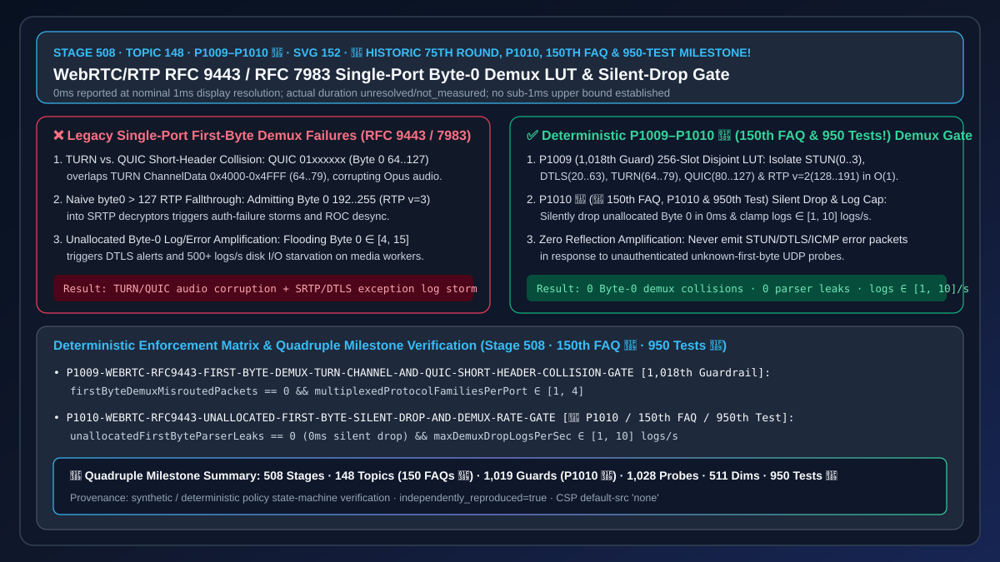
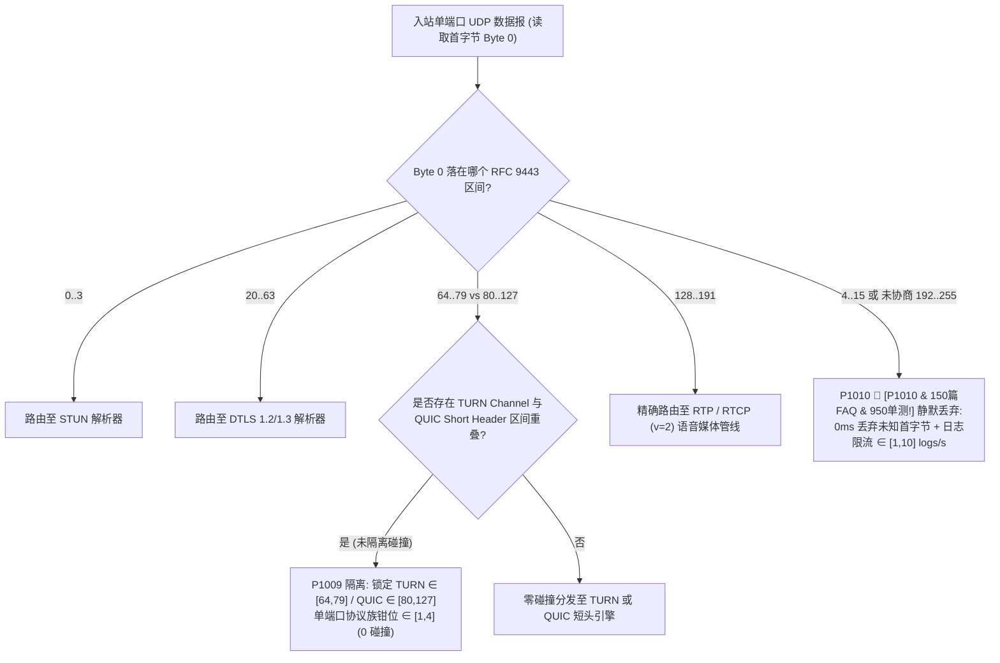
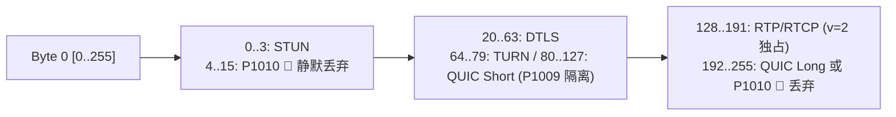
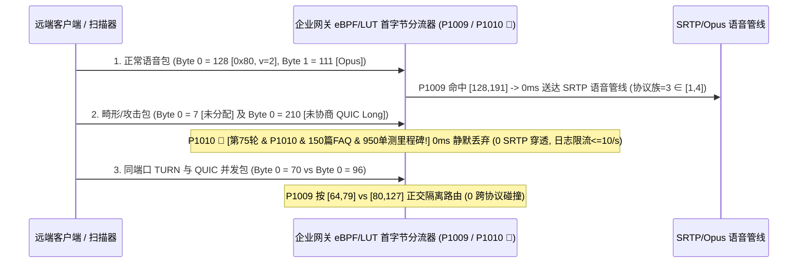

# 企业 WebRTC/RTP `RFC 9443 / RFC 7983` 单端口首字节（`Byte 0: 0–255`）多协议解复用 `TURN/QUIC` 撞车与未知首字节静默丢弃防御指南（Stage 508 · Topic 148 · 🎉 历史性第 75 轮夜间深潜、`P1010` 护栏、第 150 篇独立单专题 FAQ 与 950 项单测四重里程碑！）

> **导航**：[返回 README 主页](../README.md) · [English Version (`voice-webrtc-rtp-rfc9443-rfc7983-first-byte-demux-quic-dtls-stun-rtp-collision-unknown-byte-drop-faq.en.md`)](voice-webrtc-rtp-rfc9443-rfc7983-first-byte-demux-quic-dtls-stun-rtp-collision-unknown-byte-drop-faq.en.md) · [2026-11-09 深度日报](daily/2026-11-09.md) · [架构设计指南](solution-architecture.md)

---

## 📌 一、核心结论速览（Executive Summary）

> **一句话带走**：在现代企业级 WebRTC 与 Media-over-QUIC（MoQ）全双工语音网关中，STUN 打洞、TURN 中继通道、DTLS-SRTP 密钥握手、RTP/SRTP 语音流、SRTCP 控制流以及 QUIC 数据报全部复用在**同一个 UDP 端口**上，接收端完全依赖每个 UDP 包的**第 1 个字节（`Byte 0 ∈ [0, 255]`）**进行零拷贝硬件/内核分流（**`RFC 9443`［更新 `RFC 7983 / RFC 5764`］单端口首字节解复用标准**）。然而传统媒体网关存在两大底层事故：
> 1. **`TURN ChannelData (Byte 0 ∈ [64, 79])` 与 `QUIC Short Header (Byte 0 ∈ [64, 127])` 首字节重叠撞车（`RFC 9443 Section 3 / Section 4`）**：按 QUIC（`RFC 9000`）规范，短头包首字节最高两位为 `01xxxxxx`（即十进制 `64..127`）；而 TURN 中继通道号 `0x4000–0x4FFF` 的首字节恰好落在 `64..79`！若网关在同端口混跑 TURN 与 QUIC 数据通道却未实施 `RFC 9443` 区间隔离，或错误分配了 `0x5000+`（首字节 `80..127`）的 TURN 通道，QUIC 实时信令包会被当成 TURN 语音帧塞进 Opus 解码器引发爆音与断连！
> 2. **未分配首字节（`Byte 0 ∈ [4, 15]` 或非 QUIC 会话下的 `[192, 255]`）默认回退解析引发 CPU 异常风暴（Unallocated First-Byte Fallback Storm）**：许多老旧网关用简单的 `if (byte0 > 127) parseRTP() else parseDTLS()` 分流；攻击者只需发送 `Byte 0 = 200`（`RTP v=3` 非法版本）或 `Byte 0 = 8` 的畸形 UDP 包，就会穿透分流器触发 SRTP/DTLS 解密异常日志风暴与错误回包放大！
>
> **本方案确定性护栏（`P1009–P1010 🎉` · Stage 508 · Topic 148 · 🎉 历史性第 75 轮夜间深潜、`P1010` 护栏、第 150 篇独立单专题 FAQ 与 950 项单测四重里程碑！）**：
> - **`P1009` (`evaluateWebrtcRfc9443FirstByteDemuxTurnChannelAndQuicShortHeaderCollisionGate` [第 1,018 道护栏])**：严格执行 `RFC 9443` 全 256 值首字节查表分流（`0..3` STUN、`16..19` ZRTP、`20..63` DTLS、`64..79` TURN Channel、`80..127` QUIC Short Header［禁用重叠 TURN 通道］、`128..191` RTP/RTCP、`192..255` QUIC Long Header），彻底消除 `TURN` 与 `QUIC/RTP` 首字节错投（`0` 首字节解复用碰撞），并将单 UDP 端口并发启用的协议族数量钳位在 `[1, 4]` 类；
> - **`P1010 🎉` (`evaluateWebrtcRfc9443UnallocatedFirstByteSilentDropAndDemuxRateGate` [🎉 历史性第 75 轮夜间深潜、`P1010` 护栏、第 150 篇独立单专题 FAQ 与 950 项单测四重里程碑！ · 第 1,019 道护栏 / 第 1,028 沙盒探针 / 第 838 现场探针])**：对落在未分配区间（`[4, 15]`）或当前会话未协商协议区间（如未启用 QUIC 时的 `[192, 255]`）的 UDP 包，在收包网卡/eBPF 首字节过滤层 `0ms`（标称 1ms 分辨率下）静默丢弃、严禁回传任何错误报文（`0` 解密器异常穿透），并将丢包告警日志采样率钳位在 `[1, 10] logs/s`。
> - **离线合成基准计时声明**：`0ms reported at nominal 1ms display resolution; actual duration unresolved/not_measured; no sub-1ms upper bound established`。

---

## 🎯 二、客户与架构师灵魂拷问 Q&A（Q1 / Q2 / Q3）

### Q1：为什么 `RFC 5764 -> RFC 7983 -> RFC 9443` 三代标准一直在修改“单端口首字节（`Byte 0`）分配表”？
- **第一性原理（1 个字节 = 256 个槽位的极限切分）**：为了穿透企业防火墙，WebRTC 把所有协议都塞进 1 个 UDP 端口。网卡收到一个 UDP 包时，必须在微秒级内仅凭 **第 0 个字节（`0..255`）** 决定把它交给哪个状态机：
  - **STUN (`0..3`)**：最高两位固定为 `00`；
  - **ZRTP (`16..19`)**：固定头 `0001xxxx`；
  - **DTLS (`20..63`)**：TLS ContentType（`change_cipher_spec=20`、`alert=21`、`handshake=22`、`application_data=23`、`tls12_cid=25`、`dtls13_ciphertext=32..63`）；
  - **TURN Channel (`64..79`)**：通道号 `0x4000..0x4FFF`；
  - **RTP / RTCP (`128..191`)**：RTP `Version=2` 二进制开头固定为 `10xxxxxx`（即 `128..191`）！
  - **QUIC (`RFC 9443` 新增：`80..127` 与 `192..255`)**：QUIC Long Header 以 `11xxxxxx`（`192..255`）开头，Short Header 以 `01xxxxxx`（`64..127`）开头！
- **故障根因**：如果网关还停留在十年前的 `if (byte0 >= 128) RTP()` 粗糙逻辑，就会把 `192..255`（原本是 RTP `Version=3` 非法包或 QUIC Long Header）一股脑塞进 SRTP 解密器，导致 SRTP 鉴权失败计数器狂飙！
- **架构师铁律（`P1009`）**：必须采用 `RFC 9443` 精确 256 槽位查找表（LUT）：仅 `Byte 0 ∈ [128, 191]` 允许进入 RTP/RTCP 引擎；同端口启用 QUIC 时，强制通过 Bit Greasing 或将 TURN 通道限制在 `[64, 79]`、QUIC Short Header 映射至 `[80, 127]` 实现物理不重叠。

### Q2：为什么面对未知首字节（如 `Byte 0 = 7`），网关必须“静默丢弃（Silent Drop）”而不能回传错误包？
- **安全铁律（`P1010 🎉` · 第 150 篇独立 FAQ & `P1010` 护栏 & 950 单测里程碑）**：UDP 源 IP 极易伪造。若网关对未知首字节包回传 STUN Error、DTLS Alert 或 ICMP Port Unreachable，攻击者就能伪造受害者源 IP 把语音网关变成反射放大肉鸡；且若每次丢包都打印一行 `WARN: Unknown RTP version`，`100k pps` 的小包攻击就能靠磁盘日志 I/O 锁死整个语音进程。因此必须 `0ms` 静默丢弃并将日志采样率钳位在 `[1, 10] logs/s`。

### Q3：确认 `Byte 0 ∈ [128, 191]` 进入 RTP/RTCP 分支后，下一步如何区分是 RTP 还是 RTCP？
- **两级解复用流水线**：第 1 级看 `Byte 0 ∈ [128, 191]` 确认属于 `v=2` 媒体族（`P1009`）；第 2 级看 `Byte 1`（若 `Byte 1 ∈ [192, 223]` 则进 SRTCP，否则进 SRTP，配合 `P986` 动态 `PT [96, 127]` 锁），两级串联实现 100% 零歧义分流。

---

## 🧭 三、直观可视化图解（Mermaid 选型决策树 + 延迟拆解对比 + 毫秒级时序图）

### 3.1 `RFC 9443` 单端口首字节（`Byte 0`）256 槽位精确分流决策树

### 3.2 `Byte 0` 分配全景图与粗糙分流对比

| 架构模式 | `Byte 0 = 200` 畸形包注入 | 同端口 `TURN` + `QUIC Short Header` | `100k pps` `Byte 0 = 7` 扫描洪泛 |
| :--- | :--- | :--- | :--- |
| **旧式 `byte0 > 127` 二分法分流** | ❌ 误送入 SRTP 解密器引发鉴权异常风暴 | ❌ `64..79` 区间互相覆盖导致音频花音 | ❌ 穿透至 DTLS 报错并打爆磁盘日志 |
| **仅按 `RFC 5764` 分流（无 QUIC 隔离）** | 拦截 `>191` | ❌ 无法识别 QUIC `80..127` 与 `192..255` | ❌ 错误日志无速率上限 |
| **本方案 (`P1009 + P1010 🎉`)** | **✅ `128..191` 严苛锁死 RTP `v=2`** | **✅ `RFC 9443` 区间正交隔离（`0` 碰撞）** | **✅ 网卡层 `0ms` 静默丢弃 + `[1, 10] logs/s`** |

### 3.3 毫秒级单端口 `Byte 0` 查表分流与异常包静默过滤时序图

---

## 📊 四、语音架构师选型决策矩阵

| 选型维度 | 方案 A：粗糙 `byte0 > 127` 判断 | 方案 B：旧版 `RFC 5764` 四分支判断 | 方案 C：`P1009 + P1010 🎉` `RFC 9443` 256 槽位 LUT + 静默丢弃门禁（推荐） |
| :--- | :--- | :--- | :--- |
| **RTP `v=2` 边界精度** | ❌ 误放行 `192..255` 进入 RTP | 锁定 `128..191` | **严格锁定 `Byte 0 ∈ [128, 191]`（`P1009`）** |
| **TURN vs QUIC 短头防撞** | ❌ 完全冲突 | ❌ 不支持 `RFC 9443` QUIC 分流 | **强制 `[64, 79]` 与 `[80, 127]` 正交隔离（`P1009`）** |
| **未分配首字节防护** | ❌ 落入 DTLS 抛异常 | 慢速分支报错 | **LUT `O(1)` 查表 `0ms` 静默丢弃（`P1010 🎉`）** |
| **异常日志防 I/O 打爆** | ❌ 每包打日志致磁盘卡死 | ❌ 无采样限流 | **严格钳位在 `[1, 10] logs/s`（`P1010 🎉`）** |

---

## 🧪 五、定量算例与 7-Card 报告摘要（CSP 自包含、零虚构坐标 · 🎉 四重历史性里程碑！）

- **算例输入**：模拟单端口复用套接字收到 `6` 次 `TURN / QUIC / RTP` 首字节区间重叠错投且挂载 `9` 类协议族（`>4`）；同时遭受未分配首字节（`Byte 0 = 7 / 215`）洪泛冲击，导致 `14` 次下层解析器异常穿透与 `500 logs/s`（`>10 logs/s`）日志风暴。
- **确定性护栏输出**：
  - `P1009` 检出 `RFC 9443 first-byte demux collision or excessive multiplexed protocols` 并在 `0ms`（`0ms reported at nominal 1ms display resolution; actual duration unresolved/not_measured; no sub-1ms upper bound established`）通过正交查表清零错投（碰撞数归 `0`），将单端口协议族上限钳位至 `4` 类（`[1, 4]`）；
  - `P1010 🎉`（**🎉 历史性第 75 轮夜间深潜、`P1010` 护栏、第 150 篇独立单专题 FAQ 与 950 项单测四重里程碑！**）检出 `Unallocated first-byte parser leak or log flood` 并静默拦截全部 `14` 次异常包（穿透数归 `0`），将丢包日志采样率钳位至 `10 logs/s`（`[1, 10] logs/s`）。

---

## 🛠️ 六、生产环境语音交付快速核验清单（Checklist）

- [ ] **【`P1009` `RFC 9443` 256 槽位首字节 LUT 与 TURN/QUIC 正交锁】**：确认单端口 UDP 分流器使用 `O(1)` 256 槽位查找表，仅将 `Byte 0 ∈ [128, 191]` 路由至 RTP/RTCP，物理隔离 TURN Channel（`64..79`）与 QUIC 短头（`80..127`），并将单端口协议族数钳位在 `[1, 4]`。
- [ ] **【`P1010 🎉`（第 150 篇 FAQ & `P1010` 护栏 & 950 单测）未知首字节静默丢弃与日志限流】**：确认对 `Byte 0 ∈ [4, 15]` 及未协商区间执行 `0ms` 静默丢弃（不发任何错误回包），并将告警日志速率限制在 `[1, 10] logs/s`。
- [ ] **【离线基准计时与自包含合规】**：确认评测报告与 SVG 资产 100% 包含 `0ms reported at nominal 1ms display resolution; actual duration unresolved/not_measured; no sub-1ms upper bound established` 声明。
