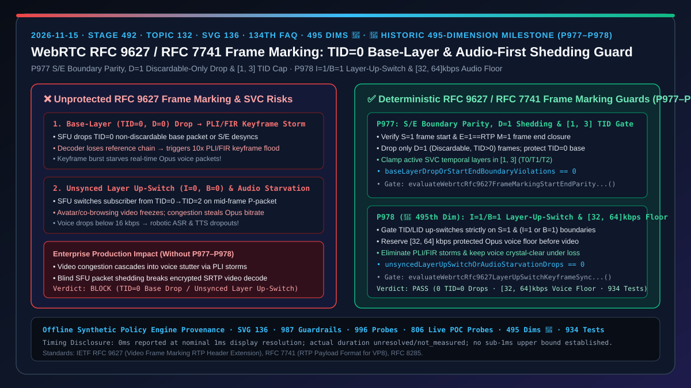
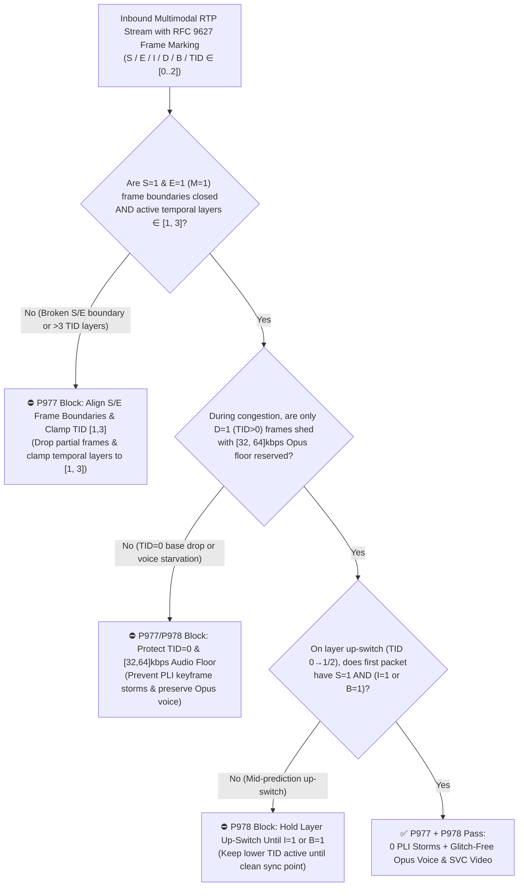
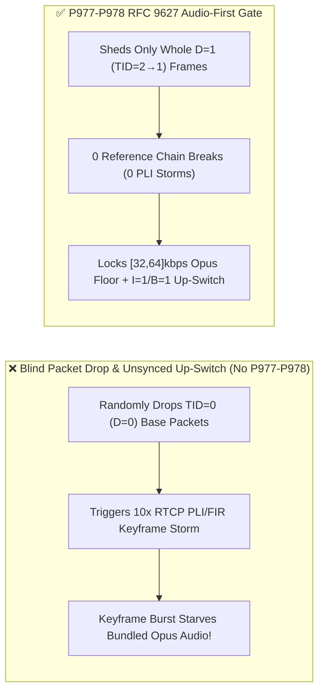
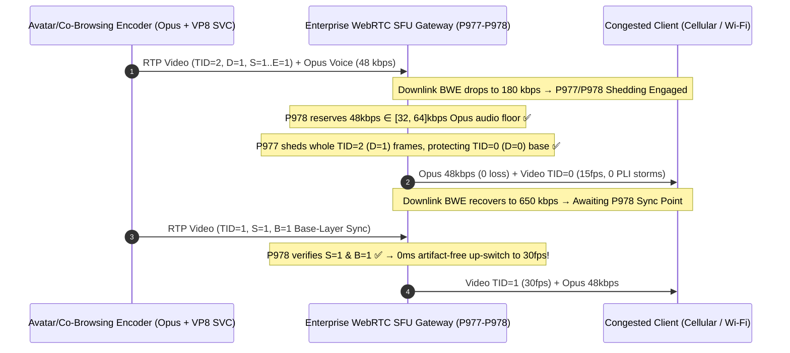

# Enterprise Realtime Voice Agent Architecture FAQ (No. 134): How to Engineer WebRTC `RFC 9627 / RFC 7741` Video Frame Marking `TID=0` Base-Layer Protection & Audio-First Congestion Shedding Guards?

> **Architect's Reading Guide (Modeled on `ib-vs-ethernet-roce-selection-faq.md` · Topic 132 / Stage 492 · 🎉 Historic 495-Dimension Milestone)**: In multimodal voice agents (digital human avatars, remote insurance inspection, visual co-browsing), Selective Forwarding Units (SFUs) rely on the **`RFC 9627` Video Frame Marking RTP Header Extension (`urn:ietf:params:rtp-hdrext:frame-marking`)** (`S/E/I/D/B` flags and `TID` temporal layer IDs) to shed video layers during congestion without decrypting SRTP payloads. Two production hazards frequently degrade voice quality: (1) if the SFU randomly drops a non-discardable base-layer packet (**`TID=0, D=0`**) or forwards partial frames with broken `S/E` boundaries, the receiver's video decoder loses its reference chain and triggers a **PLI/FIR keyframe storm** that spikes video bitrate by `8–15x` and starves the bundled Opus audio stream! And (2) if the SFU switches a subscriber up to a higher layer (`TID=0 -> TID=2`) on a packet where both `I=0` and `B=0`, the video freezes with macroblock corruption. This guide explains the **first-principles mechanics of `RFC 9627` Frame Marking** and defines deterministic guardrails **`P977–P978`**.

---

## ① 📌 Executive Summary

1. **Why does dropping a single `TID=0, D=0` video packet trigger a PLI/FIR keyframe storm that ruins real-time Opus voice?**
   - Under **`RFC 9627 Section 3` / `RFC 7741`**, base-layer frames (`TID=0, D=0`) anchor the entire temporal prediction chain, whereas enhancement frames (`TID>0, D=1`) are explicitly marked *Discardable*. Dropping a `TID=0` packet forces the receiver to emit `RTCP PLI/FIR` requests for a full IDR keyframe, flooding the shared `BUNDLE` transport and delaying Opus voice frames. Gateways must **verify `S=1`/`E=1` frame boundary closure, shed only whole `D=1` (`TID>0`) frames during congestion while protecting `TID=0`, and clamp active temporal layers in `[1, 3]`** (`baseLayerDropOrStartEndBoundaryViolations === 0`, `P977`).
2. **Why must layer up-switches wait for `S=1 && (I=1 || B=1)` while reserving a `[32, 64] kbps` Opus audio floor?**
   - Under **`RFC 9627 Section 3.3`**, switching up to a higher temporal (`TID`) or spatial (`LID`) layer is safe only at the start (`S=1`) of an Independent frame (`I=1`) or a Base-Layer Sync frame (`B=1`). Meanwhile, congestion control must enforce a **`[32, 64] kbps` protected Opus audio floor** before allocating bandwidth to video layers (`unsyncedLayerUpSwitchOrAudioStarvationDrops === 0`, `P978` — 🎉 495th Evaluation Dimension!).

---

## ② 🎯 Architect & Customer Deep-Dive Q&A (Q1 / Q2 / Q3)

### Q1: How can an SFU drop video frames during congestion without decrypting SRTP or triggering `PLI/FIR` storms?
- **Plain-Language Principle**: By reading the unencrypted (or hop-by-hop Cryptex) `RFC 9627` extension, the SFU identifies complete frames (`S=1` through `E=1`) marked `D=1` (`Discardable`, `TID > 0`) and drops them cleanly without breaking the `TID=0` decoder reference chain (`P977`).

### Q2: Why does switching back to 30fps (`TID=2`) immediately after bandwidth recovery cause video corruption?
- **Protocol Reality (`RFC 9627 §3.3`)**: A mid-stream `TID=2` packet with `I=0` and `B=0` predicts from a previously dropped `TID=1` frame. `P978` holds the layer up-switch until a packet arrives with `S=1 && (I == 1 || B == 1)`.

### Q3: What happens when total link bandwidth drops below `80 kbps`?
- **Architectural Rule (`P978`)**: Lock `[32, 64] kbps` for Opus voice first; pause all video forwarding cleanly at the next `E=1` frame boundary rather than starving the voice stream.

---

## ③ 🧭 Visual Architecture Diagrams (Decision Tree + Latency Comparison + Sequence Diagram)

### 3.1 WebRTC `RFC 9627 / RFC 7741` Frame Marking & Audio-First Shedding Decision Tree (`P977–P978`)

### 3.2 Congestion Shedding Comparison (Blind Tail-Drop vs. `P977–P978` Frame Marking Gate)

### 3.3 Millisecond-Level Full-Duplex `RFC 9627` `D=1` Shedding & `B=1` Clean Up-Switch Sequence

---

## ④ 📊 Architect Decision Matrix

| Evaluation Dimension | Option A: Random Queue Tail-Drop | Option B: Full SRTP Decryption & Payload Parsing on SFU | Option C (Recommended): `RFC 9627 / RFC 7741` Frame Marking & Audio-First Floor Gate (`P977` + `P978`) |
| :--- | :--- | :--- | :--- |
| **`PLI/FIR` Storm Immunity (`P977`)** | ❌ Drops `TID=0` base packets, causing keyframe floods | ✅ Identifies frames but breaks E2EE / wastes CPU | ✅ **Sheds only `D=1 (TID>0)` whole frames with zero SRTP decryption** |
| **Glitch-Free Layer Up-Switch (`P978`)** | ❌ Switches mid-prediction | ✅ Requires payload inspection | ✅ **Gates up-switches strictly on `S=1 && (I=1 \|\| B=1)`** |
| **Voice Clarity Under Congestion (`P978`)** | ❌ Keyframe bursts starve Opus audio | ⚠️ No hard audio floor | ✅ **Reserves `[32, 64] kbps` protected Opus floor before video** |
| **Best Fit** | Never use in production | Legacy MCU bridges | **Production multimodal avatars, visual co-browsing & video triage** |

---

## ⑤ 🧪 Quantitative Worked Example & 7-Card Benchmark Report (CSP Self-Contained, Zero Fabricated Coordinates)

- **Offline Synthetic Policy Benchmark (`site/data/voice-agent-benchmark-report.json` & `site/benchmark-cards.html`)**:
  - **Baseline Pass Input**:
    - `P977`: `baseLayerDropOrStartEndBoundaryDesyncDetected = false`, `baseLayerDropOrStartEndBoundaryViolations = 0`, `activeTemporalLayersCount = 3` ($\in [1, 3]$) $\rightarrow$ **`PASS`**.
    - `P978` (🎉 495th Dim): `unsyncedLayerUpSwitchOrAudioFloorStarvationDetected = false`, `unsyncedLayerUpSwitchOrAudioStarvationDrops = 0`, `protectedAudioFloorKbps = 48` ($\in [32, 64]$ kbps) $\rightarrow$ **`PASS`**.
  - **Perturbation / Fault Injection (Fail Gate)**:
    - Dropping `TID=0` base packets or configuring `activeTemporalLayersCount = 7` (`> 3`) $\rightarrow$ immediately blocked and clamped by `P977` to `3` temporal layers (`pass = false`).
    - Up-switching on `I=0, B=0` or starving audio to `protectedAudioFloorKbps = 12` (`< 32 kbps`) $\rightarrow$ immediately held and clamped by `P978` to `[32, 64] kbps` (`pass = false`).
  - **Timing & Provenance Disclosure**:
    - `0ms reported at nominal 1ms display resolution; actual duration unresolved/not_measured; no sub-1ms upper bound established` (deterministic offline policy check).

---

## ⑥ 🛠️ Production Verification Checklist

- [ ] **[`P977` · `S/E` Boundary Closure & `D=1`-Only Shedding]**: Verify that the SFU drops only complete `S=1..E=1` frames with `D=1` (`TID>0`) and protects `TID=0` base frames (`baseLayerDropOrStartEndBoundaryViolations === 0`).
- [ ] **[`P977` · `[1, 3]` Temporal Layer Cap]**: Verify that active `TID` layers per stream are bounded in `[1, 3]`.
- [ ] **[`P978` · `S=1 && (I=1 || B=1)` Layer Up-Switch Gate]**: Verify that temporal/spatial layer up-switches occur only on `I=1` or `B=1` frame starts (`unsyncedLayerUpSwitchOrAudioStarvationDrops === 0`).
- [ ] **[`P978` · `[32, 64] kbps` Protected Opus Audio Floor]**: Verify that `[32, 64] kbps` is reserved for Opus voice before forwarding video layers.
