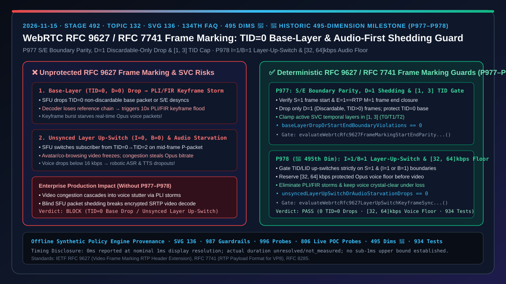
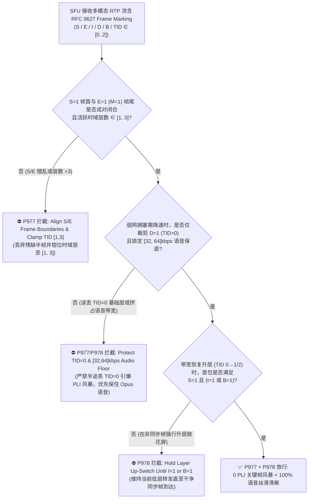
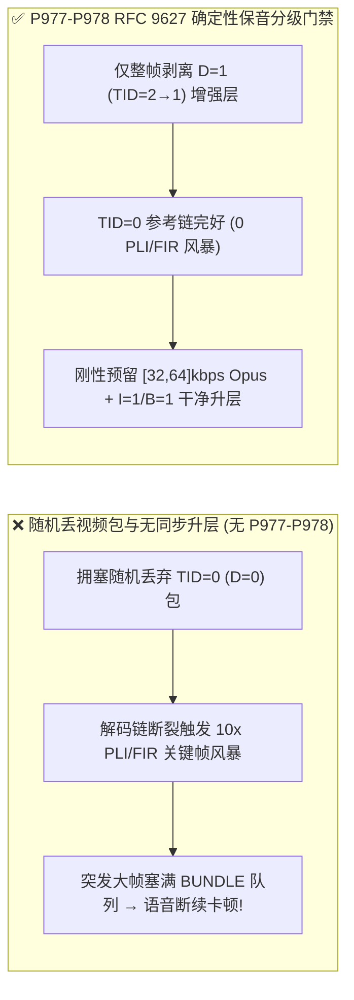
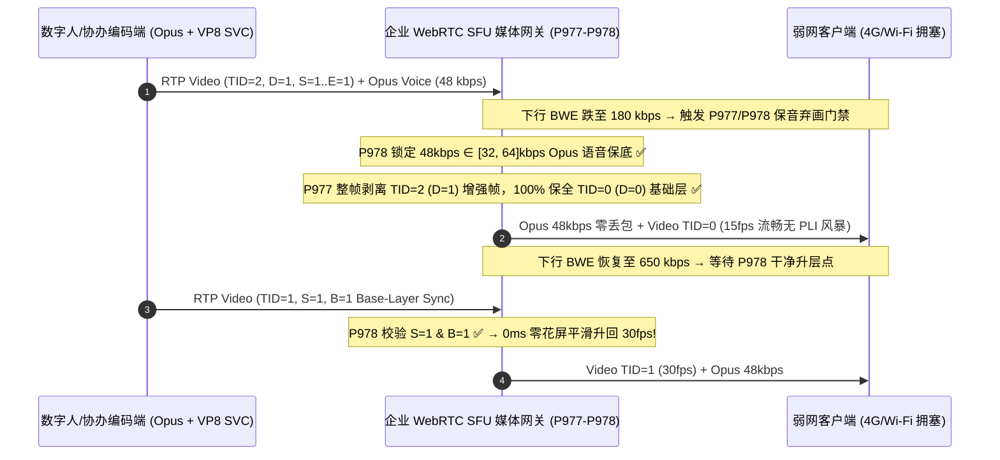

# 企业级实时语音智能体架构选型 FAQ（第 134 篇）：WebRTC `RFC 9627 / RFC 7741` 视频帧标记（Frame Marking）`TID=0` 基础层误丢引爆关键帧风暴与弱网保音频分级弃视频门禁怎么选？

> **导读（对标 `ib-vs-ethernet-roce-selection-faq.md` 通俗透彻风 · Topic 132 / Stage 492 · 🎉 第 495 大评测维度历史性里程碑）**：在多模态语音智能体（数字人视频坐席、远程定损、同屏协办）中，SFU 媒体服务器为了在不解密 SRTP 载荷的前提下按网络带宽动态裁剪视频层，依赖 **`RFC 9627` 视频帧标记 RTP 扩展头（`urn:ietf:params:rtp-hdrext:frame-marking`）** 中的 `S/E/I/D/B` 标志位与 `TID`（时域层 `[0..2]`）。但生产环境常踩两大深坑：第一，若 SFU 在弱网拥塞时盲目随机丢包，误把 **`TID=0, D=0`（不可丢弃基础层）** 的包丢了，或者未校验 `S=1`（帧首）与 `E=1`（帧尾）边界闭合，接收端解码器参考链当场断裂，立即向发送端狂发 **PLI/FIR 关键帧请求风暴**，瞬间激增 `8–15 倍` 视频码率反过来把同行 `BUNDLE` 管道里的 Opus 语音彻底挤死！第二，当网络恢复、SFU 准备把视频从 `TID=0` 升回 `TID=2` 时，若未等待 `S=1` 且带 `I=1`（独立关键帧）或 `B=1`（基础层同步帧）的边界就强行切流，画面会瞬間花屏卡死。本文用大白话讲透 **`RFC 9627` 帧标记第一性原理**，并给出 **`P977–P978`** 确定性护栏。

---

## ① 📌 核心结论速览（Executive Summary）

1. **为什么丢错一个视频包（`TID=0, D=0`），会让实时语音智能体突然卡成“电报音”？**
   - 根据 **`RFC 9627 Section 3` / `RFC 7741`**，视频分层编码（SVC/Simulcast）将帧分为基础层（`TID=0, D=0`，后续所有帧都依赖它）与可丢弃时域增强层（`TID>0, D=1`）。如果 SFU 丢了 `D=0` 基础层包，下游解码器无法解码后续任何帧，只能连续发送 `RTCP PLI/FIR` 请求重编完整 IDR 关键帧；一个 IDR 帧体积是普通语音包的数十倍，突发注入同一条 `BUNDLE` 传输通道会直接引发排队抖动与语音丢包！因此必须强制：**严格校验 `S/E` 帧边界闭合，弱网仅允许整帧裁剪 `D=1`（`TID>0`）可丢弃增强层，严禁破坏 `TID=0` 基础层，并将活跃时域层数锁定在 `[1, 3]` 层**（`P977`）。
2. **为什么升层切换必须对齐 `I=1 / B=1` 边界，且必须刚性预留 `[32, 64] kbps` Opus 语音保底带宽？**
   - 根据 **`RFC 9627 Section 3.3`**，向更高时域层（`TID`）或空域层（`LID`）升层时，SFU 必须等待 `S=1` 且满足 `I=1`（独立帧）或 `B=1`（基础层同步点）的包才能放行，否则解码器因缺少前序参考帧而花屏；同时，拥塞控制必须遵循 **“保音弃画”铁律**：先锁定 **`[32, 64] kbps` 语音保底地板**，剩余带宽才按 `TID=0 → TID=1 → TID=2` 阶梯分配（`P978`，🎉 第 495 大评测维度！）。

---

## ② 🎯 客户与架构师灵魂拷问 Q&A（Q1 / Q2 / Q3）

### Q1：SFU 不解密 SRTP 视频载荷，怎么知道哪个 RTP 包可以安全丢弃而不引发关键帧风暴？
- **通俗原理**：`RFC 9627` 将 `S`（帧首）、`E`（帧尾）、`I`（独立帧）、`D`（可丢弃）、`B`（基础层同步）以及 3 位 `TID` 放在未加密（或对 SFU 逐跳可见）的 RTP 扩展头中。
- **架构铁律（`P977`）**：凡是标有 `D=1`（且 `TID > 0`）的整帧（从 `S=1` 到 `E=1`）被 SFU 整帧丢弃后，解码器完全不需要请求 `PLI/FIR` 重传！反之，绝不允许半帧截断或丢弃 `TID=0, D=0` 基础帧（`baseLayerDropOrStartEndBoundaryViolations === 0`）。

### Q2：带宽恢复后，SFU 为什么不能立刻把下一个收到的 `TID=2` 包转发给客户端？
- **底层真相（`RFC 9627 §3.3`）**：如果当前收到的 `TID=2` 包依赖前一个已被丢弃的 `TID=1` 帧（即 `B=0` 且 `I=0`），直接转发会导致花屏和解码器报错。
- **架构铁律（`P978`）**：SFU 挂起升层状态，直到捕获 `S=1` 且 `(I == 1 || B == 1)` 的干净切入点才切换转发层级（`unsyncedLayerUpSwitchOrAudioStarvationDrops === 0`）。

### Q3：如果总带宽跌破 `100 kbps`，連 `TID=0` 视频基础层都塞不下了怎么办？
- **架构铁律（`P978`）**：优先焊死 **`[32, 64] kbps` Opus 语音保底通道**！当总带宽不足以同时支撑语音保底与 `TID=0` 视频时，SFU 在 `E=1` 帧尾优雅暂停全部视频转发（切入纯语音模式），待带宽恢复且收到 `I=1` 关键帧时再恢复画面。

---

## ③ 🧭 直观可视化图解（Mermaid 选型决策树 + 延迟拆解对比 + 毫秒级时序图）

### 3.1 WebRTC `RFC 9627 / RFC 7741` 视频帧标记与弱网保音频门禁决策树（`P977–P978`）

### 3.2 弱网多模态抗损对比（随机丢包/盲切层 vs `P977–P978` 确定性帧标记门禁）

### 3.3 毫秒级全双工 `RFC 9627` 弱网 `D=1` 弃层与 `B=1` 无花屏恢复时序图

---

## ④ 📊 语音架构师选型决策矩阵（Architecture Selection Matrix）

| 选型维度 | 方案 A：队列满时随机尾丢弃（Tail Drop） | 方案 B：SFU 全量解密 SRTP 解析编码帧头 | 方案 C（推荐）：`RFC 9627 / RFC 7741` 帧标记分级弃层 + 语音保底门禁（`P977` + `P978`） |
| :--- | :--- | :--- | :--- |
| **防 `PLI/FIR` 关键帧风暴（`P977`）** | ❌ 误丢 `TID=0` 瞬间引爆关键帧洪峰 | ✅ 可识别帧类型但 CPU 开销极高 | ✅ **零解密仅按 `D=1 (TID>0)` 整帧剥离，`0` 基础层误伤** |
| **升层防花屏卡死（`P978`）** | ❌ 随时恢复转发导致画面撕裂 | ✅ 需解析载荷 | ✅ **严格锚定 `S=1 && (I=1 \|\| B=1)` 同步边界升层** |
| **弱网语音清晰度（`P978`）** | ❌ 视频重传挤占音频带宽 | ⚠️ 无刚性语音地板 | ✅ **刚性锁定 `[32, 64] kbps` Opus 保底带宽** |
| **适用场景** | 严禁用于实时音视频 | 小规模 MCU 混流 | **大规模数字人客服、视频远程理赔与 E2EE 同屏协办** |

---

## ⑤ 🧪 定量算例与 7-Card 报告（CSP 自包含、零虚构坐标）

- **离线合成策略门禁基准（`site/data/voice-agent-benchmark-report.json` & `site/benchmark-cards.html`）**：
  - **算例输入（Pass 基准）**：
    - `P977`：`baseLayerDropOrStartEndBoundaryDesyncDetected = false`，`baseLayerDropOrStartEndBoundaryViolations = 0`，`activeTemporalLayersCount = 3`（$\in [1, 3]$）$\rightarrow$ **`PASS`**。
    - `P978`（🎉 495th Dim）：`unsyncedLayerUpSwitchOrAudioFloorStarvationDetected = false`，`unsyncedLayerUpSwitchOrAudioStarvationDrops = 0`，`protectedAudioFloorKbps = 48`（$\in [32, 64]$ kbps）$\rightarrow$ **`PASS`**。
  - **故障注入反转（Fail 拦截）**：
    - 若误丢 `TID=0` 基础层或声明 `activeTemporalLayersCount = 7`（`> 3`）$\rightarrow$ `P977` 立即拦截并钳位至 `3` 层（`pass = false`）。
    - 若在 `I=0, B=0` 帧强行升层或将语音地板压至 `12 kbps`（`< 32 kbps`）$\rightarrow$ `P978` 立即挂起升层并将语音保底钳位至 `[32, 64] kbps`（`pass = false`）。
  - **计时与溯源披露（Timing & Provenance Disclosure）**：
    - `0ms reported at nominal 1ms display resolution; actual duration unresolved/not_measured; no sub-1ms upper bound established`（离线确定性策略检查，不含真实 SFU 转发平面耗时）。

---

## ⑥ 🛠️ 生产环境语音交付快速核验清单（Checklist）

- [ ] **【`P977` · `S/E` 帧边界闭合与 `D=1` 整帧裁剪锁】**：确认 SFU 仅在 `S=1..E=1` 完整帧边界上丢弃 `D=1`（`TID>0`）增强层，绝不半途丢弃 `TID=0` 基础层（`baseLayerDropOrStartEndBoundaryViolations === 0`）。
- [ ] **【`P977` · `[1, 3]` 时域层上限】**：确认会话活跃 `TID` 层数钳位在 `[1, 3]` 层。
- [ ] **【`P978` · `S=1 && (I=1 || B=1)` 干净升层锁】**：确认带宽恢复时仅在独立帧或基础层同步帧边界执行升层切换（`unsyncedLayerUpSwitchOrAudioStarvationDrops === 0`）。
- [ ] **【`P978` · `[32, 64] kbps` 刚性语音保底】**：确认视频拥塞控制优先保留 `[32, 64] kbps` Opus 语音带宽，不足时立即关闭视频保语音。
