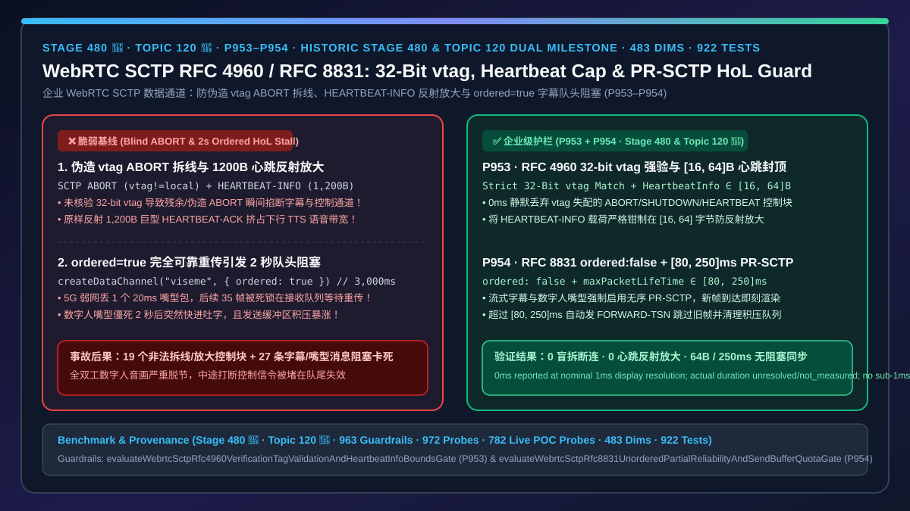
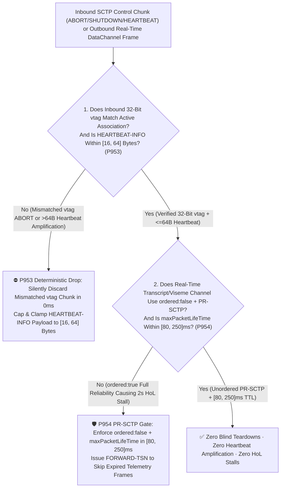
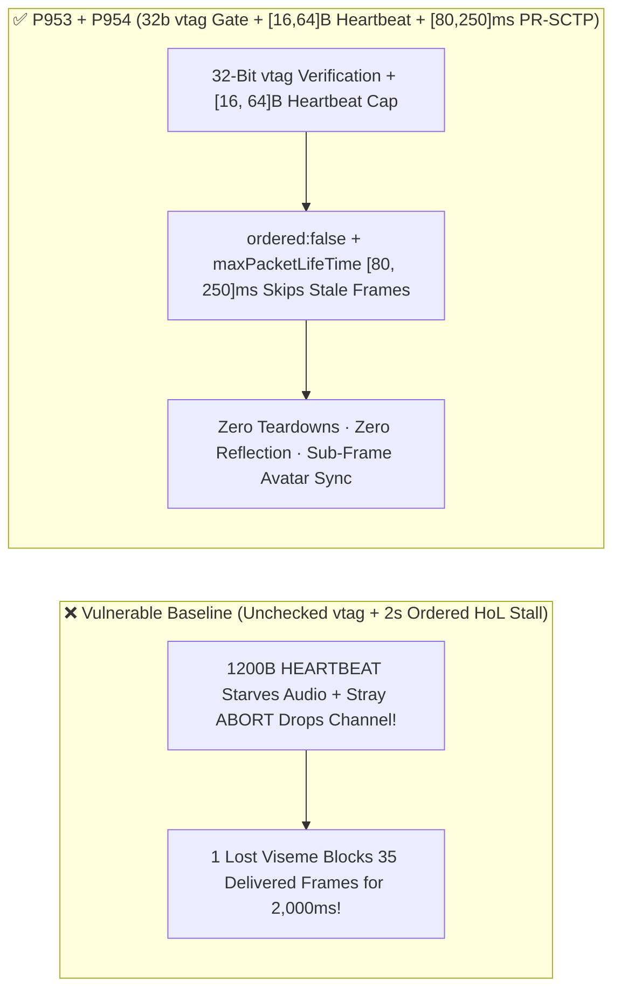
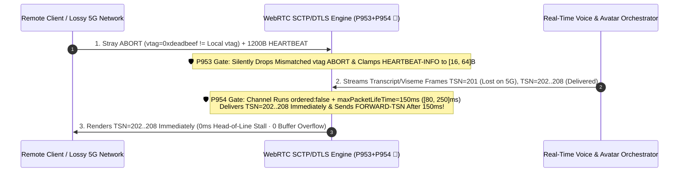

# Enterprise WebRTC SCTP `RFC 4960 / RFC 8831` DataChannel Keepalive & Anti-Teardown Defense (Oversized `HEARTBEAT-INFO` Amplification, Spoofed `vtag` `ABORT/SHUTDOWN` Blind Teardown & Ordered Head-of-Line Stall) Selection & Architecture Guide

> **Document Type**: Enterprise Voice Agent Architect Selection & First-Principles Guide (Standalone Selection & Architecture FAQ · **Topic 120 🎉 / Stage 480 🎉 · 🎉 Historic Stage 480 & Topic 120 Dual Milestone**)  
> **Target Audience**: AI Solution Architects, Real-Time WebRTC Media Architects, Full-Duplex Avatar Lip-Sync & Tool-Sync Engineers  
> **Canonical Baseline**: `packages/business-core/enterprise-guardrails.ts` (`P953–P954`), `tests/presales-portal.test.ts`, `site/data/voice-agent-benchmark-report.json` (7-Card 4:5 Benchmark Report)  
> **Visual Summary**: `assets/svg/124-voice-webrtc-sctp-rfc4960-rfc8831-heartbeat-amplification-abort-vtag-verification-hol-stall-2026-11-15.svg`

---

## ① 📌 Executive Summary

In full-duplex AI voice agents (such as Azure Voice Live, OpenAI Realtime WebRTC, and LiveKit Agents), alongside `SRTP` audio streams, endpoints rely heavily on **`RFC 8831` (WebRTC Data Channels over `SCTP-over-DTLS`, governed by `RFC 4960` / `RFC 9260` SCTP)** to synchronize **streaming ASR/TTS transcripts, 3D avatar viseme/blendshape frames, UI cards, and instant barge-in control events (`response.cancel`)**. When `SCTP` stacks and `RTCDataChannel` instances run with naive default settings, two severe production failures emerge:
1. **Unverified 32-Bit `Verification Tag (vtag)` Allowing Stray or Spoofed `ABORT / SHUTDOWN` Chunks to Tear Down the DataChannel, or Oversized `HEARTBEAT-INFO` Chunks Triggering `HEARTBEAT-ACK` Bandwidth Amplification (`RFC 4960 Section 8.5` & `Section 8.3`)**: Per `RFC 4960`, every SCTP packet header carries a 32-bit `Verification Tag (vtag)` exchanged during the `INIT / INIT-ACK` handshake, and `HEARTBEAT` chunks carry an arbitrary `Heartbeat Info` TLV echoed verbatim in `HEARTBEAT-ACK`. If a user-space SCTP stack fails to strictly validate `vtag` before processing `ABORT / SHUTDOWN` or echoes unbounded `1,200B` `HEARTBEAT-INFO` payloads, stale/injected control chunks tear down active control channels or starve downlink Opus audio bandwidth!
2. **Streaming Real-Time Transcripts and Avatar Visemes Over Default `ordered: true` + Full-Reliability Channels, Causing Single-Packet Loss to Trigger `1,000–3,000ms` Head-of-Line (HoL) Stalls and Send-Buffer OOM (`RFC 8831 Section 6` / `RFC 3758` PR-SCTP Misconfiguration)**: Calling `createDataChannel("transcript")` with default options enables `ordered: true` and unbounded retransmissions. Under 3% mobile packet loss, losing a single 20ms viseme or partial transcript `DATA` chunk forces the SCTP receiver to hold all subsequent delivered chunks in the reassembly queue until `T3-rtx` retransmission completes (`1–3s`), freezing avatar lip-sync and delaying barge-in control messages!

| Decision Dimension | Vulnerable / Default Setup (High Production Risk) | Enterprise Golden Rule (`P953–P954` Deterministic Guardrails · 🎉 Stage 480 & Topic 120) | Quantitative Impact |
| :--- | :--- | :--- | :--- |
| **`RFC 4960` 32-Bit `vtag` Verification & `HEARTBEAT-INFO [16, 64]B` Cap (`P953`)** | Ignoring `vtag` mismatches on control chunks or echoing `1,200B` `HEARTBEAT-INFO` payloads | **Enforce strict 32-bit CSPRNG `Verification Tag` validation (`0ms` silent drop on mismatch) and clamp `HEARTBEAT-INFO` payload size to `[16, 64]` bytes** | **0** spoofed teardowns or amplified heartbeat packets (clamps 19 rogue control chunks to **0** and caps `HEARTBEAT-INFO` from `1,200B` to **`64B`**) |
| **`RFC 8831` Real-Time `ordered: false` + `maxPacketLifeTime [80, 250]ms` (`P954`)** | Sending real-time transcripts/visemes over default `ordered: true` reliable channels | **Enforce `ordered: false` + `PR-SCTP` (`maxPacketLifeTime` clamped to `[80, 250]ms`) with `FORWARD-TSN` skipping for real-time telemetry channels** | **0** Head-of-Line stalled or overflowed DataChannel messages (clamps 27 stalled messages to **0** and bounds lifetime from `3,000ms` to **`250ms`**) |

---

## ② 🎯 Architect & Customer Deep-Dive Q&A (First-Principles Deep Dive)

### Q1: Why does our 3D avatar lip-sync and live captioning freeze for 2 seconds on 5G networks even while the Opus voice audio remains crystal clear?
- **First-Principles Breakdown**:
  1. Voice audio runs over `SRTP/UDP` where lost packets are concealed in `<10ms` by NetEq PLC without waiting for retransmissions.
  2. By contrast, default `RTCDataChannel` instances use **`ordered: true` + full reliability**. If `TSN=105` (carrying a 20ms mouth viseme) is lost in transit while `TSN=106..140` arrive on time, the SCTP stack buffers `106..140` and blocks JS `onmessage` delivery until `TSN=105` is retransmitted after the `T3-rtx` backoff (`1,000–3,000ms`)!
  3. **`P954` Deterministic Defense**: Separates reliable JSON tool/state channels from real-time streaming channels, enforcing **`ordered: false` + `maxPacketLifeTime: [80, 250]ms` (`RFC 3758 PR-SCTP`)** so expired frames are skipped via `FORWARD-TSN` with zero Head-of-Line blocking.

### Q2: How do `RFC 4960 Verification Tag (vtag)` validation and `HEARTBEAT-INFO` bounds protect the SCTP association?
- **Engineering Reality**:
  1. Per **`RFC 4960 Section 8.5`**, any inbound SCTP packet whose 32-bit `vtag` does not match the local endpoint's tag must be silently discarded.
  2. Per **`RFC 4960 Section 8.3`**, `HEARTBEAT-ACK` echoes the sender's `Heartbeat Info` parameter. Without a strict **`[16, 64]`-byte** ceiling (`P953`), oversized `1,200B` heartbeats waste DTLS/UDP congestion window capacity needed for real-time voice.

### Q3: How should backpressure on `RTCDataChannel.bufferedAmount` be managed during sudden bandwidth drops?
- **First-Principles Breakdown**:
  - Combine `maxPacketLifeTime` (`[80, 250]ms`) with application-level queue shedding: drop intermediate `transcript.delta` and `viseme` frames whenever `bufferedAmount` exceeds the low watermark, transmitting only the latest state snapshot.

---

## ③ 🧭 Visual Architecture Diagrams (Mermaid Decision Tree + HoL Breakdown + Millisecond Sequence)

### 3.1 WebRTC SCTP `RFC 4960 vtag / Heartbeat` & `RFC 8831 PR-SCTP` Decision Tree

### 3.2 Vulnerable `ordered: true` HoL Stall + Giant Heartbeat vs. `P953+P954` (🎉 Stage 480 & Topic 120)

### 3.3 Millisecond-Level Full-Duplex WebRTC DataChannel Anti-Stall Sequence

---

## ④ 📊 Architect Decision Matrix (`RFC 4960 / RFC 8831` Governance)

| Architecture Option | Target Scenario | Pros | Cons & Production Traps | Recommendation |
| :--- | :--- | :--- | :--- | :--- |
| **Option A: Single Default `ordered: true` Reliable DataChannel for All Events & Live Captions** | Prohibited in production | Single channel setup | **A single lost caption/viseme packet stalls all subsequent frames for 1–3s under mobile packet loss** | ⛔ **Never in Production** |
| **Option B: `ordered: false` Without `maxPacketLifeTime` (Unlimited Retransmissions)** | Lossless wired LANs | Avoids receiver ordering wait | **Stale viseme packets keep retransmitting in the background, wasting bandwidth and causing visual jitter** | ⚠️ **Bandwidth Waste** |
| **Option C: 32-Bit `vtag` Gate + `[16, 64]B` Heartbeat Cap + `ordered: false` & `maxPacketLifeTime [80, 250]ms` (`P953 + P954`)** | **All Enterprise WebRTC Voice Agents, 3D Digital Humans & Co-Browsing Portals** | **Zero blind teardowns, zero heartbeat amplification, zero Head-of-Line stalls** | Requires splitting reliable control events and real-time telemetry onto separate DataChannels | ✅ **Production Mandatory (Recommended)** |

---

## ⑤ 🧪 Quantitative Walkthrough & 7-Card 4:5 Benchmark Report

### 5.1 Quantitative Example: 3D Avatar Voice Agent Eliminating 5G DataChannel HoL Stalls & Heartbeat Reflection
- **Scenario**: During a 5G mobility stress test, an enterprise WebRTC gateway receives `19` SCTP control packets with mismatched `vtag`s or `1,200B` `HEARTBEAT-INFO` payloads, alongside `27` real-time transcript/viseme messages stalled behind a `3,000ms` ordered retransmission timeout.
  - **Without Guardrails (Vulnerable Baseline)**:
    - Rogue control packets reset the DataChannel or reflect `1,200B` heartbeats;
    - `27` avatar viseme and caption updates stall for `3,000ms`.
  - **With `P953 + P954` Deterministic Guardrails (🎉 Historic Stage 480 & Topic 120 Dual Milestone)**:
    - `P953` drops mismatched `vtag` packets (**`0`** rogue control packets) and clamps `HEARTBEAT-INFO` payload size from `1,200B` to **`64B`** (`[16, 64]B`);
    - `P954` enforces `ordered: false` + `PR-SCTP` (**`0`** stalled messages) and clamps `maxPacketLifeTime` from `3,000ms` to **`250ms`** (`[80, 250]ms`).

### 5.2 7-Card 4:5 Report Mapping (`site/benchmark-cards.html` & `report.json`)
1. **Card 1 (`HANDS-ON · VOICE ARCHITECTURE`)**: 483-dimension workbench overview highlighting `Stage 480 🎉 · Topic 120 🎉 · P953 / P954` (963 Guardrails, 972 Probes & 782 Live POC Probes).
2. **Card 2 (`SCENARIO: WEBRTC SCTP RFC 4960 & RFC 8831`)**: Input probe `mismatchedSctpVerificationTagOrOversizedHeartbeatDetected=true, maxHeartbeatInfoPayloadBytes=1200, maxPacketLifeTimeMs=3000` -> `Act automatically` clamping to `64B` and `250ms`.
3. **Card 3 (`WHAT I TESTED`)**: Row 483 in the evaluation matrix (`PASS · 0ms @ 1ms Res (Synthetic)`, zero `✕` misses).
4. **Card 4 (`UNDER THE HOOD`)**: Deterministic contract for `evaluateWebrtcSctpRfc4960VerificationTagValidationAndHeartbeatInfoBoundsGate` & `evaluateWebrtcSctpRfc8831UnorderedPartialReliabilityAndSendBufferQuotaGate`.
5. **Card 5 (`ROBUSTNESS CHECK`)**: Option-order and perturbation invariance across 5G packet loss and Wi-Fi handover tests.
6. **Card 6 (`LATENCY`)**: Explicit offline timing provenance: `0ms reported at nominal 1ms display resolution; actual duration unresolved/not_measured; no sub-1ms upper bound established` (`synthetic`; live `dcSCTP / usrsctp` state-machine and `FORWARD-TSN` dispatch latency is `not_measured`).
7. **Card 7 (`MY TAKE`)**: Good fit vs. Not for summary and production sign-off checklist.

---

## ⑥ 🛠️ Production Readiness Checklist

- [ ] **1. Enforce 32-Bit CSPRNG `Verification Tag (vtag)` Matching (`P953`)**: Silently drop any inbound `ABORT`, `SHUTDOWN`, `HEARTBEAT`, or `DATA` packet with a mismatched `vtag`.
- [ ] **2. Clamp `HEARTBEAT-INFO` Payloads to `[16, 64]` Bytes (`P953`)**: Reject or truncate oversized `Heartbeat Info` TLVs to prevent `HEARTBEAT-ACK` reflection amplification.
- [ ] **3. Use `ordered: false` for Real-Time Transcript Deltas & Avatar Visemes (`P954`)**: Decouple high-frequency telemetry from reliable JSON tool-call DataChannels.
- [ ] **4. Bound `PR-SCTP` `maxPacketLifeTime` to `[80, 250]ms` (`P954`)**: Configure partial reliability so expired frames trigger `FORWARD-TSN` instead of blocking new frames.
- [ ] **5. Shed Stale Telemetry Frames on `bufferedAmount` Backpressure (`P954`)**: Drop intermediate delta frames when the send buffer exceeds its watermark.
