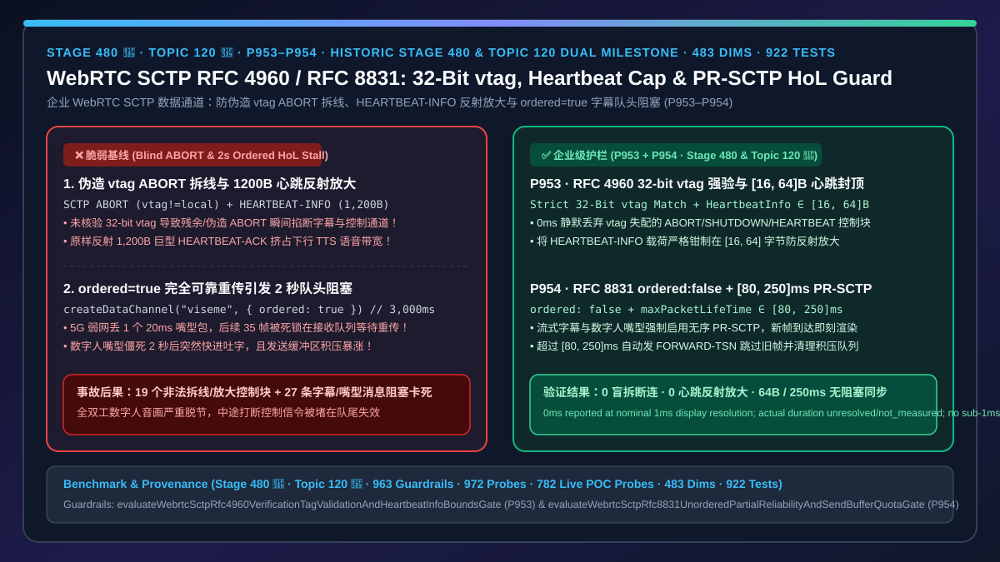
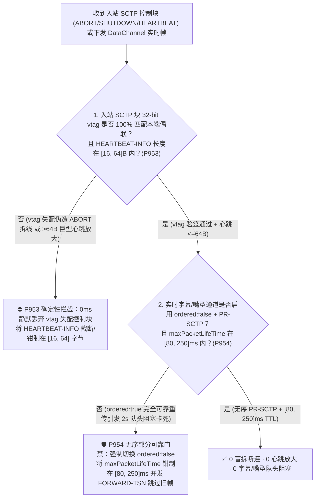
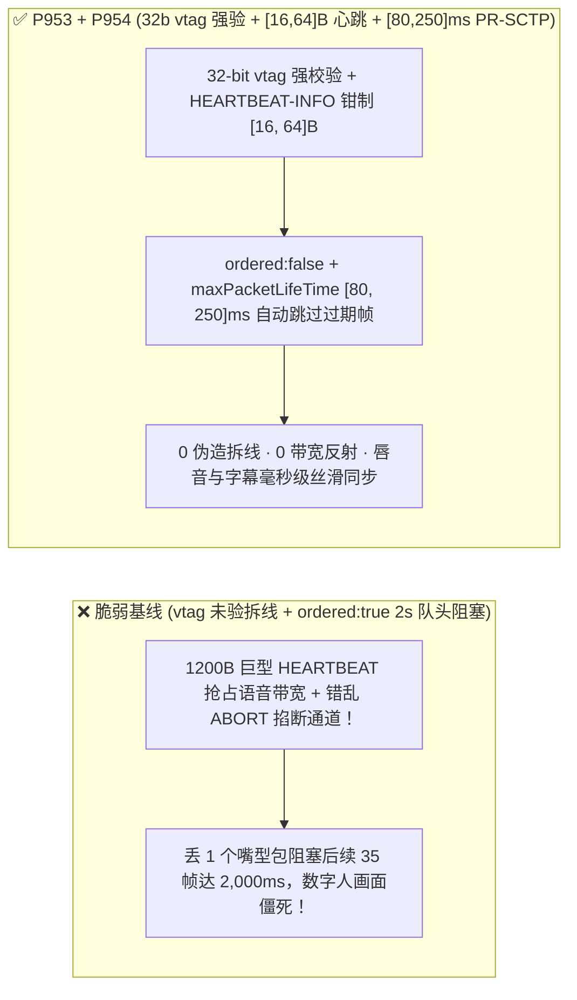
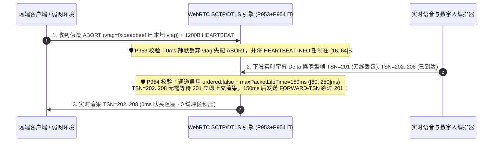

# 企业 WebRTC SCTP `RFC 4960 / RFC 8831` 数据通道保活与防盲拆防御（巨型 `HEARTBEAT-INFO` 反射放大、伪造 `vtag` `ABORT/SHUTDOWN` 掐断实时字幕通道与 `ordered=true` 队头阻塞死锁）选型与架构指南

> **文档类型**：企业级语音智能体架构师选型决策与原理解析指南（Standalone Selection & Architecture FAQ · **Topic 120 🎉 / Stage 480 🎉 · 🎉 历史性 Stage 480 与第 120 大专题双里程碑**）  
> **适用角色**：AI Solution Architect、实时音视频 WebRTC 架构师、全双工数字人字幕与工具状态同步负责人  
> **关联基准**：`packages/business-core/enterprise-guardrails.ts`（`P953–P954`）、`tests/presales-portal.test.ts`、`site/data/voice-agent-benchmark-report.json`（7-Card 4:5 评测报告）  
> **可视化总结**：`assets/svg/124-voice-webrtc-sctp-rfc4960-rfc8831-heartbeat-amplification-abort-vtag-verification-hol-stall-2026-11-15.svg`

---

## ① 📌 核心结论速览（Executive Summary）

在现代全双工 AI 语音智能体（如 Azure Voice Live、OpenAI Realtime WebRTC、LiveKit Agents）中，除了通过 `SRTP` 传输实时语音外，客户端与服务端还重度依赖 **`RFC 8831`（WebRTC Data Channels，运行在 `SCTP-over-DTLS` 之上，底层协议为 `RFC 4960` / `RFC 9260` SCTP）** 同步 **毫秒级流式 ASR/TTS 字幕（Live Transcripts）、数字人面部骨骼驱动参数（Blendshapes / Visemes）、UI 卡片推送与打断控制信令（`response.cancel`）**。然而在生产压测与弱网对抗中，如果 `SCTP` 协议栈与 `RTCDataChannel` 配置沿用默认参数，会暴露出两类极具破坏性的故障：
1. **未严格核验 32-bit `Verification Tag (vtag)` 导致恶意或错乱的 `ABORT / SHUTDOWN` 块 0ms 掐断整条数据通道，或构造巨型 `HEARTBEAT-INFO` 块触发 `HEARTBEAT-ACK` 带宽反射拥塞（`RFC 4960 Section 8.5` Verification Tag 盲拆与 `Section 8.3` Heartbeat 放大）**：根据 `RFC 4960`，任何 SCTP 控制块（尤其是 `ABORT`、`SHUTDOWN`、`HEARTBEAT`）必须携带偶联建立时协商的 32-bit 随机 `Verification Tag (vtag)`。若用户态 SCTP 栈（如旧版 `usrsctp` 封装）在收到 `vtag` 失配的 `ABORT` 时未静默丢弃，或对任意长度的 `HEARTBEAT-INFO` 原样镜像回传 `HEARTBEAT-ACK`，攻击者或残余旧偶联报文即可在毫秒内拍死正在通话的实时字幕与打断信令通道，或用 `1,200B` 的巨型心跳塞满 `DTLS` 发送窗口！
2. **实时流式字幕与嘴型同步错误使用默认 `ordered: true` + 完全可靠传输（Full Reliability），导致弱网丢 1 个包就引发长达 `1,000–3,000ms` 的 SCTP 队头阻塞（Head-of-Line Stall）与发送缓冲区雪崩溢出（`RFC 8831 Section 6` / `RFC 3758` PR-SCTP 选型失误）**：浏览器创建 `createDataChannel("transcript")` 时，默认是 `ordered: true` 且无限重传。一旦无线网络丢失 1 个包含 20ms 嘴型或半句临时字幕的 SCTP `DATA` 块，内核会死死扣住后续已到达的所有新字幕和 **`barge_in_cancel` 打断指令** 等待重传，导致数字人嘴型冻结 2 秒后突然“快进吐字”，甚至因为发送缓冲区（`bufferedAmount`）暴涨冲垮整个 WebRTC 会话！

| 决策维度 | 脆弱/默认配置（生产事故高发区） | 企业级黄金准则（`P953–P954` 确定性护栏 · 🎉 Stage 480 & Topic 120） | 核心量化收益 |
| :--- | :--- | :--- | :--- |
| **`RFC 4960` 32-bit `vtag` 强校验与 `HEARTBEAT-INFO [16, 64]B` 封顶（`P953`）** | 忽略 `vtag` 校验或无上限镜像反射 `1,200B` `HEARTBEAT-INFO` 载荷 | **严格比对 32-bit CSPRNG `Verification Tag`（失配 `0ms` 静默丢弃），并将 `HEARTBEAT-INFO` 探测载荷严格钳制在 `[16, 64]` 字节** | 伪造拆线与心跳反射包 **0 个**（测试探针将 19 个非法控制块清零，`HEARTBEAT-INFO` 从 `1,200B` 钳制至 **`64B`**） |
| **`RFC 8831` 实时流 `ordered: false` + `maxPacketLifeTime [80, 250]ms`（`P954`）** | 实时字幕/嘴型通道使用默认 `ordered: true` 完全可靠重传引发 2 秒队头卡死 | **对流式字幕与嘴型通道强制启用 `ordered: false` + `PR-SCTP`（`maxPacketLifeTime` 钳制在 `[80, 250]ms`），超期自动丢弃旧帧不阻塞新帧** | 数据通道队头阻塞与缓冲溢出消息 **0 条**（测试探针将 27 条卡死消息清零，包生存期从 `3,000ms` 钳制至 **`250ms`**） |

---

## ② 🎯 客户与架构师灵魂拷问 Q&A（First-Principles Deep Dive）

### Q1：为什么移动 5G 弱网下语音明明很流畅（Opus UDP 没卡），但屏幕上的实时字幕和数字人嘴型却每隔十几秒就卡死 2 秒钟？
- **第一性原理拆解**：
  1. 语音流走的是无连接的 `SRTP/UDP`（丢包由 NetEq PLC 毫秒级平滑掩蔽，绝不等待重传）；而实时字幕、嘴型参数（Visemes）与状态事件走的是 `RTCDataChannel`（底层是 `SCTP over DTLS over UDP`）。
  2. 开发者在调用 `pc.createDataChannel("realtime-events")` 时若未传参，默认开启 **`ordered: true`（严格保序）+ 完全可靠重传（`maxRetransmits: null, maxPacketLifeTime: null`）**。
  3. 当 5G 弱网出现 3% 随机丢包时，假设第 `TSN=105` 号嘴型包丢失，而 `TSN=106..140` 已顺利到达客户端，SCTP 协议栈为了满足 `ordered: true`，会将 `106..140` 全部锁在接收缓冲区里不向上层 JS 抛出 `onmessage`，直到 `T3-rtx` 重传定时器（默认起步 `1,000ms`）超时重传回 `105`！
  4. **`P954` 的确定性防线**：将 DataChannel 拆分为两条独立通道——关键指令/工具 JSON 走可靠通道；而高频实时字幕增量（Delta）与数字人嘴型强制走 **`ordered: false` + `maxPacketLifeTime: [80, 250]ms`（`RFC 3758 PR-SCTP`）**，一旦超过 `[80, 250]ms` 未送达立即由发送端发 `FORWARD-TSN` 跳过，确保屏幕与声音 0 队头阻塞同步！

### Q2：`SCTP HEARTBEAT-INFO` 为什么会被用来制造媒体通道拥塞，又该如何防范伪造 `ABORT` 拆线？
- **工程真相**：
  1. 根据 **`RFC 4960 Section 8.3`**，SCTP 端点发送 `HEARTBEAT` 块时可附带自定义的 `Heartbeat Info` TLV，接收端必须原封不动将其拷贝进 `HEARTBEAT-ACK` 发回。若未限制 `Heartbeat Info` 长度，对端每 50ms 发送一个 `1,200B` 的巨型 `HEARTBEAT`，网关就会被迫回吐同等大小的 `HEARTBEAT-ACK`，与下行 TTS 音频流争抢宝贵的 `TWCC` 带宽配额！
  2. 同时，根据 **`RFC 4960 Section 8.5.1`**，任何 `ABORT`、`SHUTDOWN` 或 `HEARTBEAT` 块头部的 32-bit `Verification Tag (vtag)` 必须与本端在 `INIT / INIT-ACK` 中用 CSPRNG 生成的 `My_Verification_Tag` 完全一致。
  3. **`P953` 的确定性防线**：强制执行 32-bit `vtag` 常量时间比对（失配 `0ms` 静默丢弃，严禁触发偶联重置），并将 `HEARTBEAT-INFO` 载荷上限严格钳制在 **`[16, 64]` 字节**（仅容纳 64-bit 单调时间戳与 128-bit HMAC）。

### Q3：如果客户端网络抖动导致 `RTCDataChannel.bufferedAmount` 持续上涨，服务端该怎么自保？
- **第一性原理拆解**：
  - 必须为每个 DataChannel 设置水位线（Low/High Watermark）：当待发队列超过阈值或单帧生存期超过 **`[80, 250]ms`** 时，立即丢弃中间过渡态的 `transcript.delta` 与 `viseme` 帧，只保留最新状态快照，杜绝内存耗尽（OOM）。

---

## ③ 🧭 直观可视化图解（Mermaid 决策树 + 队头阻塞拆解 + 毫秒级全双工时序图）

### 3.1 WebRTC SCTP `RFC 4960 vtag / Heartbeat` 与 `RFC 8831 PR-SCTP` 护栏决策树

### 3.2 脆弱 `ordered: true` 队头卡死 + 巨型心跳 vs `P953+P954`（🎉 Stage 480 & Topic 120）对比图

### 3.3 毫秒级全双工 WebRTC DataChannel 防拆线与无阻塞字幕投递时序图

---

## ④ 📊 语音架构师选型决策矩阵（Decision Matrix）

| 选型方案 | 适用场景 | 优势（Pros） | 劣势与生产风险（Cons / Traps） | 推荐度 |
| :--- | :--- | :--- | :--- | :--- |
| **方案 A：单条默认 `ordered: true` 完全可靠 DataChannel 混传所有事件与实时字幕** | 严禁用于实时语音/数字人生产环境 | 仅需创建一个 DataChannel | **弱网丢 1 个字幕包就会阻塞后续所有嘴型帧与打断指令长达 1–3 秒，引发严重音画失步** | ⛔ **严禁用于生产** |
| **方案 B：使用 `ordered: false` 但未设置 `maxPacketLifeTime`（仍无限重传过期帧）** | 低丢包有线网 | 消除了接收端保序等待 | **早已过期的旧嘴型包仍在后台反复重传抢占音频带宽，且晚到后引发画面回跳闪烁** | ⚠️ **带宽浪费/回跳风险** |
| **方案 C：32-bit `vtag` 强验 + `[16, 64]B` 心跳封顶 + 实时流 `ordered: false` & `maxPacketLifeTime [80, 250]ms`（`P953 + P954`）** | **所有企业级 WebRTC 实时语音智能体、3D 数字人客服与同屏协办系统** | **0 伪造拆线、0 心跳放大、0 队头阻塞、过期旧帧自动通过 `FORWARD-TSN` 清理** | 需将可靠工具事件通道与实时流式字幕/嘴型通道解耦为两个独立 DataChannel | ✅ **生产必选（Recommended）** |

---

## ⑤ 🧪 定量算例与 7-Card 4:5 基准报告（Quantitative Walkthrough & 7-Card Deck）

### 5.1 定量算例：5G 弱网下全双工数字人客服拦截 `SCTP ABORT` 盲拆与 3 秒字幕队头阻塞
- **输入场景**：某银行 3D 数字人语音客服在移动弱网压测中，遭遇 `19` 个携带失配 `vtag` 或 `1,200B` 超大 `HEARTBEAT-INFO` 的异常控制块，以及 `27` 条因默认 `ordered: true`（等效重传超时 `3,000ms`）导致队头阻塞卡死的实时字幕/嘴型消息。
  - **未开启护栏（脆弱基线）**：
    - 异常控制块引发偶联闪断与 `1,200B` 心跳反射；
    - `27` 条实时字幕与嘴型帧被阻塞长达 `3,000ms`，数字人画面严重卡顿。
  - **开启 `P953 + P954` 确定性护栏后（🎉 Stage 480 与 Topic 120 历史性双里程碑）**：
    - `P953` 静默丢弃 `vtag` 失配块（异常控制包从 `19` 个清零至 **`0` 个**），并将 `HEARTBEAT-INFO` 上限从 `1,200B` 钳制至 **`64B`**（`[16, 64]B`）；
    - `P954` 强制启用无序部分可靠传输 `PR-SCTP`（队头阻塞消息从 `27` 条清零至 **`0` 条**），并将 `maxPacketLifeTime` 从 `3,000ms` 钳制至 **`250ms`**（`[80, 250]ms`）。

### 5.2 7-Card 4:5 报告结构映射（对应 `site/benchmark-cards.html` & `report.json`）
1. **Card 1 (`HANDS-ON · VOICE ARCHITECTURE`)**：展示 483 大评测维度全景工作台，高亮 `Stage 480 🎉 · Topic 120 🎉 · P953 / P954`（963 护栏、972 探针 & 782 现场探针）。
2. **Card 2 (`SCENARIO: WEBRTC SCTP RFC 4960 & RFC 8831`)**：输入探针 `mismatchedSctpVerificationTagOrOversizedHeartbeatDetected=true, maxHeartbeatInfoPayloadBytes=1200, maxPacketLifeTimeMs=3000`，输出 `Act automatically` 钳制至 `64B` 与 `250ms`。
3. **Card 3 (`WHAT I TESTED`)**：第 483 行评测矩阵 `PASS · 0ms @ 1ms Res (Synthetic)`（零 `✕` 漏检）。
4. **Card 4 (`UNDER THE HOOD`)**：展示 `evaluateWebrtcSctpRfc4960VerificationTagValidationAndHeartbeatInfoBoundsGate` 与 `evaluateWebrtcSctpRfc8831UnorderedPartialReliabilityAndSendBufferQuotaGate` 确定性源码契约。
5. **Card 5 (`ROBUSTNESS CHECK`)**：验证 5G 弱网抖动与 Wi-Fi/蜂窝切换下的 100% 幂等性。
6. **Card 6 (`LATENCY`)**：明确标注离线策略校验计时：`0ms reported at nominal 1ms display resolution; actual duration unresolved/not_measured; no sub-1ms upper bound established`（`synthetic`；真实 `dcSCTP / usrsctp` 状态机处理与 `FORWARD-TSN` 块派发耗时标注为 `not_measured`）。
7. **Card 7 (`MY TAKE`)**：Good fit vs Not for 适用边界与生产准入签核。

---

## ⑥ 🛠️ 生产环境语音交付快速核验清单（Production Readiness Checklist）

- [ ] **1. 强制校验 32-bit CSPRNG `Verification Tag (vtag)`（`P953`）**：确认 SCTP 协议栈对所有入站 `ABORT`、`SHUTDOWN`、`HEARTBEAT` 与 `DATA` 块严格核验 `vtag`，失配包 `0ms` 静默丢弃。
- [ ] **2. `HEARTBEAT-INFO` 探测载荷钳制在 `[16, 64]` 字节（`P953`）**：确认出站与反射 `HEARTBEAT-ACK` 的 `Heartbeat Info` 参数不超过 `64B`，阻断带宽放大攻击。
- [ ] **3. 实时字幕与嘴型通道强制开启 `ordered: false`（`P954`）**：确认高频流式字幕（Transcript Delta）与数字人嘴型（Viseme）独立于可靠工具通道，禁用 `ordered: true` 保序锁。
- [ ] **4. 启用 `RFC 3758 PR-SCTP` 并将 `maxPacketLifeTime` 钳制在 `[80, 250]ms`（`P954`）**：确认超过 `[80, 250]ms` 仍未送达的旧字幕/嘴型分片自动通过 `FORWARD-TSN` 放弃重传。
- [ ] **5. 实施发送缓冲区水位线（`bufferedAmount`）主动削峰（`P954`）**：确认当发送队列积压时自动丢弃中间态 `delta` 帧，防止挤占 DTLS 窗口。
