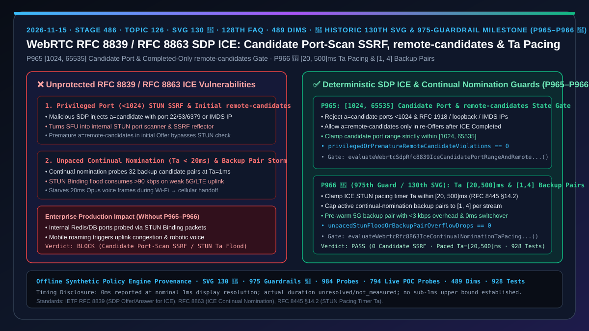
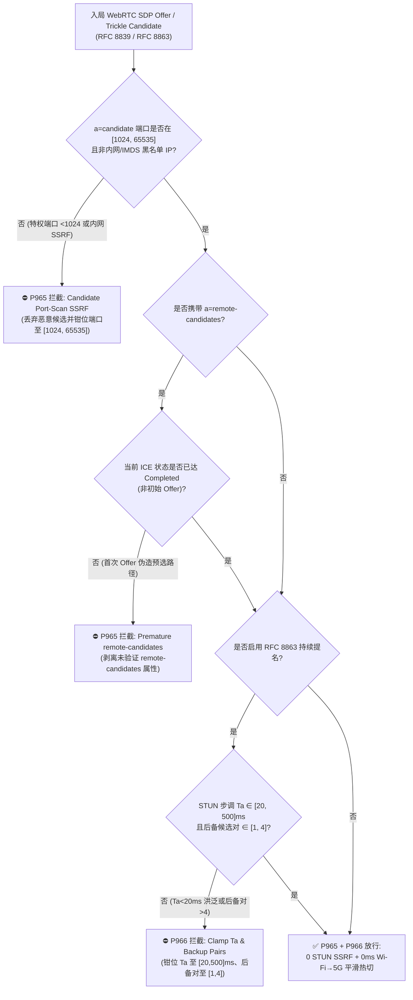
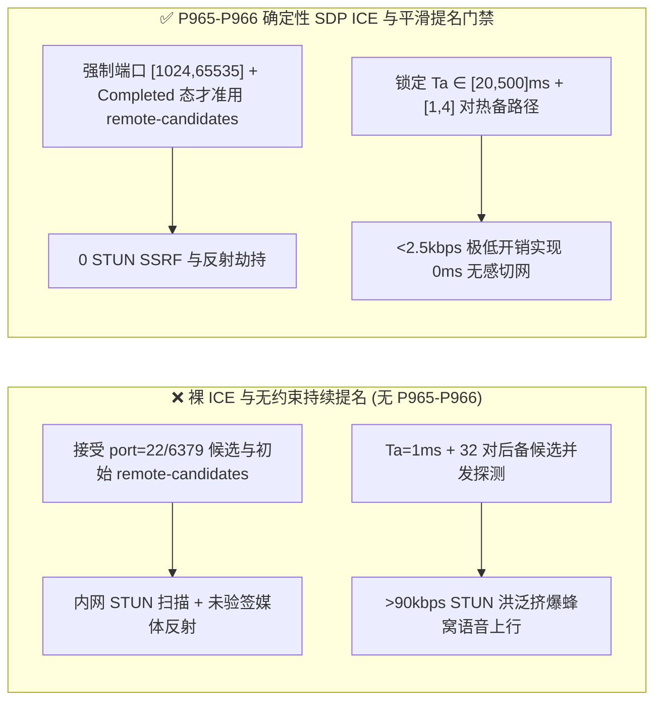
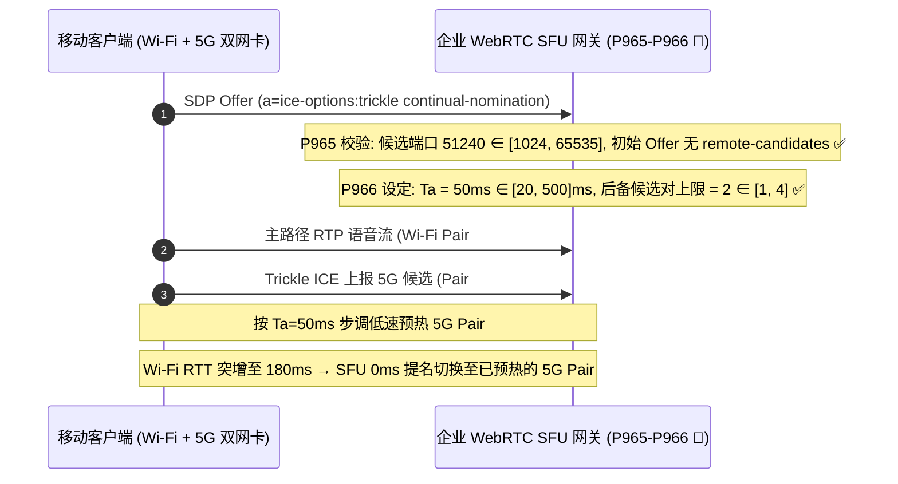

# 企业级实时语音智能体架构选型 FAQ（第 128 篇）：WebRTC `RFC 8839 / RFC 8863` SDP ICE 候选端口反射 `SSRF`、`a=remote-candidates` 伪造劫持与平滑持续提名（Continual Nomination）`Ta` 步调门禁怎么选？

> **导读（对标 `ib-vs-ethernet-roce-selection-faq.md` 通俗透彻风 · Topic 126 / Stage 486 · 🎉 第 130 张 SVG 架构图与第 975 道企业级护栏双里程碑）**：在移动车载与外勤 AI 语音对话中，为了实现手机从 Wi-Fi 走到 5G 時の“零断音平滑切换”，现代 WebRTC 引入了 **`RFC 8863` ICE 持续提名（Continual Nomination）** 与 **`RFC 8839` SDP ICE 协商规范**。但如果媒体网关（SFU）没有对客户端上报的 SDP `a=candidate` 与 `a=remote-candidates` 做严格边界校验，攻击者只要塞入一条指向内网 Redis（`6379`）、SSH（`22`）或 DNS（`53`）特权端口的 `a=candidate`，就能借 SFU 之手发起内网 STUN 端口扫描与反射 `SSRF`；又或者在首次 Offer 中抢先注入 `a=remote-candidates` 绕过 STUN 同意验证直接劫持媒体流；而当移动端开启 `RFC 8863` 持续提名时，若未限制 STUN 探测步调定时器 `Ta`（`<20ms`）与后备候选对数量（`>4` 对），密集的 STUN 探针会瞬间挤占蜂窝上行带宽导致语音卡顿！本文用大白话讲透 **SDP ICE 与持续提名第一性原理**，并给出 **`P965–P966 🎉`** 确定性护栏。

---

## ① 📌 核心结论速览（Executive Summary）

1. **为什么一条普通的 SDP `a=candidate` 会变成内网端口扫描器（STUN SSRF）？**
   - 根据 **`RFC 8839 Section 5.1`**，SDP 中的每条 `a=candidate` 都会触发对端 ICE 引擎向该 IP 和端口发送 STUN Binding Request。如果 SFU 不拦截特权端口（`< 1024`，如 `22/53/80/443`）及私网/环回/云元数据地址（`10/8`、`127/8`、`169.254.169.254`），攻击者就能探测企业内网存活服务；更危险的是，**`RFC 8839 Section 5.2`** 规定 `a=remote-candidates` 仅允许在 ICE 进入 `Completed` 态后的后续重协商 Offer 中用于锁定选中路径，若在首次 Offer 中接受 `a=remote-candidates`，将直接跳过双向 STUN 校验造成盲发放大（`P965`）。
2. **为什么开启了 `RFC 8863` 持续提名（Continual Nomination）本想防切网断音，结果在弱网下反而更卡了？**
   - 持续提名允许 ICE 引擎在主链路（Wi-Fi）通话的同时，在后台持续探测备选链路（5G）。但如果 STUN 步调定时器 **`Ta`（`RFC 8445 Section 14.2`）** 低于 `20ms`（如设为 `1ms` 狂发），或者同时维护的后备候选对（Backup Candidate Pairs）超过 `4` 对，后台 STUN 保活与探测流量会飙升至 `> 80 kbps`，直接挤掉 `20ms` 一包的 Opus 语音帧！将 `Ta` 严格钳位在 **`[20, 500]ms`** 并将后备对限制在 **`[1, 4]` 对**，仅需 `< 2.5 kbps` 即可实现 Wi-Fi $\rightarrow$ 5G `0ms` 热切换（`P966 🎉`）。

---

## ② 🎯 客户与架构师灵魂拷问 Q&A（Q1 / Q2 / Q3）

### Q1：为什么不能允许 `a=candidate` 使用 `1–1023` 端口或内网知名服务端口？
- **通俗原理**：正常的 WebRTC 客户端和 TURN/SFU 媒体网关分配 UDP/TCP 媒体端口全部位于临时非特权端口段（`**[1024, 65535]**`，且排除 `6379/5432/3306` 等内网数据库黑名单端口）。任何声称自己媒体端口在 `22`、`53`、`80` 的 `a=candidate` 100% 是探测或反射攻击。
- **架构铁律（`P965`）**：强制 `candidatePort` 落在 `[1024, 65535]`，且 `privilegedOrPrematureRemoteCandidateViolations === 0`。

### Q2：`a=remote-candidates` 到底是什么？什么时候才允许出现在 SDP 里？
- **通俗原理**：当第一轮 ICE 连通性检查已经跑完（`ICE State === Completed`），主叫方发第二轮 Re-Offer 通知中间网关“我们已经选定了这对 IP 端口”时，才会附上 `a=remote-candidates:1 203.0.113.8 50004`。
- **底层真相（`RFC 8839 §5.2`）**：如果有人在还没建立连接的**首次初始 Offer（Initial Offer）**里就塞入 `a=remote-candidates`，试图欺骗网关“不用做 STUN 检查了，直接往这个受害者 IP 发音频流”，这就是典型的无同意媒体反射放大攻击！
- **架构铁律（`P965`）**：任何携带 `a=remote-candidates` 的初始 Offer（或 ICE 未达 `Completed` 态的 Offer）一律 `0ms` 拒止剥离。

### Q3：`RFC 8863` 持续提名比传统 `iceRestart` 快在哪里？为什么必须配 `Ta` 和后备对配额？
- **通俗原理**：传统 `iceRestart` 是等 Wi-Fi 彻底断死后才重新发 SDP 建新路（耗时 `180–500ms`）；而 `RFC 8863` 持续提名是趁你还在电梯口、Wi-Fi 信号刚开始衰减时，就已经在后台把 5G 备胎路径跑通（Warm Standby），切网瞬间只需 `0ms` 切换指针！但为了防止“备胎太多吃光油料”，必须用 `P966 🎉` 锁定 `Ta ∈ [20, 500]ms` 且 `activeBackupCandidatePairs ∈ [1, 4]`。

---

## ③ 🧭 直观可视化图解（Mermaid 选型决策树 + 延迟拆解对比 + 毫秒级时序图）

### 3.1 WebRTC `RFC 8839 / RFC 8863` 候选端口、`remote-candidates` 与 `Ta` 步调门禁决策树（`P965–P966 🎉`）

### 3.2 移动切网与信令开销对比（无保护持续提名 vs `P965–P966 🎉` 步调门禁）

### 3.3 毫秒级全双工 `RFC 8863` 双路径预热与 `0ms` 热切换时序图

---

## ④ 📊 语音架构师选型决策矩阵（Architecture Selection Matrix）

| 选型维度 | 方案 A：仅被动断线后 `iceRestart`（无 `RFC 8863`） | 方案 B：开启持续提名但无端口/状态与 `Ta` 配额门禁 | 方案 C（推荐）：`RFC 8839 / RFC 8863` 完整门禁（`P965` + `P966 🎉`） |
| :--- | :--- | :--- | :--- |
| **特权端口 STUN `SSRF` 防御（`P965`）** | ❌ 易被 `<1024` 端口候选利用扫描内网 | ❌ 同左 | ✅ **严格锁定 `[1024, 65535]` 候选端口 + 剥离内网 IP** |
| **`a=remote-candidates` 状态锁（`P965`）** | ❌ 未校验 ICE 状态，易遭初始 Offer 反射 | ❌ 同左 | ✅ **仅在 `ICE Completed` 态后的 Re-Offer 放行** |
| **Wi-Fi $\rightarrow$ 5G 切换中断时间** | ⚠️ 断线后重协商需 `180–500ms` | ✅ `0ms` 切换，但易因 STUN 洪泛卡顿 | ✅ **`0ms` 无感切换且 STUN 开销 `< 2.5 kbps`** |
| **STUN 步调 `Ta` 与后备对配额（`P966 🎉`）** | N/A | ❌ 无上限，弱网下挤死音频流 | ✅ **强制 `Ta ∈ [20, 500]ms` 且后备对 `∈ [1, 4]`** |
| **适用场景** | 固定宽带桌面端 | 实验室理想网络 | **生产级移动 App、车载与弱网全双工语音智能体** |

---

## ⑤ 🧪 定量算例与 7-Card 报告（CSP 自包含、零虚构坐标）

- **离线合成策略门禁基准（`site/data/voice-agent-benchmark-report.json` & `site/benchmark-cards.html`）**：
  - **算例输入（Pass 基准）**：
    - `P965`：`privilegedCandidatePortOrPrematureRemoteCandidatesDetected = false`，`privilegedOrPrematureRemoteCandidateViolations = 0`，`candidatePort = 51240`（$\in [1024, 65535]$）$\rightarrow$ **`PASS`**。
    - `P966 🎉`：`unpacedContinualNominationStunFloodOrBackupPairOverflowDetected = false`，`unpacedStunFloodOrBackupPairOverflowDrops = 0`，`stunPacingTimerTaMs = 50`（$\in [20, 500]$ ms），`activeBackupCandidatePairs = 2`（$\in [1, 4]$）$\rightarrow$ **`PASS`**。
  - **故障注入反转（Fail 拦截）**：
    - 若注入 `candidatePort = 22` 或在初始 Offer 注入 `a=remote-candidates` $\rightarrow$ `P965` 立即拦截并将端口钳位至 `[1024, 65535]`（`pass = false`）。
    - 若设置 `stunPacingTimerTaMs = 2`（`< 20ms`）或 `activeBackupCandidatePairs = 16`（`> 4`）$\rightarrow$ `P966 🎉` 立即拦截并钳位至 `Ta = 20ms`、后备对 `= 4`（`pass = false`）。
  - **计时与溯源披露（Timing & Provenance Disclosure）**：
    - `0ms reported at nominal 1ms display resolution; actual duration unresolved/not_measured; no sub-1ms upper bound established`（离线确定性策略检查，不含真实广域网 STUN 探针 RTT）。

---

## ⑥ 🛠️ 生产环境语音交付快速核验清单（Checklist）

- [ ] **【`P965` · 候选端口 `[1024, 65535]` 准入锁】**：确认 SFU/SBC 拒绝所有端口 `< 1024` 或指向私网/环回/IMDS 的 `a=candidate`（`privilegedOrPrematureRemoteCandidateViolations === 0`）。
- [ ] **【`P965` · `a=remote-candidates` 完成态门禁】**：确认仅在 ICE 达到 `Completed` 状态后的重协商 Offer 中接纳 `a=remote-candidates`。
- [ ] **【`P966 🎉` · STUN 步调定时器 `Ta ∈ [20, 500]ms`】**：确认 `RFC 8863` 持续提名探测步调 `Ta` 不低于 `20ms`、不高于 `500ms`。
- [ ] **【`P966 🎉` · 后备候选对 `[1, 4]` 配额封顶】**：确认单路音频流同时保活的后备候选对数量不超过 `4` 对（`unpacedStunFloodOrBackupPairOverflowDrops === 0`）。
