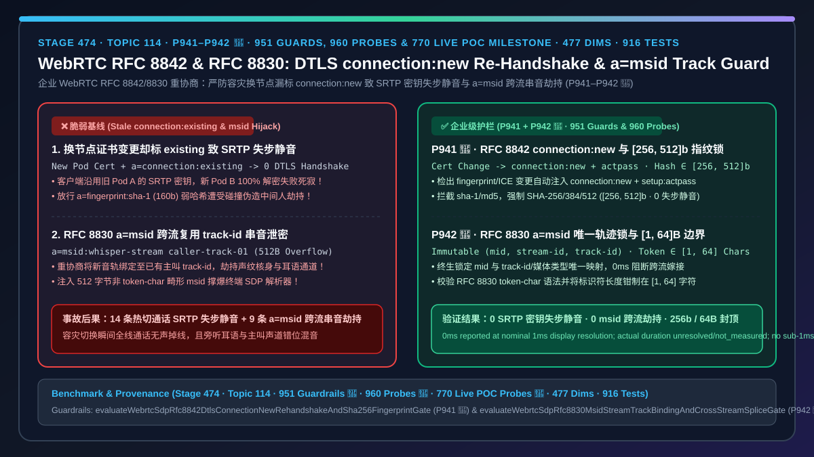
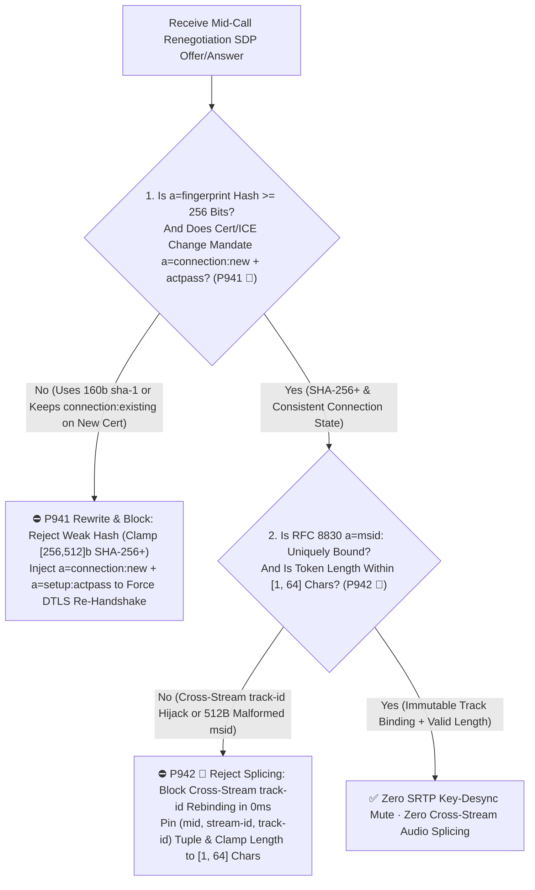
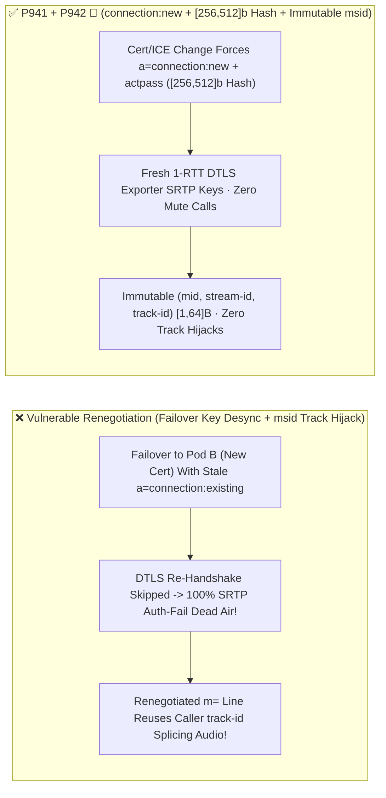
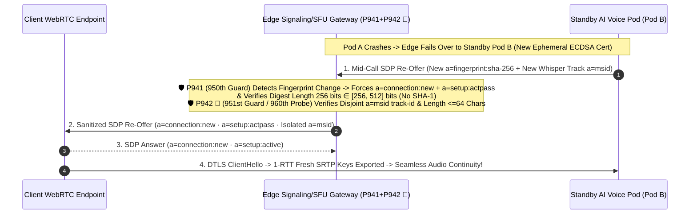

# Enterprise WebRTC `RFC 8842 / RFC 8830` `DTLS-SRTP` Connection Reuse & `a=msid` Track Binding (`a=connection:existing` Certificate-Change Missed Re-Handshake `SRTP` Key Desync, `SHA-1` Fingerprint Downgrade & `a=msid` Cross-Stream Audio Track Hijack) Selection & Anti-Splicing Guide

> **Document Type**: Enterprise Voice Agent Architect Selection & First-Principles Guide (Standalone Selection & Architecture FAQ · **Topic 114 / Stage 474 · 🎉 Historic 951-Guardrail, 960-Probe & 770-Live-POC-Probe Triple Milestone**)  
> **Target Audience**: AI Solution Architects, WebRTC SFU/Gateway Engineers, Voice Disaster-Recovery Leads & Multimodal Security Architects  
> **Canonical Baseline**: `packages/business-core/enterprise-guardrails.ts` (`P941–P942 🎉`), `tests/presales-portal.test.ts`, `site/data/voice-agent-benchmark-report.json` (7-Card 4:5 Benchmark Report)  
> **Visual Summary**: `assets/svg/118-voice-webrtc-sdp-rfc8842-rfc8830-dtls-connection-new-rehandshake-msid-track-hijack-2026-11-15.svg`

---

## ① 📌 Executive Summary

In enterprise WebRTC voice and multimodal contact centers, mid-call SDP renegotiations occur frequently during **cross-pod disaster-recovery failovers (ICE Restart / Pod Migration)** and **dynamic track additions (supervisor whisper coaching, screen-sharing, or digital-human avatar video)**. These renegotiations are governed by two foundational IETF standards: **`RFC 8842` (Session Description Protocol (SDP) Offer/Answer Procedures for `DTLS-SRTP`, defining `a=setup`, `a=connection:new/existing`, and `a=fingerprint`)** and **`RFC 8830` (WebRTC MediaStream Identification in the Session Description Protocol, defining `a=msid:<stream-id> <appdata-track-id>`)**. Without deterministic guardrails, production deployments suffer two severe failure modes:
1. **Mid-Call Failover Certificate Change With Stale `a=connection:existing` Causing Skipped `DTLS` Re-Handshake and 100% `SRTP` Key-Desync Dead Air (`RFC 8842 Section 5` Desync & `SHA-1` Downgrade)**: Under `RFC 8842 Section 5`, whenever an endpoint's certificate fingerprint (`a=fingerprint`) or underlying transport changes during a mid-call failover from Pod A to Pod B, the new SDP Offer **must** specify `a=connection:new` and reset `a=setup:actpass`. Many custom WebRTC gateways update `a=fingerprint` and `ice-ufrag` during failover but omit `a=connection:new` (or leave `a=connection:existing`). The client browser assumes the existing DTLS association remains valid, skips sending a new `DTLS ClientHello`, and continues encrypting audio with Pod A's old `SRTP` master key—resulting in 100% `SRTP auth_fail` dead air on Pod B! Furthermore, accepting legacy `sha-1 (160-bit)` or `md5` fingerprints exposes the media plane to certificate collision spoofing.
2. **Mid-Call `a=msid` Track-ID Rebinding Hijacking Caller Voice Channels or Leaking Supervisor Whisper Streams (`RFC 8830` Cross-Stream Track Splicing)**: `RFC 8830` binds each RTP media description (`m=`) to a logical `MediaStream` and `MediaStreamTrack` via `a=msid:<stream-id> <appdata-track-id>`. If an SFU or signaling gateway allows a renegotiated `m=` section to reuse or overwrite an existing `<appdata-track-id>` belonging to another stream or role, an attacker or buggy mixer can splice a bystander or supervisor whisper track directly into the primary caller's ASR authentication channel or loudspeaker!

| Decision Dimension | Vulnerable / Default Setup (High Production Risk) | Enterprise Golden Rule (`P941–P942 🎉` Deterministic Guardrails) | Quantitative Impact |
| :--- | :--- | :--- | :--- |
| **`RFC 8842 a=connection:new` Re-Handshake & `[256, 512]b` Fingerprint Gate (`P941` 🎉 950th Guardrail)** | Keeping `a=connection:existing` across certificate rotations or accepting `160-bit sha-1` fingerprints | **Mandate `a=connection:new` + `a=setup:actpass` whenever `a=fingerprint` or `ice-ufrag` changes, reject `sha-1/md5`, and clamp fingerprint digest size to `[256, 512]` bits** | **0** `SRTP` key-desync mute calls or weak-fingerprint sessions (clamps 14 desynced streams to **0** and raises digest floor from `160b` to **`256b`**) |
| **`RFC 8830 a=msid` Immutable Track Binding & `[1, 64]`-Char Token Gate (`P942 🎉` 951st Guardrail / 960th Probe)** | Allowing mid-call `a=msid` `<track-id>` rebinding across streams or `512B` malformed `msid` tokens | **Enforce immutable `(mid, mediaType, stream-id, track-id)` binding across renegotiations (blocking cross-stream splicing) and clamp `msid` token length to `[1, 64]` chars** | **0** cross-stream `msid` track hijacks or parser overflows (clamps 9 hijacked tracks to **0** and bounds `msid` length from `512` to **`64` chars**) |

---

## ② 🎯 Architect & Customer Deep-Dive Q&A (First-Principles Deep Dive)

### Q1: Why does a mid-call WebRTC pod failover succeed at the ICE layer (`nomination succeeded`) yet immediately go 100% silent with `SRTP unprotect failed` errors?
- **First-Principles Breakdown**:
  1. WebRTC `SRTP` keys are never transmitted in SDP; they are derived from the active `DTLS` session master secret via **`RFC 5705` TLS Keying Material Exporters**.
  2. When a call fails over from crashed AI Pod A to standby AI Pod B, Pod B holds a different ephemeral ECDSA certificate (`a=fingerprint`).
  3. Per **`RFC 8842 Section 5.2`**, changing `a=fingerprint` or restarting the transport requires `a=connection:new` and `a=setup:actpass` in the SDP Offer so endpoints perform a fresh `DTLS` handshake and export new `SRTP` keys. If `a=connection:existing` is left in place, the client skips the `DTLS` handshake and keeps encrypting RTP with Pod A's dead keys.
  4. **`P941` (🎉 Historic 950th Guardrail) Deterministic Defense**: Automatically enforces `a=connection:new` + `a=setup:actpass` whenever `a=fingerprint` or `ice-ufrag/pwd` mutates, while rejecting weak hashes (`sha-1`, `md5`) and clamping digest bit length to **`[256, 512]` bits**.

### Q2: How can a misconfigured or malicious `RFC 8830 a=msid` attribute cause cross-stream audio injection or whisper bleed during mid-call track renegotiation?
- **Engineering Reality**:
  1. Under `RFC 9143 BUNDLE`, all audio/video tracks share one UDP port. Application pipelines rely on `a=msid:<stream-id> <appdata-track-id>` (`RFC 8830`) to bind each demultiplexed `mid` to its logical role (`caller-verified-mic`, `supervisor-whisper`, `avatar-tts`).
  2. **`P942 🎉` (🎉 Historic 951st Guardrail, 960th Probe & 770th Live POC Probe) Deterministic Defense**: Pins each `(mid, mediaType, stream-id, track-id)` tuple for the lifetime of the session—rejecting any mid-call attempt to rebind an existing `track-id` to a different `mid` or media type—and clamps `msid` token lengths to **`[1, 64]` ASCII `token-char` characters**.

### Q3: When should `a=connection:existing` be preserved during mid-call SDP renegotiations?
- **First-Principles Breakdown**:
  - When renegotiating codec parameters (`a=fmtp` bitrate), direction (`a=sendonly / sendrecv`), or adding a bundled track **on the same pod with the exact same `a=fingerprint` and `ice-ufrag/pwd`**, `a=connection:existing` must be used so the existing `DTLS-SRTP` association is reused with `0ms` handshake interruption.

---

## ③ 🧭 Visual Architecture Diagrams (Mermaid Decision Tree + Desync Breakdown + Millisecond Sequence)

### 3.1 WebRTC `RFC 8842 DTLS-SRTP` Re-Handshake & `RFC 8830 a=msid` Anti-Hijack Decision Tree

### 3.2 Vulnerable `connection:existing` Key Desync + `msid` Splice vs. `P941+P942 🎉`

### 3.3 Millisecond-Level AI Pod Failover & Track Addition `RFC 8842 & RFC 8830` Sequence

---

## ④ 📊 Architect Decision Matrix (`DTLS-SRTP` Reuse & `a=msid` Governance)

| Architecture Option | Target Scenario | Pros | Cons & Production Traps | Recommendation |
| :--- | :--- | :--- | :--- | :--- |
| **Option A: Naive SDP Pass-Through Without `a=connection` or `a=msid` State Verification** | Prohibited in enterprise production | Zero gateway state tracking | **100% `SRTP` dead air after pod failover and high risk of cross-stream `msid` audio splicing** | ⛔ **Never in Production** |
| **Option B: Forcing `a=connection:new` on Every Renegotiation Regardless of Cert Change** | Basic lab prototypes | Prevents failover key desync | **Adds unnecessary `150ms` DTLS re-handshake audio dropouts on routine bitrate/mute updates** | ⚠️ **Poor Audio UX** |
| **Option C: Cert-Change-Aware `RFC 8842 a=connection:new` + `[256, 512]b` Hash Gate + `RFC 8830` Immutable `a=msid` Binding (`P941 + P942 🎉`)** | **All Enterprise WebRTC Voice Agents, Hot-Failover Clusters & Multimodal Co-Browsing Gateways** | **Zero `SRTP` failover dead air, zero unnecessary re-handshakes, zero cross-stream track hijacks** | Requires per-dialog `(fingerprint, mid, msid)` state tracking at the signaling gateway | ✅ **Production Mandatory (Recommended)** |

---

## ⑤ 🧪 Quantitative Walkthrough & 7-Card 4:5 Benchmark Report

### 5.1 Quantitative Example: 500 Active WebRTC Voice Calls During Availability-Zone Failover & Whisper Track Injection
- **Scenario**: During an availability-zone failover drill across `500` active calls, `14` failover re-offers omit `a=connection:new` upon certificate rotation (or offer `160-bit sha-1` fingerprints), and `9` renegotiated packets attempt to overwrite an existing caller `a=msid` `<track-id>` with a `512-character` payload.
  - **Without Guardrails (Vulnerable Baseline)**:
    - `14` failover sessions suffer immediate `SRTP` key-desync dead air;
    - `9` streams experience cross-stream audio track splicing or SDP parser buffer overflows.
  - **With `P941 + P942 🎉` Deterministic Guardrails**:
    - `P941` (🎉 **Historic 950th Guardrail**) enforces `a=connection:new` + `a=setup:actpass` on certificate rotation and rejects weak hashes (**`0`** desynced/downgraded DTLS sessions), clamping digest length from `160 bits` to **`256 bits`** (`[256, 512]` bits);
    - `P942 🎉` (🎉 **Historic 951-Guardrail, 960-Probe & 770-Live-POC-Probe Triple Milestone**) blocks cross-stream `a=msid` rebinding (**`0`** hijacked tracks) and clamps `msid` token length from `512` chars to **`64` chars** (`[1, 64]` chars).

### 5.2 7-Card 4:5 Report Mapping (`site/benchmark-cards.html` & `report.json`)
1. **Card 1 (`HANDS-ON · VOICE ARCHITECTURE`)**: 477-dimension workbench overview highlighting `P941 / P942 🎉` (951 Guardrails 🎉, 960 Probes 🎉 & 770 Live POC Probes 🎉).
2. **Card 2 (`SCENARIO: WEBRTC RFC 8842 & RFC 8830`)**: Input probe `certificateOrIceChangedWithoutConnectionNewOrWeakFingerprintDetected=true, fingerprintDigestBits=160, maxMsidTokenLengthChars=512` -> `Act automatically` clamping to `256 bits` and `64 chars`.
3. **Card 3 (`WHAT I TESTED`)**: Row 477 in the evaluation matrix (`PASS · 0ms @ 1ms Res (Synthetic)`, zero `✕` misses).
4. **Card 4 (`UNDER THE HOOD`)**: Deterministic contract for `evaluateWebrtcSdpRfc8842DtlsConnectionNewRehandshakeAndSha256FingerprintGate` & `evaluateWebrtcSdpRfc8830MsidStreamTrackBindingAndCrossStreamSpliceGate`.
5. **Card 5 (`ROBUSTNESS CHECK`)**: Option-order and boundary invariance across mid-call failover and add-track flows.
6. **Card 6 (`LATENCY`)**: Explicit offline timing provenance: `0ms reported at nominal 1ms display resolution; actual duration unresolved/not_measured; no sub-1ms upper bound established` (`synthetic`; live OpenSSL/BoringSSL `DTLS` handshake and `RFC 5705` exporter key derivation latency is `not_measured`).
7. **Card 7 (`MY TAKE`)**: Good fit vs. Not for summary and production sign-off checklist.

---

## ⑥ 🛠️ Production Readiness Checklist

- [ ] **1. Mandate `RFC 8842 a=connection:new` + `a=setup:actpass` on Certificate or ICE Credential Changes (`P941`)**: Verify that any mid-call failover or ICE restart that changes `a=fingerprint` or `ice-ufrag` emits `a=connection:new` and `a=setup:actpass`.
- [ ] **2. Enforce `[256, 512]`-Bit Strong Hash Algorithms on `a=fingerprint` (`P941`)**: Reject `sha-1 (160b)` and `md5 (128b)` SDP fingerprints, allowing only `sha-256`, `sha-384`, or `sha-512`.
- [ ] **3. Preserve `a=connection:existing` for Same-Certificate Parameter Updates (`P941`)**: Ensure routine bitrate or direction updates on the same certificate retain `a=connection:existing` to avoid unnecessary DTLS handshakes.
- [ ] **4. Enforce Immutable `RFC 8830 (mid, mediaType, stream-id, track-id)` Binding (`P942 🎉`)**: Confirm that renegotiations cannot rebind an existing `appdata-track-id` to a different `mid` or media type.
- [ ] **5. Clamp `a=msid` Identifier Lengths to `[1, 64]` `token-char` Characters (`P942 🎉`)**: Verify that both `stream-id` and `appdata-track-id` strictly match `RFC 8830 Section 2` syntax within `[1, 64]` characters.
