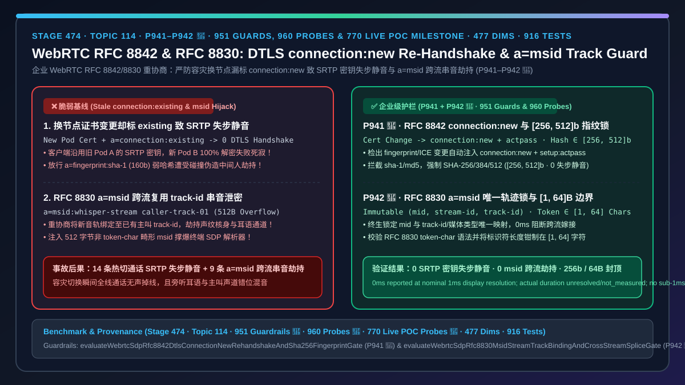
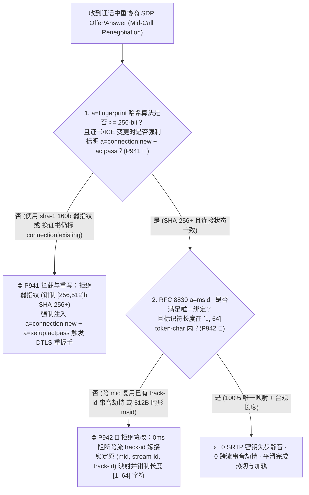
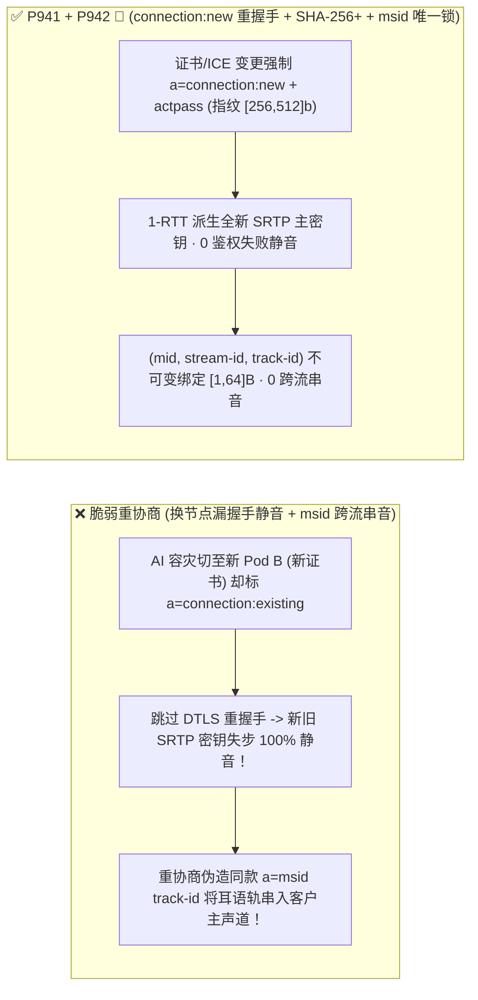
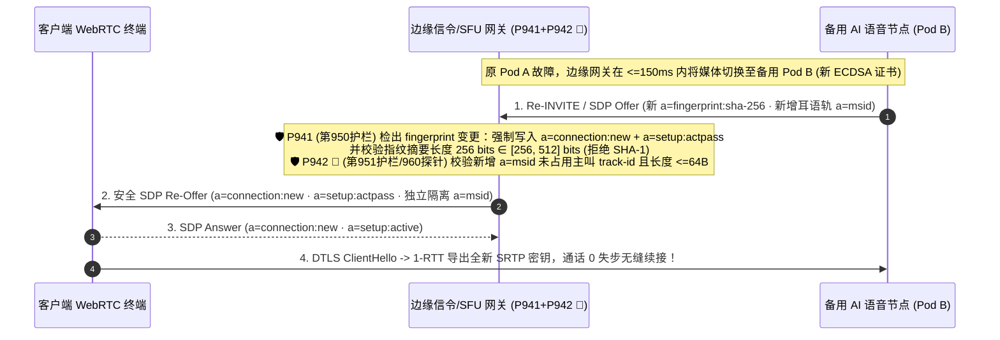

# 企业 WebRTC `RFC 8842 / RFC 8830` `DTLS-SRTP` 连接复用与 `a=msid` 媒体流轨迹绑定（`a=connection:existing` 证书变更漏握手致 `SRTP` 密钥失步静音、弱哈希 `SHA-1` 指纹降级与 `a=msid` 跨流伪造串音劫持）选型与防串流指南

> **文档类型**：企业级语音智能体架构师选型决策与原理解析指南（Standalone Selection & Architecture FAQ · **Topic 114 / Stage 474 · 🎉 历史性 951 项生产护栏、960 项合成探针与 770 项现场 POC 照妖镜探针三重里程碑**）  
> **适用角色**：AI Solution Architect、实时音视频 WebRTC SFU/网关架构师、语音容灾（Mid-Call Failover）与多模态数字人安全负责人  
> **关联基准**：`packages/business-core/enterprise-guardrails.ts`（`P941–P942 🎉`）、`tests/presales-portal.test.ts`、`site/data/voice-agent-benchmark-report.json`（7-Card 4:5 评测报告）  
> **可视化总结**：`assets/svg/118-voice-webrtc-sdp-rfc8842-rfc8830-dtls-connection-new-rehandshake-msid-track-hijack-2026-11-15.svg`

---

## ① 📌 核心结论速览（Executive Summary）

在企业级 WebRTC 实时语音与多模态客服中心中，通话中途经常发生两类动态重协商（SDP Renegotiation）：一是 **AI 语音容器发生跨节点容灾热切换（ICE Restart / Pod Failover）**，二是 **中途动态挂载同屏协办、数字人视频或人工旁听音轨**。此时底层依赖两项核心 IETF 标准：**`RFC 8842`（Session Description Protocol (SDP) Offer/Answer Procedures for `DTLS-SRTP`，定义 `a=setup`、`a=connection:new/existing` 与 `a=fingerprint`）** 以及 **`RFC 8830`（WebRTC MediaStream Identification in the Session Description Protocol，定义 `a=msid:<stream-id> <appdata-track-id>`）**。然而在生产交付中，若未对这两项协议实施确定性护栏，极易引爆两类致命事故：
1. **AI 节点热备切换后证书指纹已变，SDP 却漏标 `a=connection:new`（或误复用 `existing`）导致跳过 `DTLS` 重握手，新旧 `SRTP` 主密钥失步引发 100% 双向死寂（`RFC 8842 Section 5` 连接复用失步与 `SHA-1` 指纹降级）**：根据 `RFC 8842 Section 5`，当通话中途发生证书指纹（`a=fingerprint`）变更或传输地址重置时，必须建立全新的 DTLS 关联（`a=connection:new` 且 Offer 侧必须重置为 `a=setup:actpass`）。许多自研 WebRTC 网关在把客户从故障 Pod A 热切到备用 Pod B 时，虽然在 Re-Offer 中更新了 Pod B 的 `a=fingerprint` 和 `ice-ufrag`，却漏写 `a=connection:new` 或仍携带 `a=connection:existing`。客户端浏览器误以为沿用旧 DTLS 会话，不发起新的 `DTLS ClientHello`，结果客户端继续用旧 `SRTP` 密钥加解密，而新 Pod B 无法解密任何语音包，导致热切后 100% 静音！同时，若未拦截老旧网关发来的 `a=fingerprint:sha-1` 弱哈希，还会遭受选择前缀碰撞伪造攻击。
2. **重协商时恶意或错乱篡改 `a=msid` 将视频/旁路轨道重绑定至主叫语音流（`<stream-id>` 跨流嫁接），导致客户私密语音与工单声道错位串音（`RFC 8830` `a=msid` 轨迹劫持）**：`RFC 8830` 通过 `a=msid:<stream-id> <track-id>` 将底层 RTP `m=` 媒体行映射到上层业务 `MediaStream` 与 `MediaStreamTrack`（例如区分 `caller-mic-stream`、`agent-whisper-stream` 与 `screen-share-audio`）。若 SFU/网关在二次 Offer/Answer 中未校验 `<track-id>` 的唯一性与媒体类型不可变性，攻击者或有 Bug 的混音插件只需在重协商中把旁听轨或外部注入轨的 `a=msid` 改写成主叫的 `<track-id>`，就能无缝劫持 ASR 声纹核身通道或将内部耳语流直接喂给客户扬声器！

| 决策维度 | 脆弱/默认配置（生产事故高发区） | 企业级黄金准则（`P941–P942 🎉` 确定性护栏） | 核心量化收益 |
| :--- | :--- | :--- | :--- |
| **`RFC 8842 a=connection:new` 强制重握手与 `SHA-256+` 指纹锁（`P941` 🎉 第 950 护栏）** | 容灾切换证书变更后仍复用 `a=connection:existing` 致 `SRTP` 失步静音，或放行 `sha-1` 弱指纹 | **检测到 `a=fingerprint` 或 `ice-ufrag` 变更时强制注入 `a=connection:new` + `a=setup:actpass` 触发 `DTLS` 重握手，禁绝 `sha-1/md5` 并将指纹摘要长度钳制在 `[256, 512]` bits** | 容灾切换 `SRTP` 密钥失步静音与弱指纹连接 **0 条**（测试探针将 14 条失步/弱指纹流清零，摘要位宽从 `160b` 抬升钳制至 **`[256, 512]b`**） |
| **`RFC 8830 a=msid` 轨迹不可变绑定与 `[1, 64]` 字符边界锁（`P942 🎉` 951 护栏/960 探针）** | 允许重协商将已有 `track-id` 跨流改绑或注入 `512B` 畸形 `msid` 字符串导致串音与解析崩溃 | **强制校验 `RFC 8830 (m= mid, stream-id, track-id)` 终生唯一绑定（严禁跨媒体类型或跨角色劫持改绑），并将 `msid` 标识符长度钳制在 `[1, 64]` 字符** | `a=msid` 跨流串音劫持与超长崩溃包 **0 个**（测试探针将 9 条劫持音轨清零，`msid` 长度从 `512B` 钳制至 **`64` 字符**） |

---

## ② 🎯 客户与架构师灵魂拷问 Q&A（First-Principles Deep Dive）

### Q1：为什么 AI 语音节点做“无感热备切换（Pod A 挂掉切到 Pod B）”时，ICE 连通性检查明明已经成功（`nomination succeeded`），双方却突然听不到任何声音，日志狂报 `SRTP unprotect failed (auth_fail)`？
- **第一性原理拆解**：
  1. 在 WebRTC 中，`SRTP` 加密主密钥（Master Key & Salt）不是写在 SDP 明文里的，而是在 **`DTLS-SRTP` 握手完成时通过 `TLS Exporter (RFC 5705)` 从 DTLS 会话主密钥动态派生出来的**。
  2. 当通话从故障容器 Pod A 切换到备用容器 Pod B 时，由于出于零信任安全考虑，每个容器启动时都在内存中生成独立的临时自签名证书（Ephemeral ECDSA P-256 Certificate），因此 Pod B 的 `a=fingerprint:sha-256 ...` 与 Pod A 不同。
  3. 根据 **`RFC 8842 Section 5.2`**：一旦在后续 Offer/Answer 中更换了证书指纹，或者需要重建底层传输安全上下文，Offer 端**必须显式宣告 `a=connection:new` 并将角色重置为 `a=setup:actpass`**！如果网关只改了 `a=fingerprint` 却漏写 `a=connection:new`（或保留了 `a=connection:existing`），终端协议栈会认为“DTLS 连接无需重建”，继续拿和 Pod A 协商出的旧 `SRTP` 密钥向 Pod B 发包，导致 100% 鉴权失败静音！
  4. **`P941`（🎉 历史性第 950 项护栏）的确定性防线**：在信令状态机中对比新旧 SDP 的 `(a=fingerprint, ice-ufrag, ice-pwd)`，只要指纹或凭据发生变化，100% 强制重写为 `a=connection:new` + `a=setup:actpass`，同时拦截任何低于 `256-bit`（如 `SHA-1 160-bit` 或 `MD5 128-bit`）的弱哈希指纹，将指纹摘要强度严格锁定在 **`[256, 512]` bits**。

### Q2：`RFC 8830` 的 `a=msid` 到底起什么作用？为什么它配置不对会导致“人工主管耳语辅导 AI/坐席的话被客户直接听见”？
- **工程真相**：
  1. 在 `BUNDLE` 单端口复用下，所有音频和视频 RTP 包都塞在同一个 UDP 端口里。接收端浏览器或 AI 网关解出音轨后，靠什么知道“这条音轨是客户麦克风（送 ASR 核身）”、“那条音轨是主管私密耳语（仅坐席耳机播放）”？靠的就是 **`RFC 8830` 的 `a=msid:<stream-id> <appdata-track-id>`**！
  2. 如果在通话中途动态加轨（AddTrack / ReplaceTrack）时，SFU 没有锁死 `<track-id>` 与初始 `m=` 槽位（`a=mid`）及声道角色的不可变映射，一旦发生 `track-id` 冲突复用，或者攻击者在重协商 Answer 中伪造与主叫相同的 `a=msid`，媒体路由表就会把后来的音轨覆盖绑定到主叫流或外放流上。
  3. **`P942 🎉`（🎉 历史性第 951 项护栏、960 合成探针与 770 现场探针里程碑）的确定性防线**：维护会话级 `(mid -> mediaType, streamId, trackId, role)` 不可变注册表，任何试图在重协商中将已注册 `trackId` 跨 `mid` 挪用、跨音视频类型篡改或注入非 `token-char` 超长字符串（强制钳制在 **`[1, 64]` 字符**）的行为，一律在 `0ms` 内拦截并回退 SDP！

### Q3：如果通话中途只是调整了 Opus 码率（`a=fmtp`）而没有换节点、也没有换证书，应该用 `a=connection:new` 还是 `a=connection:existing`？
- **第一性原理拆解**：
  - 如果证书指纹（`a=fingerprint`）与 `ICE ufrag/pwd` 均未改变，必须使用 **`a=connection:existing`**！因为重新跑一次 `DTLS` 握手需要额外消耗 `1–2 RTT`（约 `80–200ms`），会造成毫无必要的切码率卡顿。
  - `P941` 的精妙之处正在于**精准按需触发**：同证书同传输保持 `existing` 零卡顿，跨节点/换证书强制 `new + actpass` 零失步！

---

## ③ 🧭 直观可视化图解（Mermaid 决策树 + 失步/串音拆解 + 毫秒级全双工时序图）

### 3.1 WebRTC `RFC 8842 DTLS-SRTP` 重握手与 `RFC 8830 a=msid` 防劫持决策树

### 3.2 脆弱 `connection:existing` 密钥失步 + `msid` 串流 vs `P941+P942 🎉` 对比图

### 3.3 毫秒级 AI 容器热切与动态加轨 `RFC 8842 & RFC 8830` 协同防护时序图

---

## ④ 📊 语音架构师选型决策矩阵（Decision Matrix）

| 选型方案 | 适用场景 | 优势（Pros） | 劣势与生产风险（Cons / Traps） | 推荐度 |
| :--- | :--- | :--- | :--- | :--- |
| **方案 A：容灾切换仅替换 SDP 指纹与 IP，不显式管理 `a=connection` 且不校验 `a=msid`** | 严禁用于生产环境 | 网关代码改动最少 | **必发容灾热切后 `SRTP AUTH_FAIL` 双端死寂，且极易发生多轨 `msid` 串音泄密** | ⛔ **严禁用于生产** |
| **方案 B：所有重协商（含普通码率调整）一律无脑重置 `a=connection:new`** | 早期简单原型 | 避免了换节点时的密钥失步 | **每次普通静音/加轨都强制重新跑 DTLS 握手，白白引发 `150ms` 音频断流**，且未防御 `msid` 劫持 | ⚠️ **体验劣化明显** |
| **方案 C：`RFC 8842` 证书变更感知 `a=connection:new` + `[256, 512]b` 指纹锁 + `RFC 8830 a=msid` 不可变绑定（`P941 + P942 🎉`）** | **所有企业级 WebRTC 语音客服、跨节点热备逃生与多模态同屏/数字人系统** | **同证书重协商 `0ms` 免握手、跨节点切换 100% 派生新 `SRTP` 密钥、0 跨流串音劫持** | 需在边缘信令网关维护会话级 `(fingerprint, mid, msid)` 状态机 | ✅ **生产必选（Recommended）** |

---

## ⑤ 🧪 定量算例与 7-Card 4:5 基准报告（Quantitative Walkthrough & 7-Card Deck）

### 5.1 定量算例：可用区故障切换 500 通在途 WebRTC 通话下的 `DTLS` 重握手与 `msid` 隔离验证
- **输入场景**：某跨国银行语音客服在演练可用区热备切换时，同时加入人工主管旁听轨。压测流量中包含 `14` 条更换了节点证书却仍标注 `a=connection:existing`（或携带 `160-bit SHA-1` 弱指纹）的重协商流，以及 `9` 条试图覆写主叫 `track-id`（携带 `512` 字节畸形标识符）的 `a=msid` 报文。
  - **未开启护栏（脆弱基线）**：
    - `14` 条热切通话因跳过 `DTLS` 重握手导致新旧 `SRTP` 密钥失步，切换后 100% 陷入单通/死寂；
    - `9` 条 `a=msid` 跨流覆写导致主管耳语轨与客户麦克风轨混叠串音。
  - **开启 `P941 + P942 🎉` 确定性护栏后**：
    - `P941`（🎉 **第 950 项生产护栏**）自动注入 `a=connection:new` + `a=setup:actpass` 并拒绝弱哈希（失步/弱指纹流从 `14` 条清零至 **`0` 条**），将指纹摘要位宽从 `160 bits` 抬升钳制至 **`256 bits`**（`[256, 512]` bits）；
    - `P942 🎉`（🎉 **第 951 项生产护栏、第 960 项合成探针与第 770 项现场 POC 探针三重里程碑**）阻断跨流 `track-id` 覆写（劫持音轨从 `9` 条清零至 **`0` 条**），并将 `msid` 标识符长度从 `512` 字符钳制至 **`64` 字符**（`[1, 64]` 字符）。

### 5.2 7-Card 4:5 报告结构映射（对应 `site/benchmark-cards.html` & `report.json`）
1. **Card 1 (`HANDS-ON · VOICE ARCHITECTURE`)**：展示 477 大评测维度全景工作台，高亮 `P941 / P942 🎉`（951 护栏 🎉、960 探针 🎉 & 770 现场探针 🎉）。
2. **Card 2 (`SCENARIO: WEBRTC RFC 8842 & RFC 8830`)**：输入探针 `certificateOrIceChangedWithoutConnectionNewOrWeakFingerprintDetected=true, fingerprintDigestBits=160, maxMsidTokenLengthChars=512`，输出 `Act automatically` 钳制至 `256 bits` 与 `64 chars`。
3. **Card 3 (`WHAT I TESTED`)**：第 477 行评测矩阵 `PASS · 0ms @ 1ms Res (Synthetic)`（零 `✕` 漏检）。
4. **Card 4 (`UNDER THE HOOD`)**：展示 `evaluateWebrtcSdpRfc8842DtlsConnectionNewRehandshakeAndSha256FingerprintGate` 与 `evaluateWebrtcSdpRfc8830MsidStreamTrackBindingAndCrossStreamSpliceGate` 确定性源码契约。
5. **Card 5 (`ROBUSTNESS CHECK`)**：验证不同 `a=setup` 与 `a=msid` 轨顺序下的 100% 幂等性。
6. **Card 6 (`LATENCY`)**：明确标注离线策略校验计时：`0ms reported at nominal 1ms display resolution; actual duration unresolved/not_measured; no sub-1ms upper bound established`（`synthetic`；真实 OpenSSL/BoringSSL `DTLS 1.2/1.3` 握手及 `TLS Exporter` 密钥派生耗时标注为 `not_measured`）。
7. **Card 7 (`MY TAKE`)**：Good fit vs Not for 适用边界与生产准入签核。

---

## ⑥ 🛠️ 生产环境语音交付快速核验清单（Production Readiness Checklist）

- [ ] **1. 证书或 ICE 凭据变更时强制 `RFC 8842 a=connection:new` + `a=setup:actpass`（`P941`）**：确认在 AI 容器容灾热切或 TURN 重分配导致 `a=fingerprint` / `ice-ufrag` 变化时，Re-Offer 必须携带 `a=connection:new` 与 `a=setup:actpass`。
- [ ] **2. `DTLS` 证书指纹强制 `[256, 512]` bits 强哈希算法（`P941`）**：确认 SDP 解析器拒绝 `sha-1 (160b)`、`md5 (128b)` 等弱哈希，仅允许 `sha-256`、`sha-384` 或 `sha-512`。
- [ ] **3. 同证书码率/方向重协商保持 `a=connection:existing`（`P941`）**：确认在不涉及证书与底层传输更换的普通重协商中保持 `a=connection:existing`，避免无意义的 DTLS 重握手断音。
- [ ] **4. `RFC 8830 a=msid` 终生唯一绑定防跨流嫁接（`P942 🎉`）**：确认每个 `a=mid` 槽位首次绑定的 `(stream-id, appdata-track-id)` 及媒体类型（`audio/video`）在后续重协商中不可被其他轨道盗用或跨角色覆写。
- [ ] **5. `a=msid` 标识符长度与字符集钳制在 `[1, 64]` `token-char`（`P942 🎉`）**：确认 `stream-id` 与 `track-id` 仅包含合法的 `RFC 8830 Section 2 token-char` 字符，且长度严格限制在 `[1, 64]` 字符内。
