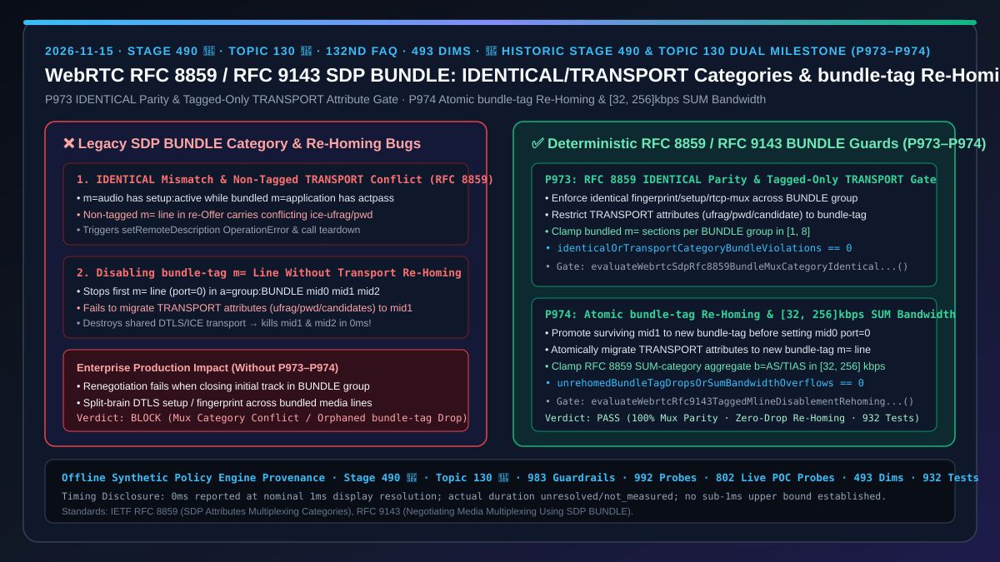
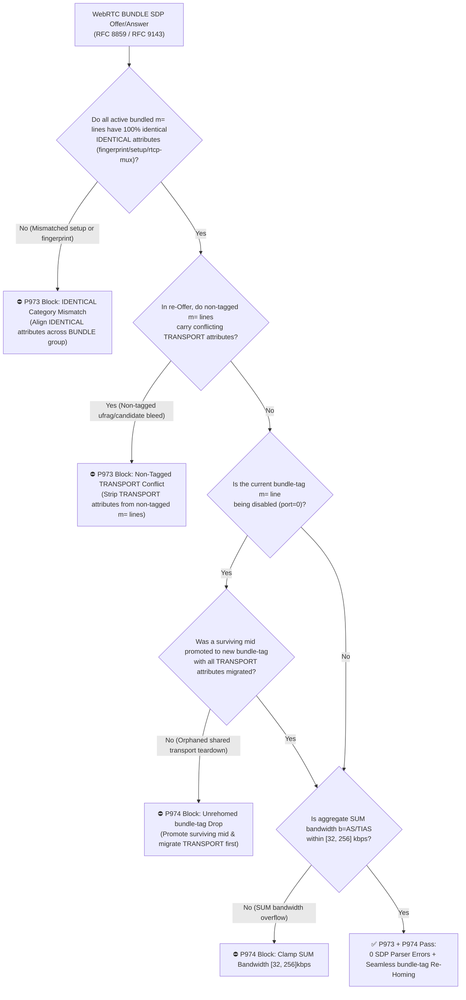
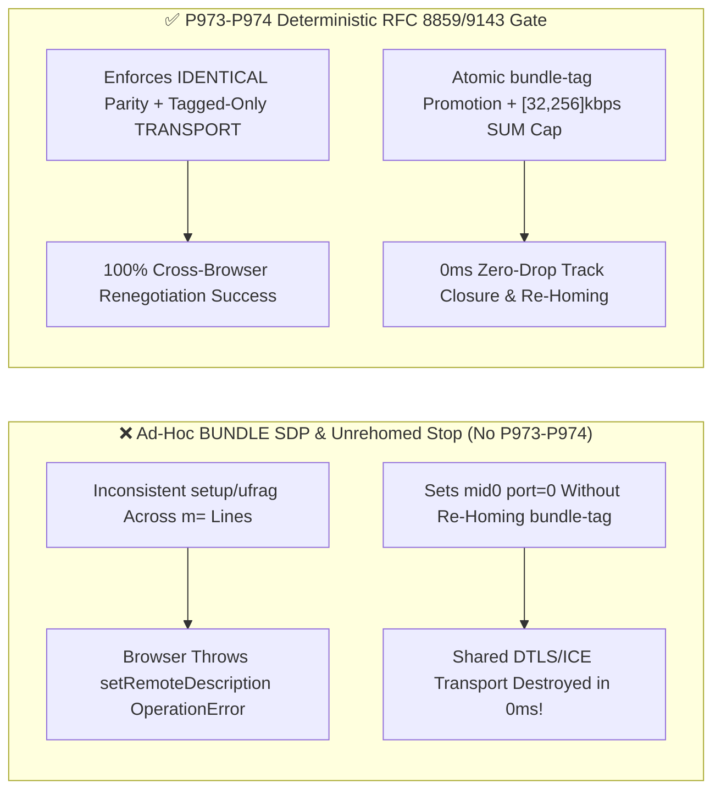

# Enterprise Realtime Voice Agent Architecture FAQ (No. 132): How to Engineer WebRTC `RFC 8859 / RFC 9143 (BUNDLE)` SDP Multiplexing Attribute Categories (`IDENTICAL / TRANSPORT / SUM`) & `bundle-tag` Re-Homing Guards?

> **Architect's Reading Guide (Modeled on `ib-vs-ethernet-roce-selection-faq.md` · Topic 130 🎉 / Stage 490 🎉 Historic Dual Milestone)**: In enterprise WebRTC voice agents, primary dialogue audio, auxiliary prompt tracks, and transcript DataChannels share a single UDP 5-tuple via **`RFC 9143 (BUNDLE)`**. Yet custom SFU and SIP-WebRTC gateways frequently crash during mid-call track changes—throwing `OperationError: Failed to setRemoteDescription` or tearing down the entire call when stopping the initial `m=` section (`mid0`). Two fundamental IETF rules govern this behavior: (1) **`RFC 8859` SDP Attribute Multiplexing Categories**, which dictate which attributes must be identical across all bundled `m=` lines (`IDENTICAL`) and which must appear *only* on the nominated `bundle-tag` `m=` line during renegotiation (`TRANSPORT`); and (2) **`RFC 9143 Section 7.5.3` Tagged `m=` Section Re-Homing**, which requires atomically promoting a surviving `m=` line to the new `bundle-tag` and migrating all `TRANSPORT` attributes before setting `port=0` on the old `bundle-tag`! This guide explains the **first-principles mechanics of SDP BUNDLE categories and transport re-homing** and defines deterministic guardrails **`P973–P974`**.

---

## ① 📌 Executive Summary

1. **Why does copying or omitting SDP attributes across bundled `m=` lines cause `setRemoteDescription` failures?**
   - Under **`RFC 8859`** and **`RFC 9143 Section 7`**, SDP attributes in a `BUNDLE` group follow strict multiplexing categories:
     - **`IDENTICAL` category (`a=fingerprint`, `a=setup`, `a=rtcp-mux`, `a=rtcp-rsize`)**: must be repeated with **100% identical values** across every active `m=` line in the `BUNDLE` group.
     - **`TRANSPORT` category (`a=ice-ufrag`, `a=ice-pwd`, `a=candidate`)**: once `BUNDLE` has been negotiated, subsequent re-Offers/Answers must place `TRANSPORT` attributes **exclusively on the `bundle-tag` `m=` section** (`identicalOrTransportCategoryBundleViolations === 0`, `P973`).
2. **Why does disabling the first `m=` section (`mid0 port=0`) in `a=group:BUNDLE mid0 mid1 mid2` instantly kill `mid1` and `mid2`?**
   - The first token in `a=group:BUNDLE` (`mid0`) is the **`bundle-tag` owner** of the shared DTLS/ICE transport. Under **`RFC 9143 Section 7.5.3`**, setting `port=0` on `mid0` without first **re-homing the `bundle-tag` to `mid1` (`a=group:BUNDLE mid1 mid2`) and migrating `c=`, `ice-ufrag`, `ice-pwd`, and `candidate` attributes onto `mid1`** destroys the shared transport! Meanwhile, **`SUM`-category bandwidth attributes (`b=AS/TIAS`)** across the `BUNDLE` group must be clamped within **`[32, 256] kbps`** (`unrehomedBundleTagDropsOrSumBandwidthOverflows === 0`, `P974`).



---

## ② 🎯 Architect & Customer Deep-Dive Q&A (Q1 / Q2 / Q3)

### Q1: What is the clearest mental model for `RFC 8859` `IDENTICAL`, `TRANSPORT`, `NORMAL`, and `SUM` categories?
- **Plain-Language Principle**:
  - **`IDENTICAL` (`fingerprint`, `setup`, `rtcp-mux`)**: shared security/mux contract—must match verbatim on every active bundled `m=` line;
  - **`TRANSPORT` (`ice-ufrag`, `ice-pwd`, `candidate`)**: shared socket address—belongs only to the leading `bundle-tag` `m=` line in re-Offers;
  - **`NORMAL` (`rtpmap`, `fmtp`, `msid`)**: per-track codec/stream settings—independent per `m=` line;
  - **`SUM` (`b=AS`, `b=TIAS`)**: combined bitrate budget—summed across bundled `m=` lines and clamped in `[32, 256] kbps` (`P973` & `P974`).

### Q2: Why are `ice-ufrag` and `ice-pwd` allowed on all `m=` lines in an initial Offer, but forbidden on non-tagged `m=` lines in a re-Offer?
- **Protocol Reality (`RFC 9143 §7.2` vs. `§7.5`)**: In an initial Offer, the offerer does not yet know if the answerer supports `BUNDLE`, so each `m=` section carries fallback transport parameters. Once `BUNDLE` is negotiated, only the `bundle-tag` `m=` section owns transport parameters (`P973`).

### Q3: How do we safely close the initial `mid=0` track mid-call without dropping the shared `BUNDLE` transport?
- **Architectural Rule (`P974`)**: Atomically update `a=group:BUNDLE` so a surviving active `mid` (`mid=1`) becomes the first token (`bundle-tag`), move all `TRANSPORT` attributes to `mid=1`, and only then set `port=0` on `mid=0`.

---

## ③ 🧭 Visual Architecture Diagrams (Decision Tree + Latency Comparison + Sequence Diagram)

### 3.1 WebRTC `RFC 8859 / RFC 9143` Mux Category & `bundle-tag` Re-Homing Decision Tree (`P973–P974`)



### 3.2 Renegotiation Stability Comparison (Ad-Hoc BUNDLE SDP vs. `P973–P974`)



### 3.3 Millisecond-Level Full-Duplex `RFC 9143` Atomic `bundle-tag` Re-Homing Sequence

```mermaid
sequenceDiagram
    autonumber
    participant Agent as Enterprise Voice Gateway (P973-P974)
    participant Browser as Client Browser (WebRTC BUNDLE)

    Note over Agent,Browser: Active State: a=group:BUNDLE 0 1 2 (mid=0 is initial prompt track & bundle-tag)
    Note over Agent: Prompt track mid=0 finishes; need to stop mid=0 while keeping dialogue mid=1 & DataChannel mid=2
    Note over Agent: P974 Atomic Re-Homing: Update a=group:BUNDLE 1 2 (promote mid=1 to new bundle-tag) ✅
    Note over Agent: P974 Attribute Migration: Move c= / ice-ufrag / ice-pwd / candidate to mid=1; set mid=0 port=0 ✅
    Note over Agent: P973 Category Check: mid=1 & mid=2 share identical fingerprint/setup; SUM b=AS=96kbps ∈ [32, 256] ✅
    Agent->>Browser: SDP Re-Offer (group:BUNDLE 1 2, m=audio 0 [mid:0], m=audio 9 [mid:1 + TRANSPORT])
    Browser-->>Agent: SDP Answer (0ms seamless transport re-homing to mid=1, zero audio/data interruption!)
```

---

## ④ 📊 Architect Decision Matrix

| Evaluation Dimension | Option A: Naive SDP String Splicing | Option B: Never Close `mid=0` (Leave Zombie Track Open) | Option C (Recommended): Full `RFC 8859` Category + `RFC 9143` Re-Homing Gate (`P973` + `P974`) |
| :--- | :--- | :--- | :--- |
| **`IDENTICAL` Attribute Parity (`P973`)** | ❌ Prone to `setup` / `fingerprint` drift | ⚠️ Drift on dynamic track additions | ✅ **100% verbatim `IDENTICAL` parity across `BUNDLE` group** |
| **`TRANSPORT` Attribute Ownership (`P973`)** | ❌ Stale `ufrag` on non-tagged lines | ✅ Static `mid=0` owner | ✅ **Restricts `TRANSPORT` attributes to `bundle-tag` in re-Offers** |
| **`bundle-tag` Disablement Survival (`P974`)** | ❌ Closing `mid=0` drops the whole call | ⚠️ Wastes transceiver slots | ✅ **Atomically promotes surviving `mid` & migrates transport** |
| **`SUM` Bandwidth Cap (`P974`)** | ❌ Unbounded multi-track bitrate | ⚠️ Uncapped aggregate bandwidth | ✅ **Clamps aggregate `b=AS/TIAS` within `[32, 256] kbps`** |
| **Best Fit** | Single-track static demos | Temporary workaround | **Production multi-track & DataChannel enterprise voice agents** |

---

## ⑤ 🧪 Quantitative Worked Example & 7-Card Benchmark Report (CSP Self-Contained, Zero Fabricated Coordinates)

- **Offline Synthetic Policy Benchmark (`site/data/voice-agent-benchmark-report.json` & `site/benchmark-cards.html`)**:
  - **Baseline Pass Input**:
    - `P973`: `bundleIdenticalMismatchOrNonTaggedTransportConflictDetected = false`, `identicalOrTransportCategoryBundleViolations = 0`, `bundledMediaLinesCount = 3` ($\in [1, 8]$) $\rightarrow$ **`PASS`**.
    - `P974`: `unrehomedTaggedMlineDisablementOrSumBandwidthOverflowDetected = false`, `unrehomedBundleTagDropsOrSumBandwidthOverflows = 0`, `bundleSumBandwidthKbps = 96` ($\in [32, 256]$ kbps) $\rightarrow$ **`PASS`**.
  - **Perturbation / Fault Injection (Fail Gate)**:
    - Introducing `IDENTICAL`/`TRANSPORT` category conflicts (`identicalOrTransportCategoryBundleViolations = 4`) or `bundledMediaLinesCount = 16` (`> 8`) $\rightarrow$ immediately blocked by `P973` and clamped to `8` (`pass = false`).
    - Disabling `bundle-tag` without re-homing (`unrehomedBundleTagDropsOrSumBandwidthOverflows = 2`) or setting `bundleSumBandwidthKbps = 1024` (`> 256 kbps`) $\rightarrow$ immediately blocked by `P974` and clamped to `256 kbps` (`pass = false`).
  - **Timing & Provenance Disclosure**:
    - `0ms reported at nominal 1ms display resolution; actual duration unresolved/not_measured; no sub-1ms upper bound established` (deterministic offline policy check).

---

## ⑥ 🛠️ Production Verification Checklist

- [ ] **[`P973` · `RFC 8859 IDENTICAL` Attribute Parity]**: Verify that `a=fingerprint`, `a=setup`, `a=rtcp-mux`, and `a=rtcp-rsize` are 100% identical across all active bundled `m=` lines (`identicalOrTransportCategoryBundleViolations === 0`).
- [ ] **[`P973` · Tagged-Only `TRANSPORT` Attributes & `[1, 8]` m-Line Cap]**: Verify that subsequent re-Offers place `ice-ufrag/pwd/candidate` only on the `bundle-tag` `m=` section and cap bundled `m=` lines in `[1, 8]`.
- [ ] **[`P974` · Atomic `bundle-tag` Re-Homing Before `port=0`]**: Verify that disabling the leading `bundle-tag` `m=` section promotes a surviving `mid` and migrates all `TRANSPORT` attributes in the same Offer.
- [ ] **[`P974` · `[32, 256] kbps` `SUM` Bandwidth Clamp]**: Verify that aggregate `b=AS/TIAS` bandwidth across the `BUNDLE` group stays within `[32, 256] kbps` (`unrehomedBundleTagDropsOrSumBandwidthOverflows === 0`).
