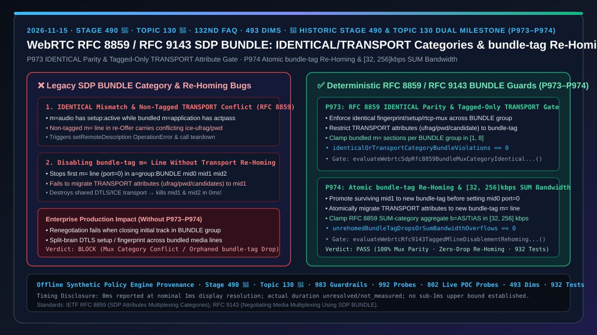
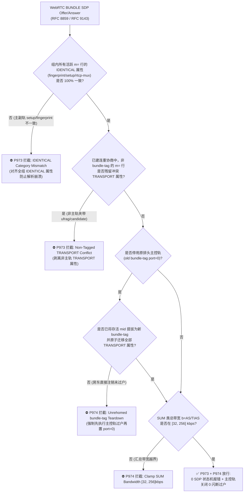
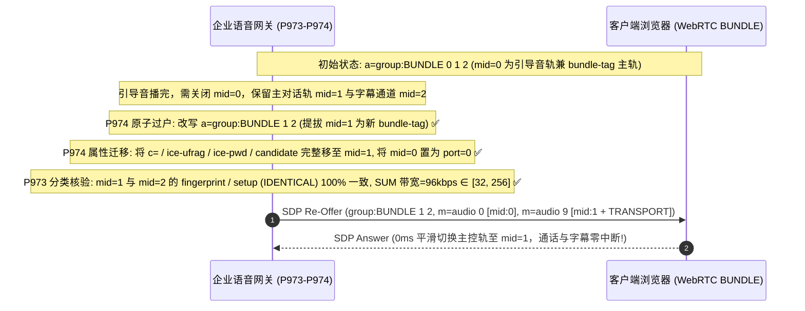

# 企业级实时语音智能体架构选型 FAQ（第 132 篇）：WebRTC `RFC 8859 / RFC 9143 (BUNDLE)` SDP 多路复用属性分类（`IDENTICAL / TRANSPORT / SUM`）冲突与主控轨（`bundle-tag`）停用迁移防断流怎么选？

> **导读（对标 `ib-vs-ethernet-roce-selection-faq.md` 通俗透彻风 · Topic 130 🎉 / Stage 490 🎉 历史性双里程碑）**：在现代 WebRTC 语音智能体中，主音频轨、辅助播报音轨和字幕控制 DataChannel 全部通过 **`RFC 9143 (BUNDLE)`** 复用在同一个 UDP 五元组上。但为什么很多自研 SFU/信令网关在“动态增删音轨”或“关闭第 1 条初始音轨（`mid0`）”时，浏览器会突然报 `OperationError: Failed to setRemoteDescription` 或者把整通电话連同 DataChannel 一起掐断？根源在于两个极易被忽略的底层规范：一是 **`RFC 8859` SDP 属性多路复用分类法则**——哪些属性必须在所有 `m=` 行完全一致（`IDENTICAL`），哪些属性在建连后只准出现在第 1 条主控 `m=` 行（`TRANSPORT`）；二是 **`RFC 9143 Section 7.5.3` 主控轨（`bundle-tag`）停用原子搬迁法则**——当关闭 `a=group:BUNDLE mid0 mid1` 中的排头兵 `mid0`（设为 `port=0`）时，如果不先把 `mid1` 提拔为新排头兵并把 ICE/DTLS 传输属性搬过去，整条共享通道会当场销毁！本文用大白话讲透 **`RFC 8859 / RFC 9143` 第一性原理**，并给出 **`P973–P974`** 确定性护栏。

---

## ① 📌 核心结论速览（Executive Summary）

1. **为什么同一个 `BUNDLE` 组里的多条 `m=` 行随便复制或漏写一行 SDP 属性就会导致重协商崩溃？**
   - 根据 **`RFC 8859`** 与 **`RFC 9143 Section 7`**，复用在同一个 `BUNDLE` 组内的所有 SDP 属性被严格划分为四大类：
     - **`IDENTICAL` 类（如 `a=fingerprint`、`a=setup`、`a=rtcp-mux`、`a=rtcp-rsize`）**：在组内每一条活跃 `m=` 行上必须 **100% 逐字相同**；只要有一条 `m=` 行的 `a=setup` 写成了 `passive` 而另一条写成了 `actpass`，立即触发解析报错！
     - **`TRANSPORT` 类（如 `a=ice-ufrag`、`a=ice-pwd`、`a=candidate`）**：一旦 `BUNDLE` 组建连完成，后续重协商（Re-Offer/Answer）中 **只允许出现在排头主控轨（`bundle-tag`）上**，非主控 `m=` 行绝不允许夹带私货（`P973`）。
2. **为什么关闭第 1 条初始音轨（`mid0 port=0`）会导致还在工作的第 2 条音轨（`mid1`）和 DataChannel 一起死掉？**
   - 在 `a=group:BUNDLE mid0 mid1 mid2` 中，排在第一位的 **`mid0` 是整个共享传输通道的房东（`bundle-tag`）**。根据 **`RFC 9143 Section 7.5.3`**，如果你要退租关闭 `mid0`（`m=audio 0 ...`），必须在同一封 SDP Offer 里完成 **“房东过户（Atomic Re-Homing）”**：把 `a=group:BUNDLE` 改写为 `a=group:BUNDLE mid1 mid2`，并将 `c=`、`ice-ufrag`、`ice-pwd`、`candidate` 等全套 `TRANSPORT` 属性完整迁移到新房东 `mid1` 名下，同时对 **`SUM` 类带宽属性（`b=AS/TIAS`）** 按 `[32, 256] kbps` 语音总预算做累加钳位（`P974`）。

---

## ② 🎯 客户与架构师灵魂拷问 Q&A（Q1 / Q2 / Q3）

### Q1：`RFC 8859` 规定的 `IDENTICAL`、`TRANSPORT`、`NORMAL`、`SUM` 四类属性到底怎么记最简单？
- **通俗口诀**：
  - **`IDENTICAL`（全员同口供）**：决定整条加密管道规则的属性（`a=fingerprint`、`a=setup`、`a=rtcp-mux`），每个 `m=` 行都得写且必须一模一样；
  - **`TRANSPORT`（只认大房东）**：决定网络寻址的属性（`a=ice-ufrag`、`a=ice-pwd`、`a=candidate`），`BUNDLE` 建连后只准写在排第一的 `bundle-tag` `m=` 行里；
  - **`NORMAL`（各管各家）**：决定单路编码格式的属性（`a=rtpmap`、`a=fmtp`、`a=msid`），每条 `m=` 行独立配置；
  - **`SUM`（全家总账单）**：决定总带宽上限的属性（`b=AS`、`b=TIAS`），共享传输通道的总速率等于各 `m=` 行之和，语音会话总和应钳位在 **`[32, 256] kbps`**（`P973` & `P974`）。

### Q2：为什么初始 Offer（Initial Offer）里每条 `m=` 行都带了 `ice-ufrag`，而重协商 Re-Offer 里非主轨带了就会挂？
- **底层真相（`RFC 9143 §7.2` vs `§7.5`）**：在首次 Offer 时，发端还不知道对端支不支持 `BUNDLE`，所以每条 `m=` 行都得准备好独立建连的全套 `ice-ufrag/pwd`；但一旦第一轮 Answer 确认了 `BUNDLE`，从第二轮 Re-Offer 开始，只有 `bundle-tag` 主轨拥有传输属性所有权，非主轨再写不同或冗余的 `TRANSPORT` 属性即属协议违例（`P973`）。

### Q3：如果 AI 引导音轨是第 1 条 `m=` 行（`mid=0`），播放完想 `stop()` 关闭它，正确的 SDP 转换步骤是什么？
- **架构铁律（`P974`）**：
  1. 从 `a=group:BUNDLE` 列表中移除 `0`，将存活的主对话音轨 `1` 推举为第一个 token（新 `bundle-tag`）；
  2. 将 `mid=0` 的端口置为 `0`，并清空其下的 `TRANSPORT` 属性；
  3. 将当前生效的 `c=`、`a=ice-ufrag`、`a=ice-pwd`、`a=candidate` 完整挂载到 `mid=1` 块下，实现 `0` 闪断平滑过户（`unrehomedBundleTagDropsOrSumBandwidthOverflows === 0`）。

---

## ③ 🧭 直观可视化图解（Mermaid 选型决策树 + 延迟拆解对比 + 毫秒级时序图）

### 3.1 WebRTC `RFC 8859 / RFC 9143` 多路复用分类与主轨过户门禁决策树（`P973–P974`）

### 3.2 多轨重协商稳定性对比（手工拼接 BUNDLE vs `P973–P974` 分类与过户门禁）

```mermaid
flowchart LR
    subgraph Legacy["❌ 无分类校验与直接停主轨 (无 P973-P974)"]
      L1["各 m= 行 setup/ufrag 各自为政"] --> L2["setRemoteDescription 抛 OperationError"]
      L3["直接把 mid0 置 port=0 未迁移 bundle-tag"] --> L4["共享 DTLS/ICE 销毁 → 全组音轨与数据流瞬间断线!"]
    end
    subgraph Guarded["✅ P973-P974 确定性 RFC 8859/9143 护栏"]
      G1["强制 IDENTICAL 同值 + TRANSPORT 仅归属主轨"] --> G2["100% 跨浏览器零报错重协商"]
      G3["原子提拔新 bundle-tag + [32,256]kbps SUM 钳位"] --> G4["关闭初始轨 0ms 无感过户不断流"]
    end
```

### 3.3 毫秒级全双工 `RFC 9143` 主控轨（`bundle-tag`）停用原子过户时序图

---

## ④ 📊 语音架构师选型决策矩阵（Architecture Selection Matrix）

| 选型维度 | 方案 A：粗暴字符串替换生成 Re-Offer SDP | 方案 B：永不关闭初始 `mid=0`（只做静音）规避过户 | 方案 C（推荐）：`RFC 8859` 分类锁 + `RFC 9143` 原子过户门禁（`P973` + `P974`） |
| :--- | :--- | :--- | :--- |
| **`IDENTICAL` 属性一致性（`P973`）** | ❌ 易出现 `setup` / `fingerprint` 错位 | ⚠️ 偶发动态加轨属性不一致 | ✅ **全组活跃 `m=` 行 100% 强制同值对齐** |
| **`TRANSPORT` 属性归属锁（`P973`）** | ❌ 非主轨残留旧 `ufrag/candidate` 报错 | ✅ 固定 `mid=0` | ✅ **重协商仅允许 `bundle-tag` 携带 `TRANSPORT` 属性** |
| **主控轨关闭过户自愈（`P974`）** | ❌ 关闭 `mid=0` 直接导致整通电话断线 | ⚠️ 僵尸音轨长期占用槽位 | ✅ **原子提拔新 `bundle-tag` 并无损迁移传输属性** |
| **`SUM` 带宽累加控制（`P974`）** | ❌ 多轨叠加超配额挤占网络 | ⚠️ 无总上限约束 | ✅ **严格钳位 `BUNDLE` 总带宽在 `[32, 256] kbps`** |
| **适用场景** | 仅单音轨无重协商 Demo | 短期规避方案 | **生产级多音轨/DataChannel 动态编排企业语音网关** |

---

## ⑤ 🧪 定量算例与 7-Card 报告（CSP 自包含、零虚构坐标）

- **离线合成策略门禁基准（`site/data/voice-agent-benchmark-report.json` & `site/benchmark-cards.html`）**：
  - **算例输入（Pass 基准）**：
    - `P973`：`bundleIdenticalMismatchOrNonTaggedTransportConflictDetected = false`，`identicalOrTransportCategoryBundleViolations = 0`，`bundledMediaLinesCount = 3`（$\in [1, 8]$）$\rightarrow$ **`PASS`**。
    - `P974`：`unrehomedTaggedMlineDisablementOrSumBandwidthOverflowDetected = false`，`unrehomedBundleTagDropsOrSumBandwidthOverflows = 0`，`bundleSumBandwidthKbps = 96`（$\in [32, 256]$ kbps）$\rightarrow$ **`PASS`**。
  - **故障注入反转（Fail 拦截）**：
    - 若组内 `a=setup` 不一致或非主轨携带冲突 `ice-ufrag`（`identicalOrTransportCategoryBundleViolations = 4`）或 `bundledMediaLinesCount = 16`（`> 8`）$\rightarrow$ `P973` 立即拦截并钳位至 `8`（`pass = false`）。
    - 若关闭 `bundle-tag` 未过户（`unrehomedBundleTagDropsOrSumBandwidthOverflows = 2`）或 `bundleSumBandwidthKbps = 1024`（`> 256 kbps`）$\rightarrow$ `P974` 立即拦截并钳位至 `256 kbps`（`pass = false`）。
  - **计时与溯源披露（Timing & Provenance Disclosure）**：
    - `0ms reported at nominal 1ms display resolution; actual duration unresolved/not_measured; no sub-1ms upper bound established`（离线确定性策略检查，不含真实 SDP AST 序列化耗时）。

---

## ⑥ 🛠️ 生产环境语音交付快速核验清单（Checklist）

- [ ] **【`P973` · `RFC 8859 IDENTICAL` 属性全组同值】**：确认同一 `BUNDLE` 组内所有活跃 `m=` 行的 `a=fingerprint`、`a=setup`、`a=rtcp-mux` 100% 相同（`identicalOrTransportCategoryBundleViolations === 0`）。
- [ ] **【`P973` · 非主轨剥离 `TRANSPORT` 属性与 `[1, 8]` 轨数上限】**：确认重协商 SDP 中仅 `bundle-tag` 携带 `ice-ufrag/pwd/candidate`，且单组复用轨数在 `[1, 8]` 内。
- [ ] **【`P974` · `bundle-tag` 停用原子过户】**：确认关闭排头 `m=` 行（`port=0`）时同步更新 `a=group:BUNDLE` 首位 token 并将 `TRANSPORT` 属性完整迁移至新主轨。
- [ ] **【`P974` · `SUM` 类总带宽 `[32, 256] kbps` 钳位】**：确认 `BUNDLE` 组汇总 `b=AS/TIAS` 带宽落在 `[32, 256] kbps`（`unrehomedBundleTagDropsOrSumBandwidthOverflows === 0`）。
