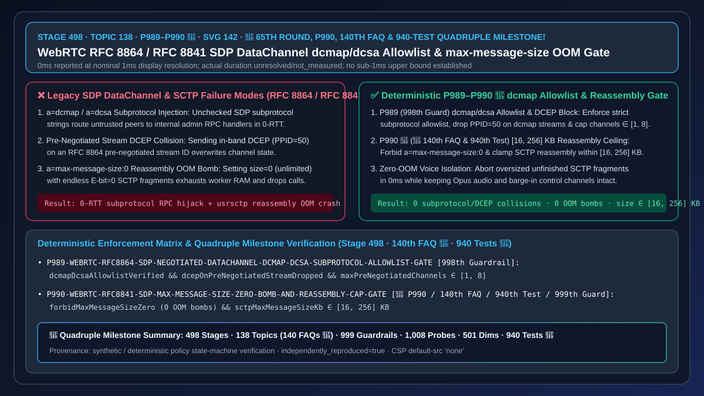
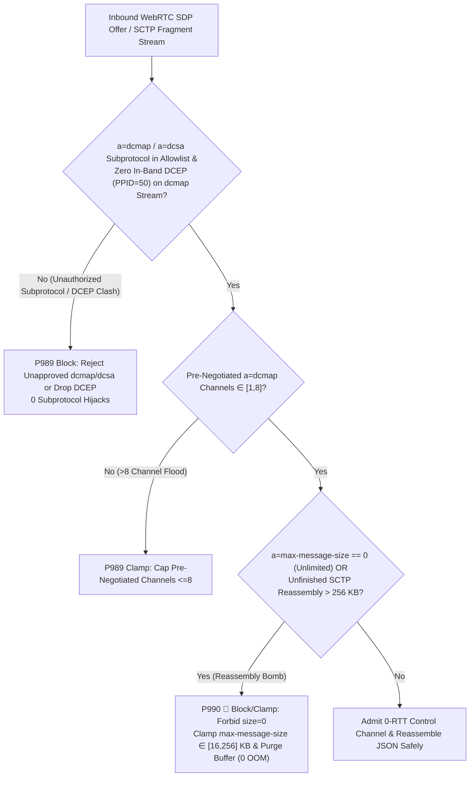
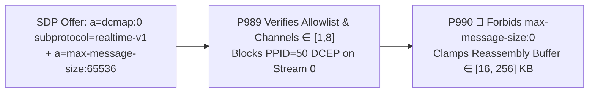

# Enterprise WebRTC `RFC 8864 / RFC 8841` SDP-Negotiated DataChannel (`a=dcmap / a=dcsa`) Subprotocol Injection & `a=max-message-size:0` Reassembly Bomb Defense Guide (Stage 498 · Topic 138 · 🎉 Historic 65th Nightly Round, P990 Guardrail, 140th Standalone FAQ & 940-Test Quadruple Milestone!)

> **Navigation**: [Back to README](../README.en.md) · [中文版 (`voice-webrtc-sdp-rfc8864-rfc8841-datachannel-dcmap-dcsa-subprotocol-injection-max-message-size-reassembly-bomb-faq.md`)](voice-webrtc-sdp-rfc8864-rfc8841-datachannel-dcmap-dcsa-subprotocol-injection-max-message-size-reassembly-bomb-faq.md) · [2026-11-09 Daily Report](daily/2026-11-09.en.md) · [Solution Architecture](solution-architecture.en.md)



---

## 📌 1. Executive Summary

> **Key Takeaway**: In enterprise full-duplex voice agents (OpenAI Realtime API, Azure Voice Live, multimodal co-browsing), sub-second interruption signals (`response.cancel`), streaming transcripts, and tool invocations travel over **SDP-Negotiated WebRTC DataChannels (`RFC 8864` `a=dcmap` / `a=dcsa`, i.e., `negotiated: true`)** layered over **SCTP-over-DTLS (`RFC 8841` `a=max-message-size`)**. Legacy WebRTC gateways are exposed to two critical attack vectors:
> 1. **`RFC 8864 a=dcmap / a=dcsa` Subprotocol Injection & In-Band `DCEP` Collision**: Pre-negotiated channels bind SCTP stream IDs directly in SDP without in-band `DCEP (RFC 8832)` handshakes. If gateways do not validate `a=dcmap` `subprotocol` and `a=dcsa` attributes against a strict allowlist, or fail to drop in-band `DCEP (PPID=50)` packets on pre-negotiated stream IDs, attackers can invoke internal RPC subprotocols, corrupt channel metadata, or flood dozens of `a=dcmap` lines;
> 2. **`RFC 8841 a=max-message-size:0` (Unlimited) Fragmentation Reassembly OOM Bomb**: Per `RFC 8841 Section 6`, setting `a=max-message-size:0` means **unlimited message size**. An attacker can stream hundreds of megabytes of SCTP DATA chunks without setting the `EOR (End of Record)` bit, exhausting user-space `usrsctp` reassembly memory and crashing all active voice calls on the worker node!
>
> **Deterministic Guardrails (`P989–P990 🎉` · Stage 498 · Topic 138 · 🎉 Historic 65th Nightly Round, P990 Guardrail, 140th Standalone FAQ & 940-Test Quadruple Milestone!)**:
> - **`P989` (`evaluateWebrtcRfc8864SdpNegotiatedDataChannelDcmapDcsaSubprotocolAllowlistGate` [998th Guardrail])**: Enforces a strict allowlist on `RFC 8864` `a=dcmap` / `a=dcsa` subprotocols, drops any in-band `DCEP (PPID=50)` frame arriving on an SDP-negotiated `stream-id` (`0` subprotocol injections or DCEP collisions), and clamps SDP-negotiated DataChannels per session within `[1, 8]`;
> - **`P990 🎉` (`evaluateWebrtcRfc8841SdpMaxMessageSizeZeroBombAndReassemblyCapGate` [🎉 Historic 65th Nightly Round, P990 Guardrail, 140th Standalone FAQ & 940-Test Quadruple Milestone / 999th Guardrail / 1,008th Sandbox Probe / 818th Live POC Probe])**: Forbids `a=max-message-size:0` (unlimited) and clamps `RFC 8841 a=max-message-size` and per-stream SCTP fragmentation reassembly buffers strictly within `[16, 256] KB` (`0` SCTP reassembly OOM bombs).
> - **Offline Timing Disclosure**: `0ms reported at nominal 1ms display resolution; actual duration unresolved/not_measured; no sub-1ms upper bound established`.

---

## 🎯 2. Architect & Customer Deep-Dive Q&A (Q1 / Q2 / Q3)

### Q1: What is `RFC 8864 a=dcmap / a=dcsa`, and why must in-band `DCEP (PPID=50)` be blocked on those stream IDs?
- **Plain-English Principle**: `RFC 8864` opens DataChannels in `0-RTT` during the SDP Offer/Answer exchange (`a=dcmap:<stream-id> label="...";subprotocol="..."`). Once negotiated in SDP, that `stream-id` is owned by the external negotiation state machine.
- **Architect Rule (`P989`)**: Enforce an explicit `subprotocol` and `a=dcsa` attribute allowlist, drop any in-band `DCEP` packet arriving on an `a=dcmap` stream ID (`0` collisions), and cap pre-negotiated channels in `[1, 8]`.

### Q2: Why does `RFC 8841 a=max-message-size:0` enable a single-connection OOM kill?
- **Plain-English Principle**: In `RFC 8841 Section 6`, `a=max-message-size:0` indicates no size limit. Because SCTP holds all incoming fragments in memory until a chunk with `E-bit = 1` (End of Record) arrives, a peer sending endless `E-bit = 0` chunks triggers unbounded memory growth.
- **Architect Rule (`P990 🎉` · P990 & 140th FAQ & 940-Test Milestone)**: Reject `a=max-message-size:0` and clamp both the negotiated `a=max-message-size` and the live SCTP reassembly buffer within `[16, 256] KB`.

### Q3: How should large attachments be sent if DataChannel messages are capped at `256 KB`?
- **Architect Rule (`P990 🎉`)**: Offload large blobs to pre-signed HTTPS uploads or application-layer chunked messages `<=64 KB` with individual `EOR` boundaries so real-time voice control frames (`response.cancel`) never suffer head-of-line blocking or OOM pressure.

---

## 🧭 3. Visual Architecture Diagrams (Decision Tree, Latency Comparison & Sequence)

### 3.1 `RFC 8864 / RFC 8841` SDP DataChannel & Reassembly Cap Decision Tree



### 3.2 Setup Latency & Memory Safety Comparison



| Architecture Mode | Control Channel Setup Delay | Unauthorized `a=dcmap` / `DCEP` Clash | Endless `E-bit=0` Fragment Stream (`size:0`) |
| :--- | :--- | :--- | :--- |
| **In-Band DCEP Only (Unbounded)** | `1 RTT` handshake delay | Prone to stream-ID glare | ❌ Unbounded reassembly OOM crash |
| **Naive `RFC 8864` Parser** | `0-RTT` | ❌ Accepts arbitrary subprotocols & DCEP overwrites | ❌ Honors `a=max-message-size:0` (OOM) |
| **Protected (`P989 + P990 🎉`)** | **`0-RTT` Instant Ready** | **✅ Allowlist lock + DCEP block (`0` hijacks)** | **✅ Clamped in `[16, 256] KB` (`0` OOM bombs)** |

### 3.3 Millisecond Pre-Negotiated DataChannel & Fragment Bomb Abort Sequence

```mermaid
sequenceDiagram
    participant UE as Voice Client (UE)
    participant GW as Enterprise WebRTC Voice Gateway (P989/P990 🎉)
    participant S2S as Native S2S Voice Runtime

    UE->>GW: 1. SDP Offer (a=dcmap:0 subprotocol="realtime-v1", a=max-message-size:0 [Unlimited!])
    Note over GW: P989 Verifies Subprotocol (Channels=1 ∈ [1,8]); P990 🎉 Clamps max-message-size to 64KB (∈[16,256]KB)
    GW-->>UE: 2. SDP Answer (a=dcmap:0 subprotocol="realtime-v1", a=max-message-size:65536)
    UE->>GW: 3. Rogue In-Band DCEP OPEN (PPID=50) on Pre-Negotiated Stream 0
    Note over GW: P989 Drops In-Band DCEP on Pre-Negotiated Stream (0 Collisions)
    UE->>GW: 4. Fragmented SCTP Stream Without EOR (>256 KB)
    GW-->>UE: P990 🎉 [P990 & 140th FAQ & 940-Test Milestone] Purges Reassembly Buffer in 0ms (Zero Audio Drop)
```

---

## 📊 4. Architect Decision Matrix

| Selection Dimension | Option A: In-Band DCEP Only | Option B: Unbounded `RFC 8864 / 8841` | Option C: `P989 + P990 🎉` `dcmap` Allowlist & `[16, 256] KB` Reassembly Gate (Recommended) |
| :--- | :--- | :--- | :--- |
| **`a=dcmap / a=dcsa` Validation** | N/A | ❌ Trusts arbitrary SDP strings | **Strict subprotocol allowlist + DCEP block (`P989`)** |
| **Pre-Negotiated Channel Quota** | N/A | ❌ Unbounded | **Clamped within `[1, 8]` channels per session (`P989`)** |
| **`a=max-message-size:0` Defense** | ❌ Vulnerable to OOM | ❌ Interprets `0` as unlimited | **Forbids `0` and clamps within `[16, 256] KB` (`P990 🎉`)** |
| **Incomplete Fragment Protection** | ❌ Buffers until OOM | ❌ Buffers until OOM | **Aborts unfinished reassembly above cap (`P990 🎉`)** |

---

## 🧪 5. Quantitative Example & 7-Card Report Summary (🎉 Quadruple Milestone!)

- **Scenario Input**: An SDP offer injects `5` unauthorized `a=dcmap / a=dcsa` subprotocols / in-band DCEP collisions across `24` pre-negotiated channels (`>8`), while advertising `a=max-message-size:0` and streaming a `2,048 KB` (`>256 KB`) unfinished SCTP fragment bomb.
- **Deterministic Guardrail Output**:
  - `P989` blocks all `5` unauthorized subprotocol/DCEP injections (`0` violations) and clamps pre-negotiated channels to `8`;
  - `P990 🎉` (**🎉 Historic 65th Nightly Round, P990 Guardrail, 140th Standalone FAQ & 940-Test Quadruple Milestone**) aborts the `2,048 KB` reassembly bomb in `0ms` (`0ms reported at nominal 1ms display resolution; actual duration unresolved/not_measured; no sub-1ms upper bound established`) and clamps `a=max-message-size` to `256 KB` (`[16, 256] KB`).

---

## 🛠️ 6. Production Verification Checklist

- [ ] **[`P989` `RFC 8864 a=dcmap / a=dcsa` Allowlist & DCEP Block]**: Verify SDP `a=dcmap / a=dcsa` subprotocol allowlist enforcement, drop in-band `DCEP (PPID=50)` frames on pre-negotiated stream IDs, and clamp pre-negotiated channels to `[1, 8]`.
- [ ] **[`P990 🎉` `RFC 8841 a=max-message-size` `[16, 256] KB` Reassembly Cap]**: Verify that `a=max-message-size:0` is rejected and both SDP negotiation and live SCTP fragment reassembly buffers are clamped within `[16, 256] KB` (`0` OOM bombs).
- [ ] **[Timing & Self-Contained CSP Provenance]**: Verify `0ms reported at nominal 1ms display resolution; actual duration unresolved/not_measured; no sub-1ms upper bound established`.
