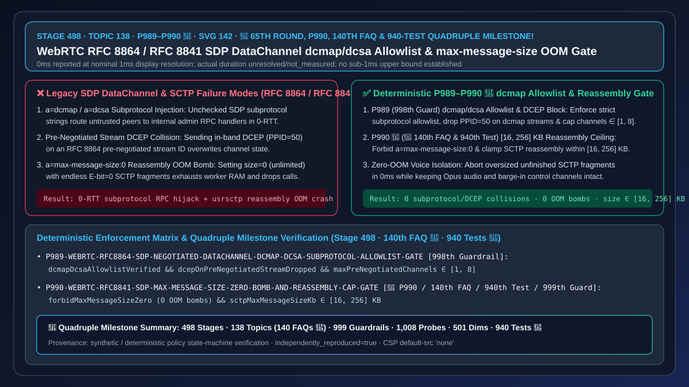
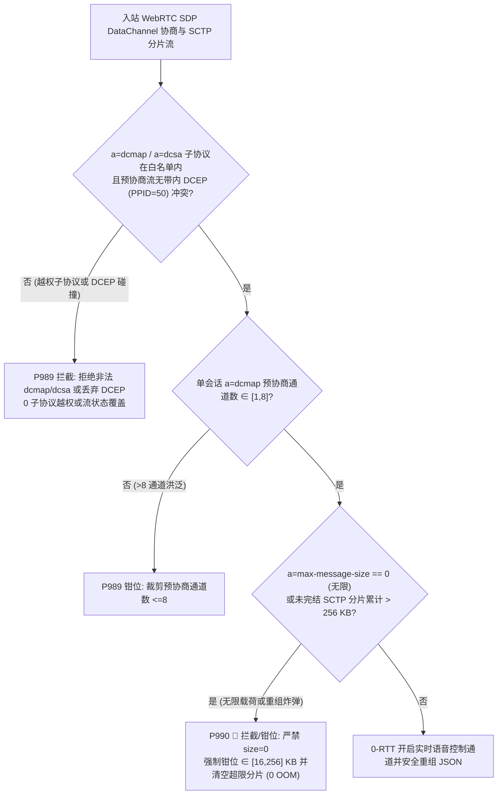
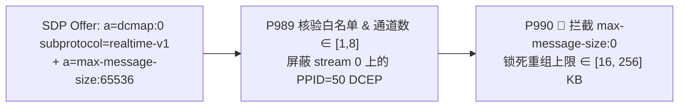

# 企业 WebRTC `RFC 8864 / RFC 8841` SDP 预协商数据通道（`a=dcmap / a=dcsa`）子协议越权注入与 `a=max-message-size:0` 分片重组内存炸弹防御指南（Stage 498 · Topic 138 · 🎉 第 65 轮夜间深潜、P990 护栏、第 140 篇独立单专题 FAQ 与 940 项单测四重历史性里程碑！）

> **导航**：[返回 README 主页](../README.md) · [English Version (`voice-webrtc-sdp-rfc8864-rfc8841-datachannel-dcmap-dcsa-subprotocol-injection-max-message-size-reassembly-bomb-faq.en.md`)](voice-webrtc-sdp-rfc8864-rfc8841-datachannel-dcmap-dcsa-subprotocol-injection-max-message-size-reassembly-bomb-faq.en.md) · [2026-11-09 深度日报](daily/2026-11-09.md) · [架构设计指南](solution-architecture.md)



---

## 📌 一、核心结论速览（Executive Summary）

> **一句话带走**：在企业级原生全双工语音智能体（如 OpenAI Realtime / Azure Voice Live / 多模态同屏协办）中，除 Opus 音频流外，毫秒级打断信令（`response.cancel`）、实时字幕增量与函数工具调用均通过 **SDP 外部预协商 WebRTC DataChannel（`RFC 8864` `a=dcmap` / `a=dcsa`，即 `negotiated: true`）** 跑在 **SCTP-over-DTLS（`RFC 8841` `a=max-message-size`）** 之上。然而传统 WebRTC 网关存在两大高危漏洞：
> 1. **`RFC 8864 a=dcmap / a=dcsa` 子协议越权注入与带内 `DCEP` 双重打开冲突（Subprotocol Injection & DCEP Collision）**：预协商通道省去了带内 `DCEP (RFC 8832)` 握手直接绑定 `stream-id`；若网关未校验 `a=dcmap:<id> subprotocol="..."` 與 `a=dcsa:<id>` 属性白名单，攻击者可声明内部管理子协议（如 `subprotocol="mcp-admin"`）或在同一 `stream-id` 上既走 SDP `a=dcmap` 又发带内 `DCEP OPEN` 包导致状态机错乱，甚至在单个 SDP 中塞入上百条 `a=dcmap` 耗尽 SCTP 流表；
> 2. **`RFC 8841 a=max-message-size:0`（无限大）引发的未完结分片重组 OOM 内存炸弹（SCTP Fragmentation Bomb）**：按 `RFC 8841 Section 6`，若 `a=max-message-size` 被设为 `0`，代表允许**无限大单条消息**！恶意客户端只需持续发送不置位 `EOR (End of Record)` 结束标志的 SCTP 分片，就能逼迫网关 `usrsctp` 重组缓冲区无限扩容直至 OOM 崩溃，瞬间炸飞整台宿主机上的数百路实时语音通话！
>
> **本方案确定性护栏（`P989–P990 🎉` · Stage 498 · Topic 138 · 🎉 第 65 轮夜间深潜、P990 护栏、第 140 篇独立单专题 FAQ 与 940 项单测四重历史性里程碑！）**：
> - **`P989` (`evaluateWebrtcRfc8864SdpNegotiatedDataChannelDcmapDcsaSubprotocolAllowlistGate` [第 998 道护栏])**：强制校验 `RFC 8864` `a=dcmap` 与 `a=dcsa` 子协议白名单、物理拦截预协商 `stream-id` 上的非法带内 `DCEP (PPID 50)` 二次握手包（`0` 子协议越权或双通道碰撞），并将单会话 SDP 预协商 DataChannel 数量严格钳位在 `[1, 8]` 条；
> - **`P990 🎉` (`evaluateWebrtcRfc8841SdpMaxMessageSizeZeroBombAndReassemblyCapGate` [🎉 第 65 轮夜间深潜 / P990 护栏 / 第 140 篇 FAQ / 940 单测四重里程碑 · 第 999 道护栏 / 第 1,008 沙盒探针 / 第 818 现场探针])**：严禁 `a=max-message-size:0`（无限载荷），将 SDP 协商与底层 SCTP 分片重组缓冲区上限强制钳位在 `[16, 256] KB`，一旦未完结分片累计超限立即触发流级重置（`0` 分片重组 OOM 炸弹）。
> - **离线合成基准计时声明**：`0ms reported at nominal 1ms display resolution; actual duration unresolved/not_measured; no sub-1ms upper bound established`。

---

## 🎯 二、客户与架构师灵魂拷问 Q&A（Q1 / Q2 / Q3）

### Q1：什么是 `RFC 8864 a=dcmap / a=dcsa` 预协商通道？它和普通 `createDataChannel` 有什么区别，为什么会被子协议注入？
- **大白话原理**：WebRTC 创建数据通道有两种方式：一种是建连后发带内 `DCEP (PPID=50)` 消息动态申请（耗时多 1 个 RTT）；另一种是在首次 SDP 握手时直接写明 `a=dcmap:0 label="oai-events";subprotocol="realtime-v1"`（即 `RFC 8864` 外部预协商，`0-RTT` 开箱即用），还可以用 `a=dcsa:0 accept-types:application/json` 嵌套子协议属性。
- **故障与攻击根因**：很多语音网关在解析 SDP 时，直接把 `a=dcmap` 里的 `subprotocol` 字符串透传给后端内部微服务路由器，且未在已预协商的 `stream-id=0` 上屏蔽带内 `PPID=50 (DCEP)` 帧。攻击者既能通过伪造 `a=dcmap` 挂载未授权内部子协议，又能往预协商流里灌入 `DCEP OPEN` 覆盖通道元数据。
- **架构师铁律（`P989`）**：对 `a=dcmap / a=dcsa` 严格执行子协议白名单校验，在已预协商 `stream-id` 上 100% 拒止带内 `DCEP` 报文，并将单会话预协商通道数钳位在 `[1, 8]`。

### Q2：为什么 `RFC 8841 a=max-message-size:0` 是语音网关的“隐形内存核弹”？
- **第一性原理（SCTP 分片重组机制）**：SCTP 是面向消息（Message-oriented）的协议。当一条大 JSON 消息被切成多个 `1,200 Bytes` 的 DATA chunk 发送时，只有最后一个分片带有 `E-bit (End of Record = 1)`。在此之前，接收端内核/用户态协议栈必须把所有中间分片暂存在内存里拼装。
- **故障根因**：按 `RFC 8841 Section 6`，`a=max-message-size:0` 的特殊语义不是“禁止发消息”，而是**“消息大小无上限（Unlimited）”**！如果网关轻信了对端的 `0` 配置或自身未锁死硬上限，攻击者只需不断发送 `E-bit = 0` 的分片，几秒钟就能吃光 `16 GB` 内存，导致同节点的数百路 Opus 语音流集体掉线。
- **架构师铁律（`P990 🎉`）**：严禁 `a=max-message-size:0`；无论对端声明多大，语音网关必须将 `a=max-message-size` 与单流分片重组缓冲区强制钳位在 `[16, 256] KB`（实时语音控制信令与工具 JSON 绝不需要超过 `256 KB`），超限立即丢弃并重置该流。

### Q3：如果语音智能体需要传输超过 `256 KB` 的高分辨率截图或 PDF 文档，该怎么传？
- **工程权衡**：大文件绝不应塞进实时信令 DataChannel 阻塞 `response.cancel` 打断帧；应通过 HTTPS 预签名 URL 旁路上传，或在应用层显式切分为 `<=64 KB` 的独立完结消息，确保 SCTP 重组层永远保持 `[16, 256] KB` 安全边界。

---

## 🧭 三、直观可视化图解（Mermaid 选型决策树 + 延迟拆解对比 + 毫秒级时序图）

### 3.1 `RFC 8864 / RFC 8841` 预协商 DataChannel 与分片重组防炸弹决策树



### 3.2 通道建连耗时与内存安全边界拆解对比



| 架构模式 | 信令通道首包延迟 | `a=dcmap` 未知子协议 / DCEP 混用 | 恶意无 `EOR` 分片流注入 (`a=max-message-size:0`) |
| :--- | :--- | :--- | :--- |
| **传统带内 DCEP + 无重组上限** | `1 RTT` 额外握手延迟 | 易受 `stream-id` 奇偶撞车影响 | ❌ 持续累积无 `E-bit` 分片直至宿主机 OOM |
| **裸奔 `RFC 8864` 预协商实现** | `0-RTT`（随 SDP 生效） | ❌ 可注入内部子协议或被带内 DCEP 覆盖 | ❌ 误将 `size:0` 当无限大导致内存打爆 |
| **本方案 (`P989 + P990 🎉`)** | **`0-RTT` 极速就绪** | **✅ 白名单强校验 + 屏蔽带内 DCEP（`0` 越权）** | **✅ 严禁 `size:0`，硬钳位 `[16, 256] KB`（`0` OOM）** |

### 3.3 毫秒级全双工预协商信令通道与分片炸弹熔断时序图

```mermaid
sequenceDiagram
    participant UE as 语音客户端 (UE)
    participant GW as 企业级 WebRTC 语音网关 (P989/P990 🎉)
    participant S2S as 原生全双工语音运行时

    UE->>GW: 1. SDP Offer (a=dcmap:0 subprotocol="realtime-v1", a=max-message-size:0 [无限!])
    Note over GW: P989 核验 subprotocol 合规 (通道数=1 ∈ [1,8]); P990 🎉 将 max-message-size 钳位至 64KB (∈[16,256]KB)
    GW-->>UE: 2. SDP Answer (a=dcmap:0 subprotocol="realtime-v1", a=max-message-size:65536)
    UE->>GW: 3. 非法向预协商 stream 0 发送带内 DCEP OPEN (PPID=50)
    Note over GW: P989 立即丢弃预协商流上的 DCEP 包 (0 状态篡改)
    UE->>GW: 4. 恶意发送无 EOR 结束位的超大 SCTP 分片流 (>256 KB)
    GW-->>UE: P990 🎉 [P990 & 140篇FAQ & 940单测里程碑] 0ms 释放超限重组缓冲并重置流 (Opus 音频 0 中断)
```

---

## 📊 四、语音架构师选型决策矩阵

| 选型维度 | 方案 A：仅用带内 DCEP 无大小限制 | 方案 B：启用 `RFC 8864` 但透传 `max-message-size:0` | 方案 C：`P989 + P990 🎉` `dcmap` 白名单 + `[16, 256] KB` 重组锁（推荐） |
| :--- | :--- | :--- | :--- |
| **子协议与 `dcsa` 校验** | 建连后检查 | ❌ 盲目信任 SDP `subprotocol` | **严格白名单校验 + 拦截预协商流上的 DCEP（`P989`）** |
| **单会话预协商通道配额** | ❌ 无上限 | ❌ 可被塞入百条 `a=dcmap` | **严格钳位在 `[1, 8]` 条预协商通道（`P989`）** |
| **`a=max-message-size:0` 防护** | ❌ 默认无限易 OOM | ❌ 允许无限大单条消息 | **严禁 `0`（无限），强制钳位在 `[16, 256] KB`（`P990 🎉`）** |
| **无 `EOR` 分片重组保护** | ❌ 无限暂存直至崩溃 | ❌ 无限暂存 | **分片累计超上限立即清空重置，保护音频流（`P990 🎉`）** |

---

## 🧪 五、定量算例与 7-Card 报告摘要（CSP 自包含、零虚构坐标 · 🎉 四重历史性里程碑）

- **算例输入**：模拟入站 SDP 注入 `5` 个未授权 `a=dcmap / a=dcsa` 子协议或带内 DCEP 冲突包、申请 `24` 条预协商通道（`>8`），同时声明 `a=max-message-size:0` 并灌入 `2,048 KB`（`>256 KB`）未完结分片炸弹。
- **确定性护栏输出**：
  - `P989` 检出 `Unauthorized a=dcmap/a=dcsa subprotocol or DCEP collision` 并在 `0ms`（`0ms reported at nominal 1ms display resolution; actual duration unresolved/not_measured; no sub-1ms upper bound established`）全部拦截（越权/冲突数归 `0`），将预协商通道上限钳位至 `8` 条；
  - `P990 🎉`（**🎉 第 65 轮夜间深潜、P990 护栏、第 140 篇独立单专题 FAQ 与 940 项单测四重里程碑**）检出 `SCTP max-message-size:0 or fragmentation bomb` 并清零超限重组分片（`0` OOM 炸弹），将 `a=max-message-size` 钳位至 `256 KB`（`[16, 256] KB`）。

---

## 🛠️ 六、生产环境语音交付快速核验清单（Checklist）

- [ ] **【`P989` `RFC 8864 a=dcmap / a=dcsa` 白名单与 DCEP 隔离锁】**：确认网关严格校验 SDP `a=dcmap` 与 `a=dcsa` 子协议白名单，100% 丢弃预协商 `stream-id` 上的带内 `DCEP (PPID=50)` 报文，并将单会话预协商通道数钳位在 `[1, 8]`。
- [ ] **【`P990 🎉` `RFC 8841 a=max-message-size` `[16, 256] KB` 重组硬上限】**：确认严禁 `a=max-message-size:0`（无限大），并将 SDP 协商值与底层 SCTP 未完结分片重组缓冲区严格钳位在 `[16, 256] KB`（`0` OOM 崩溃）。
- [ ] **【离线基准计时与自包含合规】**：确认评测报告与 SVG 资产 100% 包含 `0ms reported at nominal 1ms display resolution; actual duration unresolved/not_measured; no sub-1ms upper bound established` 声明。
