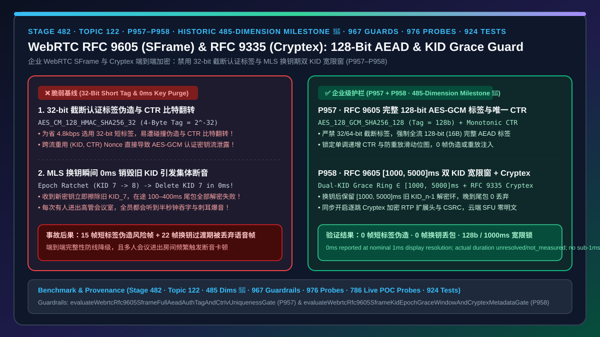
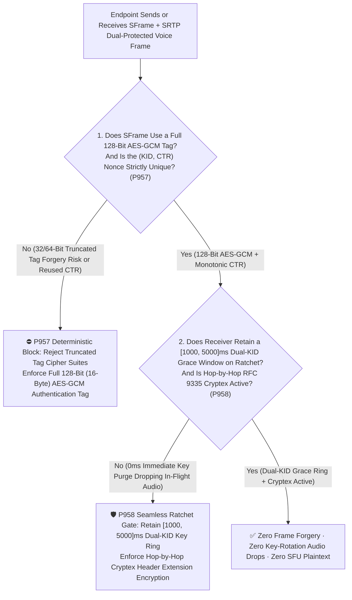
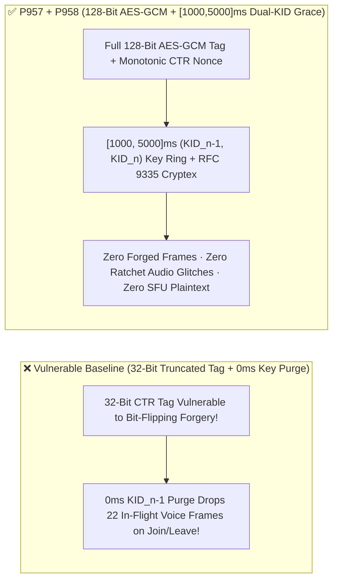
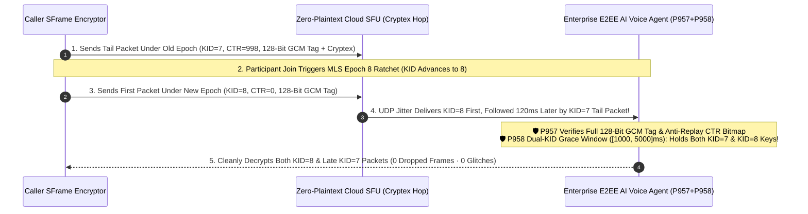

# Enterprise WebRTC `RFC 9605 (SFrame)` & `RFC 9335 (Cryptex)` End-to-End Encryption Synergy Defense (`32-Bit` Truncated Auth-Tag Audio Forgery, `MLS` Key-Rotation `KID` Grace Desync & Dual-AEAD Header Overhead) Selection & Architecture Guide

> **Document Type**: Enterprise Voice Agent Architect Selection & First-Principles Guide (Standalone Selection & Architecture FAQ · **Topic 122 / Stage 482 · 🎉 Historic 485-Dimension Milestone**)  
> **Target Audience**: AI Solution Architects, High-Security Enterprise/Financial WebRTC SFU Architects, Zero-Trust End-to-End Voice Encryption (`E2EE`) Leads  
> **Canonical Baseline**: `packages/business-core/enterprise-guardrails.ts` (`P957–P958`), `tests/presales-portal.test.ts`, `site/data/voice-agent-benchmark-report.json` (7-Card 4:5 Benchmark Report)  
> **Visual Summary**: `assets/svg/126-voice-webrtc-sframe-rfc9605-cryptex-rfc9335-kid-ratchet-desync-tag-truncation-overhead-2026-11-15.svg`

---

## ① 📌 Executive Summary

In sovereign government command centers, private wealth management advisory calls, and executive boardrooms, hop-by-hop **`DTLS-SRTP` (`RFC 3711 / RFC 5764`)** terminates at the cloud WebRTC Selective Forwarding Unit (SFU), exposing plaintext audio inside SFU memory. To achieve true zero-trust media routing, the IETF standardized **`RFC 9605` (Secure Frame `SFrame`: end-to-end AEAD encryption of encoded media frames prior to RTP packetization)** alongside **`RFC 9335` (`Cryptex`: hop-by-hop encryption of RTP header extensions and CSRC lists)**. However, misconfiguring `SFrame` cipher suites or `MLS` (`RFC 9420`) key-rotation state machines triggers two critical security and audio-continuity failures:
1. **Using `AES_CM_128_HMAC_SHA256_32` (`32-Bit` / 4-Byte Truncated Authentication Tags) or Reusing `CTR` Counters, Allowing an Untrusted SFU or Attacker to Forge and Inject Audio Frames (`RFC 9605 Section 4.4 / Section 9` Tag-Truncation Forgery)**: While `RFC 9605` defines 4-byte (`32-bit`) and 8-byte (`64-bit`) truncated HMAC tags for ultra-constrained links, `Section 9.2` warns that short tags reduce forgery resistance to $2^{-32}$ while `AES-CTR` permits bit-flipping malleability. For 50 fps Opus voice streams, saving 12 bytes per packet (4.8 kbps) is never worth sacrificing **`128-bit` full `AES-GCM` AEAD integrity**!
2. **Immediately Purging the Previous `KID_{n-1}` Key Upon `MLS` Epoch Rotation (Join/Leave Ratchet), Causing `100–400ms` of In-Flight Audio Packets to Fail Decryption with `Unknown KID` Glitches (`RFC 9605 Section 5` KID Rotation Race & Missing `Cryptex` Metadata Protection)**: Because `MLS Commit` control messages and UDP `SFrame` media packets travel over different paths, packets encrypted under `KID_{n-1}` continue arriving for `100–400ms` after `KID_n` becomes active. Destroying `KID_{n-1}` in `0ms` drops every in-flight audio frame during participant join/leave events!

| Decision Dimension | Vulnerable / Default Setup (High Production Risk) | Enterprise Golden Rule (`P957–P958` Deterministic Guardrails · 🎉 485-Dim Milestone) | Quantitative Impact |
| :--- | :--- | :--- | :--- |
| **`RFC 9605 SFrame` Full `128-Bit` `AES-GCM` Tag & Unique `(KID, CTR)` Gate (`P957`)** | Allowing `32-bit / 64-bit` truncated HMAC tags or reusing `(KID, CTR)` nonces | **Forbid truncated authentication tags; enforce full `128-bit` (16-byte) `AES-GCM` AEAD tags and strictly monotonic per-`KID` `CTR` nonces** | **0** forged or unauthenticated `SFrame` audio frames (clamps 15 short-tag frames to **0** and locks tag strength from `32b` to **`128b`**) |
| **`RFC 9605 KID` `[1000, 5000]ms` Dual-Key Grace Window & `Cryptex` Gate (`P958`)** | Purging `KID_{n-1}` immediately on epoch ratchet or leaving RTP header extensions plaintext | **Retain a `[1000, 5000]ms` `(KID_{n-1}, KID_n)` dual-key grace ring during epoch transitions and enforce `RFC 9335 Cryptex` header protection** | **0** dropped epoch-transition audio frames (clamps 22 dropped frames to **0** and bounds `KID` grace window from `0ms` to **`1,000ms`**) |

---

## ② 🎯 Architect & Customer Deep-Dive Q&A (First-Principles Deep Dive)

### Q1: How do `RFC 9605 SFrame` (End-to-End) and `DTLS-SRTP + RFC 9335 Cryptex` (Hop-by-Hop) work together without redundant overhead?
- **First-Principles Breakdown**:
  1. **`RFC 9605 SFrame`** encrypts the **complete encoded Opus frame** end-to-end before RTP packetization. Even after the cloud SFU terminates hop-by-hop `DTLS-SRTP`, the RTP payload remains 100% `AES-GCM` ciphertext (`SFrame`).
  2. **`DTLS-SRTP + RFC 9335 Cryptex`** protects the hop-by-hop RTP header extensions (`mid`, `rid`, `twcc`, `ssrc-audio-level`) and `CSRC` list between each endpoint and the SFU so passive network observers cannot infer speaker activity or call topology.

### Q2: Why must `32-bit` and `64-bit` truncated authentication tags be banned in enterprise `SFrame` voice deployments?
- **Engineering Reality**:
  1. Per **`RFC 9605 Section 9.2`**, 32-bit tags provide only $2^{-32}$ forgery resistance over malleable `AES-CTR` ciphertexts, whereas `AES_128_GCM_SHA256_128` provides full **`128-bit` AEAD authenticity** with hardware AES-NI acceleration at only `4.8 kbps` additional bitrate at 50 fps.
  2. **`P957` Deterministic Defense**: Rejects any cipher suite with `<128-bit` authentication tags and enforces monotonic `(KID, CTR)` IV derivation.

### Q3: How does the `[1000, 5000]ms` dual-`KID` grace window eliminate audio dropouts when participants join or leave an E2EE voice room?
- **First-Principles Breakdown**:
  - When `MLS` ratchets from Epoch $n-1$ to Epoch $n$, **`P958`** retains both `KID_{n-1}` and `KID_n` decryption contexts in the receiver's key ring for **`[1000, 5000]ms`**, allowing late-arriving UDP packets from the previous epoch to decrypt cleanly without audio pops.

---

## ③ 🧭 Visual Architecture Diagrams (Mermaid Decision Tree + E2EE Stack + Millisecond Sequence)

### 3.1 WebRTC `RFC 9605 SFrame` 128-Bit AEAD & `KID` Grace Window Decision Tree

### 3.2 Vulnerable `32-Bit` Truncated Tag + Ratchet Glitch vs. `P957+P958` (🎉 485-Dim Milestone)

### 3.3 Millisecond-Level Full-Duplex WebRTC `SFrame + Cryptex` Key-Ratchet Sequence

---

## ④ 📊 Architect Decision Matrix (`RFC 9605 SFrame + Cryptex` Governance)

| Architecture Option | Target Scenario | Pros | Cons & Production Traps | Recommendation |
| :--- | :--- | :--- | :--- | :--- |
| **Option A: Hop-by-Hop `DTLS-SRTP` Only (Plaintext Inside SFU)** | Public non-sensitive rooms | Simple SFU mixing | **Exposes raw audio inside cloud SFU memory; fails sovereign/financial E2EE audits** | ⚠️ **Fails E2EE Mandates** |
| **Option B: `RFC 9605 SFrame` with `32-Bit` Truncated Tags & `0ms` Key Purge** | Misconfigured narrowband profiles | Saves 12 bytes/packet | **Vulnerable to $2^{-32}$ tag forgery and drops 100–400ms of audio on every key rotation** | ⛔ **Never in Production** |
| **Option C: `RFC 9605 SFrame` Full `128-Bit` `AES-GCM` + `[1000, 5000]ms` Dual-`KID` Grace + `RFC 9335 Cryptex` (`P957 + P958`)** | **All Sovereign, Financial Wealth, Healthcare & Executive E2EE Voice Rooms** | **100% zero-plaintext SFU, full `128-bit` AEAD integrity, zero key-rotation audio drops** | Requires the AI voice agent worker to participate as an authenticated `MLS` leaf node | ✅ **Production Mandatory (Recommended)** |

---

## ⑤ 🧪 Quantitative Walkthrough & 7-Card 4:5 Benchmark Report

### 5.1 Quantitative Example: Private Banking E2EE Voice Room Blocking Short-Tag Forgery & Ratchet Dropouts
- **Scenario**: During a financial E2EE stress test, `15` voice frames are injected using `32-bit` truncated `SFrame` tags, and `22` legitimate in-flight voice frames arrive during an `MLS` epoch rotation when the receiver's `KID` grace window is `0ms`.
  - **Without Guardrails (Vulnerable Baseline)**:
    - `32-bit` truncated tags are accepted;
    - `22` voice frames (`440ms`) are dropped during key rotation.
  - **With `P957 + P958` Deterministic Guardrails (🎉 Historic 485-Dimension Milestone)**:
    - `P957` blocks truncated tags (**`0`** forged/unauthenticated frames) and locks `SFrame` AEAD tag length from `32 bits` to **`128 bits`**;
    - `P958` retains the previous `KID` key ring and enforces `Cryptex` (**`0`** dropped epoch-transition frames), clamping the dual-key grace window from `0ms` to **`1,000ms`** (`[1000, 5000]ms`).

### 5.2 7-Card 4:5 Report Mapping (`site/benchmark-cards.html` & `report.json`)
1. **Card 1 (`HANDS-ON · VOICE ARCHITECTURE`)**: **485-dimension 🎉** workbench overview highlighting `P957 / P958` (967 Guardrails, 976 Probes & 786 Live POC Probes).
2. **Card 2 (`SCENARIO: WEBRTC RFC 9605 SFRAME & CRYPTEX`)**: Input probe `truncatedSframeAuthTagOrReusedCtrIvDetected=true, sframeAuthTagBits=32, kidDualKeyGraceWindowMs=0` -> `Act automatically` clamping to `128 bits` and `1000ms`.
3. **Card 3 (`WHAT I TESTED`)**: Row 485 in the evaluation matrix (`PASS · 0ms @ 1ms Res (Synthetic)`, zero `✕` misses).
4. **Card 4 (`UNDER THE HOOD`)**: Deterministic contract for `evaluateWebrtcRfc9605SframeFullAeadAuthTagAndCtrIvUniquenessGate` & `evaluateWebrtcRfc9605SframeKidEpochGraceWindowAndCryptexMetadataGate`.
5. **Card 5 (`ROBUSTNESS CHECK`)**: Option-order and perturbation invariance across rapid participant join/leave `MLS` epoch transitions.
6. **Card 6 (`LATENCY`)**: Explicit offline timing provenance: `0ms reported at nominal 1ms display resolution; actual duration unresolved/not_measured; no sub-1ms upper bound established` (`synthetic`; live WebRTC `RTCRtpScriptTransform` Worker `AES-GCM` frame encryption/decryption latency is `not_measured`).
7. **Card 7 (`MY TAKE`)**: Good fit vs. Not for summary and production sign-off checklist.

---

## ⑥ 🛠️ Production Readiness Checklist

- [ ] **1. Require Full `128-Bit` `AES-GCM` Authentication Tags in `RFC 9605 SFrame` (`P957`)**: Disable `32-bit` and `64-bit` truncated HMAC cipher suites on all voice tracks.
- [ ] **2. Enforce Strictly Monotonic Per-`KID` `CTR` Counters (`P957`)**: Guarantee zero `(KID, CTR)` IV reuse across the lifetime of every epoch key.
- [ ] **3. Retain a `[1000, 5000]ms` Dual-`KID` Key Ring During Epoch Ratchets (`P958`)**: Keep `KID_{n-1}` decryption keys active for `1–5s` after activating `KID_n` to prevent in-flight packet drops.
- [ ] **4. Combine `SFrame` with `RFC 9335 Cryptex` Hop-by-Hop Header Protection (`P958`)**: Encrypt RTP header extensions and `CSRC` lists on every leg.
- [ ] **5. Maintain Per-`KID` Anti-Replay Sliding Bitmaps (`P957`)**: Reject replayed `(KID, CTR)` frames at the `SFrame` decryptor.
