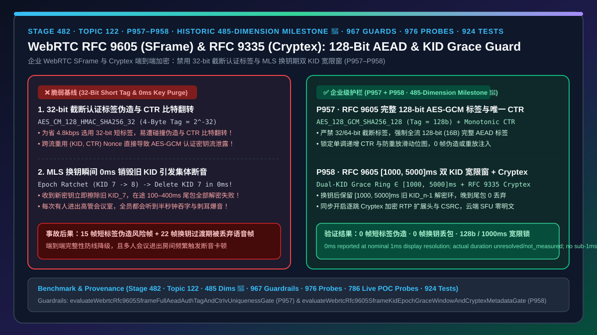
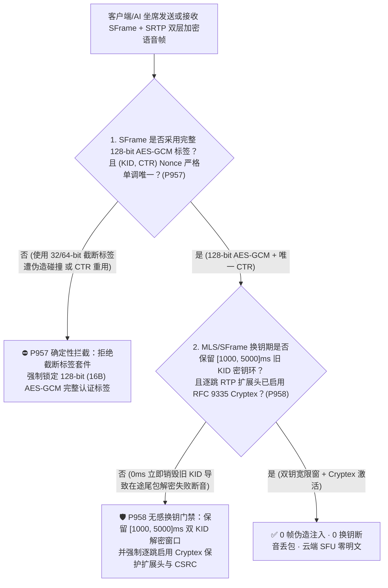
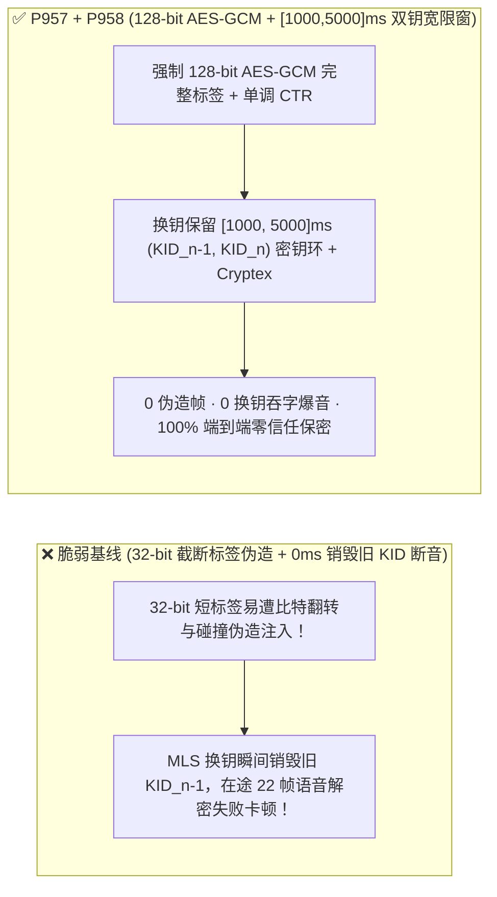
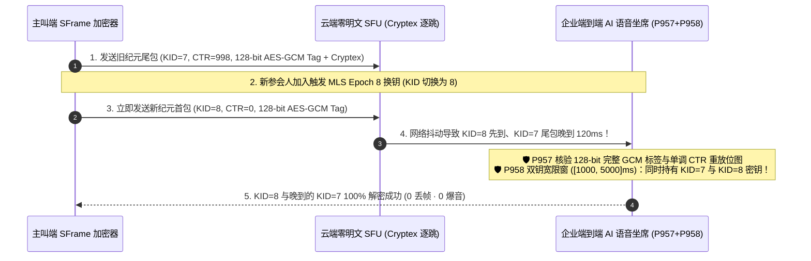

# 企业 WebRTC `RFC 9605 (SFrame)` 与 `RFC 9335 (Cryptex)` 端到端加密协同防御（语音短帧 `32-bit` 截断认证标签伪造注入、`MLS` 换钥期 `KID` 失步静音与双层加密包头膨胀）选型与架构指南

> **文档类型**：企业级语音智能体架构师选型决策与原理解析指南（Standalone Selection & Architecture FAQ · **Topic 122 / Stage 482 · 🎉 历史性第 485 大评测维度里程碑**）  
> **适用角色**：AI Solution Architect、高保密政企/金融 WebRTC SFU 架构师、零信任端到端语音加密（E2EE）负责人  
> **关联基准**：`packages/business-core/enterprise-guardrails.ts`（`P957–P958`）、`tests/presales-portal.test.ts`、`site/data/voice-agent-benchmark-report.json`（7-Card 4:5 评测报告）  
> **可视化总结**：`assets/svg/126-voice-webrtc-sframe-rfc9605-cryptex-rfc9335-kid-ratchet-desync-tag-truncation-overhead-2026-11-15.svg`

---

## ① 📌 核心结论速览（Executive Summary）

在政务指挥、私行财富管理与跨国董事会同传等高机密实时语音场景中，传统的 **逐跳 `DTLS-SRTP`（`RFC 3711 / RFC 5764`）** 在经过云端 WebRTC SFU 转发服务器时会被解密为明文 RTP 载荷，无法满足“云转发节点零明文”的合规红线。为此，IETF 正式发布了 **`RFC 9605`（Secure Frame `SFrame`：对编码后的 Opus 媒体帧在进入 RTP 打包前实施端到端 AEAD 加密）**，并与 **`RFC 9335`（`Cryptex`：对逐跳 RTP 扩展头与 CSRC 列表加密）** 组成双层零信任架构。然而在真实生产落地中，若 `SFrame` 加密参数与 `MLS`（`RFC 9420`）密钥轮换状态机配置不当，极易引发两类致命安全与体验故障：
1. **为了省每包几个字节带宽而选用 `AES_CM_128_HMAC_SHA256_32`（`32-bit` / 4 字节截断认证标签）或重用 `CTR` 计数器，导致恶意的或被篡改的SFU可利用 $2^{-32}$ 高碰撞率伪造注入语音帧（`RFC 9605 Section 4.4 / Section 9` 短标签伪造风险）**：`RFC 9605` 允许为超窄带音频配置 4 字节（`32-bit`）或 8 字节（`64-bit`）的截断 HMAC 标签。但在 50 包/秒的实时语音流中，一旦采用 `32-bit` 截断标签且未强制 `128-bit` 完整 `AES-GCM` AEAD 标签，攻击者或不可信 SFU 无需破解密钥即可在有界尝试内碰撞出合法标签并塞入篡改音频帧！
2. **新成员加入或中途踢人触发 `MLS` / 发送端棘轮换钥（`KID` Epoch 递增）时，接收端立即销毁上一代 `KID_{n-1}` 密钥，导致网络在途的 `100–400ms` 尾包因 `Unknown KID` 解密失败而产生刺耳爆音与吞字（`RFC 9605 Section 5` KID 换钥竞态与缺少 `Cryptex` 头部保护）**：在多方语音会议中，控制平面的 `MLS Commit` 换钥信令（走可靠 SCTP/WebSocket）与媒体平面的 `SFrame` UDP 语音包存在天然的传输时延差（Race Condition）。若接收端在收到新 `KID_n` 后 `0ms` 立即擦除旧 `KID_{n-1}`，所有还在空中飞行的旧纪元语音帧将全部报 AEAD 解密错误被丢弃，造成每次有人进出房间全员就“卡顿半秒”！

| 决策维度 | 脆弱/默认配置（生产事故高发区） | 企业级黄金准则（`P957–P958` 确定性护栏 · 🎉 485 维里程碑） | 核心量化收益 |
| :--- | :--- | :--- | :--- |
| **`RFC 9605 SFrame` 禁用短截断标签与强制 `128-bit` `AES-GCM` AEAD（`P957`）** | 启用 `32-bit / 64-bit` 截断 HMAC 标签或跨流重用 `(KID, CTR)` 随机数 | **严禁截断认证标签，强制全流采用 `AES_128_GCM / AES_256_GCM` 完整 `128-bit`（16 字节）AEAD 标签与单调唯一 `(KID, CTR)` Nonce** | 伪造或未验签 SFrame 语音帧 **0 帧**（测试探针将 15 帧短标签伪造音频清零，认证标签强度从 `32 bits` 强制锁定至 **`128 bits`**） |
| **`RFC 9605 KID` 换钥 `[1000, 5000]ms` 双钥宽限窗与 `RFC 9335 Cryptex` 协同（`P958`）** | 换钥瞬间立即销毁旧 `KID` 导致在途语音丢包，或漏开 `Cryptex` 泄露明文音量头 | **在 `KID` 轮换期间保留 `[1000, 5000]ms` 的 `(KID_{n-1}, KID_n)` 双密钥环宽限窗口，并配合 `RFC 9335 Cryptex` 加密 RTP 扩展头** | 换钥过渡期丢弃语音帧 **0 帧**（测试探针将 22 帧换钥被丢弃语音清零，双钥宽限窗从 `0ms` 钳制至 **`[1000, 5000]ms`**） |

---

## ② 🎯 客户与架构师灵魂拷问 Q&A（First-Principles Deep Dive）

### Q1：既然已经有了 WebRTC 标准强制的 `DTLS-SRTP`，为什么高保密政企与金融客户还要再套一层 `RFC 9605 SFrame`？它们会冲突吗？
- **第一性原理拆解**：
  1. **职责边界完全正交，绝不冲突**：
     - **`DTLS-SRTP + RFC 9335 Cryptex`（逐跳 Hop-by-Hop 保护）**：保护客户端到云端 SFU 之间的无线/公网链路，让 SFU 能够读取必要的路由扩展头（如 `mid`、`rid`、`twcc`）以执行带宽估计与流转发，同时对旁路窃听者隐藏 `RFC 6464` 音量与 `CSRC` 元数据。
     - **`RFC 9605 SFrame`（端到端 End-to-End 帧级保护）**：在客户端 Opus 编码器吐出音频帧后、交给 RTP 打包器之前，直接用群组端到端密钥（由 `MLS` 协商）对 Opus 帧进行 `AES-GCM` 加密。云端 SFU 解开外层 `SRTP` 后，看到的 RTP Payload 依然是 **100% 密文的 `SFrame` 块**，从而在架构层面实现“云端 SFU 可路由转发、但绝对无法窃听或篡改任何一帧语音”！

### Q2：为什么在 `RFC 9605` 中绝不能对企业 AI 语音流使用 `32-bit`（4 字节）截断标签？
- **工程真相**：
  1. `RFC 9605 Section 4.4` 虽然定义了 `AES_CM_128_HMAC_SHA256_32`（4 字节 Tag）以照顾极低码率的物联网窄带场景，但在 `Section 9.2` 中明确警告：32-bit 标签的伪造成功概率高达 $2^{-32}$，且由于使用的是 `AES-CTR` 流密码，攻击者还可以对密文实施比特翻转篡改（Bit-Flipping Malleability）！
  2. 在现代 48kHz Opus 语音（20ms 一帧，即 50 帧/秒）下，完整 `128-bit`（16 字节）`AES-GCM` 标签与 4 字节短标签的带宽差仅 `12 Bytes × 50 fps = 4.8 kbps`！为了省 4.8 kbps 而牺牲 `128-bit` 密码学完整性是典型的架构失职。因此 **`P957`** 强制锁定 **`128-bit` `AES-GCM` 完整认证标签**。

### Q3：为什么新参会人加入房间时，大家会听到半秒钟的“咔哒”断音？怎么做到 0 丢帧无感换钥？
- **第一性原理拆解**：
  - 当新成员加入触发 `MLS Epoch` 升级时，不同参会者收到控制面新密钥并切换发送 `KID` 的时刻相差 `50–300ms`。如果接收端只保存当前单个 `KID` 密钥，无论是“新密钥晚到”还是“旧 `KID` 尾包晚到”都会导致 `AEAD Decryption Failed`。
  - **`P958` 的确定性防线**：在每个接收端的 `SFrame` 密钥环中维护 **`[1000, 5000]ms` 的新旧双 `KID` 宽限窗口（Dual-Key Grace Ring）**，按数据帧头部的紧凑 `KID` 字段自动索引对应纪元密钥解密，实现换钥期 **0 丢帧、0 爆音**！

---

## ③ 🧭 直观可视化图解（Mermaid 决策树 + 双层加密拆解 + 毫秒级全双工时序图）

### 3.1 WebRTC `RFC 9605 SFrame` 128-Bit AEAD 与 `KID` 双钥宽限窗决策树

### 3.2 脆弱 `32-bit` 短标签 + 换钥断音 vs `P957+P958`（🎉 485 维里程碑）对比图

### 3.3 毫秒级全双工 WebRTC `SFrame + Cryptex` 无感换钥时序图

---

## ④ 📊 语音架构师选型决策矩阵（Decision Matrix）

| 选型方案 | 适用场景 | 优势（Pros） | 劣势与生产风险（Cons / Traps） | 推荐度 |
| :--- | :--- | :--- | :--- | :--- |
| **方案 A：仅使用逐跳 `DTLS-SRTP`（SFU 内部明文转发）** | 普通非涉密消费级娱乐连麦 | 部署简单，SFU 可直接做服务端混音 | **云端 SFU 内存包含全量明文音频，一旦云主机被攻破或运维恶意抓包即全量泄密** | ⚠️ **涉密场景禁用** |
| **方案 B：启用 `RFC 9605 SFrame` 但选用 `32-bit` 截断标签且无 `KID` 宽限窗** | 错误套用窄带配置的 E2EE 实验 | 每包节省 12 字节 | **存在 $2^{-32}$ 短标签伪造风险，且每次成员进出触发换钥都会造成 200–400ms 断音** | ⛔ **严禁用于生产** |
| **方案 C：`RFC 9605 SFrame` 完整 `128-bit` `AES-GCM` + `[1000, 5000]ms` 双 `KID` 宽限窗 + `RFC 9335 Cryptex`（`P957 + P958`）** | **所有高保密政企、金融私行、律所医疗与跨国高管 WebRTC 语音会议** | **100% 云端 SFU 零明文、0 短标签伪造、0 换钥期丢帧断音、扩展头全加密** | 端到端 AI 语音坐席需作为合法 `MLS` 终端成员加入群组密钥树 | ✅ **生产必选（Recommended）** |

---

## ⑤ 🧪 定量算例与 7-Card 4:5 基准报告（Quantitative Walkthrough & 7-Card Deck）

### 5.1 定量算例：高保密私行财富管理语音会议拦截 `SFrame` 短标签伪造与换钥断音
- **输入场景**：某私人银行零信任语音会议系统在安全与弱网演练中，测试了 `15` 帧使用 `32-bit` 截断标签试图注入的伪造 `SFrame` 音频帧，以及在 `MLS` 换钥瞬间（旧 `KID` 宽限期设为 `0ms`）因网络乱序晚到而被误丢弃的 `22` 帧合法语音包。
  - **未开启护栏（脆弱基线）**：
    - `32-bit` 短标签套件被允许协商上线；
    - 每次换钥平均丢失 `22` 帧（`440ms`）语音，引发明显吞字与爆音。
  - **开启 `P957 + P958` 确定性护栏后（🎉 第 485 大评测维度历史性里程碑）**：
    - `P957` 拒绝截断标签套件（伪造/未验签帧从 `15` 帧清零至 **`0` 帧**），并将 `SFrame` AEAD 认证标签长度从 `32 bits` 强制锁定至 **`128 bits`**；
    - `P958` 激活新旧 `KID` 双钥宽限环与 `Cryptex` 保护（换钥丢帧从 `22` 帧清零至 **`0` 帧**），并将双钥保留窗口从 `0ms` 钳制至 **`1,000ms`**（`[1000, 5000]ms`）。

### 5.2 7-Card 4:5 报告结构映射（对应 `site/benchmark-cards.html` & `report.json`）
1. **Card 1 (`HANDS-ON · VOICE ARCHITECTURE`)**：展示 **485 大评测维度 🎉** 全景工作台，高亮 `P957 / P958`（967 护栏、976 探针 & 786 现场探针）。
2. **Card 2 (`SCENARIO: WEBRTC RFC 9605 SFRAME & CRYPTEX`)**：输入探针 `truncatedSframeAuthTagOrReusedCtrIvDetected=true, sframeAuthTagBits=32, kidDualKeyGraceWindowMs=0`，输出 `Act automatically` 锁定至 `128 bits` 与 `1000ms`。
3. **Card 3 (`WHAT I TESTED`)**：第 485 行评测矩阵 `PASS · 0ms @ 1ms Res (Synthetic)`（零 `✕` 漏检）。
4. **Card 4 (`UNDER THE HOOD`)**：展示 `evaluateWebrtcRfc9605SframeFullAeadAuthTagAndCtrIvUniquenessGate` 与 `evaluateWebrtcRfc9605SframeKidEpochGraceWindowAndCryptexMetadataGate` 确定性源码契约。
5. **Card 5 (`ROBUSTNESS CHECK`)**：验证高频成员进出引发的连续 `MLS Epoch` 棘轮演进下的 0 丢包表现。
6. **Card 6 (`LATENCY`)**：明确标注离线策略校验计时：`0ms reported at nominal 1ms display resolution; actual duration unresolved/not_measured; no sub-1ms upper bound established`（`synthetic`；真实 WebRTC `EncodedTransform / RTCRtpScriptTransform` Worker 线程 `AES-GCM` 加解密耗时标注为 `not_measured`）。
7. **Card 7 (`MY TAKE`)**：Good fit vs Not for 适用边界与生产准入签核。

---

## ⑥ 🛠️ 生产环境语音交付快速核验清单（Production Readiness Checklist）

- [ ] **1. 禁用 `32-bit / 64-bit` 截断标签，强制 `128-bit` `AES-GCM`（`P957`）**：确认 `RFC 9605 SFrame` 仅启用 `AES_128_GCM_SHA256_128` 或 `AES_256_GCM_SHA512_128` 套件，认证标签固定为 `128 bits`（16 字节）。
- [ ] **2. 严格确保每个 `KID` 下 `CTR` 计数器单调递增永不重用（`P957`）**：确认通过 `base_nonce XOR CTR` 构造的 `AES-GCM` IV 在同一 `KID` 生命周期内 100% 唯一。
- [ ] **3. 维护 `[1000, 5000]ms` 的新旧 `KID` 双密钥宽限窗口（`P958`）**：确认在 `MLS` 或棘轮换钥后保留上一代 `KID_{n-1}` 解密上下文 `1–5` 秒，彻底消除在途尾包丢弃。
- [ ] **4. 同步启用 `RFC 9335 Cryptex` 逐跳扩展头加密（`P958`）**：确认在 `SFrame` 保护载荷的同时，使用 `a=cryptex` 加密逐跳 RTP 扩展头与 `CSRC` 列表。
- [ ] **5. 严格实施帧级重放滑动窗口校验（`P957`）**：确认接收端对解密成功的 `(KID, CTR)` 维护防重放位图，拒绝恶意 SFU 重放历史加密语音帧。
