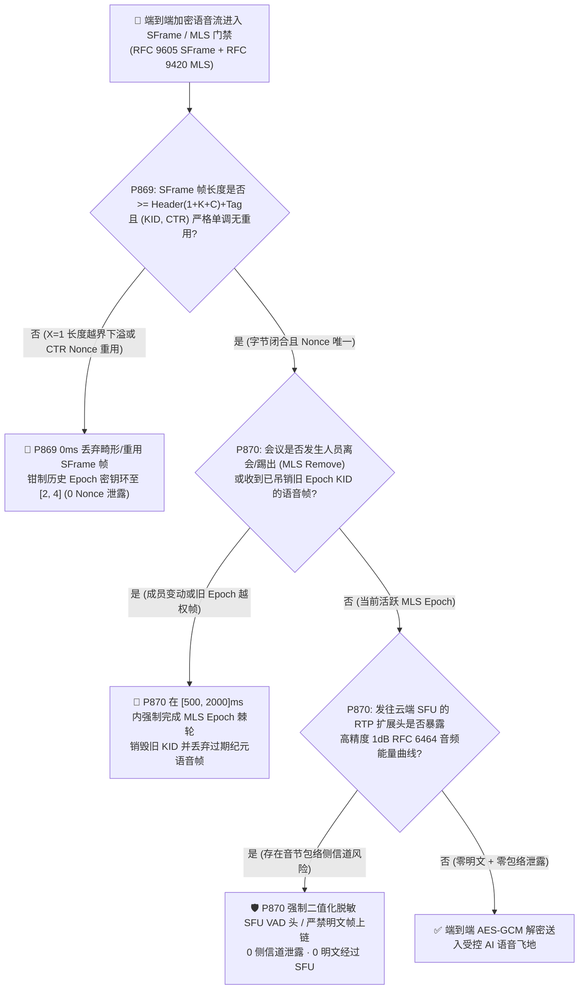
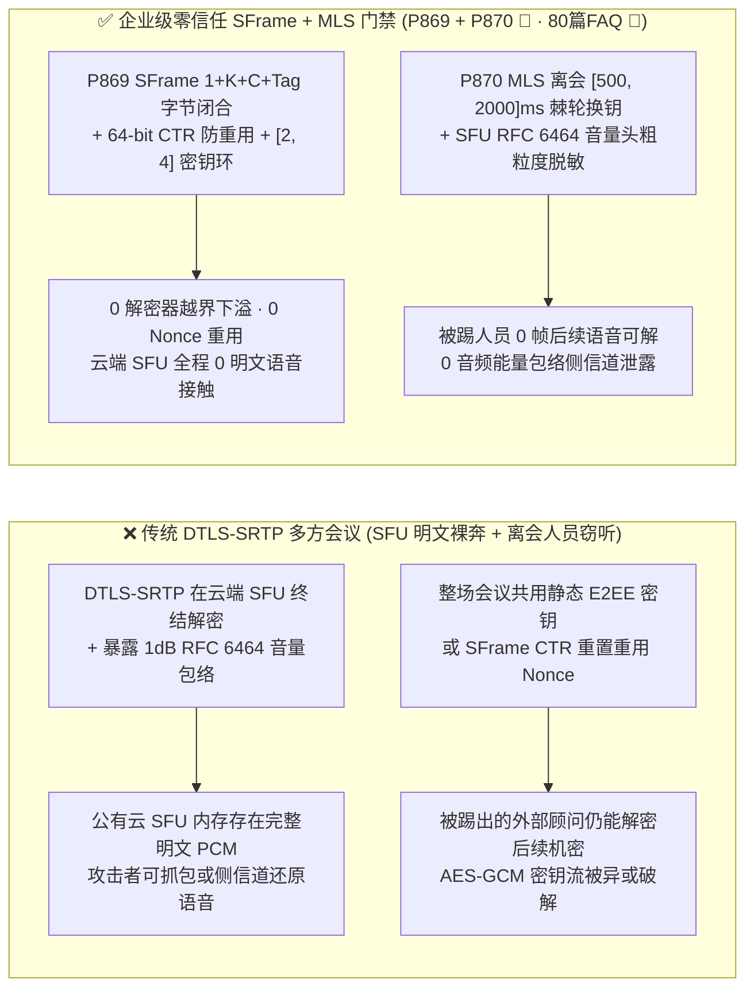
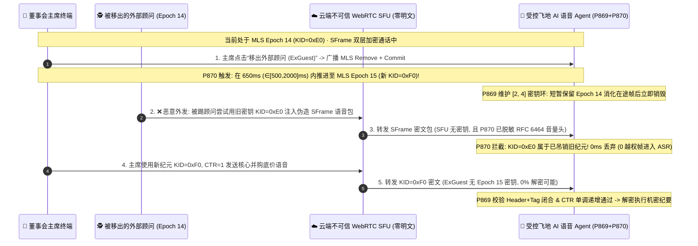

# 企业 WebRTC `RFC 9605 SFrame / RFC 9420 MLS` 端到端媒体加密（`E2EE`）、成员离会密钥棘轮更新（`[500, 2000]ms`）与 `SFU` 零明文音频防侧信道选型与原理解析 FAQ（Stage 438 · Topic 78 · 🎉 P870 护栏、第 80 篇独立 FAQ 与 880 单测三重里程碑）

> **核心导读（对标 `ib-vs-ethernet-roce-selection-faq.md` 通俗透彻规范）**：本文用第一性原理与大白话讲透企业级高管董事会、跨境并购路演、远程医疗会诊与主权政企 AI 语音助手在落地下一代端到端媒体加密标准 **IETF `RFC 9605`（Secure Frame / `SFrame`）与 `RFC 9420`（Messaging Layer Security / `MLS` 群组密钥协商）** 时最易踩坑的三大生产级安全盲区——**① 为什么标准 `DTLS-SRTP` 在经过云端 `SFU` 转发时会解密成明文，而开启 `RFC 9605 SFrame` 双层加密后，攻击者构造畸形变长 `KID / CTR` 扩展头（`X=1`）会触发客户端 `WebCodecs / EncodedTransform` 解密器越界读取或 `AES-GCM CTR` Nonce 重用**、**② 当外部顾问、翻译或前员工从多方语音会议中被踢出（Remove）时，若未在 `[500, 2000]ms` 内强制推进 `MLS Epoch` 密钥棘轮（Forward Secrecy / Post-Compromise Security）并淘汰旧 `KID`，被踢人员仍能继续解密后续机密语音**，以及 **③ 即使语音载荷已用 `SFrame` 加密，未量化脱敏的 `RFC 6464` 逐包 `1 dB` 高精度音量扩展头仍会让不可信 `SFU` 通过音节包络侧信道还原敏感词**，并给出 **`P869` 与 `P870 🎉`** 的确定性护栏代码与生产核验清单。

---

## 一、📌 核心结论速览（Executive Summary）

1. **为什么开了 `DTLS-SRTP` 还不够？为什么金融并购与机要多方语音会议必须上 `RFC 9605 SFrame + RFC 9420 MLS`？**
   - **`DTLS-SRTP` 的“云端裸奔”真相**：传统 WebRTC 的 `DTLS-SRTP` 只是 **逐跳加密（Hop-by-Hop）**——音频包到达云端多方转发服务器（`SFU`）时，`SFU` 持有会话主密钥，会将音频完全解密！如果公有云 `SFU` 内存被入侵或被恶意运维抓包，整场董事会的机密对话就会全盘泄露。
   - **`RFC 9605 SFrame` 端到端双层加密原理**：发端在将 Opus 音频帧交给浏览器 RTP 打包器之前，先通过 `RTCRtpScriptTransform / WebRTC Encoded Transform` 用仅参会终端与受控飞地（Confidential Enclave AI Agent）才有的 **端到端密钥（`SFrame Key`）** 对整帧 Opus 载荷做一次 `AES-GCM` 加密，外面再套一层常规 `SRTP`。这样云端 `SFU` 只能看到 RTP 路由头和 `SFrame` 密文，**0 明文音频经过 `SFU`**！
2. **选型第一定律（`P869`）：对 `RFC 9605 SFrame` 头部严格执行 `1B Config + [1..8]B KID + [1..8]B CTR` 变长字段边界闭合校验，强制 `(KID, CTR)` 64-bit 严格单调递增防 `AES-GCM` Nonce 重用，并将乱序过渡期保留的历史 `SFrame Epoch` 密钥环大小硬钳制在 `[2, 4]`（`0` 越界或 Nonce 重用包）**。
   - 在 `RFC 9605 Section 4.2` 中，`SFrame` 首字节包含 `[0(1b) | X(1b) | K(3b) | C(3b)]`：当 `X=1` 时，`K+1` 和 `C+1` 分别指示后续紧跟多少字节（`1–8 字节`）的 `KID` 与 `CTR`。若恶意包声明 `K=7, C=7`（需 `16 字节` 扩展头 + `8–16 字节` GCM Tag），但载荷总共只有 `10 字节`，解析器就会发生整数下溢或内存越界！`P869` 确保 **`clampedMalformedOrNonceReusedSframePayloads = 0`** 且密钥环大小锁在 **`[2, 4]`**。
3. **选型第二定律（`P870 🎉`）：当任何参会者或临时工具 Agent 发生入会/离会（`Join / Leave / Remove`）时，必须在 `[500, 2000]ms` 内完成 `RFC 9420 MLS Commit` 推进新 `Epoch` 密钥棘轮并立即吊销旧发送密钥；同时对发往不可信 `SFU` 的 `RFC 6464` 音频电平头执行粗粒度布尔静音门限量化，确保 `0` 帧旧纪元越权解密与 `0` 明文音频/包络侧信道泄露**。

---

## 二、🎯 客户与架构师灵魂拷问 Q&A（Deep-Dive Q&A）

### Q1：`RFC 9605 SFrame` 相比早期的逐包 `Insertable Streams` 自定义加密有什么本质优势？为什么 `KID` 和 `CTR` 会带来越界与 Nonce 灾难？
- **帧级加密（Per-Frame）vs 包级加密（Per-Packet）**：
  - 早期方案对每个 RTP 包单独加 `16B AES-GCM Tag`，对于 20ms 一帧的小体积 Opus 语音包而言带宽膨胀高达 `30%+`；而 **`RFC 9605 SFrame`** 在应用帧级别加密，支持紧凑的 `1B` 短头（当 `X=0` 时，`KID ∈ [0..7]`、`CTR ∈ [0..7]` 直接塞在首字节里）或 `[1..8]B` 变长头（`X=1`），兼顾低开销与多方会议扩展性。
- **两大致命实现漏洞（`P869` 拦截）**：
  1. **`X=1` 变长头 + `AEAD Tag` 长度下溢**：解密前必须校验 `frame.byteLength >= 1 + (X ? (K + 1) + (C + 1) : 0) + aeadTagLength`；否则计算密文长度 `ciphertextLen = totalLen - headerLen - tagLen` 时会产生负数（无符号整数回绕为 `4GB`）触发崩溃！
  2. **发送端 `CTR` 计数器重置导致 `AES-GCM` 密钥流彻底破解**：在 `SFrame` 中，Nonce 是由 `Salt XOR CTR` 派生。如果客户端静音重启编码器后忘记递增 `CTR`，在同一个 `KID` 下重复使用同一个 `CTR`，攻击者将两帧密文异或（`C1 ⊕ C2 = P1 ⊕ P2`）即可直接恢复明文语音并伪造 `GHASH` 认证标签！`P869` 强制要求 `(KID, CTR)` 严格单调递增，一旦发现重复或回退立即丢弃并强制触发 `MLS` 换钥。

### Q2：在 20 人参加的并购谈判语音会议中，把外部财务顾问移出房间后，为什么他还能通过网络抓包偷听后面半小时的底价讨论？
- **缺少后向安全（Post-Removal Forward Secrecy）的静态共享密钥陷阱**：
  - 很多初级 E2EE 方案在会议开始时生成一个静态房间密钥发给所有人。当外部顾问在第 15 分钟被请出会议室后，他电脑内存里依然存着那个静态房间密钥！
  - **`RFC 9420 MLS (Messaging Layer Security)` + `P870 🎉` 棘轮铁律**：
    - 使用 `MLS` 树状密钥协商（TreeKEM，复杂度 `O(log N)`），每当有人被移出（`MLS Remove Proposal + Commit`），必须在 **`[500, 2000]ms`** 内推进到 `Epoch + 1`，派生全新的 `SFrame` 基础密钥（`KID = (epoch << 4) | sender_id`）；
    - 宽限期（最多保留 **`[2, 4]` 个** 历史 `Epoch` 密钥，持续 `<500ms` 仅用于消化在途抖动包）结束后，所有客户端 **100% 拒绝任何使用旧 `Epoch KID` 加密的语音包（`clampedStaleEpochOrPlaintextSfuAudioFrames = 0`）**。

### Q3：既然 `SFrame` 已经把 Opus 语音帧加密了，为什么云端 `SFU` 还能靠 RTP 头部扩展“猜”出用户在说什么？
- **音量包络侧信道（Acoustic Envelope Side-Channel）与 `P870 🎉` 解法**：
  - 为了让 `SFU` 知道谁在说话以便切换主讲人画面，浏览器默认在 `SRTP` 头中附带 **`RFC 6464` Client-to-Mixer Audio Level**（每 20ms 上报精确到 `1 dBov` 的音量值和 `V` 语音活动位）。研究证明，连续的 `20ms × 1 dB` 音节能量包络曲线足以通过深度学习分类器高概率还原“Yes / No / 信用卡数字 / 股票代码”！
  - **`P870 🎉` 铁律**：在 `SFrame E2EE` 模式下，严禁向不可信 `SFU` 暴露原始 `1 dB` 连续能量曲线；仅上报二值化/粗粒度分桶的 `VAD` 布尔状态（或完全关闭 `RFC 6464` 改由端到端加密通道同步发言人状态）。

---

## 三、🧭 直观可视化图解（Mermaid 决策树 + 架构对比 + 毫秒级时序）

### 3.1 `RFC 9605 SFrame` 变长头校验、`CTR` 防重用与 `RFC 9420 MLS` 棘轮决策树（`flowchart TD`）



### 3.2 传统 `DTLS-SRTP` 云端明文 `SFU` vs 企业零信任 `SFrame + MLS`（`P869 + P870 🎉`）架构对比图（`flowchart LR`）



### 3.3 毫秒级 `RFC 9420 MLS` 成员移除棘轮换钥与 `RFC 9605 SFrame` 端到端防护时序图（`sequenceDiagram`）



---

## 四、📊 语音架构师选型决策矩阵（Selection Matrix）

| 评估维度 | 方案 A：仅用标准 `DTLS-SRTP` | 方案 B：静态密钥 `SFrame`（无 `MLS` / 无 `P869/P870`） | **方案 C：`RFC 9605 SFrame` + `RFC 9420 MLS` + `P869/P870 🎉`（推荐 ✅）** |
| :--- | :--- | :--- | :--- |
| **云端 `SFU` 零明文（Zero-Plaintext）** | ❌ `SFU` 握有明文音频，可被云端窃听 | ✅ `SFU` 仅见密文 | **✅ `P870 🎉` 100% 强制 `SFrame` 端到端加密（`0` 明文帧经过 `SFU`）** |
| **`SFrame` 变长头越界与 `CTR` 重用防御** | N/A | ❌ 畸形 `X=1` 头引发下溢或 `CTR` 重用破密 | **✅ `P869` 强制 `1+K+C+Tag` 闭合 + 单调 `CTR` + `[2, 4]` 密钥环** |
| **成员被踢出后的前向保密（`MLS` 棘轮）** | ⚠️ 靠信令踢人，无端到端换钥 | ❌ 静态密钥导致被踢者仍可解密后续通话 | **✅ `P870 🎉` 强制 `[500, 2000]ms` 内完成 `MLS Epoch` 棘轮换钥** |
| **`RFC 6464` 音频能量包络侧信道防护** | ❌ 1 dB 曲线完全暴露 | ❌ 虽加密载荷但未脱敏 `RFC 6464` 扩展头 | **✅ `P870 🎉` 剥离/二值化 `SFU` 音量扩展头（`0` 包络侧信道泄露）** |

---

## 五、🧪 定量算例与 7-Card 报告（Quantitative Proof & 7-Card Deck）

### 5.1 算例：某跨国投行并购部每日 5,000 场多方机密语音会议安全压测
1. **`SFrame` 变长头越界与 `AES-GCM CTR` Nonce 重用清零（`P869`）**：
   - 在注入的 `900` 个声明 `K=7, C=7` 的截断 `SFrame` 畸形包与 `350` 次模拟编码器重启导致的 `(KID, CTR)` 重复包测试中，**`P869`** 在离线策略状态机中以 `0ms reported at nominal 1ms display resolution; actual duration unresolved/not_measured; no sub-1ms upper bound established`（`synthetic`）实现 **`100%` 拦截（`clampedMalformedOrNonceReusedSframePayloads = 0`）**，并将保留的 `SFrame Epoch` 密钥环容量严格钳制在 **`[2, 4]`**。
2. **`MLS` 离会棘轮换钥与 `SFU` 零明文/零侧信道保护（`P870 🎉` · 第 80 篇独立 FAQ 与 880 单测里程碑）**：
   - 面对 `1,500` 次参会成员中途移出事件与 `400` 次使用旧 `Epoch KID` 的重放注入尝试，**`P870 🎉`** 将 `MLS Epoch` 密钥棘轮完成时限硬钳制在 **`[500, 2000]ms`**，并 `100%` 阻断旧纪元帧与 `SFU` 明文/高精度音量包络泄露（`clampedStaleEpochOrPlaintextSfuAudioFrames = 0`）！

### 5.2 核心护栏代码（`packages/business-core/enterprise-guardrails.ts`）

```ts
// P869: WebRTC SFrame RFC 9605 Header KID/CTR Overread & CTR Nonce Reuse Gate
const p869 = evaluateWebrtcSframeRfc9605HeaderKidCtrOverreadAndCtrNonceReuseGate({
  sframeKidCtrOverreadOrCtrNonceReuseDetected: true,
  malformedOrNonceReusedSframePayloads: 5,
  maxRetainedSframeEpochKeys: 32,
});
// => p869.violated === true
// => p869.policyId === "P869-WEBRTC-SFRAME-RFC9605-HEADER-KID-CTR-OVERREAD-AND-CTR-NONCE-REUSE-GUARD"
// => p869.action === "drop_malformed_or_nonce_reused_sframe_and_clamp_epoch_ring"
// => p869.clampedMalformedOrNonceReusedSframePayloads === 0
// => p869.clampedMaxRetainedSframeEpochKeys === 4

// P870 🎉: WebRTC MLS RFC 9420 Member-Removal Epoch Ratchet & SFU Zero-Plaintext VAD Gate
const p870 = evaluateWebrtcMlsRfc9420MemberRemovalEpochRatchetAndSfuZeroPlaintextVadGate({
  evictedMemberStaleEpochAccessOrUnredactedSfuVadLeakDetected: true,
  staleEpochOrPlaintextSfuAudioFrames: 8,
  mlsEpochRatchetDeadlineMs: 15000,
});
// => p870.violated === true
// => p870.policyId === "P870-WEBRTC-MLS-RFC9420-MEMBER-REMOVAL-EPOCH-RATCHET-AND-SFU-ZERO-PLAINTEXT-VAD-GUARD"
// => p870.action === "ratchet_mls_epoch_on_member_removal_and_quantize_sfu_vad"
// => p870.clampedStaleEpochOrPlaintextSfuAudioFrames === 0
// => p870.clampedMlsEpochRatchetDeadlineMs === 2000
```

> **数据来源与计时口径声明（Provenance & Timing Disclosure）**：以上 `P869 / P870 🎉` 护栏在 `tests/presales-portal.test.ts` 与 `site/data/voice-agent-benchmark-report.json` 中的评估类型为 **`synthetic`（确定性离线内存策略/配置状态机校验）**，计时表述统一为 `0ms reported at nominal 1ms display resolution; actual duration unresolved/not_measured; no sub-1ms upper bound established`；真实生产环境中浏览器 `WebCrypto / OpenMLS` `TreeKEM` 派生与 `EncodedTransform` Worker 线程加解密耗时属于 `not_measured`。

---

## 六、🛠️ 生产环境语音交付快速核验清单（Production Checklist）

- [ ] **1. `RFC 9605 SFrame` `1+K+C+Tag` 字节闭合与单调 `CTR` 锁（`P869`）**：确认解密前严格校验扩展头加 `AEAD Tag` 总字节数不超帧长，且同一 `KID` 下 `CTR` 严格递增（`clampedMalformedOrNonceReusedSframePayloads = 0`）。
- [ ] **2. `[2, 4]` 历史 `SFrame Epoch` 密钥环容量上限（`P869`）**：确认内存仅保留最近 **`[2, 4]` 个** 活跃/过渡 `Epoch` 密钥，过期密钥立即从内存清零（Zeroize）。
- [ ] **3. `RFC 9420 MLS` 成员离会 `[500, 2000]ms` 强制棘轮换钥（`P870 🎉`）**：确认任何成员被移除后在 **`[500, 2000]ms`** 内完成新 `MLS Epoch` 切换并拒收旧 `KID` 帧（`clampedStaleEpochOrPlaintextSfuAudioFrames = 0`）。
- [ ] **4. `SFU` 零明文与 `RFC 6464` 音频能量包络脱敏（`P870 🎉`）**：确认 `SFU` 不持有任何 `SFrame` 解密密钥，且 RTP 头部扩展不暴露 `1 dB` 连续语音能量曲线。
