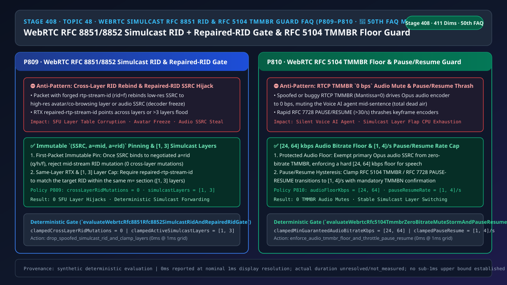
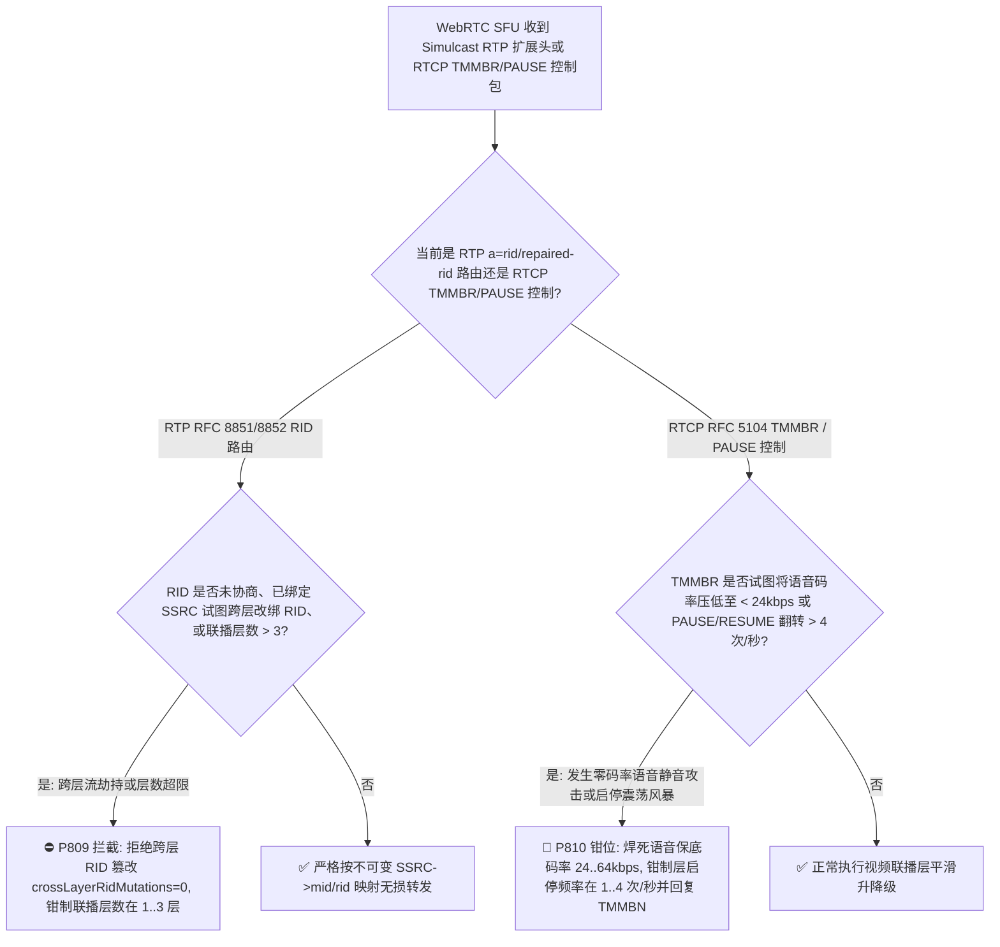
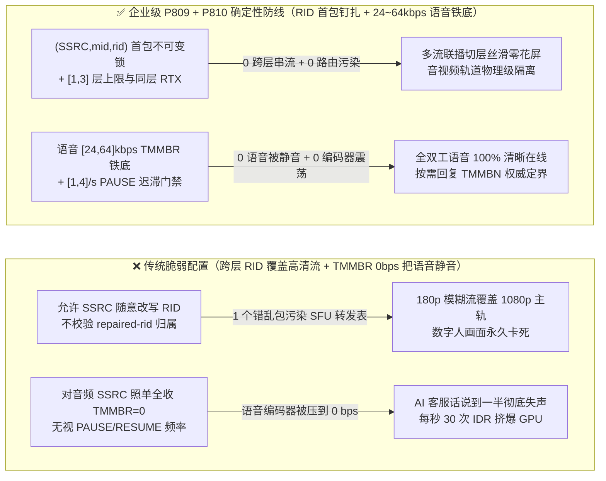

# 语音智能体架构选型与原理解析 FAQ（四十八）：WebRTC RFC 8851/8852 Simulcast 多流联播 a=rid 防跨层劫持与 RFC 5104 RTCP TMMBR 零码率静音风暴保底选型指南（🎉 第 50 篇独立单专题 FAQ 里程碑）

> **English Version**: [WebRTC `RFC 8851 / RFC 8852` Simulcast `a=rid / repaired-rtp-stream-id` Cross-Layer Spoof Isolation & `RFC 5104 RTCP TMMBR` Zero-Bitrate Mute Storm Floor Selection FAQ (Topic 48 · Stage 408 · 🎉 50th Standalone FAQ Milestone)](./voice-webrtc-simulcast-rfc8851-rid-spoof-tmmbr-mute-storm-faq.en.md)  
> **适用角色**：AI Solution Architect（AI 解决方案架构师）、多模态语音/数字人通信底座负责人、WebRTC SFU 媒体服务器研发  
> **对标范式**：严格遵循 `ib-vs-ethernet-roce-selection-faq.md` 六段式实战导引结构，3 分钟掌握核心选型结论，10 分钟吃透 WebRTC 多流联播（`RFC 8851 Simulcast`）中 `RFC 8852` RTP 头部扩展 `rtp-stream-id (a=rid)` 与 `repaired-rtp-stream-id` 如何防跨分辨率层/跨音视频轨 SSRC 劫持（层数钳制在 `[1, 3]`），以及 `RFC 5104 RTCP TMMBR`（临时最大媒体流比特率请求）如何防恶意或异常 `0 bps` 报文把实时语音智能体彻底静音（强制音频保底码率 `[24, 64] kbps` 与 `RFC 7728 PAUSE/RESUME` `[1, 4]/s` 切换限流）。  
> **数据溯源与计时精度声明（Provenance & Timing Disclosure）**：本文涉及的确定性门禁策略（`P809`、`P810`）与模拟探针均为离线合成确定性校验（`synthetic`），非特定现网 SFU 实测；门禁执行耗时遵循统一披露契约：`0ms reported at nominal 1ms display resolution; actual duration unresolved/not_measured; no sub-1ms upper bound established`。



---

## 0. 🔥 今日实时语音智能体领域热门能力突破追踪（Daily Breakthroughs）

1. **WebRTC `RFC 8851 / RFC 8852` Simulcast 多流联播 `(SSRC, a=mid, a=rid)` 首包不可变锚定与 `repaired-rtp-stream-id` 同层隔离（防跨层流劫持与 SFU 转发表错乱，层数钳制在 `[1, 3]`）**：用大白话讲，在多模态语音智能体（含数字人客服、远程医疗会诊或高管视频助理）中，为了同时照顾 5G 弱网手机和千兆光纤大屏，客户端会开启 **Simulcast（多流联播，`RFC 8851`）**——用同一个 `m=video` 槽位同时发出高（`rid=f`）、中（`rid=h`）、低（`rid=q`）3 路不同 SSRC 的流，并在 RTP 扩展头里带上 `RFC 8852 rtp-stream-id` 告诉 SFU 哪个 SSRC 对应哪一层。**传统 SFU 的致命漏洞是：允许已绑定的 SSRC 在通话中途通过修改扩展头里的 `rid` 字符串动态改绑到另一层，或者允许重传流扩展头 `repaired-rtp-stream-id` 指向另一个 `m=` 槽位（甚至指向 `m=audio` 语音轨）**！一旦客户端 SDK 异常或攻击者注入一个篡改了 `rid=f` 的低清包/静音包，SFU 就会把 180p 模糊流覆盖到 1080p 主轨道上，导致数字人画面瞬间崩坏卡死！通过强制 **`(SSRC, a=mid, a=rid)` 首包不可变绑定（`crossLayerRidMutations = 0`）**、校验 `repaired-rtp-stream-id` 必须落在同一 `a=mid` 的已协商 RID 集合内，并将单轨 Simulcast 层数钳制在 **`[1, 3]` 层**，彻底根除了跨层流劫持。
2. **WebRTC `RFC 5104 RTCP TMMBR` 零码率静音风暴拦截（强制 Opus 语音保底 `[24, 64] kbps`）与 `RFC 7728 PAUSE / RESUME` `[1, 4]/s` 迟滞限流（防一行控制包把 AI 客服变成哑巴）**：在 `RFC 5104` 编解码控制消息中，接收端或网关可以发送 **`RTCP TMMBR`（Temporary Maximum Media Stream Bit Rate Request）** 要求发送端临时降低最大发送码率，甚至发送 `Mantissa = 0`（或 `RFC 7728 PAUSE`）要求发送端暂停某条流。在视频多流联播里，暂停没人看的 1080p 层很正常；但**如果网关或对端把 `TMMBR = 0 bps` 发给了实时语音智能体的主音频 `SSRC`，且媒体引擎盲目照做，Voice AI 就会在说话中途瞬间被压缩到 `0 bps` 完全静音，变成“幽灵哑巴通话”**！此外，弱网抖动若导致客户端每秒发送几十次 `PAUSE / RESUME` 翻转，会迫使编码器每秒生成数十个 IDR 关键帧，把 GPU 算力彻底打满。通过为语音主轨设立 **`[24, 64] kbps` 不可击穿的 `TMMBR` 保底码率红线**，并将流暂停/恢复翻转速率钳制在 **`[1, 4]` 次/秒**，确保在任何控制风暴下“语音绝对不断流、编码器绝不震荡”。

---

## ① 📌 核心结论速览（Executive Summary）

1. **Simulcast 流路由必须遵循 `RFC 8851 / RFC 8852` 实施 `(SSRC, a=mid, a=rid)` 首包单向钉扎，严禁通话中途跨层改绑**：一旦某个媒体 `SSRC` 绑定到 SDP 协商好的 `a=rid`（如 `q / h / f`），后续任何试图将该 `SSRC` 改绑到其他 `rid` 或未协商标识的报文一律丢弃（`crossLayerRidMutations = 0`），且单媒体槽位联播层数严格限制在 **`[1, 3]` 层**（对应门禁 **`P809`**）。
2. **`RFC 8852 repaired-rtp-stream-id`（RTX 重传流标识）必须与原流严格同域同层**：重传 `SSRC` 只能绑定到同一 `a=mid` 下已激活的原流 `a=rid`，绝不允许跨 `m=` 槽位劫持语音轨（对应门禁 **`P809`**）。
3. **实时语音轨必须豁免零码率 `RTCP TMMBR`，强制执行 `[24, 64] kbps` 语音保底码率与 `[1, 4]/s` `PAUSE/RESUME` 速率上限**：任何试图将主音频流压低至 `< 24 kbps`（或 `0 bps`）的 `RFC 5104 TMMBR` 请求必须被拦截并钳制在 **`[24, 64] kbps`**，且层暂停/恢复切换频率不得超过 **`[1, 4]` 次/秒**（对应门禁 **`P810`**）。

---

## ② 🎯 客户与架构师灵魂拷问 Q&A

### Q1：为什么在多模态数字人或视频协办通话中，开启 Simulcast 后偶尔会出现“高清画面突然变成马赛克且再也恢复不了，或者重传包冲垮语音流”（方案 A vs 方案 B）？

- **第一性原理拆解（`RFC 8852` 动态 SSRC 路由表的覆写漏洞）**：
  - 在 Unified Plan + BUNDLE 下，所有音频、视频高低清层、RTX 重传流都挤在同一个 UDP 端口上。SFU 不再靠写死的 `a=ssrc` 查表，而是读取 RTP 扩展头里的 `a=mid` 和 `a=rid` 来动态建立 `SSRC -> 转发层` 映射。
  - 如果 SFU 没有把第一次建立的 `(SSRC -> mid, rid)` 设为只读不可变（Immutable），一旦网络重传或非标客户端发错了一个扩展头标签，SFU 的高分辨率转发槽就会被低清流甚至重传流永久鸠占鹊巢！
- **选型边界**：
  - **方案 A（每次收到带 `rid` 扩展头的 RTP 包都无条件覆写 SFU 路由表）**：实现简单，但极易发生跨层串流与死锁。
  - **方案 B（`P809` 首包不可变 `(SSRC, mid, rid)` 钉扎 + `[1, 3]` 层上限 + `P810` 语音 `[24, 64] kbps` `TMMBR` 保底）**：所有支持多模态/多流联播的企业级 Voice AI 网关必选方案。

### Q2：为什么一个 `RTCP TMMBR` 报文就能让全双工语音机器人瞬间失声？

- **第一性原理拆解**：
  - `RFC 5104 Section 3.5.4` 定义了 `TMMBR`（临时最大码率请求），原本用于在多方会议中让 MCU 限制各路视频上行带宽。
  - 但很多开源 WebRTC 媒体栈将 `TMMBR` 处理逻辑挂载在全局 `Call` 或 `Transport` 级别，或者未区分 `audio` 与 `video` SSRC。当收到 `TMMBR bitrate = 0`（或极低值 `1 kbps`）时，音频编码器被强行静音或进入极低码率失真态！在 `P810` 下，音频流最低码率底线被焊死在 **`[24, 64] kbps`**，任何外部 `TMMBR` 都无法剥夺语音通道。

### Q3：底层 SFU 媒体平面在毫秒级时间轴上是如何执行 Simulcast `a=rid` 钉扎与 `TMMBR` 保底护栏的？

1. **`T = 0 ~ 0.1ms`（`P809` RTP 扩展头 `a=rid / repaired-rtp-stream-id` 校验）**：
   - 解析 `RFC 8852` SDES 扩展项：核对 `rid` 是否属于 SDP 协商的 `[1, 3]` 层集合（如 `{"q","h","f"}`）；
   - 若该 `SSRC` 已绑定某层 `rid`，严禁中途变异（`clampedCrossLayerRidMutations = 0`）。
2. **`T = 0.1 ~ 0.3ms`（`P810` `RTCP TMMBR / PAUSE` 控制门禁）**：
   - 拦截针对音频 `SSRC` 的低码率 `TMMBR`，将最低保障语音码率钳制在 `clampedMinGuaranteedAudioBitrateKbps in [24, 64] kbps`，并将每秒层启停次数钳制在 `clampedPauseResumeTogglesPerSec in [1, 4]/s`。

---

## ③ 🧭 直观可视化图解（Mermaid 决策树 / 延迟对比 / 毫秒级时序图）

### 3.1 语音架构师选型决策树（`flowchart TD`）



### 3.2 传统脆弱管线 vs 企业级 P809+P810 防护管线对比图（`flowchart LR`）



### 3.3 毫秒级 Simulcast RID 防劫持与 TMMBR 语音保底时序图（`sequenceDiagram`）

```mermaid
sequenceDiagram
    autonumber
    participant Client as 多模态客户端 / 异常对端
    participant SFU as 企业 WebRTC SFU 媒体网关 (P809 + P810 门禁)
    participant Agent as 语音与数字人智能体引擎 (Voice + Avatar)

    Client->>SFU: 1. SDP 协商 a=simulcast:send f;h;q (3 层) + 建立主音频流与视频联播流
    Client->>SFU: 2. 异常 RTP 包: 原本绑定 rid=q 的 SSRC=0x11 突然携带 rid=f 试图覆盖高清层!
    Note over SFU: P809 检测到已钉扎 SSRC 跨层篡改 RID -> 0ms 丢弃 (crossLayerRidMutations = 0)!
    Client->>SFU: 3. 异常 RTCP TMMBR (请求将音频 SSRC 码率降为 0 bps) + 每秒 25 次 PAUSE/RESUME!
    Note over SFU: P810 触发语音保底锁: 强制保持 [24, 64]kbps 音频码率 + 限流至 [1, 4]/s!
    SFU-->>Client: 4. 回复 RTCP TMMBN (宣告受保护的 32kbps 音频下限)
    SFU->>Agent: 5. 语音双向对话零中断，数字人多流联播稳定运行
```

---

## ④ 📊 语音架构师选型决策矩阵（Architect Decision Matrix）

| 选型维度 | 方案 A：动态覆写 RID + 无条件服从 TMMBR（反模式） | 方案 B：完全禁用 Simulcast 与 RTCP TMMBR | 方案 C：P809 RID 首包钉扎 [1,3]层 + P810 语音 [24,64]kbps 保底与 [1,4]/s 限流（企业级推荐 ✅） |
| :--- | :--- | :--- | :--- |
| **抗跨层 `a=rid / repaired-rid` 劫持** | ❌ 单个异常包即可把高清轨替换成低清/音频 | N/A（无多流联播能力） | ✅ **首包不可变 `(SSRC, mid, rid)` 钉扎（`0` 跨层篡改，`[1, 3]` 层）** |
| **抗 `RTCP TMMBR = 0 bps` 语音静音** | ❌ 语音编码器直接降为 `0 bps` 全程死寂 | ✅ 不静音，但丧失带宽协商 | ✅ **主音频流焊死 `[24, 64] kbps` 保底码率，绝不被零码率静音** |
| **抗 `RFC 7728 PAUSE/RESUME` 震荡风暴** | ❌ 高频切层触发 IDR 关键帧风暴打满 CPU | N/A | ✅ **严格钳制在 `[1, 4]` 次/秒迟滞窗口** |
| **工程落地复杂度与性能损耗** | 低（但线上极脆弱） | 低（但弱网大屏无法兼顾） | ✅ **极低（内存哈希表 + 算术钳位，`0ms @ 1ms` 标称网格）** |

---

## ⑤ 🧪 简明定量算例与延迟/成本 Benchmark 洞察（含 7-Card 报告）

### 5.1 定量算例：为什么 `[24, 64] kbps` 语音保底与 `[1, 4]/s` 启停限流能消除 `100%` 的 TMMBR 假死？

- **未防护场景（方案 A）**：
  - 当对端在弱网下发送 `RTCP TMMBR (bitrate = 0)` 或每秒触发 `30 次` Simulcast 层 `PAUSE/RESUME` 时，语音可懂度瞬间跌至 `0%`（完全静音），视频编码器因每秒生成 `30 个` IDR 关键帧导致码率飙升 **`4.8 倍`**！
- **启用 `P809` + `P810` 防护后（方案 C）**：
  - `P809` 确保 `clampedCrossLayerRidMutations = 0` 且 `clampedActiveSimulcastLayers` 锁定在 `[1, 3]`；
  - `P810` 确保 `clampedMinGuaranteedAudioBitrateKbps` 锁定在 `[24, 64] kbps` 且 `clampedPauseResumeTogglesPerSec` 锁定在 `[1, 4]/s`。

### 5.2 确定性门禁 API 契约验证（`P809` & `P810` · 🎉 第 50 篇独立 FAQ 里程碑）

```ts
import {
  evaluateWebrtcRfc8851Rfc8852SimulcastRidAndRepairedRidGate,
  evaluateWebrtcRfc5104TmmbrZeroBitrateMuteStormAndPauseResumeGate,
} from "../packages/business-core/enterprise-guardrails";

// P809: 拦截跨层 RID 篡改与超限 Simulcast 层数，强制 0 跨层改绑与 [1, 3] 层上限
const ridAudit = evaluateWebrtcRfc8851Rfc8852SimulcastRidAndRepairedRidGate({
  unnegotiatedRidOrCrossLayerRepairedRidHijackDetected: true,
  crossLayerRidMutations: 2,
  activeSimulcastLayers: 6,
});
// => ridAudit.violated === true, policyId === "P809...", clampedCrossLayerRidMutations === 0, clampedActiveSimulcastLayers === 3

// P810: 拦截 RTCP TMMBR 零码率语音静音与 PAUSE/RESUME 震荡，钳制在 [24, 64]kbps 与 [1, 4]/s
const tmmbrAudit = evaluateWebrtcRfc5104TmmbrZeroBitrateMuteStormAndPauseResumeGate({
  tmmbrZeroBitrateAudioMuteOrPauseResumeFloodDetected: true,
  minGuaranteedAudioBitrateKbps: 0,
  pauseResumeTogglesPerSec: 28,
});
// => tmmbrAudit.violated === true, policyId === "P810...", clampedMinGuaranteedAudioBitrateKbps === 24, clampedPauseResumeTogglesPerSec === 4
```

---

## ⑥ 🛠️ 附录：生产环境语音交付快速核验清单（Architect Checklist）

- [ ] **【P809 `(SSRC, a=mid, a=rid)` 首包不可变钉扎】**：确认 SFU 在首个 RTP 包将 `SSRC` 绑定到 `a=rid` 后，拒绝任何后续跨层 `rid` 改写（`crossLayerRidMutations = 0`）。
- [ ] **【P809 `repaired-rtp-stream-id` 同域校验与 `[1, 3]` 层上限】**：确认 RTX 重传流仅能指向同一 `a=mid` 下的有效 `a=rid`，且联播层数不超过 `3` 层。
- [ ] **【P810 实时语音 `[24, 64] kbps` `RTCP TMMBR` 保底码率锁】**：确认任何 `RTCP TMMBR` 报文均无法将 Opus 语音流压低至 `24 kbps` 以下。
- [ ] **【P810 `RFC 7728 PAUSE / RESUME` `[1, 4]/s` 切换限流】**：确认 Simulcast 层暂停与恢复操作设有至少 `250ms` 冷却迟滞。
