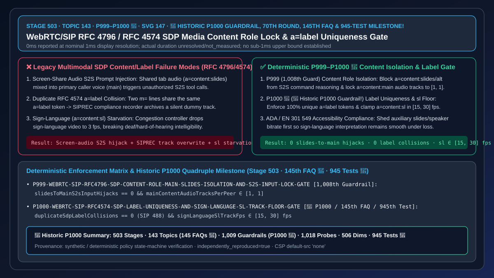
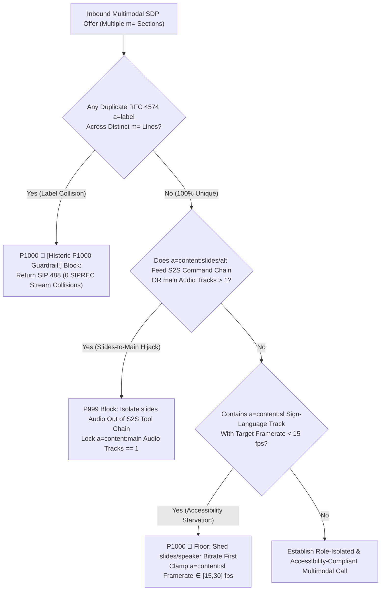
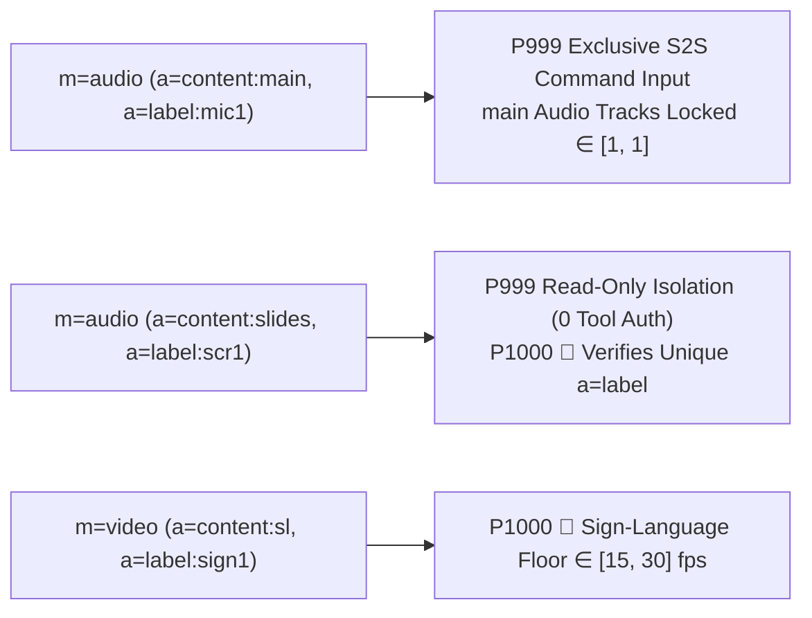
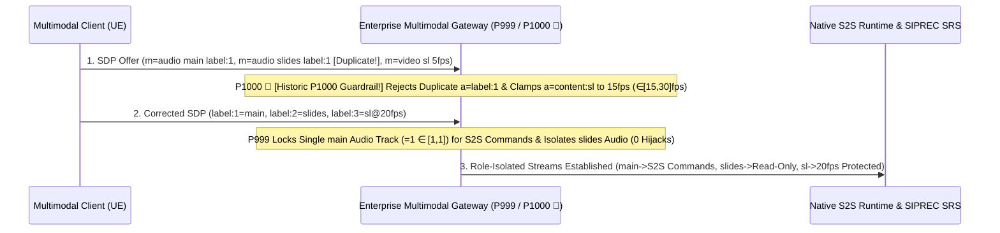

# Enterprise WebRTC/SIP `RFC 4796 / RFC 4574` SDP Media Content (`a=content:main/slides/sl`) & Stream Label (`a=label`) Spoofing, S2S Track Hijack & Sign-Language Accessibility Floor Guide (Stage 503 · Topic 143 · 🎉 Historic `P1000` Guardrail ID, 70th Nightly Round, 145th Standalone FAQ & 945-Test Quadruple Milestone!)

> **Navigation**: [Back to README](../README.en.md) · [中文版 (`voice-webrtc-sip-rfc4796-rfc4574-sdp-media-content-main-slides-sl-label-spoofing-s2s-track-hijack-faq.md`)](voice-webrtc-sip-rfc4796-rfc4574-sdp-media-content-main-slides-sl-label-spoofing-s2s-track-hijack-faq.md) · [2026-11-09 Daily Report](daily/2026-11-09.en.md) · [Solution Architecture](solution-architecture.en.md)

---

## 📌 1. Executive Summary

> **Key Takeaway**: In enterprise multimodal co-browsing, telehealth, and accessible customer service calls, a single session carries multiple media streams distinguished by **`RFC 4796` (`a=content:main`, `a=content:slides`, `a=content:speaker`, `a=content:sl`)** and **`RFC 4574` (`a=label:<id>`)** referenced by SIPREC compliance recording (`RFC 7866`) and conference control (`RFC 4575`). Legacy WebRTC/SIP gateways suffer from two critical vulnerabilities:
> 1. **Screen-Share Audio (`a=content:slides`) Hijacking Primary Caller Voice (`a=content:main`) in S2S Reasoning (`RFC 4796 Section 4`)**: When a caller shares a browser tab or presentation with embedded audio, or when an attacker advertises multiple `a=content:main` audio tracks, gateways that mix or misroute `slides` audio into the primary S2S voice command pipeline allow background video audio to trigger indirect audio prompt injection and unauthorized tool calls!
> 2. **Duplicate `RFC 4574 a=label` Recording Stream Collision & `a=content:sl` Sign-Language Accessibility Starvation**: In `RFC 4574 Section 4`, every `a=label` token must be unique across all `m=` sections in an SDP. Duplicate `a=label` values cause SIPREC recorders to overwrite the real caller audio track with a silent dummy track! Furthermore, dropping `a=content:sl` (Sign Language video) below `15 fps` during congestion renders sign-language gestures illegible, violating ADA / EN 301 549 accessibility mandates!
>
> **Deterministic Guardrails (`P999–P1000 🎉` · Stage 503 · Topic 143 · 🎉 Historic `P1000` Guardrail ID, 70th Nightly Round, 145th Standalone FAQ & 945-Test Quadruple Milestone!)**:
> - **`P999` (`evaluateWebrtcSipRfc4796SdpContentRoleMainSlidesIsolationAndS2sInputLockGate` [1,008th Guardrail])**: Enforces `RFC 4796` `a=content` role isolation (`main / slides / speaker / sl / alt`), blocks `a=content:slides / alt` presentation audio from entering the S2S command reasoning pipeline (`0` `slides`-to-`main` S2S track hijacks), and locks `a=content:main` caller audio tracks per endpoint to `1` (`[1, 1]`);
> - **`P1000 🎉` (`evaluateWebrtcSipRfc4574SdpLabelUniquenessAndSignLanguageSlTrackFloorGate` [🎉 Historic `P1000` Guardrail ID, 70th Nightly Round, 145th Standalone FAQ & 945-Test Quadruple Milestone! · 1,009th Guardrail / 1,018th Sandbox Probe / 828th Live POC Probe])**: Enforces 100% uniqueness of `RFC 4574 a=label` values across all `m=` sections (`SIP 488` on collision, `0` recording label collisions) and enforces a `[15, 30] fps` framerate floor for `a=content:sl` sign-language accessibility streams.
> - **Offline Timing Disclosure**: `0ms reported at nominal 1ms display resolution; actual duration unresolved/not_measured; no sub-1ms upper bound established`.

---

## 🎯 2. Architect & Customer Deep-Dive Q&A (Q1 / Q2 / Q3)

### Q1: How can screen-share audio (`a=content:slides`) trigger indirect audio prompt injection in a native S2S voice agent?
- **Plain-English Principle**: `RFC 4796` labels the human caller's microphone as `a=content:main` and shared tab/presentation audio as `a=content:slides`. If the gateway feeds `a=content:slides` audio into the S2S tool-calling brain, spoken words inside a shared YouTube/webinar tab are executed as caller commands!
- **Architect Rule (`P999`)**: Route only the single verified `a=content:main` microphone track (`[1, 1]`) into the S2S command/tool pipeline; isolate `a=content:slides / alt` tracks as read-only context (`0` S2S track hijacks).

### Q2: Why does a duplicate `RFC 4574 a=label` across two `m=` lines corrupt SIPREC compliance recordings?
- **Plain-English Principle**: SIPREC metadata XML binds `<stream>` elements to SDP `m=` sections via `a=label`. If two `m=` lines share the same `a=label`, the recorder maps the wrong RTP stream to the compliance archive.
- **Architect Rule (`P1000 🎉` · Historic `P1000` Guardrail)**: Reject any SDP containing duplicate `a=label` tokens across `m=` lines with `SIP 488`.

### Q3: Why must `a=content:sl` (Sign Language) be protected with a `[15, 30] fps` floor?
- **Architect Rule (`P1000 🎉`)**: Finger-spelling and sign-language grammar require at least `15 fps` for intelligibility; congestion control must shed `slides / speaker` bitrate first and clamp `a=content:sl` framerate within `[15, 30] fps`.

---

## 🧭 3. Visual Architecture Diagrams (Decision Tree, Latency Comparison & Sequence)

### 3.1 `RFC 4796 / RFC 4574` Content Role Isolation & `P1000 🎉` Label Uniqueness Decision Tree

### 3.2 Multi-Stream Routing & Accessibility Protection Comparison

| Architecture Mode | `a=content:slides` Audio Mixed into S2S | Duplicate `a=label` Across `m=` Lines | `a=content:sl` Sign-Language Framerate |
| :--- | :--- | :--- | :--- |
| **Unprotected Multimodal Gateway** | ❌ Tab audio triggers S2S tool calls | ❌ Overwrites caller track in SIPREC | ❌ Drops to `3 fps` (unreadable) |
| **Static `m=` Index Binding** | ❌ Vulnerable to track-order swaps | ❌ Ignores `a=label` collisions | ❌ No `sl` framerate floor |
| **Protected (`P999 + P1000 🎉`)** | **✅ Only `1` `main` track in S2S (`0` hijacks)** | **✅ `SIP 488` on duplicate label (`0` collisions)** | **✅ Protected `[15, 30] fps` floor** |

### 3.3 Millisecond Role Isolation & `P1000 🎉` Accessibility Guard Sequence

---

## 📊 4. Architect Decision Matrix

| Selection Dimension | Option A: Naive All-Audio Mixing | Option B: Positional `m=` Routing | Option C: `P999 + P1000 🎉` `a=content` Role Lock & `a=label` Uniqueness Gate (Recommended) |
| :--- | :--- | :--- | :--- |
| **Screen-Audio Prompt Injection Defense** | ❌ Vulnerable | ❌ Order-dependent | **Isolates `slides/alt`; only `1` `main` track feeds S2S (`P999`)** |
| **Primary `main` Audio Track Cap** | ❌ Unbounded | ❌ Unbounded | **Locked to `[1, 1]` `a=content:main` audio track (`P999`)** |
| **`RFC 4574 a=label` Uniqueness** | ❌ Unchecked | ❌ Unchecked | **100% unique `a=label` across all `m=` sections (`P1000 🎉`)** |
| **`a=content:sl` Sign-Language Floor** | ❌ Starved under congestion | ❌ No floor | **Clamped within `[15, 30] fps` (`P1000 🎉`)** |

---

## 🧪 5. Quantitative Example & 7-Card Report Summary (🎉 Historic `P1000` Quadruple Milestone!)

- **Scenario Input**: A multimodal SDP offer attempts `4` `a=content:slides` S2S command-track hijacks with `3` `a=content:main` audio tracks (`>1`), while injecting `5` duplicate `RFC 4574 a=label` bindings across `m=` lines and starving the `a=content:sl` sign-language track to `5 fps` (`<15 fps`).
- **Deterministic Guardrail Output**:
  - `P999` blocks all `4` `slides`-to-`main` S2S input hijacks (`0` hijacks) and clamps `a=content:main` caller audio tracks to `1` (`[1, 1]`);
  - `P1000 🎉` (**🎉 Historic `P1000` Guardrail ID, 70th Nightly Round, 145th Standalone FAQ & 945-Test Quadruple Milestone!**) blocks all `5` duplicate `a=label` collisions in `0ms` (`0ms reported at nominal 1ms display resolution; actual duration unresolved/not_measured; no sub-1ms upper bound established`, `0` collisions) and clamps `a=content:sl` sign-language framerate to `15 fps` (`[15, 30] fps`).

---

## 🛠️ 6. Production Verification Checklist

- [ ] **[`P999` `RFC 4796 a=content` Role Isolation & Single `main` Track Lock]**: Verify that `a=content:slides / alt` audio tracks cannot feed S2S tool-execution pipelines and `a=content:main` caller audio tracks are locked to `[1, 1]`.
- [ ] **[`P1000 🎉` (Historic `P1000` Guardrail) `RFC 4574 a=label` Uniqueness & `[15, 30] fps` `sl` Floor]**: Verify 100% unique `a=label` tokens across all `m=` sections and maintain `[15, 30] fps` on `a=content:sl` sign-language tracks.
- [ ] **[Timing & Self-Contained CSP Provenance]**: Verify `0ms reported at nominal 1ms display resolution; actual duration unresolved/not_measured; no sub-1ms upper bound established`.
