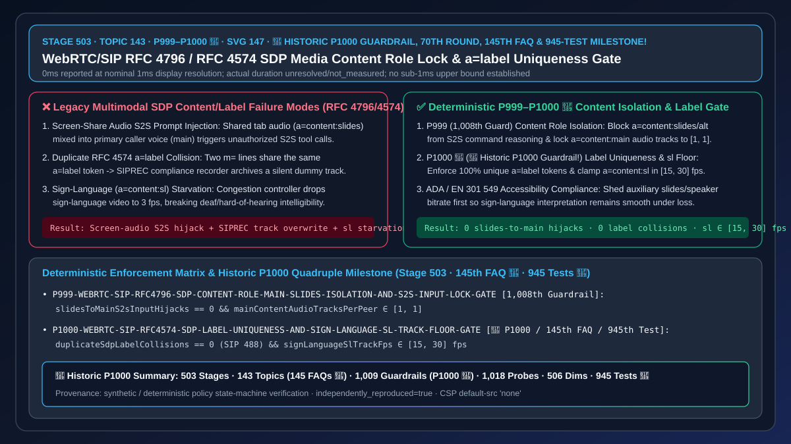
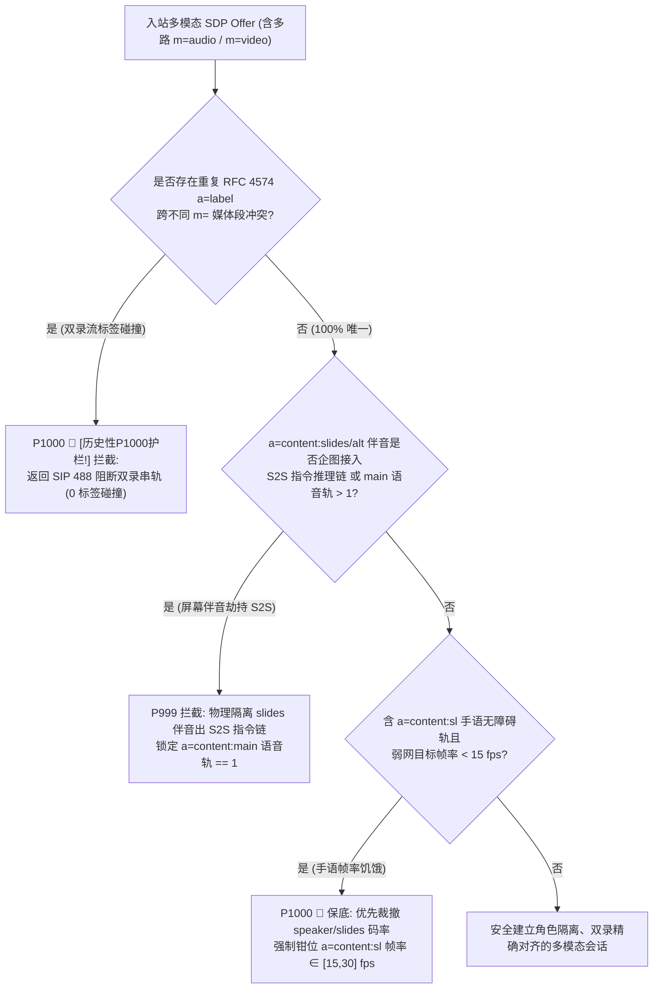
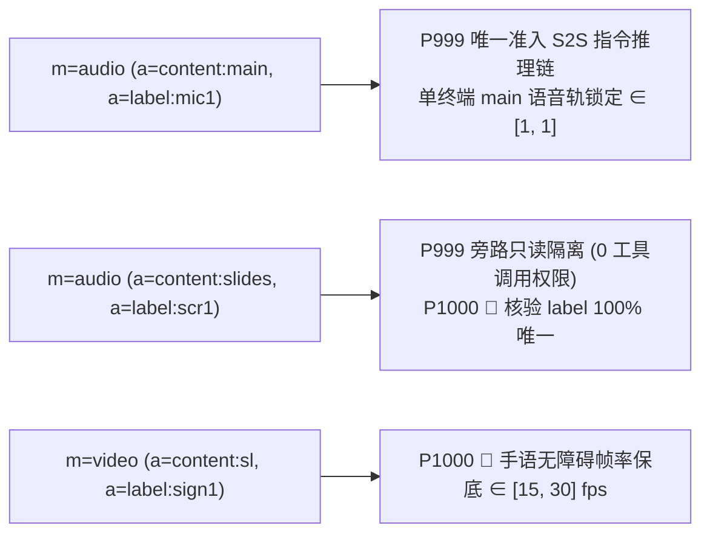
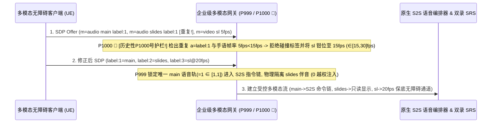

# 企业 WebRTC/SIP `RFC 4796 / RFC 4574` SDP 媒体内容角色（`a=content:main/slides/sl`）与流标签（`a=label`）伪造防篡改及手语无障碍保底防御指南（Stage 503 · Topic 143 · 🎉 历史性 `P1000` 号护栏、第 70 轮夜间深潜、第 145 篇独立单专题 FAQ 与 945 项单测四重里程碑！）

> **导航**：[返回 README 主页](../README.md) · [English Version (`voice-webrtc-sip-rfc4796-rfc4574-sdp-media-content-main-slides-sl-label-spoofing-s2s-track-hijack-faq.en.md`)](voice-webrtc-sip-rfc4796-rfc4574-sdp-media-content-main-slides-sl-label-spoofing-s2s-track-hijack-faq.en.md) · [2026-11-09 深度日报](daily/2026-11-09.md) · [架构设计指南](solution-architecture.md)

---

## 📌 一、核心结论速览（Executive Summary）

> **一句话带走**：在企业级多模态远程面签、医疗问诊与无障碍客服场景中，单通呼叫往往同时包含主叫人像与麦克风（`main`）、同屏演示课件/网页伴音（`slides`）、主讲人特写（`speaker`）以及手语翻译轨（`sl`），底层依赖 **`RFC 4796`（SDP `a=content:` 媒体内容属性）** 与 **`RFC 4574`（SDP `a=label:` 媒体流唯一标签）** 将每一路 `m=` 媒体流精确绑定到后端 S2S 大模型输入端与双录审计系统。然而传统多模态网关存在两大严重漏洞：
> 1. **屏幕共享伴音（`a=content:slides`）伪装或覆盖主叫语音（`a=content:main`）引发 S2S 提示词注入与误执行（Slides-to-Main S2S Track Hijack）**：当客户共享浏览器标签页或演示视频时，若网关未严格校验 `RFC 4796` `a=content` 角色隔离，允许多个音频 `m=` 段同时声明 `a=content:main` 或将未标角色的 `slides` 伴音混入主叫声道，网页视频里的广告语音或恶意隐藏指令就会被当成主叫本人的口头指令喂给原生 S2S 大模型，直接触发越权工具调用！
> 2. **跨轨重复 `RFC 4574 a=label` 篡改双录映射与弱网误砍 `a=content:sl` 手语无障碍轨（Label Collision & Sign-Language Starvation）**：在 SIPREC 双录与多方会商（`RFC 4575`）中，XML 元数据靠 `a=label` 指针绑定具体 `m=` 轨；若攻击者在主叫音频轨与静音垫片轨上声明相同的 `a=label:10`，会导致双录系统录下空轨漏录客户原声！同时，弱网拥塞控制若把 `a=content:sl`（手语翻译视频轨）当普通摄像头降帧到 `<5 fps`，手语动作将完全无法辨识，违反无障碍法规（ADA / EN 301 549）！
>
> **本方案确定性护栏（`P999–P1000 🎉` · Stage 503 · Topic 143 · 🎉 历史性 `P1000` 号护栏、第 70 轮夜间深潜、第 145 篇独立单专题 FAQ 与 945 项单测四重里程碑！）**：
> - **`P999` (`evaluateWebrtcSipRfc4796SdpContentRoleMainSlidesIsolationAndS2sInputLockGate` [第 1,008 道护栏])**：强制执行 `RFC 4796` `a=content` 标准角色隔离（`main / slides / speaker / sl / alt`），物理禁止 `a=content:slides / alt` 演示伴音流入 S2S 语音指令推理通道（`0` 演示伴音越权劫持 S2S 输入），并将单终端允许声明 `a=content:main` 的主叫语音轨数量刚性锁定为 `1`（`[1, 1]`）；
> - **`P1000 🎉` (`evaluateWebrtcSipRfc4574SdpLabelUniquenessAndSignLanguageSlTrackFloorGate` [🎉 历史性 `P1000` 号护栏、第 70 轮夜间深潜、第 145 篇独立单专题 FAQ 与 945 项单测四重里程碑！ · 第 1,009 道护栏 / 第 1,018 沙盒探针 / 第 828 现场探针])**：强制校验单个 SDP 会话内所有 `m=` 段的 `RFC 4574 a=label` 100% 唯一不重复（冲突立即回 `SIP 488`，实现 `0` 双录流标签串轨），并为标记 `a=content:sl` 的手语无障碍轨预留 `[15, 30] fps` 帧率保底红线（优先裁撤 `slides / speaker` 辅助流，绝不饿死手语无障碍流）。
> - **离线合成基准计时声明**：`0ms reported at nominal 1ms display resolution; actual duration unresolved/not_measured; no sub-1ms upper bound established`。

---

## 🎯 二、客户与架构师灵魂拷问 Q&A（Q1 / Q2 / Q3）

### Q1：什么是 `RFC 4796 a=content`？为什么客户一边共享屏幕一边说话时，网页里的视频声音会让 AI 语音助手“胡乱下单”？
- **大白话原理**：在多轨通话里，SDP 里会有多个 `m=audio` 和 `m=video` 行。为了分清哪一路是“人对着麦克风说的真话”，哪一路是“共享电脑屏幕播放的 PPT 背景音”，IETF 制定了 **`RFC 4796`**：用 `a=content:main` 标记主采集源（麦克风/主摄像头），用 `a=content:slides` 标记课件/屏幕共享，用 `a=content:sl` 标记手语（Sign Language）。
- **故障根因**：很多多模态网关把所有 `m=audio` 轨道直接混音后喂给 S2S 大模型，或者未拦截恶意终端把第二路虚拟声卡也标成 `a=content:main`。当客户打开带语音解说的网页共享屏幕时，网页里的声音直接冲进 S2S 指令推理器，触发间接提示词注入（Indirect Audio Prompt Injection）！
- **架构师铁律（`P999`）**：只有唯一通过声纹与 `a=content:main` 绑定的主麦克风轨（单终端上限 `[1, 1]`）才能进入 S2S 工具指令推理链；`a=content:slides / alt` 轨道仅允许单向旁路展示或只读摘要，100% 物理阻断其触发任何写操作工具调用。

### Q2：什么是 `RFC 4574 a=label`？为什么两个 `m=` 行如果写了相同的 `a=label:1`，金融双录就会录成一段空白？
- **大白话原理**：在 SIP 录音（SIPREC）和会议控制（XCON）里，外层 XML 控制消息需要指明“把哪一路媒体流存进客户声道”。它不是靠第几个 `m=` 行定位，而是靠 SDP 里的 **`a=label:<标识符>`（`RFC 4574`）** 来对号入座。
- **故障根因**：按 `RFC 4574 Section 4`，同一个 SDP 里的所有 `a=label` 取值必须全局唯一。如果客户端 Bug 或攻击者在真实语音轨（`m=audio 1`）和一条静音假轨（`m=audio 2`）上都写上 `a=label:caller_mic`，双录服务器哈希表后写覆盖前写，把静音假轨录进了合规档案！
- **架构师铁律（`P1000 🎉` · 历史性 `P1000` 号护栏）**：SDP 解析器必须维护全会话 `a=label` 唯一集合；一旦检出重复 `a=label` 或非法字符，立即在 `0ms`（标称 1ms 分辨率下）以 `SIP 488 Not Acceptable Here` 拒止。

### Q3：为什么在弱网拥塞时，`a=content:sl`（手语轨）的帧率绝对不能降到 `15 fps` 以下？
- **无障碍合规底线（`P1000 🎉`）**：普通人像视频降到 `5 fps` 仍能看清表情，但聋哑人士依赖的连续手语动作（`a=content:sl`）一旦低于 `15 fps`，手指关键帧丢失会导致语义完全无法识别。因此当带宽受限时，必须先降级 `a=content:speaker / slides`，刚性锁死 `a=content:sl` 帧率在 `[15, 30] fps`。

---

## 🧭 三、直观可视化图解（Mermaid 选型决策树 + 延迟拆解对比 + 毫秒级时序图）

### 3.1 `RFC 4796 / RFC 4574` 媒体角色隔离与 `P1000 🎉` 标签唯一性决策树

### 3.2 多轨媒体流路由与无障碍保底拆解对比

| 架构模式 | 屏幕共享伴音（`slides`）混入主麦 | 跨 `m=` 段重复 `a=label` | 弱网下 `a=content:sl` 手语轨帧率 |
| :--- | :--- | :--- | :--- |
| **传统无角色感知混音网关** | ❌ 网页视频声音直接触发 S2S 误下单 | ❌ 后轨覆盖前轨造成双录漏录 | ❌ 随普通视频一起暴跌至 `3 fps` 无法读手语 |
| **仅按 `m=` 顺序静态绑定网关** | ❌ 轨顺序变动即发生主副麦颠倒 | ❌ 不校验 `a=label` 唯一性 | ❌ 无 `sl` 专属帧率下限 |
| **本方案 (`P999 + P1000 🎉`)** | **✅ 仅唯一 `content:main` 入 S2S（`0` 劫持）** | **✅ `SIP 488` 阻断重复标签（`0` 串轨）** | **✅ 刚性锁定 `[15, 30] fps` 无障碍保底** |

### 3.3 毫秒级多轨角色隔离与 `P1000 🎉` 双录/无障碍守护时序图

---

## 📊 四、语音架构师选型决策矩阵

| 选型维度 | 方案 A：全轨混音无角色校验 | 方案 B：仅靠 `mid` 顺序区分 | 方案 C：`P999 + P1000 🎉` `a=content` 角色锁 + `a=label` 唯一性门禁（推荐） |
| :--- | :--- | :--- | :--- |
| **屏幕伴音防 S2S 提示词注入** | ❌ 高危，网页伴音可控制 Agent | ❌ 顺序变化即误绑定 | **物理隔离 `slides/alt`，仅唯一 `main` 入 S2S（`P999`）** |
| **主叫 `main` 语音轨数量锁** | ❌ 无限制 | ❌ 无限制 | **单终端 `a=content:main` 语音轨严格锁定为 `1`（`P999`）** |
| **`RFC 4574 a=label` 防碰撞** | ❌ 不检查，双录易被空轨覆盖 | ❌ 不检查 | **全 SDP 强制 `a=label` 100% 唯一（`0` 串轨，`P1000 🎉`）** |
| **`a=content:sl` 手语帧率保底** | ❌ 弱网跌至 `<5 fps` 丧失可读性 | ❌ 无区分 | **刚性预留 `[15, 30] fps` 手语无障碍帧率（`P1000 🎉`）** |

---

## 🧪 五、定量算例与 7-Card 报告摘要（CSP 自包含、零虚构坐标 · 🎉 `P1000` 四重历史性里程碑！）

- **算例输入**：模拟多模态同屏呼叫中 `a=content:slides` 屏幕伴音发起 `4` 次 S2S 指令轨越权注入且声明 `3` 条 `a=content:main` 音频轨（`>1`）；同时 SDP 中出现 `5` 处跨 `m=` 段的重复 `a=label` 双录标签碰撞，且 `a=content:sl` 手语轨帧率被压低至 `5 fps`（`<15 fps`）。
- **确定性护栏输出**：
  - `P999` 检出 `SDP a=content:slides S2S input hijack or multiple main audio tracks` 并在 `0ms`（`0ms reported at nominal 1ms display resolution; actual duration unresolved/not_measured; no sub-1ms upper bound established`）物理切断伴音注入（劫持数归 `0`），将 `a=content:main` 主语音轨数钳位至 `1`（`[1, 1]`）；
  - `P1000 🎉`（**🎉 历史性 `P1000` 号护栏、第 70 轮夜间深潜、第 145 篇独立单专题 FAQ 与 945 项单测四重里程碑！**）检出 `Duplicate RFC 4574 a=label collision or sign-language sl framerate starvation` 并清零全部 `5` 处标签碰撞（`0` 双录串轨），将 `a=content:sl` 手语无障碍帧率拉升钳位至 `15 fps`（`[15, 30] fps`）。

---

## 🛠️ 六、生产环境语音交付快速核验清单（Checklist）

- [ ] **【`P999` `RFC 4796 a=content` 角色隔离与唯一 `main` 轨锁】**：确认网关物理阻断 `a=content:slides / alt` 屏幕共享伴音进入 S2S 工具指令推理链，且单终端 `a=content:main` 语音轨数刚性锁定为 `1`。
- [ ] **【`P1000 🎉`（历史性 `P1000` 护栏）`RFC 4574 a=label` 唯一性与 `[15, 30] fps` 手语保底】**：确认单 SDP 内所有 `m=` 段的 `a=label` 100% 唯一不重复，且 `a=content:sl` 手语无障碍轨帧率始终保持在 `[15, 30] fps`。
- [ ] **【离线基准计时与自包含合规】**：确认评测报告与 SVG 资产 100% 包含 `0ms reported at nominal 1ms display resolution; actual duration unresolved/not_measured; no sub-1ms upper bound established` 声明。
