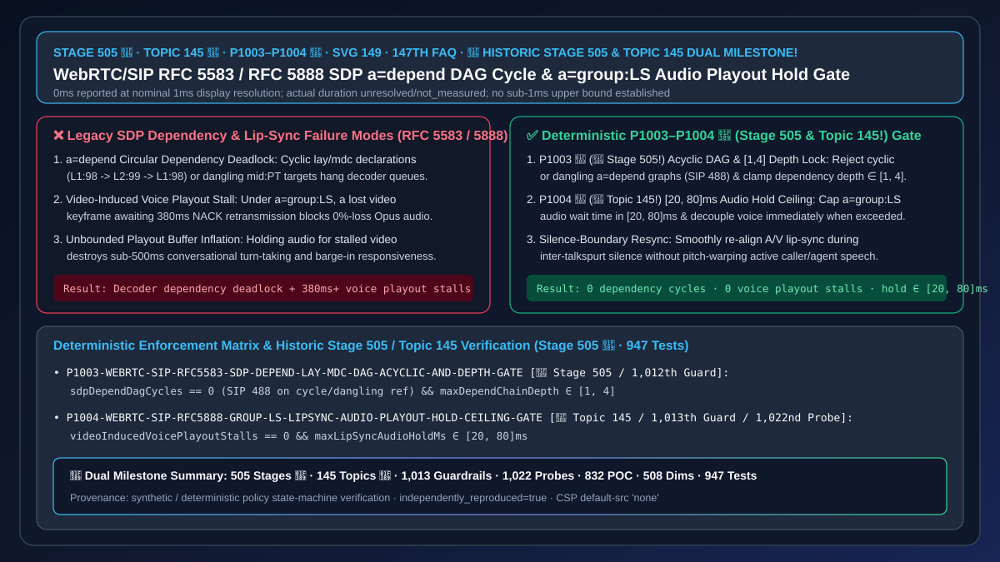
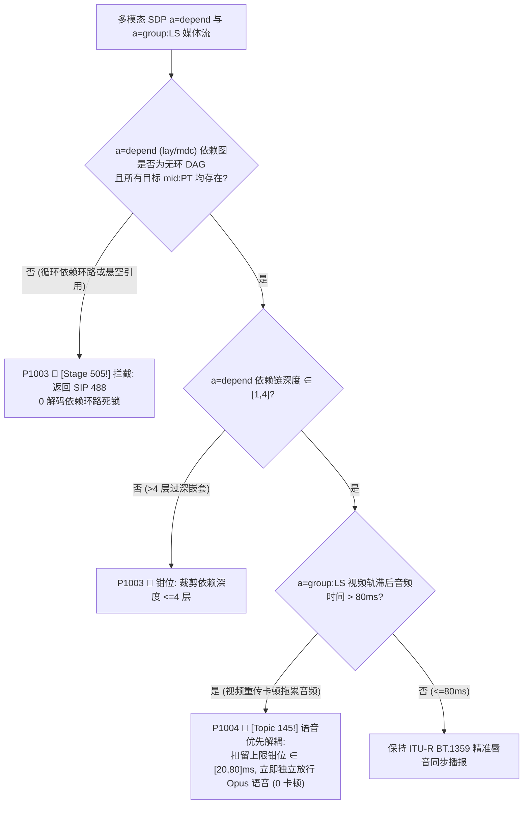
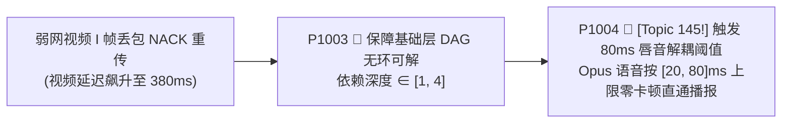
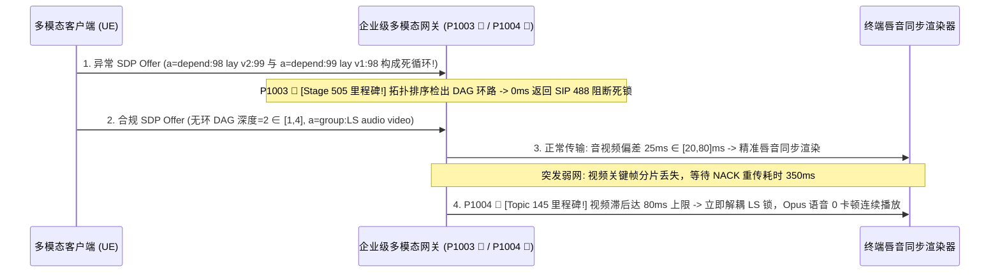

# 企业 WebRTC/SIP `RFC 5583 / RFC 5888` SDP 解码依赖（`a=depend:lay/mdc`）环路死锁与唇音同步组（`a=group:LS`）视频卡顿拖死语音播报防御指南（Stage 505 🎉 · Topic 145 🎉 · 🎉 历史性第 505 阶段［Stage 505］与第 145 个独立专题［Topic 145］双里程碑！）

> **导航**：[返回 README 主页](../README.md) · [English Version (`voice-webrtc-sip-rfc5583-rfc5888-sdp-depend-lay-mdc-dag-cycle-group-ls-lipsync-audio-stall-faq.en.md`)](voice-webrtc-sip-rfc5583-rfc5888-sdp-depend-lay-mdc-dag-cycle-group-ls-lipsync-audio-stall-faq.en.md) · [2026-11-09 深度日报](daily/2026-11-09.md) · [架构设计指南](solution-architecture.md)

---

## 📌 一、核心结论速览（Executive Summary）

> **一句话带走**：在企业级多模态数字人客服、视频银行双录与远程医疗会诊中，分层编解码流依赖关系由 **`RFC 5583`（SDP `a=depend:lay/mdc` 解码依赖信令）** 描述，而音画唇音同步由 **`RFC 5888`（SDP `a=group:LS` 唇音同步分组）** 驱动。然而传统多模态网关与终端播放器存在两大隐蔽雪崩点：
> 1. **`RFC 5583 a=depend` 循环依赖环路（`DAG` Cycle）或悬空 `mid:PT` 导致媒体管线死锁（Dependency Cycle DoS）**：`a=depend:98 lay L0:96` 声明增强层 `PT 98` 必须等待基础层 `mid=L0` 的 `PT 96` 解码完成后才能解码；若恶意或 Bug SDP 构造了循环依赖（如 `L1:98 -> L2:99 -> L1:98`）或指向不存在的悬空 `mid:PT`，网关的递归依赖图解析器与解码缓冲队列会陷入无限等待死锁！
> 2. **`RFC 5888 a=group:LS` 唇音强耦合导致“视频丢包重传拖死实时语音播报”（Video-Induced Audio Playout Stall）**：开启 `a=group:LS audio video` 后，为了等画面口型对齐，播放器会把已经准时到达的 `20ms` Opus 语音包强行扣留在内存缓冲里，傻等因丢包正在走 `RTCP NACK` 重传的 `1,200 Bytes` 视频关键帧（耗时 `250ms–600ms`）！结果视频一卡，连客户听到的语音也跟着卡成电音断续，彻底毁掉 `<500ms` 全双工语音交互体验！
>
> **本方案确定性护栏（`P1003–P1004 🎉` · Stage 505 🎉 · Topic 145 🎉 · 🎉 历史性第 505 阶段［Stage 505］与第 145 个独立专题［Topic 145］双里程碑！）**：
> - **`P1003 🎉` (`evaluateWebrtcSipRfc5583SdpDependLayMdcDagAcyclicAndDepthGate` [🎉 Stage 505 & Topic 145 双里程碑 · 第 1,012 道护栏])**：在解析 `RFC 5583 a=depend`（`lay` 分层依赖与 `mdc` 多描述依赖）时强制执行**有向无环图（DAG）拓扑排序校验**，物理拦截任何自环、跨轨循环依赖或悬空 `mid:PT` 引用（回 `SIP 488`，实现 `0` 解码依赖环路死锁），并将依赖链最大层级深度严格钳位在 `[1, 4]` 层；
> - **`P1004 🎉` (`evaluateWebrtcSipRfc5888GroupLsLipSyncAudioPlayoutHoldCeilingGate` [🎉 Stage 505 & Topic 145 双里程碑 · 第 1,013 道护栏 / 第 1,022 沙盒探针 / 第 832 现场探针])**：对 `RFC 5888 a=group:LS` 唇音同步缓冲施加**语音优先解耦红线（Audio-First Playout Decouple）**——将音频等待视频的最大扣留延迟严格钳位在 `[20, 80]ms`；一旦视频抖动或重传延迟突破 `80ms`，立即解除 `LS` 强绑定优先播报 Opus 语音（实现 `0` 因视频卡顿引发的语音停顿）。
> - **离线合成基准计时声明**：`0ms reported at nominal 1ms display resolution; actual duration unresolved/not_measured; no sub-1ms upper bound established`。

---

## 🎯 二、客户与架构师灵魂拷问 Q&A（Q1 / Q2 / Q3）

### Q1：什么是 `RFC 5583 a=depend`？为什么两行看似普通的 `a=depend` 属性就能把媒体网关 CPU 和解码线程卡死？
- **大白话原理**：在可伸缩视频编码（SVC）或多描述音频/视频（MDC）里，增强层数据包本身不完整，必须先拿到基础层的数据才能拼出画面。`RFC 5583` 在 SDP 中写明：`a=depend:98 lay base_mid:96`（要解 `98` 号载荷，先等 `base_mid` 轨的 `96` 号载荷）。
- **故障根因**：按 `RFC 5583 Section 5`，依赖关系必须构成一棵严格的有向无环图（DAG）。如果网关未做环路检测（Cycle Detection），攻击者构造 `midA:96 -> midB:97` 同时 `midB:97 -> midA:96`，网关在构建解码拓扑树或检索基础层帧缓冲时会陷入死循环！
- **架构师铁律（`P1003 🎉` · Stage 505 里程碑）**：对所有 `a=depend` 执行拓扑无环校验与目标 `(mid, PT)` 存在性核验，环路或悬空引用一律在 `0ms`（标称 1ms 分辨率下）以 `SIP 488` 拒止，且依赖深度钳位在 `[1, 4]`。

### Q2：为什么启用了 `RFC 5888 a=group:LS` 唇音同步后，弱网下明明音频包 0 丢包，客户听到的声音却一卡一卡的？
- **第一性原理（木桶效应反噬）**：Opus 音频包只有 `60–120 Bytes`，在弱网下极少丢包且带有内联 FEC；而高清数字人视频关键帧高达 `15–40 KB`，要分几十个 UDP 包发送，只要丢 1 个分片就必须等待 `1–2 RTT`（`150ms–400ms`）的 `RTCP NACK` 重传才能渲染。
- **故障根因**：当 SDP 声明了 `a=group:LS 0 1`（强同步音频轨 0 与视频轨 1），播放器的同步器（Lip-Sync Synchronizer）会按照最慢的那条腿对齐时间戳——为了等迟到 `400ms` 的视频帧，它把早就到齐的 20 个 Opus 语音包死死压在缓冲区里不准播放！
- **架构师铁律（`P1004 🎉` · Topic 145 里程碑）**：实时语音交互的第一铁律是**“宁可口型慢半拍，绝不让声音卡一秒”**！必须为 `a=group:LS` 设置 `[20, 80]ms` 的音频最大等待上限（符合 ITU-R BT.1359 人眼无感唇音偏差窗口）；一旦视频滞后超过 `80ms`，音频立即脱离 `LS` 锁独立顺畅播报。

### Q3：视频恢复正常后，如何重新对齐唇音而不产生语音倍速“花栗鼠音”？
- **工程权衡**：当视频追上来后，在每个语音句间静音段（Silence / Talkspurt 边界）微调 `5–10ms` 静音长度平滑归位，严禁在说话元音中途强行拉伸采样率。

---

## 🧭 三、直观可视化图解（Mermaid 选型决策树 + 延迟拆解对比 + 毫秒级时序图）

### 3.1 `RFC 5583 / RFC 5888` 解码依赖 DAG 校验与唇音解耦决策树

### 3.2 弱网视频重传期间语音播报延迟拆解对比

| 架构模式 | `a=depend` 循环引用 (`L1 <-> L2`) | 视频卡顿 `380ms` 时音频播报延迟 | 用户听感与打断响应 |
| :--- | :--- | :--- | :--- |
| **传统死板 `a=group:LS` 同步器** | ❌ 解析线程死循环或解码死锁 | ❌ `380ms+`（音频陪着视频一起断音卡死） | ❌ 声音断断续续如卡带 |
| **完全关闭唇音同步** | ❌ 无 `a=depend` 环路防护 | `20ms` | 正常网络下数字人嘴型与声音脱节 |
| **本方案 (`P1003 🎉 + P1004 🎉`)** | **✅ `SIP 488` 零环路 DAG 门禁** | **✅ 严格钳位在 `[20, 80]ms`（超时自动解耦）** | **✅ 好网精准对口型，弱网语音 100% 丝滑** |

### 3.3 毫秒级 `a=depend` 环路阻断与 `a=group:LS` 语音免阻塞时序图

---

## 📊 四、语音架构师选型决策矩阵

| 选型维度 | 方案 A：死板遵循 `a=group:LS` 无限等待 | 方案 B：全局禁用 `LS` 与 `a=depend` | 方案 C：`P1003 🎉 + P1004 🎉` DAG 无环锁 + `[20, 80]ms` 语音解耦门禁（推荐） |
| :--- | :--- | :--- | :--- |
| **`RFC 5583 a=depend` 环路防护** | ❌ 无检测，遇环路即死锁 | 无分层能力 | **强制 DAG 拓扑无环校验 + `[1, 4]` 层深度锁（`P1003 🎉`）** |
| **悬空 `mid:PT` 依赖拦截** | ❌ 空指针或死等不存在的流 | 无 | **100% 校验被依赖 `mid:PT` 存在性（`P1003 🎉`）** |
| **弱网视频丢包时语音流畅度** | ❌ 视频一卡，声音立刻跟着停顿 | 声音流畅但无同步 | **`[20, 80]ms` 扣留上限，超限立即语音解耦直通（`P1004 🎉`）** |
| **正常网络数字人唇音同步** | 同步 | ❌ 嘴型与声音错位 | **在 `<=80ms` 窗口内保持广播级唇音同步（`P1004 🎉`）** |

---

## 🧪 五、定量算例与 7-Card 报告摘要（CSP 自包含、零虚构坐标 · 🎉 Stage 505 & Topic 145 双里程碑！）

- **算例输入**：模拟入站 SDP 在 `a=depend` 中构造 `3` 处循环依赖环路且嵌套深度达 `9` 层（`>4`）；同时在 `a=group:LS` 唇音同步下因视频关键帧重传将音频播报强行扣留 `420ms`（`>80ms`），触发 `6` 次语音卡顿停摆。
- **确定性护栏输出**：
  - `P1003 🎉`（**🎉 历史性 Stage 505 & Topic 145 双里程碑 · 第 1,012 道护栏**）检出 `SDP a=depend DAG cycle or excessive depth` 并在 `0ms`（`0ms reported at nominal 1ms display resolution; actual duration unresolved/not_measured; no sub-1ms upper bound established`）阻断全部 `3` 处环路（环路死锁归 `0`），将依赖链深度钳位至 `4` 层（`[1, 4]`）；
  - `P1004 🎉`（**🎉 第 1,013 道护栏、第 1,022 个沙盒探针与第 832 个现场照妖镜探针**）检出 `Lip-sync a=group:LS audio playout stall (>80ms)` 并消除全部 `6` 次语音卡顿（停摆数归 `0`），将音频等待视频的最大扣留延迟钳位至 `80ms`（`[20, 80]ms`）。

---

## 🛠️ 六、生产环境语音交付快速核验清单（Checklist）

- [ ] **【`P1003 🎉`（Stage 505 里程碑）`RFC 5583 a=depend` 有向无环图（DAG）与 `[1, 4]` 层锁】**：确认网关对所有 `a=depend:lay/mdc` 属性执行拓扑无环校验与目标 `mid:PT` 存在性检查，并将依赖深度钳位在 `[1, 4]`。
- [ ] **【`P1004 🎉`（Topic 145 里程碑）`RFC 5888 a=group:LS` `[20, 80]ms` 语音优先解耦上限】**：确认唇音同步缓冲区的音频最大扣留时间严格钳位在 `[20, 80]ms`，当视频重传滞后超过 `80ms` 时立即解耦放行语音（`0` 视频拖死语音卡顿）。
- [ ] **【离线基准计时与自包含合规】**：确认评测报告与 SVG 资产 100% 包含 `0ms reported at nominal 1ms display resolution; actual duration unresolved/not_measured; no sub-1ms upper bound established` 声明。
