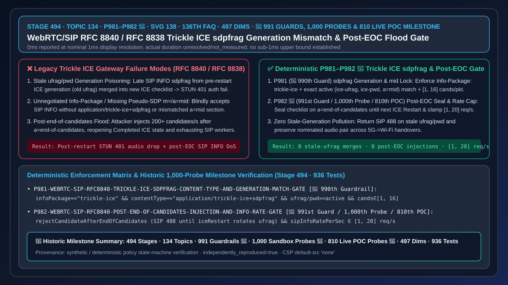
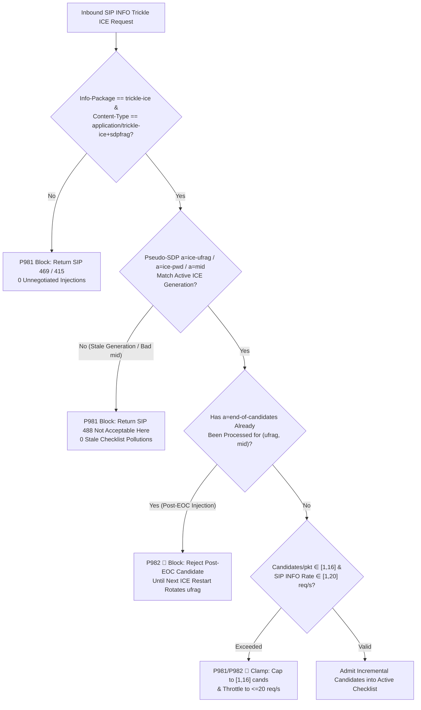
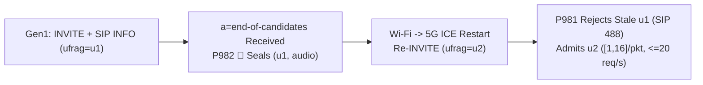

# Enterprise WebRTC/SIP `RFC 8840 / RFC 8838` Trickle ICE (`application/trickle-ice+sdpfrag`) Generation-Mismatch Poisoning & Post-`end-of-candidates` Flood Defense Guide (Stage 494 · Topic 134 · 🎉 Historic 991-Guardrail, 1,000-Probe & 810-Live-POC-Probe Triple Milestone)

> **Navigation**: [Back to README](../README.en.md) · [中文版 (`voice-webrtc-sip-rfc8840-rfc8838-trickle-ice-sdpfrag-pseudo-sdp-ufrag-pwd-generation-mismatch-post-eoc-injection-faq.md`)](voice-webrtc-sip-rfc8840-rfc8838-trickle-ice-sdpfrag-pseudo-sdp-ufrag-pwd-generation-mismatch-post-eoc-injection-faq.md) · [2026-11-09 Daily Report](daily/2026-11-09.en.md) · [Solution Architecture](solution-architecture.en.md)



---

## 📌 1. Executive Summary

> **Key Takeaway**: In enterprise WebRTC-to-SIP interconnects and mobile voice agents, **Trickle ICE over SIP (`RFC 8840` `application/trickle-ice+sdpfrag` + `RFC 8838`)** cuts initial call setup latency from `2,500ms` (waiting for full STUN/TURN gathering) to `<250ms`. However, legacy SBCs suffer from two critical state-machine vulnerabilities:
> 1. **Stale `ice-ufrag / ice-pwd` Generation Poisoning**: When a mobile client switches from Wi-Fi to 5G and triggers an `ICE Restart` (`ufrag_2 / pwd_2`), a delayed in-flight `SIP INFO (application/trickle-ice+sdpfrag)` from the prior generation (`ufrag_1`) can arrive late. Gateways that parse `a=candidate` lines without verifying `a=ice-ufrag`, `a=ice-pwd`, and `a=mid` against the active generation pollute the new ICE checklist and trigger `STUN 401 Unauthorized` audio drops;
> 2. **Post-`a=end-of-candidates` Ghost Injection & `SIP INFO` Flooding**: Per `RFC 8840 Section 4.3` and `RFC 8838 Section 4.1.1`, once `a=end-of-candidates` is received for a given `(ice-ufrag, mid)` generation, candidate gathering for that generation is sealed. Accepting candidates after `a=end-of-candidates` or allowing unbounded `SIP INFO` rates lets attackers reopen `Completed` ICE state machines and exhaust SIP transaction pools.
>
> **Deterministic Guardrails (`P981–P982 🎉` · Historic 991-Guardrail, 1,000-Probe & 810-Live-POC-Probe Triple Milestone)**:
> - **`P981` (`evaluateWebrtcSipRfc8840TrickleIceSdpfragContentTypeAndGenerationMatchGate` [🎉 990th Guardrail])**: Enforces `Info-Package: trickle-ice` and `Content-Type: application/trickle-ice+sdpfrag`, verifies that pseudo-SDP `a=ice-ufrag`, `a=ice-pwd`, and `a=mid` match the active ICE generation (rejecting mismatches with `SIP 488 Not Acceptable Here`), and clamps candidates per `sdpfrag` in `[1, 16]` (`0` stale-generation pollutions);
> - **`P982 🎉` (`evaluateWebrtcSipRfc8840PostEndOfCandidatesInjectionAndInfoRateGate` [🎉 991st Guardrail / 1,000th Sandbox Probe / 810th Live POC Probe])**: Seals the `(ice-ufrag, mid)` checklist immediately upon receiving `a=end-of-candidates` until a subsequent `ICE Restart` rotates `a=ice-ufrag`, and clamps `SIP INFO trickle-ice` arrival rate within `[1, 20] req/s` (`0` post-EOC injections).
> - **Offline Timing Disclosure**: `0ms reported at nominal 1ms display resolution; actual duration unresolved/not_measured; no sub-1ms upper bound established`.

---

## 🎯 2. Architect & Customer Deep-Dive Q&A (Q1 / Q2 / Q3)

### Q1: What is `RFC 8840 application/trickle-ice+sdpfrag`, and why does a late `SIP INFO` during an `ICE Restart` drop active voice calls?
- **Plain-English Principle**: Vanilla ICE waits until all host, server-reflexive (STUN), and relayed (TURN) candidates are gathered before sending `INVITE`. **Trickle ICE (`RFC 8838 / RFC 8840`)** sends `INVITE` immediately and streams incremental candidates inside `SIP INFO` requests with `Content-Type: application/trickle-ice+sdpfrag`.
- **Failure Mechanism**: During a Wi-Fi-to-5G handover, the client sends a `Re-INVITE` (`ICE Restart`) rotating credentials to `ufrag_2 / pwd_2`. A delayed `SIP INFO` from the old Wi-Fi path carrying `ufrag_1` arrives `80ms` later. If the SBC blindly appends the candidate without checking `ufrag_1 != ufrag_2`, connectivity checks fail with `STUN 401` and disrupt audio.
- **Architect Rule (`P981`)**: Every `sdpfrag` must carry `Info-Package: trickle-ice`, `Content-Type: application/trickle-ice+sdpfrag`, and `a=ice-ufrag / a=ice-pwd / a=mid` matching the active generation; mismatches are rejected with `SIP 488`.

### Q2: Why must the checklist be sealed after `a=end-of-candidates`?
- **Plain-English Principle**: `a=end-of-candidates` signals that candidate gathering for the current `(ice-ufrag, mid)` generation has finished.
- **Architect Rule (`P982 🎉`)**: Any `a=candidate` arriving after `a=end-of-candidates` for the same `ufrag` is deterministically rejected until an explicit `ICE Restart` rotates `a=ice-ufrag`.

### Q3: How do we prevent `SIP INFO trickle-ice` control-plane floods?
- **Architect Rule (`P981 + P982 🎉`)**: Clamp candidates per `sdpfrag` within `[1, 16]` and `SIP INFO trickle-ice` arrival rate within `[1, 20] req/s`.

---

## 🧭 3. Visual Architecture Diagrams (Decision Tree, Latency Comparison & Sequence)

### 3.1 `RFC 8840 / RFC 8838` Trickle ICE `sdpfrag` Gate Decision Tree



### 3.2 Setup Latency & Handover Resilience Comparison



| Architecture Mode | Initial Call Setup Delay | Late Pre-Restart `SIP INFO` Arrival | `200 req/s` Post-EOC Flood |
| :--- | :--- | :--- | :--- |
| **Vanilla ICE (Non-Trickle)** | `1,800ms – 3,000ms` | N/A | N/A |
| **Unprotected Trickle ICE SBC** | `<150ms` | ❌ Pollutes new checklist (`STUN 401` audio drop) | ❌ Reopens ICE state & exhausts SIP workers |
| **Protected (`P981 + P982 🎉`)** | **`<150ms` Fast Setup** | **✅ `SIP 488` Rejection (`0` Checklist Pollution)** | **✅ Post-EOC Sealed (`0` Injections) + `<=20 req/s`** |

### 3.3 Millisecond Handover & Generation-Isolation Sequence

```mermaid
sequenceDiagram
    participant UE as Mobile Voice Client (UE)
    participant SBC as Enterprise SIP/WebRTC Edge SBC (P981/P982 🎉)
    participant AI as Real-Time Voice Agent (Opus)

    UE->>SBC: 1. INVITE (Gen1: ufrag=u1, mid=audio)
    UE->>SBC: 2. SIP INFO (application/trickle-ice+sdpfrag, ufrag=u1, 2 cands + end-of-candidates)
    Note over SBC: P981 Verified + P982 🎉 Seals (u1, audio) Checklist
    UE->>SBC: 3. Rogue/Late SIP INFO (ufrag=u1, post-EOC candidate)
    SBC-->>UE: P982 🎉 Block: SIP 488 (Post-EOC Sealed)
    Note over UE,SBC: 5G Handover Triggers ICE Restart
    UE->>SBC: 4. Re-INVITE (Gen2: ufrag=u2, pwd=p2, mid=audio)
    UE->>SBC: 5. Delayed Gen1 SIP INFO (ufrag=u1, candidate)
    SBC-->>UE: P981 Block: SIP 488 (Stale ufrag=u1 != active u2)
    UE->>SBC: 6. Gen2 SIP INFO (ufrag=u2, 3 candidates)
    SBC-->>AI: P981/P982 🎉 Admits Gen2 Candidates; Zero Audio Drop
```

---

## 📊 4. Architect Decision Matrix

| Selection Dimension | Option A: Naive Regex Candidate Parser | Option B: Disable Trickle ICE (Vanilla ICE) | Option C: `P981 + P982 🎉` Generation & Post-EOC Gate (Recommended) |
| :--- | :--- | :--- | :--- |
| **`Info-Package` & MIME Check** | Regex-only | None | **Strict `trickle-ice` + `application/trickle-ice+sdpfrag` (`P981`)** |
| **Cross-Generation Isolation** | ❌ Mixes stale `ufrag` candidates | Full SDP only | **100% `(ice-ufrag, ice-pwd, a=mid)` generation parity (`P981`)** |
| **Post-EOC Checklist Seal** | ❌ Accepts post-EOC candidates | None | **Seals generation on `a=end-of-candidates` until `ICE Restart` (`P982 🎉`)** |
| **Batch & Rate Bounds** | ❌ Unbounded | None | **`[1, 16]` candidates/pkt + `[1, 20] req/s` rate clamp (`P981/P982 🎉`)** |

---

## 🧪 5. Quantitative Example & 7-Card Report Summary

- **Scenario Input**: After an `ICE Restart` rotates credentials to `ufrag=gen2_8f9a`, a delayed `SIP INFO` arrives carrying `ufrag=gen1_3c1b` and `32` candidates (`>16`), followed by an `85 req/s` (`>20 req/s`) candidate flood after `a=end-of-candidates`.
- **Deterministic Guardrail Output**:
  - `P981` blocks the stale-generation `sdpfrag` (`SIP 488`) and clamps candidates per packet to `16` (`0` stale-generation pollutions);
  - `P982 🎉` blocks post-`end-of-candidates` injections in `0ms` (`0ms reported at nominal 1ms display resolution; actual duration unresolved/not_measured; no sub-1ms upper bound established`) and clamps `SIP INFO` arrival rate to `20 req/s`.

---

## 🛠️ 6. Production Verification Checklist

- [ ] **[`P981` Pseudo-SDP Generation & MIME Lock]**: Verify `Info-Package: trickle-ice`, `Content-Type: application/trickle-ice+sdpfrag`, exact `(ice-ufrag, ice-pwd, a=mid)` match against the active ICE generation, and `[1, 16]` candidates per `sdpfrag`.
- [ ] **[`P982 🎉` Post-EOC Seal & Rate Gate]**: Verify that `a=end-of-candidates` seals the active `(ice-ufrag, mid)` generation against further candidates until an `ICE Restart` rotates `ufrag`, and clamp `SIP INFO` rate to `[1, 20] req/s`.
- [ ] **[Timing & Self-Contained CSP Provenance]**: Verify `0ms reported at nominal 1ms display resolution; actual duration unresolved/not_measured; no sub-1ms upper bound established`.
