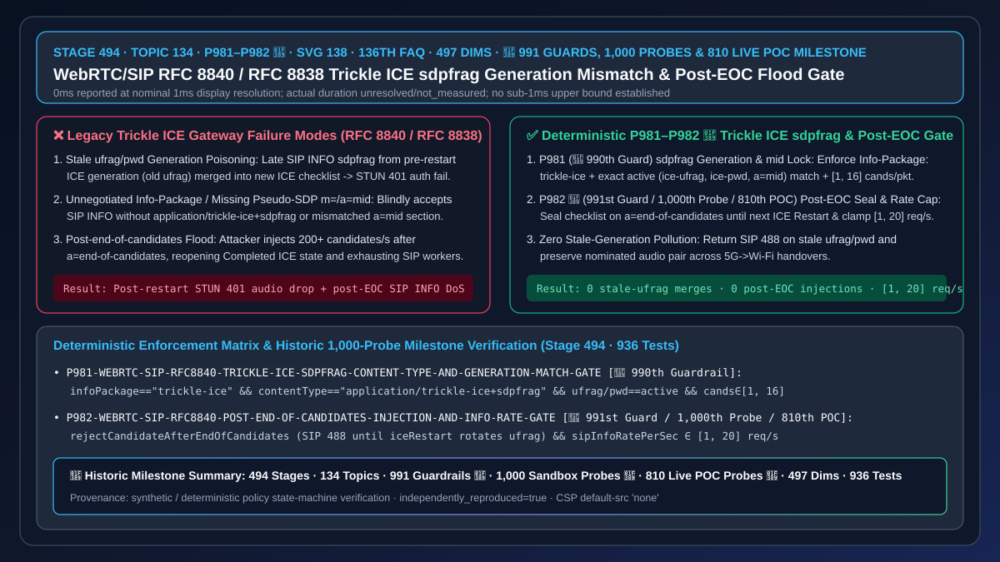
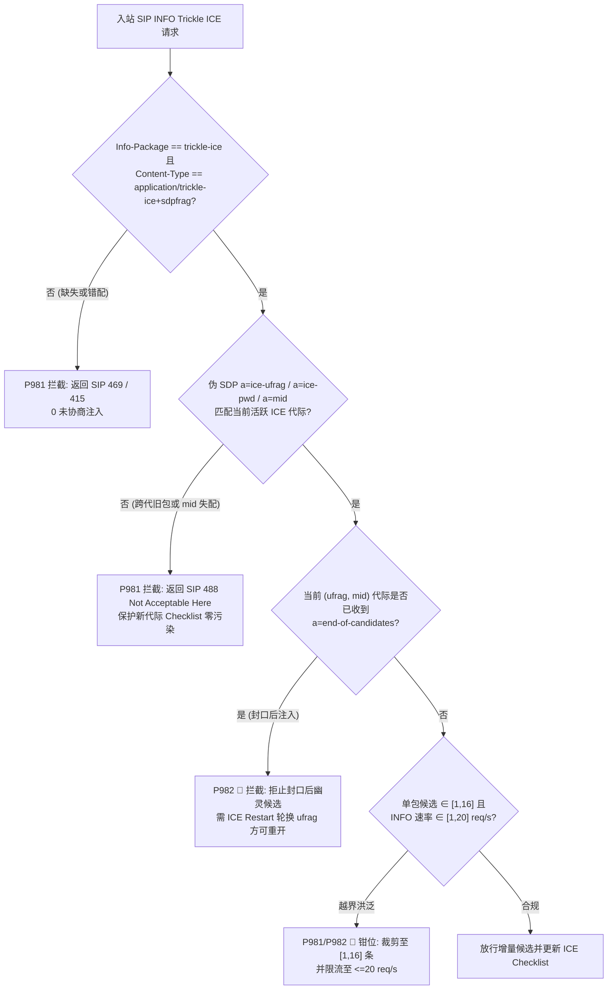
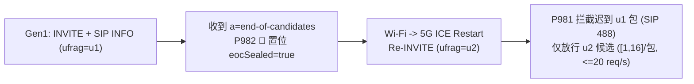
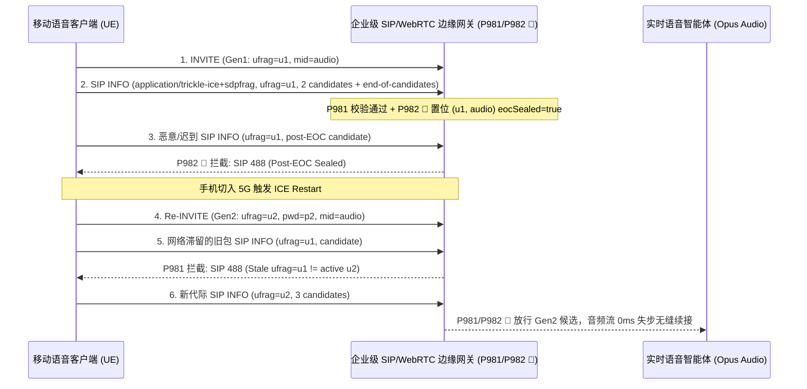

# 企业 WebRTC/SIP `RFC 8840 / RFC 8838` 涓流 ICE（`Trickle ICE`）`application/trickle-ice+sdpfrag` 跨代 `ufrag/pwd` 污染与 `a=end-of-candidates` 后幽灵候选注入防御指南（Stage 494 · Topic 134 · 🎉 历史性 991 道护栏、1,000 个沙盒探针与 810 个现场照妖镜探针三重里程碑）

> **导航**：[返回 README 主页](../README.md) · [English Version (`voice-webrtc-sip-rfc8840-rfc8838-trickle-ice-sdpfrag-pseudo-sdp-ufrag-pwd-generation-mismatch-post-eoc-injection-faq.en.md`)](voice-webrtc-sip-rfc8840-rfc8838-trickle-ice-sdpfrag-pseudo-sdp-ufrag-pwd-generation-mismatch-post-eoc-injection-faq.en.md) · [2026-11-09 深度日报](daily/2026-11-09.md) · [架构设计指南](solution-architecture.md)

---

## 📌 一、核心结论速览（Executive Summary）

> **一句话带走**：在企业级 WebRTC-SIP 互联网关与移动语音坐席中，为了把呼叫首包建连耗时从等待全量 STUN/TURN 收集的 `2,500ms` 压缩到 `<250ms`，必须启用 **`RFC 8840`（基于 `SIP INFO` `application/trickle-ice+sdpfrag` 的 Trickle ICE）** 与 **`RFC 8838`（Trickle ICE 协议状态机）**。然而传统 SBC/B2BUA 存在两大高频生产事故：
> 1. **跨代 `ice-ufrag / ice-pwd` 乱序污染（Stale Generation Poisoning）**：当手机端从 Wi-Fi 切到 5G 触发 `ICE Restart` 生成新一代 `ufrag_2 / pwd_2` 后，上一代网络滞留在途的 `SIP INFO (application/trickle-ice+sdpfrag)` 携带着旧 `ufrag_1` 晚到；若网关未校验伪 SDP（Pseudo-SDP）中的 `a=ice-ufrag / a=ice-pwd` 与 `a=mid`，直接把旧候选塞进新 Checklist，会导致 STUN 绑定请求因 `401 Unauthorized` 批量失败并误杀正在通话的音频流；
> 2. **`a=end-of-candidates` 封口后幽灵注入与 `SIP INFO` 洪泛（Post-EOC Injection & Flood）**：根据 `RFC 8840 Section 4.3` 与 `RFC 8838 Section 4.1.1`，一旦某代 `(ice-ufrag, mid)` 收到 `a=end-of-candidates`，该代候选收集必须立即封口；若网关在封口后仍接受追加候选或未限制 `SIP INFO` 速率，攻击者可发送 `200 req/s` 的伪造候选包重新打开已完成（`Completed`）的 ICE 状态机，打爆 SIP 事务池。
>
> **本方案确定性护栏（`P981–P982 🎉` · 历史性 991 护栏 & 1,000 沙盒探针 & 810 现场探针三重里程碑）**：
> - **`P981` (`evaluateWebrtcSipRfc8840TrickleIceSdpfragContentTypeAndGenerationMatchGate` [🎉 第 990 道护栏])**：强制校验 `Info-Package: trickle-ice` 与 `Content-Type: application/trickle-ice+sdpfrag`，严格比对伪 SDP 块中的 `a=ice-ufrag`、`a=ice-pwd` 及 `a=mid` 与当前活跃代际 100% 吻合（失配立即回 `SIP 488 Not Acceptable Here`），并将单包候选数钳位在 `[1, 16]` 条（`0` 跨代污染）；
> - **`P982 🎉` (`evaluateWebrtcSipRfc8840PostEndOfCandidatesInjectionAndInfoRateGate` [🎉 第 991 道护栏 / 第 1,000 沙盒探针 / 第 810 现场照妖镜探针])**：在收到 `a=end-of-candidates` 后立即对当前 `(ice-ufrag, mid)` 代际加锁封口，在下一轮 `ICE Restart` 轮换 `ufrag` 前 100% 拒止一切迟到/幽灵候选注入，并将 `SIP INFO trickle-ice` 速率钳位在 `[1, 20] req/s`（`0` 封口后重开或事务池耗尽）。
> - **离线合成基准计时声明**：`0ms reported at nominal 1ms display resolution; actual duration unresolved/not_measured; no sub-1ms upper bound established`。

---

## 🎯 二、客户与架构师灵魂拷问 Q&A（Q1 / Q2 / Q3）

### Q1：什么是 `RFC 8840 application/trickle-ice+sdpfrag`？为什么切网 `ICE Restart` 时晚到的 `SIP INFO` 会把正常通话搞断音？
- **大白话原理**：在传统 SIP（Vanilla ICE）里，客户端必须等本机网卡、STUN 公网映射和 TURN 中继候选全部收集完（耗时 `1.5s–3s`），才能发出第一个 `INVITE`。**Trickle ICE（`RFC 8838 / RFC 8840`）** 允许先发带本地 Host 候选的 `INVITE`，随后每搜集到一批 STUN/TURN 候选，就通过轻量级 `SIP INFO` 消息（载荷类型为 `application/trickle-ice+sdpfrag`）像“滴灌”一样增量补发。
- **故障根因**：当用户在电梯口发生 Wi-Fi $\rightarrow$ 5G 切换时，客户端会发起带全新 `a=ice-ufrag:gen2` 的 `Re-INVITE (ICE Restart)`。此时，旧 Wi-Fi 链路上重传的一条属于 `gen1` 的 `SIP INFO` 晚到了 `80ms`。如果 SBC 只提取里面的 `a=candidate:...` 而不核对伪 SDP 头部的 `a=ice-ufrag:gen1 != gen2`，就会把旧候选混入 `gen2` 的连通性检查表，引发 `STUN 401` 风暴甚至错误提名已失效地址。
- **架构师铁律（`P981`）**：每一包 `application/trickle-ice+sdpfrag` 必须携带当前代际的 `a=ice-ufrag`、`a=ice-pwd` 和匹配的 `m= / a=mid`；只要 `ufrag/pwd` 与活跃代际不一致，网关必须在 `0ms`（标称 1ms 分辨率下）以 `SIP 488` 拒止，绝不污染当前 Checklist。

### Q2：为什么收到 `a=end-of-candidates` 之后还必须物理封死该代候选表？
- **大白话原理**：`a=end-of-candidates` 是客户端发给网关的“收工信号”，代表本轮 ICE 搜集已全部结束，网关可以在所有候选对检查完毕后安全进入 `Completed` 态或快速清理无效端口。
- **攻击与故障面**：如果网关收到 `a=end-of-candidates` 后未置位代际封口锁（`eocSealed = true`），恶意终端或 Bug 客户端在通话中途继续狂发带 `a=candidate` 的 `SIP INFO`，会迫使网关不断唤醒 ICE 状态机、分配新的 STUN 事务内存，造成音频处理线程抖动。
- **架构师铁律（`P982 🎉`）**：一旦 `(ice-ufrag, mid)` 收到 `a=end-of-candidates`，该代际候选表立即进入只读封口态；除非通过正规 `Re-INVITE / UPDATE` 执行 `ICE Restart` 更换了全新的 `ice-ufrag`，否则后续任何携带 `a=candidate` 的 `sdpfrag` 一律拦截丢弃。

### Q3：如何防止恶意终端利用 `SIP INFO trickle-ice` 发起控制面速率放大攻击？
- **工程权衡**：正常通话每次建连或切网最多产生 `2–5` 个增量 `SIP INFO` 包（每包含 `1–8` 个候选）。
- **架构师铁律（`P981 + P982 🎉`）**：单包 `sdpfrag` 候选条数严格钳位在 `[1, 16]` 条，单对话 `SIP INFO trickle-ice` 速率严格钳位在 `[1, 20] req/s`，超出部分直接限流丢弃。

---

## 🧭 三、直观可视化图解（Mermaid 选型决策树 + 延迟拆解对比 + 毫秒级时序图）

### 3.1 `RFC 8840 / RFC 8838` Trickle ICE `sdpfrag` 守卫决策树

### 3.2 建连耗时与切网稳定性拆解对比

| 架构模式 | 首包建连等待 (`INVITE` 发包前) | `ICE Restart` 跨代旧包到达时 | `a=end-of-candidates` 封口后注入 200 req/s |
| :--- | :--- | :--- | :--- |
| **传统 Vanilla ICE (非 Trickle)** | `1,800ms – 3,000ms`（等全量 STUN/TURN 收集） | 无增量 `INFO`，但切网慢 | 不适用 |
| **无防护 Trickle ICE 网关** | `<150ms` | ❌ 旧 `ufrag` 混入新表触发 `STUN 401` 断音 | ❌ 状态机反复重开、SIP 线程池被打满 |
| **本方案 (`P981 + P982 🎉`)** | **`<150ms` 极速建连** | **✅ `SIP 488` 零污染拦截，音频 0 中断** | **✅ 封口态 `0` 注入 + `[1, 20] req/s` 硬限流** |

### 3.3 毫秒级全双工切网与 `sdpfrag` 代际隔离时序图

---

## 📊 四、语音架构师选型决策矩阵

| 选型维度 | 方案 A：裸奔 Trickle ICE 解析器 | 方案 B：直接禁用 Trickle 退回 Vanilla ICE | 方案 C：`P981 + P982 🎉` 代际匹配 + EOC 封口门禁（推荐） |
| :--- | :--- | :--- | :--- |
| **`Info-Package` / MIME 校验** | 仅解析正则 `a=candidate` | 无 `SIP INFO` | **强校验 `trickle-ice` + `application/trickle-ice+sdpfrag`（`P981`）** |
| **跨代 `ufrag/pwd` 防污染** | ❌ 旧代候选混入新表致 STUN 失败 | 靠整包 SDP 替换 | **100% 校验 `(ice-ufrag, ice-pwd, a=mid)` 代际匹配（`P981`）** |
| **`end-of-candidates` 封口锁** | ❌ 忽略 EOC 后继续塞候选 | 无 | **EOC 后硬封口，直至下次 `ICE Restart` 轮换 `ufrag`（`P982 🎉`）** |
| **单包容量与速率配额** | ❌ 无限长度易 OOM | 无 | **`[1, 16]` 候选/包 + `[1, 20] req/s` 速率钳位（`P981/P982 🎉`）** |

---

## 🧪 五、定量算例与 7-Card 报告摘要（CSP 自包含、零虚构坐标）

- **算例输入**：模拟移动客户端在 `ICE Restart` 切换到 `ufrag=gen2_8f9a` 后，网关收到携带旧代 `ufrag=gen1_3c1b`、单包塞入 `32` 条候选（`>16`）的 `SIP INFO`；以及在收到 `a=end-of-candidates` 后继续以 `85 req/s`（`>20 req/s`）洪泛注入幽灵候选。
- **确定性护栏输出**：
  - `P981` 检出 `Trickle ICE sdpfrag generation mismatch (ufrag=gen1_3c1b != active=gen2_8f9a)` 并拦截超限候选，将单包上限钳位至 `16` 条（`0` 跨代污染）；
  - `P982 🎉` 检出 `Post-end-of-candidates candidate injection` 并在 `0ms`（`0ms reported at nominal 1ms display resolution; actual duration unresolved/not_measured; no sub-1ms upper bound established`）拒止，同时将 `SIP INFO` 速率钳位至 `20 req/s`。

---

## 🛠️ 六、生产环境语音交付快速核验清单（Checklist）

- [ ] **【`P981` 协议头与伪 SDP 代际锁】**：确认 SBC/SIP 网关对所有 `SIP INFO` Trickle ICE 消息强制核验 `Info-Package: trickle-ice`、`Content-Type: application/trickle-ice+sdpfrag`，且伪 SDP 中的 `a=ice-ufrag`、`a=ice-pwd` 与 `a=mid` 必须 100% 匹配当前活跃代际，单包候选数钳位在 `[1, 16]`。
- [ ] **【`P982 🎉` EOC 封口与速率门禁】**：确认一旦某代 `(ice-ufrag, mid)` 收到 `a=end-of-candidates`，立即封锁该代候选追加直至下一次 `ICE Restart` 轮换 `ufrag`，并将 `SIP INFO trickle-ice` 速率限制在 `[1, 20] req/s`。
- [ ] **【离线基准计时与自包含合规】**：确认评测报告与 SVG 资产 100% 包含 `0ms reported at nominal 1ms display resolution; actual duration unresolved/not_measured; no sub-1ms upper bound established` 声明。
