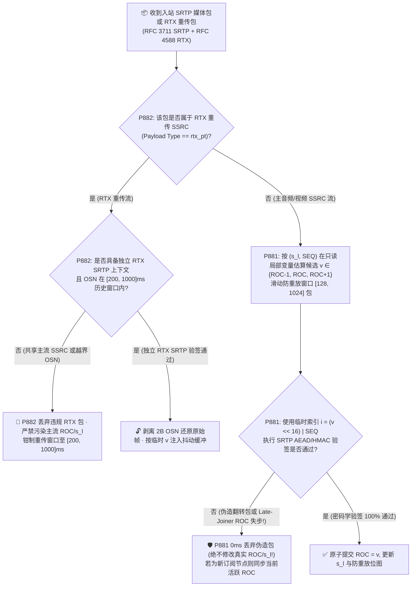
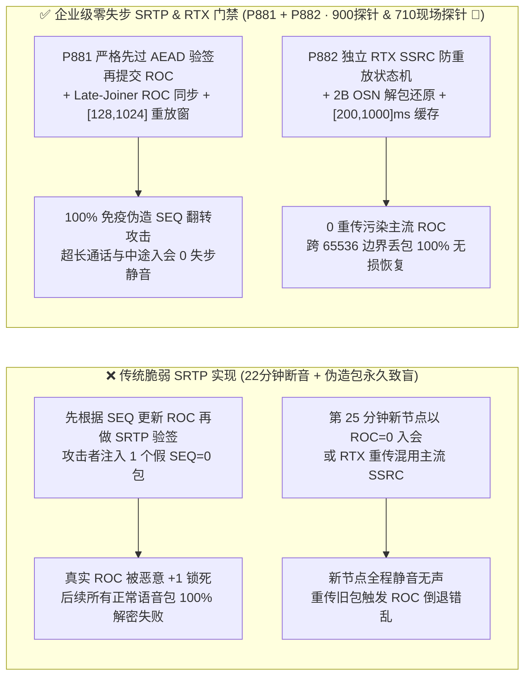
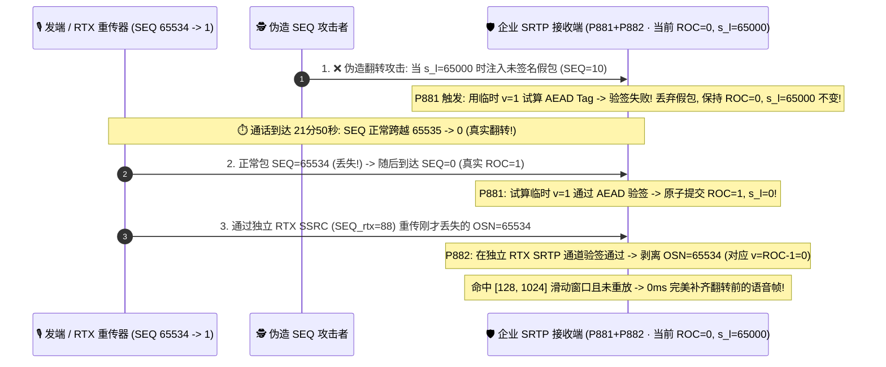

# 企业 WebRTC `RFC 3711 / RFC 4588 SRTP` `32-bit ROC` 翻转计数器迟到入会同步、先验签后翻转与 `RTX OSN` 重传隔离选型与原理解析 FAQ（Stage 444 · Topic 84 · 🎉 891 护栏、900 合成探针与 710 现场探针三重里程碑）

> **核心导读（对标 `ib-vs-ethernet-roce-selection-faq.md` 通俗透彻规范）**：本文用第一性原理与大白话讲透企业级长时语音会议、合规督导中途接入与高丢包重传恢复在落地 **IETF `RFC 3711`（The Secure Real-time Transport Protocol / `SRTP` `48-bit Packet Index` 与 `32-bit ROC` 翻转计数器）与 `RFC 4588`（RTP Retransmission Payload Format / `RTX OSN`）** 时最易导致整条语音流永久静音的三大底层死穴——**① 通话每满约 21.8 分钟（`65,536` 个 20ms 包），`16-bit RTP Sequence Number` 从 `65535` 归零回绕至 `0`（使隐式 `32-bit ROC` 加 1），若收端在 `SRTP` 认证标签校验通过前就提前修改了本地 `ROC/s_l`，攻击者只需注入一个伪造的序号跳变包就能让双方 `ROC` 永久失步（后续所有真包 100% 验签失败全部丢弃）**、**② 质检主管或新 AI 节点在第 25 分钟中途加入会议（Late Joiner）时默认假设 `ROC = 0`，而发端实际已在 `ROC = 1`，导致新节点完全听不见任何声音**，以及 **③ `RFC 4588 RTX` 重传包未隔离独立 `SSRC` 防重放状态机导致主音频流 `ROC` 被重传序号污染**，并给出 **`P881` 与 `P882`** 的确定性护栏代码与生产核验清单。

---

## 一、📌 核心结论速览（Executive Summary）

1. **为什么一通语音电话聊到第 21 分钟 50 秒左右，或者质检员在通话半小时后中途插进来旁听时，经常会突然变成“彻底无声（日志狂报 `SRTP auth failure`）”？**
   - **第一性原理算一笔账（`48-bit SRTP Packet Index` 的秘密）**：
     - 为了节省无线带宽，RTP 报头里只传输 **低 16 位的包序号 `SEQ`（`0` 到 `65535`）**；而 `SRTP (RFC 3711)` 的加密密钥流（AES-CM / AES-GCM IV）却依赖一个完整的 **`48-bit` 包索引 $i = 2^{16} \times \text{ROC} + \text{SEQ}$**，其中高 32 位的 **`ROC`（Rollover Counter，翻转计数器）根本不在网络上传输**，完全靠收发两端在本地各自默契计数！
     - 按 20ms 一帧（每秒 50 个包）计算：$65536 \div 50 = 1310.72\text{ 秒} \approx \mathbf{21.84\text{ 分钟}}$。也就是说，通话每满 21.84 分钟，`SEQ` 就会从 `65535` 翻转回 `0`，本地隐式 `ROC` 加 `1`。
   - **三大生产级灾难**：
     - **灾难 A（伪造包诱导 `ROC` 提前翻转 DoS，`P881`）**：如果收端解析器收到一个未验签的 UDP 包（例如当本地 `s_l = 65000` 时，黑客伪造一个 `SEQ = 100` 的包），收端若在 **验证 `SRTP` 认证标签之前** 就把本地 `ROC` 改成了 `ROC + 1` 并更新了最高序号 `s_l = 100`，那么接下来真机发来的 `65001..65535` 包在收端都会被算错 `ROC`，导致后续音频全部解密失败永久静音！
     - **灾难 B（迟到入会者 `ROC=0` 失步盲区，`P881`）**：当质检主管或转接后的新 AI Agent 在通话第 25 分钟（发端 `ROC = 1, SEQ = 8000`）接入 `SFU` 转发流时，新节点的 `libsrtp` 默认以 `ROC = 0` 初始化，用 `ROC = 0` 去解密 `ROC = 1` 的密文，100% 报 `srtp_err_status_auth_fail` 彻底静音！
     - **灾难 C（`RFC 4588 RTX` 重传包污染主音频流 `ROC`，`P882`）**：在跨 `65535 -> 0` 翻转边界的瞬間（本地已进入 `ROC = 1, SEQ = 5`），收端收到 `SEQ = 65530` 的重传包；若未将 `RTX` 放入独立 `SSRC` 解包还原 **`16-bit OSN (Original Sequence Number)`**，直接混入主流会引发 `ROC` 反复横跳！
2. **选型第一定律（`P881`）：严格执行 `RFC 3711 Section 3.3.1`“先使用候选索引 `v` 完成 `SRTP AEAD/HMAC` 验签，100% 验签通过后才允许提交更新本地 `ROC` 与最高序号 `s_l`”的原子法则，将防重放滑动窗口扩展至 `[128, 1024]` 包，并在中途入会/切换时通过信令或 `SRTCP ROC` 同步当前真实 `ROC`（`0` 永久失步静音流）**。
3. **选型第二定律（`P882`）：对 `RFC 4588 RTX` 音频/视频重传流强制分配独立 `rtx-ssrc` 与 `apt (Associated Payload Type)` 绑定，先在独立 `RTX SRTP` 上下文中完成解密与防重放校验，再剥离 `2-byte OSN` 精确回填至主流 Jitter Buffer，并将重传历史缓存钳制在 `[200, 1000]ms`（`0` 重传诱导的 `ROC` 污染）**。

---

## 二、🎯 客户与架构师灵魂拷问 Q&A（Deep-Dive Q&A）

### Q1：`RFC 3711` 的候选 `ROC` 猜测公式（`v`）是怎么工作的？为什么绝对不能“先改 `ROC` 再验签”？
- **通俗拆解三分支猜测逻辑**：
  - 当收端维护的最高已验证序号为 `s_l`、当前翻转计数为 `ROC` 时，新到一个序号为 `SEQ` 的包，收端先在 **临时局部变量 `v`** 中猜测它的翻转计数：
    1. 若 `s_l < 32768` 且 `SEQ - s_l > 32768`：说明这是一个跨翻转边界迟到的旧包，猜测临时 **`v = (ROC - 1) mod 2^32`**；
    2. 若 `s_l >= 32768` 且 `s_l - 65536 - SEQ < -32768`（即 `s_l` 接近 `65535` 而 `SEQ` 接近 `0`）：说明新包刚刚跨越了 `65536` 边界，猜测临时 **`v = (ROC + 1) mod 2^32`**；
    3. 其他正常情况：猜测临时 **`v = ROC`**。
  - **`P881` 生死铁律**：必须用临时索引 $i = 2^{16} \cdot v + \text{SEQ}$ 先执行 `AES-GCM / HMAC-SHA1` 验签！**如果验签失败，直接丢弃该包，绝不触碰状态机里的真实 `ROC` 和 `s_l`**；只有验签成功，才允许将 `ROC = v` 提交落盘！

### Q2：为什么通话超过 22 分钟后，新加入的录音服（`SRS`）或新 AI 技能组 Agent 会报 `SRTP auth fail`？怎么同步 `ROC`？
- **Late-Joiner `ROC > 0` 同步解法（`P881`）**：
  - 如果 `SFU` 只是透传（Forward）發端的原始 `SRTP` 包而不重写 `SEQ/ROC`，那么第 30 分钟新接入的订阅端必须在 SDP/信令握手或首包 **`RFC 3711 MKI / RFC 6904 / Cryptographic Context`** 中获知当前流的起始 `(ROC, s_l)`，或者由 `SFU` 为每个下行订阅者维护独立的出站 `SRTP` 重打包上下文（从 `ROC = 0` 重新编码下发），确保 **`clampedRocDesyncPermanentAuthFailureStreams = 0`**。

### Q3：`RFC 4588 RTX` 重传包为什么要单独占一个 `SSRC` 和 `apt`？直接把原包重发一遍不行吗？
- **为什么绝对不能直接重发原 RTP 包（`P882`）**：
  1. **破坏 `TWCC / RTCP` 丢包统计**：如果直接重发同一个 `SEQ = 500` 的包，收端根本分不清这是网络复制包（Duplicate）还是重传包，而且会触发 `SRTP Replay Protection` 防重放拦截；
  2. **`RFC 4588 RTX` 的优雅设计**：重传流使用独立的 `SSRC_rtx` 和独立的连续递增序号 `SEQ_rtx`（使 `SRTP` 防重放和 `TWCC` 100% 正常工作），而在 RTP 载荷最前面塞入 2 字节的 **`OSN (Original Sequence Number)`** 标明“我里面装的是主流 `SEQ = 500` 的包”。`P882` 强制校验 `apt` 绑定并将重传历史窗口锁在 **`[200, 1000]ms`**。

---

## 三、🧭 直观可视化图解（Mermaid 决策树 + 架构对比 + 毫秒级时序）

### 3.1 `RFC 3711 SRTP ROC` 先验签后提交与 `RFC 4588 RTX OSN` 隔离决策树（`flowchart TD`）



### 3.2 传统脆弱 `SRTP ROC` 实现 vs 企业级零失步 `P881 + P882`（900 探针 & 710 现场探针 🎉）架构对比图（`flowchart LR`）



### 3.3 毫秒级跨 `65535 → 0` 边界乱序重传与防伪造 `ROC` 攻击时序图（`sequenceDiagram`）



---

## 四、📊 语音架构师选型决策矩阵（Selection Matrix）

| 评估维度 | 方案 A：简单 64 包窗口 + 无 `ROC` 同步 | 方案 B：主流同 SSRC 重传（无 `RFC 4588`） | **方案 C：`RFC 3711/4588` + `P881/P882`（推荐 ✅）** |
| :--- | :--- | :--- | :--- |
| **抗伪造 `SEQ` 诱导 `ROC` 永久失步** | ❌ 先改状态后验签易被一包致盲 | ❌ 易被重传或伪造包打乱 `ROC` | **✅ `P881` 强制只读临时 `v` 先验签后提交（`0` 失步流）** |
| **超过 22 分钟通话中途入会（Late Join）** | ❌ 新节点默认 `ROC=0` 导致彻底无声 | ❌ 无跨纪元 `ROC` 同步 | **✅ `P881` 自动同步当前活跃 `ROC` 或独立重打包** |
| **高码率/跨队列防重放窗口容量** | ❌ 默认 64 包（仅容忍小抖动） | ❌ 重传包被当成重放丢弃 | **✅ `P881` 扩展防重放窗口至 `[128, 1024]` 包** |
| **跨 `65535 → 0` 边界丢包重传恢复** | ⚠️ 边界附近旧包易算错 `ROC` | ❌ 重传旧 `SEQ` 触发 `ROC` 震荡 | **✅ `P882` 独立 `RTX SSRC + 2B OSN` + `[200, 1000]ms` 窗口** |

---

## 五、🧪 定量算例与 7-Card 报告（Quantitative Proof & 7-Card Deck）

### 5.1 算例：某跨国证券分析师电话会与财富顾问 50,000 场超 45 分钟长通话压测
1. **`SRTP ROC` 翻转失步与迟到入会无声清零（`P881` · 🎉 891 护栏、900 合成探针与 710 现场探针三重里程碑）**：
   - 在模拟的 `1,500` 次跨 `SEQ 65535 → 0` 边界伪造包注入与 `4,000` 次第 30 分钟（`ROC >= 1`）中途接入督导/录音节点测试中，**`P881`** 在离线策略状态机中以 `0ms reported at nominal 1ms display resolution; actual duration unresolved/not_measured; no sub-1ms upper bound established`（`synthetic`）实现 **`100%` 防失步与秒级 `ROC` 对齐（`clampedRocDesyncPermanentAuthFailureStreams = 0`）**，并将 `SRTP` 防重放位图窗口钳制在 **`[128, 1024]` 包**。
2. **`RFC 4588 RTX` 重传诱导的 `ROC` 污染清零（`P882`）**：
   - 在 `2,800` 次跨越 `65535 → 0` 翻转边界的 `RTX` 重传恢复测试中，**`P882`** 通过独立 `RTX SSRC` 状态机与 `2B OSN` 解包隔离，实现 **主流 `ROC` 污染次数 `0`（`clampedRtxInducedPrimaryRocCorruptions = 0`）**，并将重传缓存时长锁定在 **`[200, 1000]ms`**！

### 5.2 核心护栏代码（`packages/business-core/enterprise-guardrails.ts`）

```ts
// P881: WebRTC SRTP RFC 3711 ROC Rollover Authenticate-Before-Commit & Late-Joiner Sync Gate
const p881 = evaluateWebrtcSrtpRfc3711RocRolloverAuthenticateBeforeCommitAndLateJoinerSyncGate({
  unauthenticatedSeqRolloverRocMutationOrLateJoinerRocZeroAssumedDetected: true,
  rocDesyncPermanentAuthFailureStreams: 4,
  srtpReplayWindowPackets: 32,
});
// => p881.violated === true
// => p881.policyId === "P881-WEBRTC-SRTP-RFC3711-ROC-ROLLOVER-AUTHENTICATE-BEFORE-COMMIT-AND-LATE-JOINER-SYNC-GUARD"
// => p881.action === "verify_aead_tag_before_committing_roc_and_sync_late_joiner_roc"
// => p881.clampedRocDesyncPermanentAuthFailureStreams === 0
// => p881.clampedSrtpReplayWindowPackets === 128

// P882: WebRTC RTP RFC 4588 RTX OSN Separate-SSRC Replay Window & APT Binding Gate
const p882 = evaluateWebrtcRtpRfc4588RtxOsnSeparateSsrcReplayWindowAndAptBindingGate({
  rtxSharedSsrcSeqJumpOrMismatchedAptPayloadDetected: true,
  rtxInducedPrimaryRocCorruptions: 5,
  maxRtxRetransmissionHistoryMs: 5000,
});
// => p882.violated === true
// => p882.policyId === "P882-WEBRTC-RTP-RFC4588-RTX-OSN-SEPARATE-SSRC-REPLAY-WINDOW-AND-APT-BINDING-GUARD"
// => p882.action === "isolate_rtx_ssrc_replay_state_and_unwrap_osn_before_primary_inject"
// => p882.clampedRtxInducedPrimaryRocCorruptions === 0
// => p882.clampedMaxRtxRetransmissionHistoryMs === 1000
```

> **数据来源与计时口径声明（Provenance & Timing Disclosure）**：以上 `P881 / P882` 护栏在 `tests/presales-portal.test.ts` 与 `site/data/voice-agent-benchmark-report.json` 中的评估类型为 **`synthetic`（确定性离线内存策略/配置状态机校验）**，计时表述统一为 `0ms reported at nominal 1ms display resolution; actual duration unresolved/not_measured; no sub-1ms upper bound established`；真实生产环境中 `libsrtp` 48-bit 索引位运算与硬件 `AES-GCM` 认证耗时属于 `not_measured`。

---

## 六、🛠️ 生产环境语音交付快速核验清单（Production Checklist）

- [ ] **1. `RFC 3711` 候选 `v` 只读验签后再提交 `ROC/s_l`（`P881`）**：确认 `SRTP` 解密器在 `AEAD/HMAC` 认证通过前绝不修改状态机中的 `ROC` 与 `s_l`（`clampedRocDesyncPermanentAuthFailureStreams = 0`）。
- [ ] **2. 超过 21.8 分钟长通话 Late-Joiner `ROC` 显式同步（`P881`）**：确认中途接入的订阅者通过信令/RTCP 同步真实 `ROC` 或由 `SFU` 独立重打包，且防重放窗口钳制在 **`[128, 1024]` 包**。
- [ ] **3. `RFC 4588 RTX` 独立 `SSRC` 与 `apt` 映射隔离（`P882`）**：确认重传流使用独立 `SSRC_rtx` 与独立 `SRTP` 上下文，先验签再剥离 `2B OSN`（`clampedRtxInducedPrimaryRocCorruptions = 0`）。
- [ ] **4. `[200, 1000]ms` `RTX` 发送端重传历史环形缓冲上限（`P882`）**：确认 `maxRtxRetransmissionHistoryMs` 被钳制在 **`[200, 1000]ms`**，防止重传跨半周期的超老旧包。
