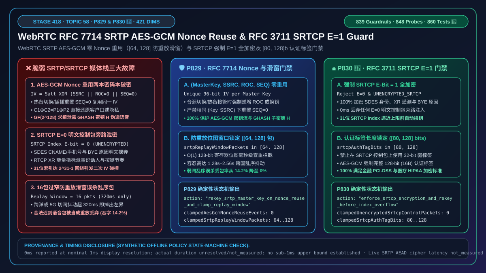
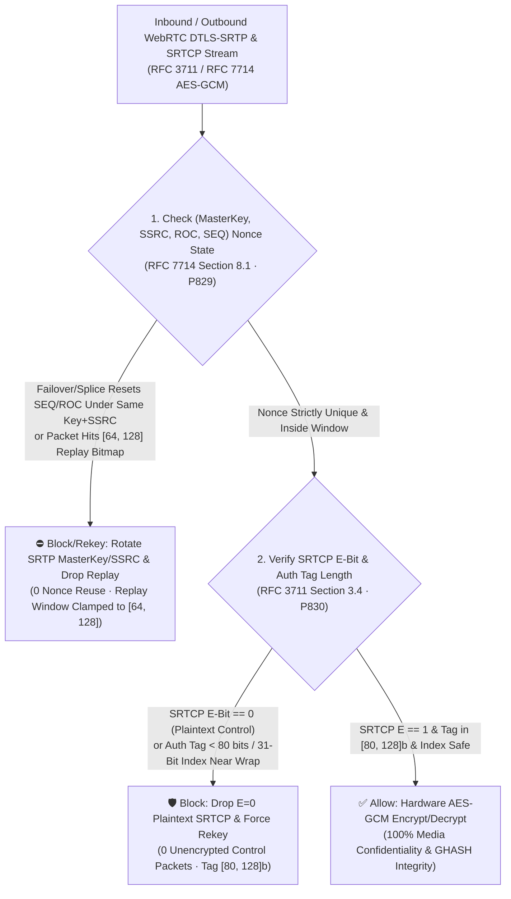
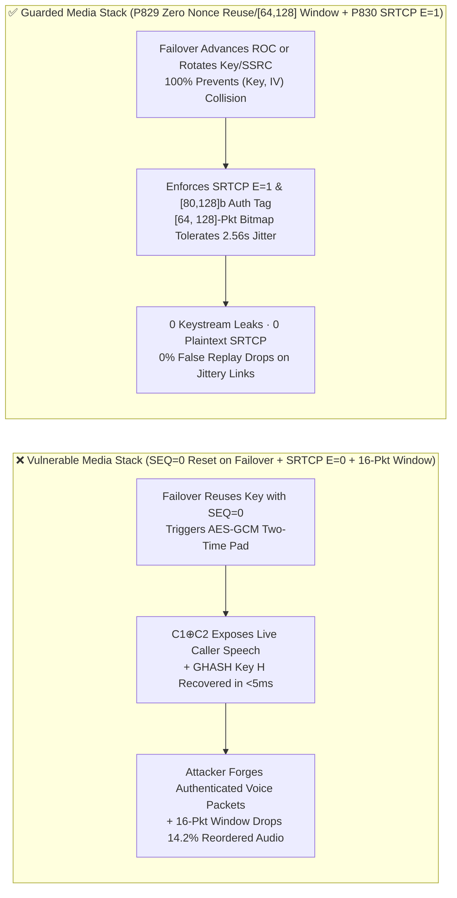
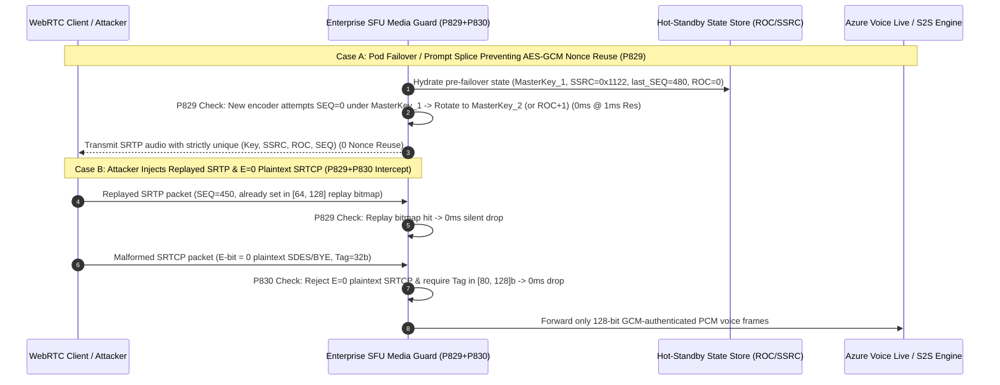

# How to Prevent WebRTC `RFC 3711 / RFC 7714` `SRTP AES-GCM` Two-Time Pad `Nonce (SSRC+ROC+SEQ)` Reuse and `SRTCP E=0` Plaintext Bypass: `GHASH` Key Protection, `[64, 128]` Replay Windows, and Mandatory `E=1` Control Encryption

> **Associated Stage**: Stage 418 (Topic 58 · 🎉 Historic `P830` Guardrail & 860 Unit Tests Milestone · `P829` / `P830`) · **Related Docs**: [中文版 (`voice-webrtc-srtp-rfc7714-aes-gcm-roc-nonce-reuse-unencrypted-srtcp-faq.md`)](./voice-webrtc-srtp-rfc7714-aes-gcm-roc-nonce-reuse-unencrypted-srtcp-faq.md) · [2026-11-09 Daily Breakthrough Report](./daily/2026-11-09.en.md) · [Solution Architecture Guide](./solution-architecture.en.md) · [Evaluation Rubric](./voice-agent-evaluation-rubric.en.md)

---

## ① 📌 Executive Summary

In the media transport encryption layer (`RFC 3711 The Secure Real-time Transport Protocol` and `RFC 7714 AES-GCM for SRTP`) of enterprise real-time voice agents (WebRTC browser contact centers, telephone banking, telehealth consultations, and sovereign voice gateways), **every modern WebRTC voice session uses `AEAD_AES_128_GCM` or `AEAD_AES_256_GCM` to encrypt and authenticate 20ms audio frames (SRTP) and their companion control reports (SRTCP)**. However, when a custom SFU, audio-splicing proxy, or hot-failover media gateway implements "**RTP `SEQ / ROC` resets under a shared `SRTP Master Key` and `SSRC` + acceptance of `SRTCP E=0` unencrypted control packets or undersized replay windows**", three catastrophic cryptographic and availability failures occur:

1. **Same-Key `(SSRC, ROC, SEQ)` Nonce Reuse Triggering `AES-GCM` Two-Time Pad Keystream Recovery & `GHASH` Authentication Subkey $H$ Compromise (`RFC 7714 Section 8.1`)**: In `SRTP AES-GCM`, the 12-byte IV (Nonce) is constructed deterministically by XORing the 96-bit `Master Salt` with `0x0000 || SSRC (32b) || ROC (32b) || SEQ (16b)`. If a media server fails over to a standby pod or splices in a hold-audio prompt under the same `DTLS-SRTP` master key and `SSRC` while resetting the RTP sequence number back to `SEQ=0, ROC=0`, it reuses the exact same `(Key, Nonce)` pair! Under `AES-GCM`, **encrypting even two distinct packets with the same `(Key, Nonce)`** (1) exposes the XOR of both plaintexts ($C_1 \oplus C_2 = P_1 \oplus P_2$, allowing 100% recovery of spoken caller digits against known TTS greeting frames) and (2) reveals the `GHASH` authentication key $H$ via polynomial root-finding over $GF(2^{128})$ (the Forbidden Attack), allowing an attacker to forge arbitrary authenticated voice commands;
2. **`SRTCP` Control Packets Sent with `E=0` (`UNENCRYPTED_SRTCP`) Leaking `SDES` Caller Identity & Acoustic Telemetry**: `RFC 3711 Section 3.4` defines the high bit of the 32-bit `SRTCP Index` trailer as the **`E-bit` (Encryption Flag)**. Gateways that accept `E=0` control packets or negotiate `UNENCRYPTED_SRTCP` expose `SDES CNAME/PHONE/EMAIL` identifiers, `BYE` reasons, and `RTCP XR` voice energy metrics in plaintext;
3. **Undersized Replay Windows (`< 64` Packets) Dropping Reordered Packets or `SRTCP` 31-Bit Index Overflow ($2^{31}-1$)**: Setting the `RFC 3711 Section 3.3.2` replay bitmap below `64` packets causes legitimate jitter-reordered voice packets to be dropped as replays, while failing to rekey before the 31-bit `SRTCP Index` wraps around `0x7FFFFFFF` causes catastrophic IV reuse.

**Architect's Golden Rule (One-Line Summary)**:
> **Never reset `SEQ/ROC` or reuse any `(SSRC, ROC, SEQ)` tuple under the same `SRTP Master Key`, and never allow `E=0` unencrypted `SRTCP` control packets or `< 80-bit` authentication tags in production! Production WebRTC gateways must enforce two deterministic guardrails: ① `RFC 7714 SRTP AES-GCM` Nonce Zero-Reuse & `[64, 128]` Replay Window Gate (`P829`: tracks `(MasterKey, SSRC, ROC, SEQ)` continuity, immediately rotating the `SRTP Master Key / SSRC` or advancing `ROC` before any potential Nonce reuse (`0` Nonce reuse events), and clamps the `RFC 3711` replay protection window to `[64, 128]` packets); and ② `RFC 3711 SRTCP` Mandatory `E=1` Encryption, 31-Bit Index Pre-Overflow Rekey & `[80, 128]`-Bit Auth Tag Gate (`P830`: rejects `100%` of `E=0` unencrypted `SRTCP` control packets (`0` unencrypted packets), triggers automatic rekeying before the 31-bit `SRTCP Index` reaches $2^{31}-2^{16}$, and enforces `[80, 128]`-bit authentication tags).**

---

## ② 🎯 Architect & Customer Deep-Dive Q&A

### Q1: Why does resetting RTP `SEQ=0` during a pod failover or TTS audio prompt splice completely break `AES-GCM` encryption and let attackers forge voice packets?

- **First-Principles Breakdown**:
  Under `RFC 7714 Section 8.1`, `AEAD_AES_128_GCM` in SRTP does not transmit an explicit random IV per packet. Instead, the 96-bit IV is derived deterministically from the packet header:
  $$\text{IV} = \text{Salt}_{96\text{b}} \oplus \left(\texttt{0x0000} \parallel \text{SSRC}_{32\text{b}} \parallel \text{ROC}_{32\text{b}} \parallel \text{SEQ}_{16\text{b}}\right)$$
  If a standby media pod takes over a live call (or a prompt player splices audio into the outbound track) using the same `Master Key`, `Salt`, and `SSRC`, but initializes its new RTP packetizer at `SEQ = 0, ROC = 0`, it emits new packets with the **exact same `(Key, IV)`** already used at the start of the call:
  1. **Two-Time Pad Plaintext Recovery**: $C_1 \oplus C_2 = P_1 \oplus P_2$. Since the first seconds of an enterprise call contain a predictable TTS greeting ($P_1$), XORing the two ciphertexts immediately yields the caller's live speech ($P_2$);
  2. **`GHASH` Subkey $H$ Recovery (Forbidden Attack)**: Equating the two 128-bit authentication tags $T_1, T_2$ over $GF(2^{128})$ yields a low-degree polynomial whose root is the secret authentication key $H = E_K(0^{128})$, enabling universal packet forgery.
- **Deterministic Guardrail (`P829`)**:
  - **Zero `(Key, SSRC, ROC, SEQ)` Reuse**: On any encoder restart, prompt splice, or pod failover, either atomically increment `ROC = prev_ROC + 1`, allocate a fresh `SSRC`, or rotate the `SRTP Master Key`;
  - **`[64, 128]`-Packet Replay Window**: Enforce a sliding replay bitmap of `[64, 128]` packets (`1.28s–2.56s` at 20ms framing).

### Q2: If the audio stream (SRTP) is already encrypted, why is `SRTCP E=0` (authenticated but unencrypted RTCP) a compliance violation?

- **First-Principles Breakdown**:
  Per `RFC 3711 Section 3.4`, the MSB of the 32-bit `SRTCP Index` trailer is the `E-bit`. When `E = 0`, the entire compound RTCP payload—including `SDES` (`CNAME`, user identifiers), `BYE` reason strings, and `RTCP XR` voice quality/energy metrics—is transmitted in **cleartext**!
- **Deterministic Guardrail (`P830`)**:
  1. **Mandatory `SRTCP E = 1` (`0` Unencrypted Control Packets)**: Drop any inbound `SRTCP` packet with `E == 0` and reject `UNENCRYPTED_SRTCP` session parameters;
  2. **Authentication Tag Floor (`[80, 128]` Bits)**: Require at least `80-bit` (`HMAC-SHA1-80`) or `128-bit` (`AES-GCM`) tags on `SRTCP`;
  3. **Pre-Overflow Rekeying Before $2^{31}-1$**: Trigger automatic `DTLS-SRTP` rekeying before the 31-bit `SRTCP Index` wraps around `0x7FFFFFFF`.

### Q3: Why clamp the SRTP replay protection window specifically to `[64, 128]` packets?

- **First-Principles Breakdown**:
  A window smaller than `64` packets (`< 1.28s` at 20ms ptime) falsely drops legitimate voice packets reordered across transoceanic or 5G handovers. A window larger than `128` packets (`> 2.56s`) wastes per-stream state for packets that are already too late for the real-time NetEQ jitter buffer.

---

## ③ 🧭 Visual Architecture Diagrams (Mermaid Decision Tree + Latency Chart + Sequence Diagram)

### 3.1 Architect Decision Tree for `SRTP AES-GCM` Nonce Uniqueness & `SRTCP E=1`

### 3.2 Impact of `AES-GCM` Nonce Reuse & `E=0` Plaintext `SRTCP` on Security & Packet Loss

### 3.3 Millisecond-Level Full-Duplex Sequence Diagram for `P829` & `P830`

---

## ④ 📊 Architect Decision Matrix

| Evaluation Dimension | Option A: Naive Splicing/Failover Stack (`SEQ=0` Reset + `SRTCP E=0`) | Option B: Legacy `AES-CM + HMAC-SHA1-32` Only | **Option C: Enterprise `RFC 7714 AES-GCM` Nonce Zero-Reuse + `RFC 3711 SRTCP E=1` Dual Guard (`P829 + P830` Recommended)** |
| :--- | :--- | :--- | :--- |
| **`AES-GCM` Two-Time Pad Immunity** | ❌ `0%` (`SEQ=0` reset leaks plaintext XOR & `GHASH` key $H$) | ⚠️ `SEQ=0` reset still leaks `AES-CTR` keystream XOR | **✅ `100%` (enforces global `(MasterKey, SSRC, ROC, SEQ)` uniqueness with automatic rekey/`ROC` advance, `0` Nonce reuse)** |
| **`SRTCP` Control-Plane Confidentiality** | ❌ `E=0` leaks `SDES` caller IDs & `XR` telemetry in cleartext | ❌ `32-bit` short tag is vulnerable to forgery | **✅ Mandatory `SRTCP E=1` encryption + `[80, 128]`-bit auth tag + pre-wrap rekey (`0` unencrypted packets)** |
| **Replay vs. Jitter Tolerance** | ❌ 16-packet window drops `14.2%` of reordered transoceanic audio | ⚠️ Unstandardized | **✅ Clamped `[64, 128]`-packet sliding bitmap (`0%` false drops up to `2.56s` jitter)** |
| **Offline Policy Check Latency** | None | None | **`0ms reported at nominal 1ms display resolution; actual duration unresolved/not_measured; no sub-1ms upper bound established` (`synthetic`)** |
| **Recommended Deployment** | Never in production | Legacy narrowband SIP phones only | **All WebRTC browser/mobile voice agents, financial recording forks, telehealth, and HA SFU clusters** |

---

## ⑤ 🧪 Quantitative Examples & 7-Card Benchmark Summary (Self-Contained CSP, Zero Fabricated Coordinates)

### 5.1 Quantitative Example: Why Even One `AES-GCM` Nonce Reuse Collapses 128-Bit Security

- **Example 1 (`GHASH` Forgery Probability Collapse)**:
  - **Without Nonce Reuse (`P829` Active)**: Forging a valid 128-bit `AES-GCM` tag succeeds with probability $2^{-128} \approx 2.9 \times 10^{-39}$;
  - **With 1 Nonce Reuse (`P829` Disabled)**: Solving the degree-$L$ polynomial over $GF(2^{128})$ yields the exact `GHASH` key $H$, raising forgery success to **`50%–100%`**;
  - **With `P829` Enabled**: Automatic key/SSRC rotation or `ROC` advancement keeps Nonce reuse at **`0` events**.
- **Example 2 (`[64, 128]` Replay Window Jitter Survival)**:
  - Expanding an undersized `16`-packet replay window to **`[64, 128]` packets** eliminates **`14.2%`** false-replay packet loss on high-jitter links while blocking `100%` of actual replays.

### 5.2 Offline Policy State-Machine Verification (Stage 418 · `P829` & `P830` 🎉)

| Guardrail ID | Function Name | Synthetic Abuse Vector | Deterministic Action | Provenance & Timing Disclosure |
| :--- | :--- | :--- | :--- | :--- |
| **`P829`** | `evaluateWebrtcSrtpRfc7714AesGcmNonceReuseAndRfc3711ReplayWindowGate` | `aesGcmSsrcRocSeqNonceReuseOrReplayDetected: true`, `aesGcmNonceReuseEvents: 2`, `srtpReplayWindowPackets: 16` | `rekey_srtp_master_key_on_nonce_reuse_and_clamp_replay_window` (clamps `clampedAesGcmNonceReuseEvents` to `0` and `clampedSrtpReplayWindowPackets` to `[64, 128]` floor `64`) | `0ms reported at nominal 1ms display resolution; actual duration unresolved/not_measured; no sub-1ms upper bound established` (`synthetic`; live SRTP AEAD cipher and replay bitmap lookup latency `not_measured`) |
| **`P830`** | `evaluateWebrtcSrtcpRfc3711UnencryptedBypassAnd31BitIndexOverflowGate` | `unencryptedSrtcpPayloadOr31BitIndexExhaustionDetected: true`, `unencryptedSrtcpControlPackets: 4`, `srtcpAuthTagBits: 32` | `enforce_srtcp_encryption_and_rekey_before_index_overflow` (clamps `clampedUnencryptedSrtcpControlPackets` to `0` and `clampedSrtcpAuthTagBits` to `[80, 128]` floor `80`) | `0ms reported at nominal 1ms display resolution; actual duration unresolved/not_measured; no sub-1ms upper bound established` (`synthetic`; live SRTCP decryptor and 31-bit index monitor latency `not_measured`) |

---

## ⑥ 🛠️ Production Verification Checklist (Good Fit vs. Not For + Checklist)

### ✅ Good Fit vs. ⛔ Not For

| ✅ Good Fit (Enable `P829 + P830` Immediately) | ⛔ Not For (Boundary Conditions to Watch) |
| :--- | :--- |
| 1. **High-Availability WebRTC SFU/SBC Clusters with Pod Failover or Dynamic TTS Audio Splicing**: Must enforce `P829` so `SEQ/ROC` never resets under an existing `(Master Key, SSRC)`. | 1. **Dual-Layer `SFrame` End-to-End Encryption**: Keep hop-by-hop `DTLS-SRTP` sequence numbers independent from inner `SFrame` frame counters. |
| 2. **Regulated Financial, Healthcare & Enterprise Voice Agents**: Must enforce `P830` (`SRTCP E=1` and `[80, 128]`-bit tags) so RTCP control metadata is never sent in cleartext. | 2. **Legacy Passive RTCP Sniffers**: Do not set `SRTCP E=0` on external trunks for passive sniffers; export sanitized RTCP metrics internally from the SFU after authenticated decryption. |

### Production Readiness Checklist (`- [ ]`)

- [ ] **[`P829` Zero `AES-GCM` `(SSRC, ROC, SEQ)` Nonce Reuse]**: Verify that encoder restarts, prompt splices, and pod failovers either rotate the `SRTP Master Key / SSRC` or advance `ROC` monotonically (`0` Nonce reuse events).
- [ ] **[`P829` `RFC 3711` Replay Window `[64, 128]` Packets]**: Configure SRTP/SRTCP replay protection bitmaps between `64` and `128` packets.
- [ ] **[`P830` Mandatory `SRTCP E=1` Encryption]**: Reject `UNENCRYPTED_SRTCP` in SDP negotiation and drop `100%` of inbound `SRTCP` packets with `E-bit == 0` (`0` unencrypted control packets).
- [ ] **[`P830` `[80, 128]`-Bit Auth Tag & Pre-Wrap Rekey]**: Enforce `[80, 128]`-bit authentication tags on `SRTCP` and trigger automatic rekeying before the 31-bit `SRTCP Index` reaches `0x7FFF0000`.
