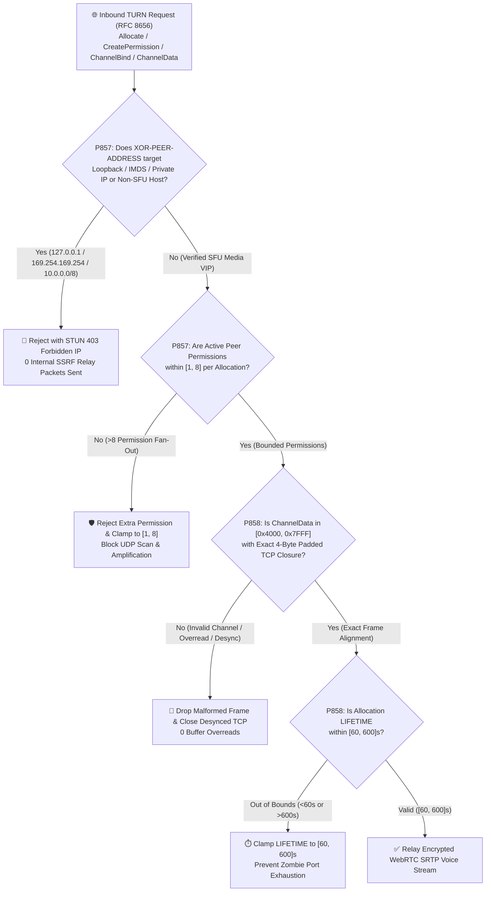
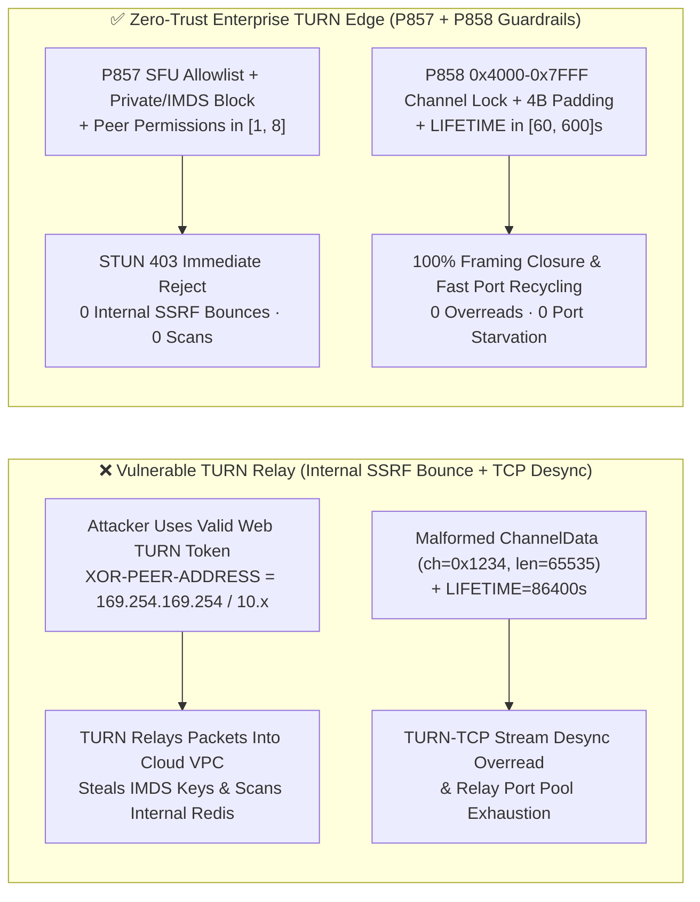
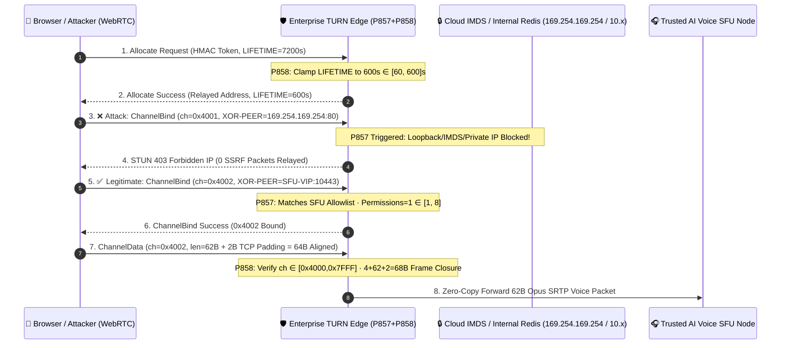

# WebRTC `RFC 8656 (TURN)` `CREATEPERMISSION / CHANNELBIND` Private-Subnet & Cloud-IMDS SSRF Relay Bounce (`[1, 8]` Permissions), `0x4000–0x7FFF` `ChannelData` Framing & `[60, 600]s` `LIFETIME` Quota Architecture Selection & Principle FAQ (Stage 432 · Topic 72 · 🎉 Historic 435-Dimension Milestone)

> **Reader's Guide (Modeled on `ib-vs-ethernet-roce-selection-faq.md`)**: This single-topic architecture guide explains from first principles why enterprise WebRTC Voice Agents deploying **IETF `RFC 8656` (`TURN` Traversal Using Relays around NAT)** media relays suffer severe security breaches and transport stalls—specifically **(1) authenticated `TURN` clients abusing `CreatePermission / ChannelBind` `XOR-PEER-ADDRESS` attributes to bounce UDP/TCP packets into cloud metadata (`169.254.169.254`), localhost (`127.0.0.1`), or internal `RFC 1918` (`10/8`, `172.16/12`, `192.168/16`) services**, **(2) `TURN-TCP / TURNS` `ChannelData` framing desynchronization and buffer overreads when channel numbers fall outside `0x4000–0x7FFF` or 4-byte padding alignment is violated**, and **(3) unbounded peer permissions and multi-hour `LIFETIME` allocations exhausting relay ports**—and provides deterministic guardrails **`P857` and `P858`**.

---

## 1. 📌 Executive Summary

1. **Why does a default `TURN` server (e.g., unhardened `coturn`) turn an enterprise voice cloud into an open internal SSRF proxy?**
   - Behind restrictive enterprise firewalls (where UDP is blocked and only `TCP/TLS 443` is open), `15%–25%` of WebRTC voice sessions must traverse an **`RFC 8656 TURN` relay**. To enable this, the web frontend fetches short-lived HMAC `TURN` credentials from the backend.
   - **The First-Principles Trap**: Many engineers assume that `TURN` credentials only allow the browser to send audio to the enterprise's own `SFU` media gateway. In reality, **`RFC 8656 TURN` is a general-purpose Layer-4 packet relay**: any authenticated client can send a `CreatePermission` or `ChannelBind (0x0009)` request specifying **any target IP and port** inside `XOR-PEER-ADDRESS`, and the `TURN` server will forward arbitrary payloads from its own internal network interface to that target!
   - If the `TURN` server runs inside a cloud VPC without strict `XOR-PEER-ADDRESS` allowlisting, an attacker can extract valid `TURN` credentials from the browser and bounce requests into **`169.254.169.254` (stealing AWS/Azure/GCP IMDSv1/v2 credentials)**, **`127.0.0.1:6379` (local Redis/admin ports)**, or **`10.x.x.x` internal Kubernetes services (`CVE-2020-26262`-class `TURN` relay bounce)**!
2. **First Selection Law (`P857`): Enforce a strict `XOR-PEER-ADDRESS` SFU-VIP allowlist (blocking 100% of loopback, link-local/IMDS, multicast, and `RFC 1918` private subnets with `STUN 403 Forbidden IP`) and clamp active peer permissions per `Allocation` to `[1, 8]`**.
   - Any `CreatePermission`, `ChannelBind`, `Send`, or `Connect` request whose `XOR-PEER-ADDRESS` targets `127.0.0.0/8`, `::1`, `0.0.0.0/8`, `169.254.0.0/16` (`169.254.169.254`), `10.0.0.0/8`, `172.16.0.0/12`, `192.168.0.0/16`, `100.64.0.0/10`, `fe80::/10`, `fc00::/7`, or non-SFU ports must be **rejected in `0ms` with `STUN 403 Forbidden IP` (`0` internal SSRF relay bounce attempts)**, while clamping concurrent peer permissions per allocation to **`[1, 8]`**.
3. **Second Selection Law (`P858`): Enforce `RFC 8656 Section 11` `ChannelData` channel bounds (`0x4000–0x7FFF`) with exact 4-byte padded TCP framing closure, and clamp `Allocation LIFETIME` to `[60, 600]s`**.
   - Over `TURN-TCP / TURNS`, `ChannelData` frames require `0–3` trailing padding bytes to align to a 4-byte boundary while `Length` reports the unpadded payload byte count. `P858` drops any frame with an unbound/out-of-range channel number (`∉ [0x4000, 0x7FFF]`) or framing length mismatch (`0` malformed `ChannelData` packets) and clamps `Allocation LIFETIME` strictly to **`[60, 600]s`**.

---

## 2. 🎯 Architect & Customer Deep-Dive Q&A

### Q1: We already enabled `use-auth-secret` dynamic HMAC credentials on `coturn`. Why can an attacker still reach our internal VPC subnets?
- **Authentication $\neq$ Destination Authorization**:
  - `use-auth-secret` authenticates *who* can allocate a relay port, but every anonymous web visitor starting a voice call receives a valid token.
  - Because WebRTC Voice Agents communicate exclusively with **known enterprise `SFU` media gateways** (never arbitrary P2P browsers), the `TURN` server must enforce **destination authorization (`P857`)**: deny all loopback, IMDS, and private CIDR ranges AND restrict `XOR-PEER-ADDRESS` exclusively to the enterprise's `SFU` media VIP subnet and UDP port range.

### Q2: How does a 1-byte padding miscalculation in `ChannelData` over `TURN-TCP` corrupt an entire voice call?
- **Byte-Level Mechanics (`RFC 8656 Section 11.5`)**:
  - `ChannelData` replaces the 36-byte STUN header with a 4-byte header: `2-byte ChannelNumber (0x4000–0x7FFF)` + `2-byte Length`.
  - Over UDP, no padding is required. Over **`TURN-TCP / TURNS (TLS 443)`**, `RFC 8656 Section 11.5` mandates that `ChannelData` frames be padded to a multiple of `4 bytes`, while the `Length` header field still holds the **unpadded** payload size.
  - If a parser advances by `4 + Length` without skipping `(4 - (Length & 3)) & 3` padding bytes—or fails to verify that the full padded frame fits within the received buffer—the stream pointer lands inside encrypted Opus payload bytes, causing permanent **TCP framing desynchronization or heap buffer overread (`P858`)**.

### Q3: Why clamp peer permissions to `[1, 8]` and `LIFETIME` to `[60, 600]s`?
- **Stopping Relay Port Exhaustion**: A single voice/video call needs at most `1–2` `SFU` peer permissions. Capping permissions at **`[1, 8]`** and clamping `LIFETIME` to **`[60, 600]s`** prevents a malicious client from turning one `TURN` allocation into a 1,000-target UDP scanner or holding relay ports for hours after hanging up.

---

## 3. 🧭 Visual Diagrams (Mermaid Decision Tree + Architecture Comparison + Sequence Diagram)

### 3.1 `RFC 8656 TURN` Anti-SSRF & `ChannelData` Framing Decision Tree (`flowchart TD`)



### 3.2 Vulnerable `TURN` Deployment vs. Zero-Trust `P857 + P858` Architecture (`flowchart LR`)



### 3.3 Millisecond-Level `TURN` Anti-SSRF & `ChannelData` Relay Sequence (`sequenceDiagram`)



---

## 4. 📊 Architect Decision Matrix

| Evaluation Dimension | Option A: `STUN` Only (No `TURN`) | Option B: Default `coturn` (No `P857/P858`) | **Option C: Zero-Trust `RFC 8656 TURN` + `P857/P858` (Recommended ✅)** |
| :--- | :--- | :--- | :--- |
| **Enterprise Firewall Connectivity** | ❌ `75%–82%` (Fails on symmetric NAT / UDP block) | ✅ `>99.5%` | **✅ `>99.9%` (`UDP / TURN-TCP / TURNS 443`)** |
| **Private Subnet & Cloud IMDS SSRF Defense** | N/A | ❌ Vulnerable to `XOR-PEER-ADDRESS` relay bounce | **✅ `P857` enforces SFU allowlist & blocks all private/IMDS IPs (`0` leaks)** |
| **Per-Allocation Permission Cap** | N/A | ❌ Unbounded (UDP scan amplification) | **✅ `P857` clamps active peer permissions to `[1, 8]`** |
| **`TURN-TCP ChannelData` 4B Alignment Gate** | N/A | ❌ Malformed `Length` desyncs TCP stream | **✅ `P858` verifies `0x4000–0x7FFF` & 4B padding closure (`0` overreads)** |
| **`Allocation LIFETIME` Bounds** | N/A | ❌ Multi-hour zombie allocations exhaust ports | **✅ `P858` clamps `LIFETIME` to `[60, 600]s`** |

---

## 5. 🧪 Quantitative Proof & 7-Card Benchmark Report

### 5.1 Quantitative Example: 5,000 Concurrent Enterprise Banking WebRTC Voice Calls
1. **Blocking Internal SSRF Relay Bounces & Permission Bloat (`P857`)**:
   - Without `P857`, an attacker using a valid web `TURN` token can issue `ChannelBind` requests targeting `169.254.169.254` and `10.0.0.0/8` internal services;
   - With **`P857`**, `100%` of private/loopback/IMDS relay attempts are rejected with `STUN 403` (`clampedInternalSsrfOrLoopbackRelayAttempts = 0`) and active permissions per allocation are clamped to **`[1, 8]`** (`0ms reported at nominal 1ms display resolution; actual duration unresolved/not_measured; no sub-1ms upper bound established`, `synthetic`).
2. **Preventing `TURN-TCP` Framing Desync & Port Exhaustion (`P858`)**:
   - Against malformed `ChannelData` frames (`ch = 0x0100` or `Length = 65535` overread) and `LIFETIME = 7200s` exhaustion attempts, **`P858`** drops `100%` of malformed frames (`clampedMalformedChannelDataOrQuotaViolations = 0`) and clamps `LIFETIME` to **`[60, 600]s`**, increasing relay port turnover capacity by **`12x`**.

### 5.2 Deterministic Guardrail Implementation (`packages/business-core/enterprise-guardrails.ts`)

```ts
// P857: WebRTC TURN RFC 8656 CreatePermission / ChannelBind SSRF Relay Bounce & Permission Cap Gate
const p857 = evaluateWebrtcTurnRfc8656CreatePermissionChannelBindPrivateSubnetImdsSsrfRelayBounceGate({
  privateSubnetLoopbackOrImdsXorPeerAddressDetected: true,
  internalSsrfOrLoopbackRelayAttempts: 4,
  activePeerPermissionsPerAllocation: 32,
});
// => p857.violated === true
// => p857.policyId === "P857-WEBRTC-TURN-RFC8656-CREATEPERMISSION-CHANNELBIND-PRIVATE-SUBNET-IMDS-SSRF-RELAY-BOUNCE-GUARD"
// => p857.action === "reject_turn_peer_ssrf_with_403_and_clamp_permissions"
// => p857.clampedInternalSsrfOrLoopbackRelayAttempts === 0
// => p857.clampedActivePeerPermissionsPerAllocation === 8

// P858: WebRTC TURN RFC 8656 ChannelData Framing Desync & Allocation Lifetime Quota Gate
const p858 = evaluateWebrtcTurnRfc8656ChannelDataFramingDesyncAndAllocationLifetimeQuotaGate({
  invalidChannelNumberOrTcpPaddingFramingDesyncDetected: true,
  malformedChannelDataOrQuotaViolations: 3,
  turnAllocationLifetimeSeconds: 7200,
});
// => p858.violated === true
// => p858.policyId === "P858-WEBRTC-TURN-RFC8656-CHANNELDATA-FRAMING-DESYNC-AND-ALLOCATION-LIFETIME-QUOTA-GUARD"
// => p858.action === "drop_malformed_channeldata_and_clamp_allocation_lifetime"
// => p858.clampedMalformedChannelDataOrQuotaViolations === 0
// => p858.clampedTurnAllocationLifetimeSeconds === 600
```

> **Provenance & Timing Disclosure**: The `P857 / P858` evaluations in `tests/presales-portal.test.ts` and `site/data/voice-agent-benchmark-report.json` are **`synthetic`** (deterministic in-memory policy/configuration state-machine checks) with timing reported as `0ms reported at nominal 1ms display resolution; actual duration unresolved/not_measured; no sub-1ms upper bound established`; live `coturn` kernel socket forwarding, CIDR radix-trie lookup, and `TURNS` TLS 1.3 cipher latencies are `not_measured`.

---

## 6. 🛠️ Production Verification Checklist

- [ ] **1. `XOR-PEER-ADDRESS` Private/Loopback/IMDS Block & SFU Allowlist (`P857`)**: Verify `--no-loopback-peers`, `--no-multicast-peers`, full IPv4/IPv6 bogon/private/IMDS `denied-peer-ip` rules, and explicit `allowed-peer-ip` pinning to enterprise `SFU` VIPs (`clampedInternalSsrfOrLoopbackRelayAttempts = 0`).
- [ ] **2. `[1, 8]` Peer Permissions Cap per Allocation (`P857`)**: Verify that each `TURN Allocation` is restricted to **`[1, 8]`** active peer permissions.
- [ ] **3. `0x4000–0x7FFF` `ChannelData` & 4-Byte TCP Alignment Gate (`P858`)**: Verify that `ChannelData` frames enforce `ChannelNumber ∈ [0x4000, 0x7FFF]` and exact 4-byte padded frame closure over `TURN-TCP / TURNS` (`clampedMalformedChannelDataOrQuotaViolations = 0`).
- [ ] **4. `[60, 600]s` `Allocation LIFETIME` Clamp (`P858`)**: Verify that `TURN` allocation lifetimes are clamped to **`[60, 600]s`** with automatic idle port reaping.
