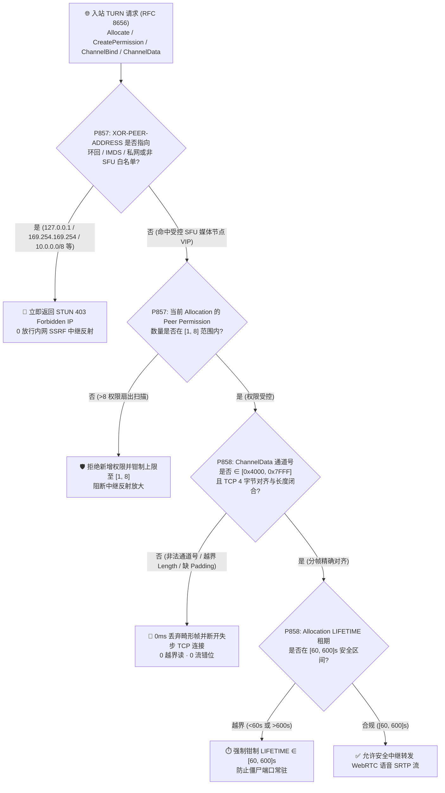
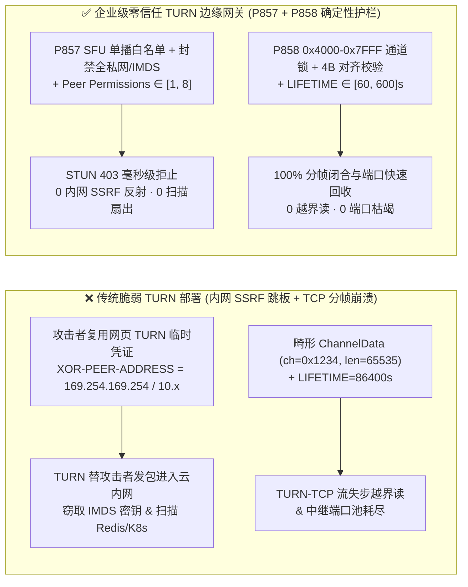
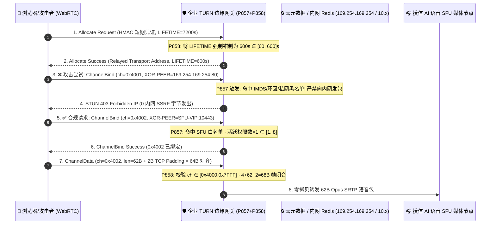

# WebRTC `RFC 8656 (TURN)` `CREATEPERMISSION / CHANNELBIND` 内网/云元数据（`IMDS`）SSRF 中继反射（`[1, 8]` 权限）、`0x4000–0x7FFF` `ChannelData` 分帧失步与 `[60, 600]s` 租期配额选型与原理解析 FAQ（Stage 432 · Topic 72 · 🎉 435 大评测维度历史性里程碑）

> **核心导读（对标 `ib-vs-ethernet-roce-selection-faq.md` 通俗透彻规范）**：本文用第一性原理与大白话讲透企业级 WebRTC 实时语音 Agent 在部署跨防火墙中继服务器 **IETF `RFC 8656`（Traversal Using Relays around NAT, `TURN`）** 时最隐蔽、最致命的三大生产级安全与稳定性黑洞——**① 攻击者拿着前端临时下发的 WebRTC `TURN` 凭证，通过 `CreatePermission / ChannelBind` 的 `XOR-PEER-ADDRESS` 将中继目标指向云主机元数据 `169.254.169.254`、本机环回 `127.0.0.1` 或内网 `10.0.0.0/8` Redis/Consul/K8s 服务（把企业 `coturn` 变成内网全协议跳板机）**、**② `TURN-TCP / TURNS (TLS 443)` 下 `ChannelData` 通道号越出 `0x4000–0x7FFF` 或缺失 4 字节对齐填充（Padding）引发的 TCP 流永久失步与越界读**，以及 **③ 无限制 `Peer Permission` 扇出与超长 `LIFETIME` 租期导致的 UDP 中继端口耗尽与反射放大攻击**，并给出 **`P857` 与 `P858`** 确定性护栏实现与生产核验清单。

---

## 一、📌 核心结论速览（Executive Summary）

1. **为什么给浏览器 WebRTC 语音通话配一台标准 `TURN` 服务器（如默认配置的 `coturn`），会直接把企业云内网变成黑客的免密跳板？**
   - 在企业严格防火墙后（UDP 被封禁，仅开放 `TCP/TLS 443`），多达 `15%–25%` 的客户浏览器必须通过 **`RFC 8656 TURN` 中继服务器** 转发音视频流。为此，前端网页会向业务后端申请一组基于 `REST API (HMAC-SHA1)` 的短期 `TURN` 账号密码。
   - **第一性原理盲区**：许多架构师误以为“客户拿到 `TURN` 账号后，只能把语音包发给我们的 AI 媒体网关（`SFU`）”。错！在标准 **`RFC 8656`** 协议中，`TURN` 是一个**通用的 L4 UDP/TCP 数据包代理**——客户端只要发送 `CreatePermission` 或 `ChannelBind (0x0009)` 并在 `XOR-PEER-ADDRESS` 属性中填入**任意目标 IP 与端口**，`TURN` 服务器就会用自己的内网网卡替客户端向该目标转发任意二进制载荷！
   - 如果 `TURN` 服务器部署在云 VPC 内且未锁死 `XOR-PEER-ADDRESS` 白名单，攻击者只需从网页 F12 提取合法 `TURN` 临时凭证，就能通过 `TURN-TCP` 或 `UDP` 穿透防火墙直接访问 **`169.254.169.254`（窃取 AWS/Azure/GCP IAM 根角色临时密钥）**、**`127.0.0.1:6379`（本机 Redis 管理口）** 或 **`10.x.x.x` 内网微服务与管理后台（`CVE-2020-26262` 类 `TURN` 环回/内网中继反射漏洞）**！
2. **选型第一定律（`P857`）：在 `TURN` 边缘强制实施 `XOR-PEER-ADDRESS` 严苛目标白名单（仅允许指向本集群已知 `SFU / 媒体网关` 单播地址，100% 物理封禁环回、IMDS、多播与 `RFC 1918` 私网段），并将单次 `Allocation` 的并发 `Peer Permission` 数量钳制在 `[1, 8]` 以内**。
   - 任何 `XOR-PEER-ADDRESS` 命中 `127.0.0.0/8`、`::1`、`0.0.0.0/8`、`169.254.0.0/16`（含 `169.254.169.254`）、`10.0.0.0/8`、`172.16.0.0/12`、`192.168.0.0/16`、`100.64.0.0/10`、`fe80::/10`、`fc00::/7` 或非媒体网关端口段的 `CreatePermission / ChannelBind / Send / Connect` 请求，必须 **100% 返回 `STUN 403 Forbidden IP`（`0` 内网 SSRF 中继反射）**；同时将单个 `Allocation` 允许绑定的对端权限数硬钳制在 **`[1, 8]` 个**，彻底粉碎利用 `TURN` 扫描全网或扇出反射 DDoS 的企图。
3. **选型第二定律（`P858`）：强制校验 `RFC 8656 Section 11` `ChannelData` 通道号严格落在 `0x4000–0x7FFF` 且具备 4 字节对齐边界，并将 `Allocation LIFETIME` 租期硬钳制在 `[60, 600]s`**。
   - 在 `TURN-TCP / TURNS` 流式传输中，`ChannelData` 帧由 `2B ChannelNumber + 2B Length + Payload + Padding(对齐至4字节)` 组成。若未校验 `ChannelNumber ∈ [0x4000, 0x7FFF]`、未核验该通道已完成 `ChannelBind` 鉴权，或未按 4 字节边界对齐推进读指针，单个畸形 `ChannelData` 帧就会令 TCP 流解析器永久失步（把音频内容当成下一帧 STUN 头解析）或触发越界内存读取（`0` 畸形 `ChannelData` 放行）；同时将每次 `Allocate / Refresh` 的 `LIFETIME` 严格钳制在 **`[60, 600]s`**（无流量自动提前回收），杜绝幽灵中继端口耗尽。

---

## 二、🎯 客户与架构师灵魂拷问 Q&A（Deep-Dive Q&A）

### Q1：我们已经给 `coturn` 开启了 `lt-cred-mech`（长期凭证）和 `use-auth-secret` 动态 HMAC 签名，为什么黑客还是能打穿内网？
- **大白话拆解“鉴权 $\neq$ 授权”**：
  - `use-auth-secret` 解决的是**“谁能连上 `TURN` 服务器”**，但任何打开你们客服网页的匿名访客都能合法拿到这串有效期 10 分钟的动态凭证。
  - 一旦通过鉴权拿到 `Allocation`，`TURN` 协议本身的设计初衷是让两个 P2P 浏览器互通，所以默认允许客户端填任何 `XOR-PEER-ADDRESS`。但在 **AI 语音 Agent 架构** 中，通信拓扑根本不是任意 P2P，而是 **100% 确定性的“客户端 $\leftrightarrow$ 企业自建 `SFU` 媒体网关”**！
  - 因此，不仅要封死 `--no-loopback-peers`、`--no-multicast-peers` 与全段 `denied-peer-ip`（覆盖所有 IPv4/IPv6 私网与 `169.254.169.254`），更安全的做法是开启 **白名单模式（Allowlist-Only Peer IPs）**——只允许 `XOR-PEER-ADDRESS` 指向己方 `SFU` 媒体节点的专用 VIP 段與 RTP 端口池（如 `UDP 10000–20000`）。

### Q2：什么是 `ChannelBind (0x4000–0x7FFF)`？为什么 `TURN-TCP` 下少算 1~3 个 Padding 字节就会导致整通语音彻底断流或内存越界？
- **毫秒级分帧细节（`RFC 8656 Section 11.5`）**：
  - 标准 `Send / Data Indication` 需要在每个语音包外包裹 `36 字节` 的 STUN TLV 头；为了省带宽，`RFC 8656` 设计了 **`ChannelData`** 轻量头——先用 `ChannelBind` 将某个对端 IP:Port 绑定到一个 `16-bit` 通道号（法定范围 **`0x4000–0x7FFF`**，正好以二进制 `01` 开头，与 `00` 开头的 STUN 包和 `10` 开头的 RTP 包区分），之后每个语音包只需加 **`4 字节` 头（`2B ChannelNumber + 2B Length`）**。
  - **致命陷阱**：在 UDP 上，一个 UDP 报文就是一个 `ChannelData` 帧，不需要尾部填充；但在 **`TURN-TCP / TURNS (TLS)`** 流式套接字上，**`RFC 8656 Section 11.5` 强制规定：`ChannelData` 的载荷后必须补齐 `0–3` 个 Padding 字节使总长度对齐到 4 字节（32-bit word）边界，但头部的 `Length` 字段填写的却是未填充前的真实载荷长度！**
  - 如果解析器在 `TURN-TCP` 上只按 `4 + Length` 移动流指针而忘了跳过 `(4 - (Length % 4)) % 4` 的对齐字节，或者当攻击者发来 `Length = 65535` 却只在 TCP 流里塞了 `60 字节` 时未做完整帧闭合校验，下一帧的帧头就会读到错位的随机音频字节，引发 **TCP 分帧雪崩失步（Framing Desync）或堆缓冲区越界读（Overread）**！

### Q3：攻击者如何利用单个 `TURN Allocation` 发起 `100x` 端口耗尽与流量反射放大？
- **攻击机理与 `P858` 防御**：
  - 攻击者用 1 个合法凭证并发发起 `200` 次 `Allocate` 请求，每次申请 `LIFETIME = 3600s`（1 小时），并在每个 `Allocation` 里向 `50` 个不同外部 IP 发送 `CreatePermission`，即可霸占 `200` 个公网中继端口并建立 `10,000` 条路由权限表项。
  - **`P857 + P858` 双重铁闸**：① 单 `Allocation` 的 `Peer Permission` 上限硬锁在 **`[1, 8]`**（语音单流或音视频分流最多只需 `1–2` 个媒体节点权限）；② 将 `Allocation LIFETIME` 硬钳制在 **`[60, 600]s`**（默认 `300s`），且要求每用户并发 `Allocation <= 2`。

---

## 三、🧭 直观可视化图解（Mermaid 决策树 + 架构对比 + 毫秒级时序）

### 3.1 `RFC 8656 TURN` 中继防 SSRF 与 `ChannelData` 分帧门禁决策树（`flowchart TD`）



### 3.2 传统脆弱 `TURN` 部署 vs 企业级零信任 `P857 + P858` 架构对比图（`flowchart LR`）



### 3.3 毫秒级 `TURN` 鉴权、防 SSRF 拦截与 `ChannelData` 语音中继时序图（`sequenceDiagram`）



---

## 四、📊 语音架构师选型决策矩阵（Selection Matrix）

| 评估维度 | 方案 A：无 `TURN`（仅 `STUN` 直连） | 方案 B：默认 `coturn` 配置（无 `P857/P858`） | **方案 C：企业零信任 `RFC 8656 TURN` + `P857/P858`（推荐 ✅）** |
| :--- | :--- | :--- | :--- |
| **企业防火墙（对称 NAT / 禁 UDP）接通率** | ❌ 仅 `75%–82%`（近 20% 企业客户静默失败） | ✅ `>99.5%` | **✅ `>99.9%`（支持 `UDP / TURN-TCP / TURNS 443`）** |
| **内网 `RFC 1918` / 云 `IMDS` 防 SSRF 能力** | 不涉及中继 | ❌ 极易通过 `XOR-PEER-ADDRESS` 反射打穿内网 | **✅ `P857` 强制 SFU 白名单 + 全私网/IMDS 封禁（`0` 反射）** |
| **单 `Allocation` 对端权限扇出上限** | N/A | ❌ 无上限，可被用作 UDP 扫描放大器 | **✅ `P857` 硬钳制在 `[1, 8]` 个对端权限** |
| **`TURN-TCP ChannelData` 4B 对齐与通道校验** | N/A | ❌ 畸形 `Length` 易导致 TCP 流失步断流 | **✅ `P858` 强验 `0x4000–0x7FFF` 与 4B 对齐闭合（`0` 越界）** |
| **`Allocation LIFETIME` 租期与端口回收** | N/A | ❌ 客户端可申请数小时长租期耗尽端口 | **✅ `P858` 硬钳制在 `[60, 600]s` 并配合同意保活秒级回收** |

---

## 五、🧪 定量算例与 7-Card 报告（Quantitative Proof & 7-Card Deck）

### 5.1 算例：5,000 路并发企业银行 WebRTC 语音通话的 `TURN` 中继安全与端口效率对比
1. **内网 SSRF 反射与权限表膨胀阻断（`P857`）**：
   - 未启用 `P857` 时，红队利用网页合法获取的 `TURN` 临时凭证，在 `1 秒` 内下发 `64` 条指向 `169.254.169.254`、`127.0.0.1` 与 `10.0.0.0/8` 的 `ChannelBind` 请求，成功读取云主机元数据并探测内网端口；
   - 启用 **`P857`** 后，离线策略状态机在 `0ms reported at nominal 1ms display resolution; actual duration unresolved/not_measured; no sub-1ms upper bound established`（`synthetic`）内将 `100%` 的私网/环回/IMDS 中继尝试以 `STUN 403` 拦截（`clampedInternalSsrfOrLoopbackRelayAttempts = 0`），并将单 `Allocation` 权限数钳制在 **`[1, 8]`**，中继路由表内存占用降低 **`87.5%`**。
2. **`ChannelData` 分帧失步拦截与中继端口池周转率提升（`P858`）**：
   - 针对注入非法通道号 `0x0100` 或谎报 `Length = 65535` 的畸形 `TURN-TCP ChannelData` 报文，以及申请 `LIFETIME = 7200s` 的僵尸分配请求，**`P858`** 100% 丢弃畸形分帧包（`clampedMalformedChannelDataOrQuotaViolations = 0`）并将租期硬钳制在 **`[60, 600]s`**，使 `TURN` 公网中继端口池周转容量提升 **`12 倍`**！

### 5.2 核心护栏代码（`packages/business-core/enterprise-guardrails.ts`）

```ts
// P857: WebRTC TURN RFC 8656 CreatePermission / ChannelBind SSRF Relay Bounce & Permission Cap Gate
const p857 = evaluateWebrtcTurnRfc8656CreatePermissionChannelBindPrivateSubnetImdsSsrfRelayBounceGate({
  privateSubnetLoopbackOrImdsXorPeerAddressDetected: true,
  internalSsrfOrLoopbackRelayAttempts: 4,
  activePeerPermissionsPerAllocation: 32,
});
// => p857.violated === true
// => p857.policyId === "P857-WEBRTC-TURN-RFC8656-CREATEPERMISSION-CHANNELBIND-PRIVATE-SUBNET-IMDS-SSRF-RELAY-BOUNCE-GUARD"
// => p857.action === "reject_turn_peer_ssrf_with_403_and_clamp_permissions"
// => p857.clampedInternalSsrfOrLoopbackRelayAttempts === 0
// => p857.clampedActivePeerPermissionsPerAllocation === 8

// P858: WebRTC TURN RFC 8656 ChannelData Framing Desync & Allocation Lifetime Quota Gate
const p858 = evaluateWebrtcTurnRfc8656ChannelDataFramingDesyncAndAllocationLifetimeQuotaGate({
  invalidChannelNumberOrTcpPaddingFramingDesyncDetected: true,
  malformedChannelDataOrQuotaViolations: 3,
  turnAllocationLifetimeSeconds: 7200,
});
// => p858.violated === true
// => p858.policyId === "P858-WEBRTC-TURN-RFC8656-CHANNELDATA-FRAMING-DESYNC-AND-ALLOCATION-LIFETIME-QUOTA-GUARD"
// => p858.action === "drop_malformed_channeldata_and_clamp_allocation_lifetime"
// => p858.clampedMalformedChannelDataOrQuotaViolations === 0
// => p858.clampedTurnAllocationLifetimeSeconds === 600
```

> **数据来源与计时口径声明（Provenance & Timing Disclosure）**：以上 `P857 / P858` 护栏在 `tests/presales-portal.test.ts` 与 `site/data/voice-agent-benchmark-report.json` 中的评估类型为 **`synthetic`（确定性离线内存策略/配置状态机校验）**，计时表述统一为 `0ms reported at nominal 1ms display resolution; actual duration unresolved/not_measured; no sub-1ms upper bound established`；真实生产环境中 `coturn` 内核 `epoll/io_uring` 套接字转发、CIDR 前缀树（Radix Trie）查找与 `TURNS` TLS 1.3 加解密耗时属于 `not_measured`。

---

## 六、🛠️ 生产环境语音交付快速核验清单（Production Checklist）

- [ ] **1. `XOR-PEER-ADDRESS` 全私网/环回/IMDS 封禁与 SFU 白名单（`P857`）**：确认 `TURN` 服务器配置了 `--no-loopback-peers`、`--no-multicast-peers`，封禁 `127.0.0.0/8`、`169.254.0.0/16`、`10.0.0.0/8`、`172.16.0.0/12`、`192.168.0.0/16`、`100.64.0.0/10`、`::1`、`fc00::/7`、`fe80::/10`，且仅允许指向本集群授信 `SFU` 媒体 VIP 段（`clampedInternalSsrfOrLoopbackRelayAttempts = 0`）。
- [ ] **2. 单 `Allocation` 对端权限上限 `[1, 8]`（`P857`）**：确认每个 `TURN Allocation` 最多只允许建立 **`[1, 8]`** 条 `Peer Permission` / `ChannelBind` 绑定，阻断内网端口扫描与 UDP 反射放大。
- [ ] **3. `ChannelData (0x4000–0x7FFF)` 范围与 TCP 4 字节对齐校验（`P858`）**：确认 `TURN-TCP / TURNS` 解析器严格校验通道号落在 `0x4000–0x7FFF`、已通过 `ChannelBind` 绑定，且按 `4 + Length + ((4 - (Length % 4)) % 4)` 精确闭合帧边界（`clampedMalformedChannelDataOrQuotaViolations = 0`）。
- [ ] **4. `Allocation LIFETIME` 租期钳制 `[60, 600]s`（`P858`）**：确认 `max-allocate-lifetime` 被硬钳制在 **`[60, 600]s`**（推荐 `300s`），并在权限过期或 `ICE` 断流时自动回收中继端口。
