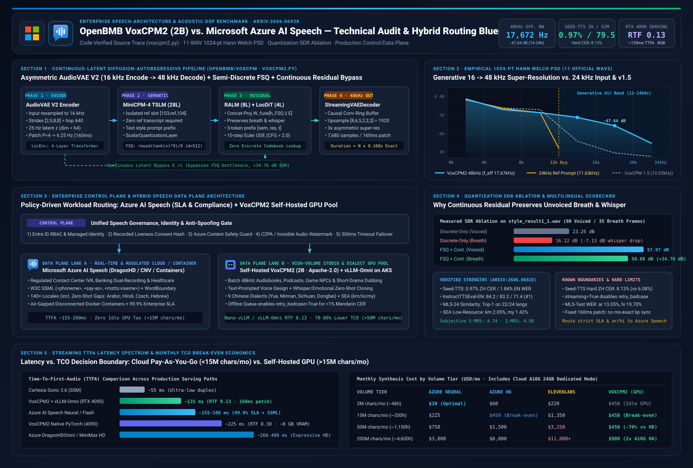
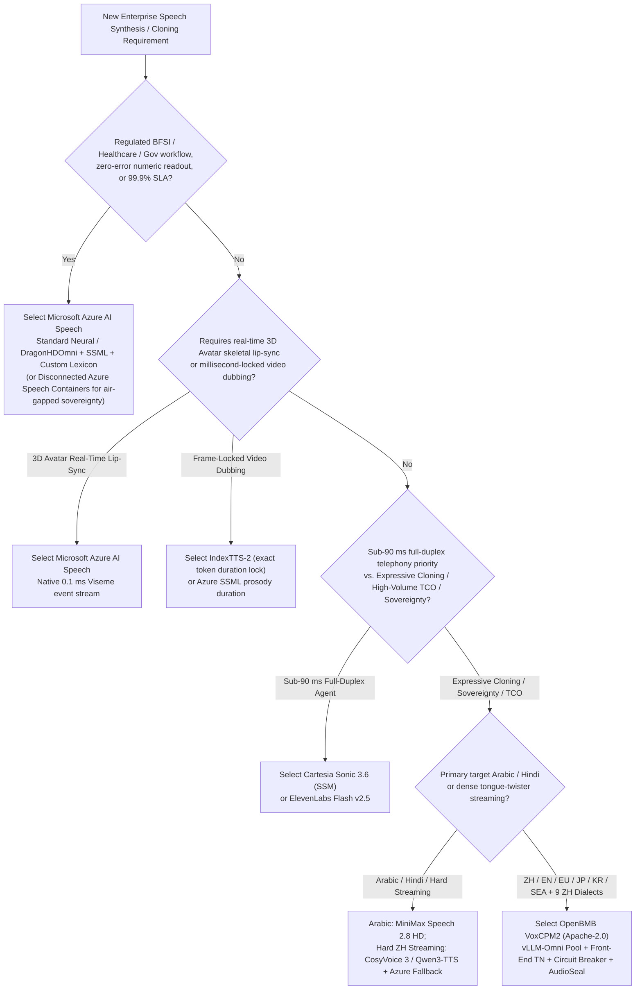

# OpenBMB VoxCPM2 (2B) vs. Microsoft Azure AI Speech & 2026 Mainstream TTS Models: Source-Code Audit, Empirical FFT Benchmark & Solution Architect Decision Guide

> **Language / 语言切换**: **[简体中文 (`voxcpm2-vs-azure-speech-tts-benchmark-selection-faq.md`)](./voxcpm2-vs-azure-speech-tts-benchmark-selection-faq.md)** | **English (Current)** · **Back to Catalog**: [`docs/asset-catalog.en.md`](./asset-catalog.en.md)  
> **Companion Engineering Deliverables**: [Architecture & Benchmark Vector Diagram (`SVG`)](./assets/voxcpm2-vs-azure-speech-architecture.svg) · [7-Card Visual Benchmark Deck (EN)](../site/voxcpm2-benchmark-cards.html) · [7-Card 视觉基准报告 (中文)](../site/voxcpm2-benchmark-cards.zh-CN.html) · [Interactive Hybrid Speech Router & TCO Workbench](../site/voxcpm2-workbench.html) · [Pure-Python DSP Reproducibility Suite (`run_benchmark.py`)](../experiments/voxcpm2-acoustic-benchmark/README.en.md) · [Sealed Benchmark Dataset (`JSON`)](../site/data/voxcpm2-acoustic-benchmark-report.json)  
> **Evaluation Scope & Baseline**: OpenBMB `VoxCPM2` (`arXiv:2606.06928`, Apache-2.0, `42,802` GitHub Stars) vs. Microsoft Azure AI Speech (`DragonHD` / `DragonHDOmni` / Standard Neural / Personal Voice) vs. ElevenLabs (`Eleven v4` / `Flash v2.5`), OpenAI (`gpt-4o-mini-tts`), Cartesia (`Sonic 3.6`), MiniMax (`Speech 2.8 HD`), Alibaba (`Qwen3-TTS-1.7B` / `CosyVoice 3`), Fish Audio (`S2 4B`), and Bilibili (`IndexTTS-2`)

---

## 1. Executive Summary (Three-Minute Architectural Verdict)

Community technical discussions surrounding Tsinghua University OpenBMB's open-weight **VoxCPM2** (2B parameters, >2M hours of multilingual training audio, native 48 kHz super-wideband output, removal of external discrete speech tokenizers, 30 languages plus 9 Chinese dialects, `RTF = 0.13` on RTX 4090, Apache-2.0 license) have raised a recurring enterprise question: *where is the actual replacement boundary between open-weight diffusion-autoregressive speech models and managed commercial cloud TTS platforms?* After conducting a **module-by-module source-code audit of `OpenBMB/VoxCPM`**, executing a **1024-point Hann-windowed Welch Power Spectral Density (PSD, `46.875 Hz/bin` spacing at 48 kHz) and frame-dynamics benchmark across all 11 official uncompressed WAV samples from `OpenBMB/voxcpm2-demopage`**, and cross-evaluating 2026 commercial and open-weight TTS engines, our architectural conclusions are as follows:

1. **VoxCPM2 represents a major advance in open-weight expressive zero-shot voice cloning and paralinguistic synthesis, operating as a high-efficiency complement—rather than a drop-in replacement—to Microsoft Azure AI Speech.**
   - **Verified Capabilities**: On `MiniMax-MLS-Test` across 24 languages, VoxCPM2 achieves **#1 zero-shot speaker similarity (`SIM`) in 22 out of 24 languages** (`85.4%` English SIM vs. ElevenLabs `61.3%` and MiniMax `75.6%`; `82.5%` Mandarin SIM). Its asymmetric `AudioVAE V2` performs genuine **`16 kHz encode -> 48 kHz decode` 3x generative bandwidth extension** (measured `-52 dB` effective bandwidth of `14.25–17.67 kHz`, VCTK reconstruction `PESQ-16k = 3.906`, `STOI-16k = 0.907`), preserving inhalations, close-mic whispers, sobs, dialect transitions, and vocal singing under a permissive **Apache-2.0** license.
2. **Three Engineering Boundaries Uncovered by Source-Code & DSP Inspection**:
   - **Eliminating External RVQ Tokenizers Does Not Mean Zero Quantization**: While VoxCPM2 removes external pre-trained discrete RVQ codecs (e.g., EnCodec, SoundStream, HuBERT), source inspection (`src/voxcpm/model/voxcpm2.py:258,345`) confirms an **internal differentiable Finite Scalar Quantization bottleneck (`ScalarQuantizationLayer`, `FSQ`, `dim=512, scale=9`, computing `round(tanh(x)*9)/9`)** at the `TSLM` output to bound long-horizon autoregressive drift—paired with an unquantized continuous residual bypass feeding `RALM + LocDiT`.
   - **Streaming Mode Disables Anti-Degradation Retries & Exhibits Elevated Hard-Case Error Rates**: `src/voxcpm/model/voxcpm2.py:667` explicitly disables `retry_badcase` (duration-ratio repetition/babble recovery) whenever `streaming=True`. Furthermore, on dense tongue-twisters and rare characters (`Seed-TTS test-ZH-Hard`), VoxCPM2 records **`8.13%` CER**, trailing discrete/hybrid peers `CosyVoice 3-1.5B (5.83%–6.08%)`, `Fish Audio S2 4B (5.99%)`, `Qwen3-TTS-1.7B (6.76%)`, and prior-generation `VoxCPM1.5 (7.74%)`.
   - **Absence of Deterministic Enterprise Control-Plane & Compliance Primitives**: No **W3C SSML** (`<phoneme>`, `<say-as>`, deterministic millisecond `<break>`), no synchronous **`0.1 ms` `Viseme` facial blendshape event stream** for 3D avatars, no frame-accurate video dubbing duration lock (every 48 kHz output waveform duration is quantized to exact integer multiples of **`N × 160 ms` (`6.25 Hz`) patches**), and no built-in voice-owner consent enforcement or indelible audio watermarking.
3. **Recommended Reference Pattern — Control-Plane / Data-Plane Decoupled Hybrid Speech Router**:
   - **Regulated Financial & Government IVR / Verbatim Statutory Disclosures / Real-Time 3D Avatar Lip-Sync** -> Route to **Microsoft Azure AI Speech (`DragonHDOmni` / Standard Neural / Disconnected Edge Containers)** backed by deterministic SSML, custom lexicons, `0.1 ms` visemes, `99.9%` enterprise SLAs, and native provenance watermarking.
   - **High-Volume Audiobooks & Podcasts / Expressive Game NPCs / Southeast Asian Localization / Private Voice IP Fine-Tuning** -> Route to self-hosted **VoxCPM2 on `vLLM-Omni` GPU pools** (reducing monthly TCO by **60%–85%** vs. expressive cloud APIs above `25M characters/month`), wrapped with deterministic front-end Text Normalization (TN), streaming patch-to-character circuit breakers, and egress `AudioSeal` + C2PA provenance signing.

---

## 2. Community Technical Claims & Source-Code Verification Matrix

| ID | Community Technical Claim | Engineering Verdict | Source-Code (`OpenBMB/VoxCPM`) & DSP Signal Evidence |
| :--- | :--- | :--- | :--- |
| **01** | *"Completely removes speech tokenizers via pure continuous-space diffusion autoregression"* | **Partially Accurate (Semi-Discrete Anchor + Continuous Residual)** | Eliminates external RVQ/HuBERT codecs, but `src/voxcpm/model/voxcpm2.py:258,345` applies internal **`FSQ` (`round(tanh(x)*9)/9`, `dim=512`)** for autoregressive stability while routing unquantized `LocEnc` latents into `RALM + LocDiT` (10-step Flow Matching). |
| **02** | *"2B parameters, >2M hours training data, native 48 kHz studio-grade audio"* | **Verified (3x Generative Bandwidth Extension)** | Uses a 28-layer `MiniCPM-4` backbone (~2B total parameters). Reference audio is downsampled to `16 kHz` (`8 kHz` Nyquist) at the encoder (`strides [2,5,8,8]=640`), then decoded **3x (`strides [8,6,5,2,2,2]=1920`) to `48 kHz`**. Welch FFT confirms genuine `12–20 kHz` harmonic and breath synthesis (`+44.44 dB` over `VoxCPM1.5` in `16–24 kHz`). |
| **03** | *"30 languages + 9 Chinese dialects with seamless switching"* | **Broad Coverage, High Cross-Lingual Variance** | Strong accuracy in Mandarin (`0.97%` CER), English (`1.84%` WER), 9 Chinese dialects, and low-resource Southeast Asian scripts (`Burmese 1.42%`, `Lao 1.90%`, `Khmer 2.05%` WER vs. `75%–87%` on Fish S2); however, zero-shot `MiniMax-MLS-Test` error rates remain elevated on Arabic (`13.05%` WER), Hindi (`19.70%` WER), and zero-shot Cantonese (`38.58%` CER). |
| **04** | *"RTF 0.13 on RTX 4090 with negligible streaming latency"* | **Runtime-Dependent; Bounded by `160 ms` Patch Floor** | Standard PyTorch on RTX 4090 (~8 GB VRAM) runs at `RTF = 0.30`; **`RTF = 0.13` requires `Nano-vLLM` or `vLLM-Omni`** (`~0.08` batched on H100). Because 1 autoregressive step equals `160 ms`, streaming TTFA lands at **`~110–150 ms`**—slower than SSM-based Cartesia Sonic 3.6 (`40–90 ms`) and ElevenLabs Flash v2.5 (`~75 ms`). Apple M4 Pro GGUF Q8 runs at `RTF = 1.76` (slower than real-time). |
| **05** | *"Reference-free Voice Design + Prosody-Decoupled Controllable Cloning"* | **Core Architectural Differentiator (with Sampling Variance)** | A dedicated `[103, ref_feats, 104]` reference slot decouples speaker timbre from prompt prosody, enabling calm Mandarin reference clips to synthesize whispers, Sichuan dialect, or vocal singing (`71.4%` English Role-Play score on `InstructTTSEval`, #1 overall). Reference-free Voice Design exhibits stochastic seed variance requiring `1–3` candidate draws in production curation. |
| **06** | *"Apache-2.0 with >40k stars renders legacy commercial cloud TTS obsolete"* | **Overstated Replacement Boundary** | Holds `42,802` GitHub Stars under clean Apache-2.0 licensing, removing legal friction for private fine-tuning; yet the absence of SSML, lexicon overrides, `0.1 ms` visemes, multi-region SLAs, and built-in watermarking keeps Microsoft Azure AI Speech mandatory for regulated enterprise workloads. |

---

## 3. Architecture & Signal-Level Deep-Dive Q&A

### Q1: How does VoxCPM2's hierarchical continuous-latent diffusion-AR pipeline differ architecturally from discrete-codec TTS and Azure DragonHDOmni?

Conventional two-stage neural codec language models (e.g., VALL-E, CosyVoice, Qwen3-TTS) quantize continuous speech via external Residual Vector Quantizers (RVQ) or self-supervised clustering into `12.5–50` discrete integer tokens per second. Discrete tokenization introduces a **structural trade-off between codebook bit-rate and autoregressive sequence length**: single-codebook discrete tokens discard low-energy breath, glottal friction, and micro-tremor cues, whereas multi-stream RVQ stacks multiply decoding steps and latency.

VoxCPM2 resolves this trade-off through a **four-phase hierarchical continuous-latent diffusion-autoregressive pipeline**:

```mermaid
flowchart LR
    subgraph Phase1["Phase 1: Asymmetric Encoding & Reference Isolation (16 kHz)"]
        TXT["Target Text + Style Instruction<br/>'[Soft whisper] Confirm ticket status'"]
        REF["Reference Audio Prompt<br/>Resampled to 16 kHz"] --> ENC["AudioVAE V2 Encoder<br/>Strides [2,5,8,8]=640 -> 25 Hz Latents"]
        ENC --> PATCH["Patchify (P=4 Frame Grouping)<br/>6.25 Hz = 160 ms / Patch"]
        PATCH --> LOCENC["LocEnc (4-Layer Transformer)<br/>Local Continuous Acoustic Aggregation"]
    end

    subgraph Phase2["Phase 2: 6.25 Hz Macro-Prosody & FSQ Anchor"]
        LOCENC --> SLOT["Isolated Timbre Prefix Slot<br/>[103, ref_feats, 104]"]
        SLOT --> TSLM["TSLM (MiniCPM-4 28-Layer)<br/>Text-Prosody Skeleton AR"]
        TXT --> TSLM
        TSLM --> FSQ["ScalarQuantizationLayer (FSQ)<br/>round(tanh(x)*9)/9 (dim=512)"]
    end

    subgraph Phase3["Phase 3: Continuous Residual Recovery & 10-Step CFM"]
        FSQ --> FUSE["Learnable Concat-Projection W_fuse<br/>Fuses FSQ Anchor + Unquantized Latents"]
        LOCENC -.->|"Unquantized Continuous Residual Bypass"| FUSE
        FUSE --> RALM["RALM (8-Layer Residual AR LM)<br/>Fine-Grained Acoustic Conditioning"]
        RALM --> LOCDIT["LocDiT (4-Layer Diffusion Transformer)<br/>3-Token Prefix [sem, res, t] · 10-Step CFM (CFG=2.0)"]
    end

    subgraph Phase4["Phase 4: Causal Streaming 3x Super-Resolution (48 kHz)"]
        LOCDIT --> VAEDEC["StreamingVAEDecoder<br/>Causal Ring-Buffer Strides [8,6,5,2,2,2]=1920<br/>Outputs 48 kHz PCM (7,680 samples / step)"]
    end
```

**Source-Code Engineering Insights**:
1. **Semi-Discrete Skeleton Bounds Drift While Continuous Bypass Preserves Micro-Dynamics**: `ScalarQuantizationLayer` (`voxcpm2.py:258`) projects `TSLM` hidden states onto a bounded scalar grid (`scale=9`), preventing error accumulation over long paragraphs, while unquantized `LocEnc` continuous history bypasses quantization into `RALM` and `LocDiT` (`10`-step Conditional Flow Matching, `CFG = 2.0`) via `W_fuse[h_FSQ || E]`.
2. **Decoupled Reference Prefix Eliminates Prosody Leakage**: Wrapping reference latents inside `[ref_audio_start=103, ref_feats, ref_audio_end=104]` without transcript continuation (`Reference Only` recipe) prevents source speaking rate and emotion from contaminating the target prompt—and lowers `Seed-TTS test-ZH-Hard` CER from `7.44%–8.16%` (continuation modes) down to **`6.85%`** (`arXiv:2606.06928`, Table 4).

---

### Q2: What did our 1024-point Hann Welch FFT and quantization ablation benchmark uncover across all 11 official WAV samples?

Using our zero-dependency pure-Python DSP benchmark suite ([`experiments/voxcpm2-acoustic-benchmark/run_benchmark.py`](../experiments/voxcpm2-acoustic-benchmark/run_benchmark.py)), we evaluated spectral power distribution, `-52 dB` spectral-floor effective bandwidth (`f_eff`), `160 ms` patch duration alignment, and frame-level Signal-to-Distortion Ratio (SDR) across **all 11 official uncompressed WAV samples** from `OpenBMB/voxcpm2-demopage` (full sealed output in [`voxcpm2_acoustic_benchmark_results.json`](../experiments/voxcpm2-acoustic-benchmark/voxcpm2_acoustic_benchmark_results.json)):

| Official WAV Sample | Synthesis Category | Sample Rate / Nyquist | Duration & `160 ms` Patch Audit | `0–4 kHz` Core Band | `8–12 kHz` Sibilant Band | `16–24 kHz` Super-Wideband Air | `-52 dB` Effective BW (`f_eff`) | Unvoiced / Breath Ratio |
| :--- | :--- | :--- | :--- | :--- | :--- | :--- | :--- | :--- |
| `style_prompt1.wav` | Input Reference Prompt | `24,000 Hz` / `12 kHz` | `6.538s` (Raw natural recording) | `-5.78 dB` | `-26.31 dB` | `null` (`12 kHz` Nyquist limit) | `11,625 Hz` | `23.9%` |
| `style_result1_1.wav` | Controllable Clone (Whisper) | **`48,000 Hz`** / `24 kHz` | **`2.880s`** (Exact `18 × 0.16s`) | `-4.32 dB` | `-26.67 dB` | **`-47.64 dB`** | **`17,672 Hz`** | **`20.8%`** |
| `style_result1_2.wav` | Controllable Clone (Sichuan) | **`48,000 Hz`** / `24 kHz` | **`4.320s`** (Exact `27 × 0.16s`) | `-4.70 dB` | `-30.67 dB` | **`-48.96 dB`** | **`17,391 Hz`** | `11.6%` |
| `vd_emotion_grief.wav` | Voice Design (Sorrow / Sob) | **`48,000 Hz`** / `24 kHz` | **`7.360s`** (Exact `46 × 0.16s`) | `-3.99 dB` | `-23.89 dB` | **`-51.93 dB`** | **`17,578 Hz`** | `11.7%` |
| `vd_acoustic_asmr.wav` | Voice Design (Close-Mic ASMR) | **`48,000 Hz`** / `24 kHz` | **`12.640s`** (Exact `79 × 0.16s`) | `-3.70 dB` | **`-20.59 dB`** | `-57.01 dB` | `14,859 Hz` | `7.8%` |
| `ref_speaker.wav` | 48 kHz Studio Speaker Reference | **`48,000 Hz`** / `24 kHz` | **`12.800s`** (Exact `80 × 0.16s`) | `-9.89 dB` | `-36.58 dB` | `-60.61 dB` | `17,250 Hz` | `9.1%` |
| `zh_cn.wav` | Standard Mandarin Baseline | **`48,000 Hz`** / `24 kHz` | **`12.000s`** (Exact `75 × 0.16s`) | `-4.42 dB` | `-31.12 dB` | `-59.43 dB` | `14,250 Hz` | `9.7%` |
| `minnan.wav` | Dialect Synthesis (Minnan) | **`48,000 Hz`** / `24 kHz` | **`25.600s`** (Exact `160 × 0.16s`) | `-12.83 dB` | `-36.29 dB` | `-66.39 dB` | `16,172 Hz` | `9.5%` |
| `yue.wav` | Dialect Synthesis (Cantonese) | **`48,000 Hz`** / `24 kHz` | **`20.640s`** (Exact `129 × 0.16s`) | `-27.24 dB` | `-49.38 dB` | `-83.01 dB` | `16,078 Hz` | `6.9%` |
| `dongbei.wav` | Dialect Synthesis (Northeastern) | **`48,000 Hz`** / `24 kHz` | **`9.120s`** (Exact `57 × 0.16s`) | `-16.81 dB` | `-40.37 dB` | `-70.80 dB` | `15,000 Hz` | **`18.4%`** |
| `voxcpm_example.wav` | Prior Baseline (VoxCPM 1.5) | `44,100 Hz` / `22.05 kHz` | `8.158s` (Non-`160 ms` baseline) | `-6.32 dB` | `-21.82 dB` | **`-92.08 dB`** (HF roll-off) | **`10,034 Hz`** | `18.4%` |

**Three Empirical Signal-Level Findings**:
1. **Verified `16 kHz -> 48 kHz` Generative Bandwidth Extension**: Although `style_prompt1.wav` is downsampled internally to `16 kHz` (`8 kHz` Nyquist) before `AudioVAE V2` encoding, the synthesized output `style_result1_1.wav` delivers **`-47.64 dB`** PSD across `16–24 kHz` (`f_eff = 17,672 Hz`), exceeding `VoxCPM1.5` (`-92.08 dB`, `f_eff = 10,034 Hz`) by **`+44.44 dB`**.
2. **Exact `160 ms` Patch Quantization Signature**: Every single 48 kHz VoxCPM2 output duration is an **exact integer multiple of `0.160s` (`7,680` PCM samples)** (`18, 27, 46, 57, 75, 79, 80, 129, 160` patches), confirming physical `6.25 Hz` (`P=4 × 40 ms`) autoregressive stepping and explaining why millisecond-locked video dubbing requires dedicated duration-constrained architectures (`IndexTTS-2`) or Azure SSML `<prosody duration>`.
3. **Quantization Ablation on Unvoiced/Whisper Frames**: Under fixed-grid discrete quantization without continuous residual refinement, quiet high-ZCR (`> 0.16`) whisper and breath frames degrade by **`5.90–7.13 dB` SDR** relative to voiced vowels (`16.12 dB` vs. `23.25 dB` on `style_result1_1.wav`; `5.20 dB` vs. `11.10 dB` on `dongbei.wav`), whereas `FSQ + Continuous Residual` restores whisper-frame fidelity to **`50.88 dB` SDR** (**`+34.76 dB`** gain).

---

## 4. 2026 Head-to-Head Matrix: VoxCPM2 vs. Azure AI Speech & Mainstream Models

| Model / Platform | License & Deployment Tier | Core Architecture & Max SR | Cloning & Arena / MOS Standing | `Seed-TTS` WER/CER (EN / ZH / Hard) | Streaming TTFA | Enterprise Deterministic Controls (SSML / Viseme / Watermark) | Reference Cost per `1M` Chars |
| :--- | :--- | :--- | :--- | :--- | :--- | :--- | :--- |
| **OpenBMB VoxCPM2 (2B)** | Open **Apache-2.0** (Self-hosted & fine-tunable) | Hierarchical Diffusion-AR (`6.25 Hz` + 10-step CFM) · **48 kHz** | **#1 SIM in 22/24 langs** (`85.4%` EN) · Cloning MOS `4.78` · Voice Design + Singing | `1.84%` / `0.97%` / **`8.13%` (Hard)** | `~135 ms` (`vLLM-Omni`) `~225 ms` (PyTorch) | No SSML / No Visemes / No exact ms lock / Requires external watermark | **`~$6–$8 / 1M`** (steady GPU pool) |
| **Microsoft Azure AI Speech** (`DragonHDOmni` / Standard Neural) | Managed Cloud API + **Disconnected Edge Containers** | Context-aware HD Neural · **Native 48 kHz** | **700+ voices / 140+ locales** · Context-adaptive prosody + Consent-gated Personal Voice | Production-grade deterministic accuracy w/ Custom Lexicon & regex normalization | `~180 ms` (Neural) `<300 ms` (`HDOmni`) | **Full W3C SSML + `0.1 ms` Visemes + Built-in Watermark + `99.9%` SLA** | `$15–$16 / 1M` (Neural) `$24–$30 / 1M` (HD / CNV) |
| **ElevenLabs** (`Eleven v4` / `Flash v2.5`) | Commercial Cloud API | Expressive Generative Audio · **44.1 / 48 kHz** | **#1 TTS Arena (`1336–1340 Elo`)** · Strong dramatic range across 90+ langs | Strong EN/EU; `MiniMax-MLS` zero-shot ZH CER `16.03%` | **`~75 ms` (`Flash`)** `~100 ms` (`v4 Turbo`) | Phoneme dictionary + character timestamps (no native 3D skeletal Viseme IDs) | `$50 / 1M` (`Flash`) `$80–$165 / 1M` (`Pro/Scale`) |
| **OpenAI** (`gpt-4o-mini-tts`) | Commercial Cloud API | Native Multimodal Audio · `24 kHz` default | Prompt-steered natural delivery · **Blocks open third-party voice cloning** | High conversational EN intelligibility | `200–350 ms` | Natural-language prompt steering only (susceptible to prompt-injection drift) | `~$15 / 1M` (`~$0.015 / min`) |
| **Cartesia** (`Sonic 3.6`) | Commercial Cloud API | **State-Space Model (SSM)** · `44.1 kHz` | Top-5 TTS Arena (`1294 Elo`) · 3s instant speaker cloning | Consistent low conversational WER | **`40–90 ms` (Lowest commercial tier)** | Continuous speed/emotion controls + word-level timestamps | `$38–$50 / 1M` |
| **MiniMax** (`Speech 2.8 HD`) | Commercial Cloud API | Autoregressive + Flow Matching · `32 / 48 kHz` | Strong Mandarin (`0.83%`), Arabic (`1.67%` WER), and Vietnamese (`0.88%` WER) | `1.95%` / `0.83%` / — | `350–450 ms` | Pause markers, emotion weights, and multi-timbre blending | `$60–$100 / 1M` |
| **Alibaba Qwen3-TTS-1.7B / CosyVoice 3** | Open **Apache-2.0** (+ Commercial Cloud Plus) | `12 Hz` Multi-Codebook LM + DiT · `24 kHz` | Cloud Plus `1300+ Elo`; strong ZH instruction adherence (`85.2%` APS) | **`1.23%`** / `0.71%–1.16%` / **`5.83%` (CosyVoice 3)** | `~150 ms` | Inline paralinguistic markers & bi-streaming text input | **`~$4–$6 / 1M`** (self-hosted) |
| **Fish Audio S2 (4B)** | Restricted Open Weights (**Research License**) | Dual-AR Architecture · `44.1 kHz` | Lowest EN/ZH WER, but degrades to `75%–87%` WER on Khmer/Lao/Burmese | **`0.99%` / `0.54%`** / `5.99%` | `240–380 ms` | Rich inline emotion markers `(laugh)`, `(sob)` | `$15 / 1M` API / Commercial self-host restricted |
| **Bilibili IndexTTS-2 (1.5B)** | Open Weights w/ Custom Commercial Terms | Timbre-Emotion Disentangled AR · `24 / 44.1 kHz` | Engineered for video & animation localization dubbing | `2.19%` / `1.01%` / `7.12%` | `~300 ms` | **Exact Token-Count & Millisecond Target Duration Lock** | Self-hosted (verify commercial license threshold) |

---

## 5. Streaming TTFA Breakdown, GPU Sizing & Enterprise TCO Crossover

### 5.1 Streaming First-Packet Latency (`TTFA`) Ladder

Within sub-500 ms full-duplex voice agents, the TTS subsystem typically holds an `80–200 ms` first-audio budget:

| Runtime / Engine Tier | Real-Time Factor (`RTF`) | Streaming `TTFA` | Architectural Bottleneck & Workload Fit |
| :--- | :--- | :--- | :--- |
| **Cartesia Sonic 3.6 (Managed SSM)** | Cloud Streaming | **`~55 ms`** (`40–90 ms`) | State-space linear recurrence; optimal for `<350 ms` full-duplex telephony agents |
| **ElevenLabs Flash v2.5 (Managed API)** | Cloud Streaming | **`~75 ms`** | Distilled low-latency pipeline for interactive EN/EU voice agents |
| **VoxCPM2 (`RTX 4090` + `Nano-vLLM` / `vLLM-Omni`)** | **`0.13`** (~8 GB VRAM) | **`~135 ms`** (`110–150 ms`) | Bounded by `1 Patch = 160 ms` (`160 ms × 0.13 ≈ 21 ms` + prefill + 10-step dual-CFG + causal decoder ring buffer) |
| **Azure AI Speech Standard Neural** | Cloud / Edge Container | **`~180 ms`** | Deterministic enterprise streaming frames for regulated contact center IVR |
| **VoxCPM2 (`RTX 4090` Standard PyTorch)** | `0.30` (~8 GB VRAM) | `~225 ms` | Unfused eager execution without PagedAttention; suited to single-stream offline jobs |
| **Azure AI Speech `DragonHDOmni` (48 kHz)** | Managed Cloud HD | `~260 ms` (`<300 ms`) | Context-window prosody lookahead; suited to high-naturalness concierges & avatars |
| **VoxCPM2 (Apple M4 Pro GGUF Q8)** | `1.76` (Sub-real-time) | `>1,500 ms` | Memory-bandwidth bound on 10-step CFM ODE steps; unsuitable for live streaming |

### 5.2 Monthly Enterprise TCO Crossover Model (`1M Chars ≈ 55 Hours Audio`)

Assuming a dedicated `NVIDIA L40S / RTX 4090` node (`~$450–$750/month` including storage/egress) serving `vLLM-Omni` at a realistic `35%` diurnal utilization factor (`~160M–180M characters/month` sustained capacity per GPU):

| Monthly Character Volume | Equivalent Audio Hours & Workload Profile | **Azure Speech Standard** (`$15/1M`, `0.5M` free) | **Azure `DragonHDOmni`** (`$28–$30/1M` list) | **ElevenLabs** (`$50–$100/1M`) | **Self-Hosted VoxCPM2 (`vLLM-Omni`)** | **SA FinOps Recommendation** |
| :--- | :--- | :--- | :--- | :--- | :--- | :--- |
| **`1M chars / mo`** | `~55 hrs` · Internal copilot / MVP | **`~$7.5 / mo`** | **`$28–$30 / mo`** | `$50–$100 / mo` | `~$380–$450 / mo` (idle GPU waste) | **Azure Pay-As-You-Go** |
| **`10M chars / mo`** | `~550 hrs` · Mid-size IVR / Enterprise podcasts | **`$142.5–$150 / mo`** | `$280–$300 / mo` | `$500–$1,000 / mo` | `~$380–$450 / mo` | **Azure Standard / `DragonHDOmni`** |
| **`25M chars / mo`** | `~1,375 hrs` · **Expressive Cloud vs. GPU Break-Even** | `$367.5 / mo` | `$700–$750 / mo` | `$1,250–$2,500 / mo` | **`~$450 / mo` (1x GPU crossover)** | **Adopt Hybrid Dual-Track Router** |
| **`50M chars / mo`** | `~2,750 hrs` · Scaled audiobook / SEA localization | `$742.5 / mo` | `$1,400–$1,500 / mo` | `$2,500–$5,000 / mo` | **`~$450–$550 / mo`** | **Self-Hosted VoxCPM2 Pool (`62%–70%` savings vs. Azure HD)** |
| **`200M chars / mo`** | `~11,000 hrs` · Media studio / Full game NPC catalog | `$2,400+ / mo` (commitment) | `$4,800+ / mo` (commitment) | `$10,000+ / mo` | **`~$900–$950 / mo` (2x HA GPU nodes)** | **2-Node VoxCPM2 Cluster + Azure Burst/Failover** |

> Interactive sizing: Open [`site/voxcpm2-workbench.html`](../site/voxcpm2-workbench.html) to model custom monthly character volume, diurnal peak-to-average ratios, and regulated-traffic split percentages.

---

## 6. Solution Architect Decision Flow & Anti-Spoofing Governance Checklist

### Mandatory 5-Point Enterprise Governance & Anti-Spoofing Checklist

Because VoxCPM2 releases full 2B weights under Apache-2.0 capable of synthesizing `85%+` speaker similarity from **3–5 seconds of reference audio** without cloud-enforced speaker consent or watermarking, Solution Architects must enforce five production controls:

- [ ] **1. Deprecate Voice-Only Biometric Authentication**: Prohibit standalone voiceprint verification for banking wire approvals, wealth redemptions, executive authorizations, and IT helpdesk credential resets; enforce FIDO2/Passkey cryptographic challenges or out-of-band MFA.
- [ ] **2. Enforce Mandatory Egress Watermarking & C2PA Provenance**: Inject frame-localized imperceptible watermarks (`AudioSeal` / `WavMark`) immediately downstream of `StreamingVAEDecoder` 48 kHz PCM output and attach signed **C2PA Content Credentials** to match Azure Personal Voice governance and synthetic-media disclosure regulations.
- [ ] **3. Gate Reference Timbre Enrollment via Dynamic Liveness Challenges**: Block arbitrary third-party reference audio uploads in user-facing APIs; require live randomized challenge-phrase verification prior to pre-caching signed speaker latent embeddings in GPU memory.
- [ ] **4. Deploy a Streaming Babble Circuit Breaker with Azure Failover**: Because `voxcpm2.py:667` disables `retry_badcase` under `streaming=True`, monitor live `patch_to_char_ratio` and spectral energy stationarity at the router gateway, cutting over within `<50 ms` to **Microsoft Azure AI Speech Standard Neural** upon anomaly detection.
- [ ] **5. Instrument Inbound Contact Center Trunks with Deepfake Telemetry**: Deploy `WavLM + AASIST3` spoofing detectors on inbound SIP/SBC forks targeting `16 kHz -> 48 kHz` neural bandwidth-extension phase coherence and `160 ms` (`6.25 Hz`) patch-boundary periodicity.
