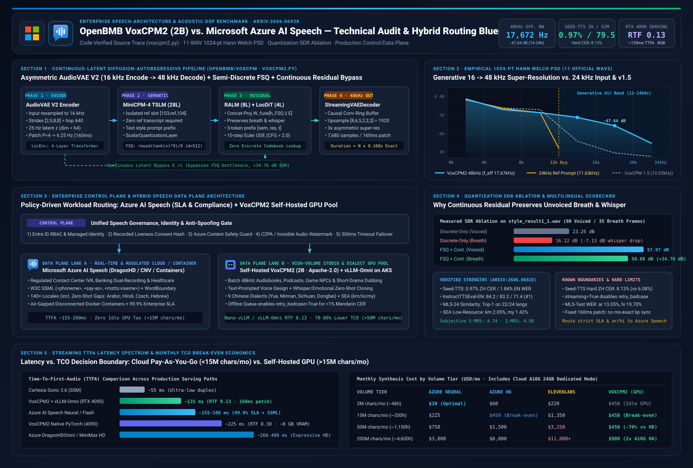

# OpenBMB VoxCPM2 (2B) vs. Microsoft Azure AI Speech 及 2026 主流语音合成模型：源码审计、频谱实测与架构师选型指南

> **语言切换 / Language**: **简体中文 (当前)** | **[English (`voxcpm2-vs-azure-speech-tts-benchmark-selection-faq.en.md`)](./voxcpm2-vs-azure-speech-tts-benchmark-selection-faq.en.md)** · **返回资产总览**: [`docs/asset-catalog.md`](./asset-catalog.md)  
> **配套工程资产**: [架构与实测总览矢量图 (`SVG`)](./assets/voxcpm2-vs-azure-speech-architecture.svg) · [7-Card 视觉基准报告 (中文)](../site/voxcpm2-benchmark-cards.zh-CN.html) · [7-Card Visual Benchmark Deck (EN)](../site/voxcpm2-benchmark-cards.html) · [交互式混合语音路由与 TCO 测算台](../site/voxcpm2-workbench.html) · [纯 Python 频谱复现套件 (`run_benchmark.py`)](../experiments/voxcpm2-acoustic-benchmark/README.md) · [密封评测数据集 (`JSON`)](../site/data/voxcpm2-acoustic-benchmark-report.json)  
> **评测基准版本**: OpenBMB `VoxCPM2` (`arXiv:2606.06928`, Apache-2.0, GitHub `42,802` Stars) vs. Microsoft Azure AI Speech (`DragonHD` / `DragonHDOmni` / Standard Neural / Personal Voice) vs. ElevenLabs (`Eleven v4` / `Flash v2.5`)、OpenAI (`gpt-4o-mini-tts`)、Cartesia (`Sonic 3.6`)、MiniMax (`Speech 2.8 HD`)、Alibaba (`Qwen3-TTS-1.7B` / `CosyVoice 3`)、Fish Audio (`S2 4B`)、Bilibili (`IndexTTS-2`)



---

## 一、 执行摘要（Executive Summary：三分钟架构定界）

近期社区技术讨论高度关注清华大学 OpenBMB 团队开源的 **VoxCPM2**（2B 参数规模、逾 200 万小时多语种预训练语料、48 kHz 原生超宽带输出、移除外部离散语音 Tokenizer、Apache-2.0 商业友好许可），并引发关于“传统商用云端 TTS 服务替代边界”的架构讨论。基于对 **`OpenBMB/VoxCPM` 核心模型源码的逐模块审计**、对 **`OpenBMB/voxcpm2-demopage` 全部 11 组官方无损 WAV 样本的 1024 点 Hann 窗 Welch 功率谱密度（PSD，48 kHz 下频率分辨率 `46.875 Hz/bin`）及帧级动态范围实测**，以及 **2026 主流商用与开源 TTS 全维度横向评测**，面向企业 AI 解决方案架构师（AI Solution Architect）的核心工程判断如下：

1. **VoxCPM2 是开源高表现力零样本声音克隆与副语言合成的重要技术节点，但与 Microsoft Azure AI Speech 等企业级确定性语音服务处于互补而非替代关系。**
   - **已验证的技术突破**：在 `MiniMax-MLS-Test` 24 语种跨语种评测中，VoxCPM2 在 **22 个语种取得零样本说话人音色相似度（SIM）第 1**（英语 `SIM = 85.4%`，高于 ElevenLabs `61.3%` 与 MiniMax `75.6%`；普通话 `SIM = 82.5%`）；其非对称 `AudioVAE V2` 实现 **`16 kHz 编码输入 -> 48 kHz 生成式频带扩展直出`**（11 组样本实测 `-52 dB` 有效带宽达 `14.25–17.67 kHz`，重构指标 `PESQ-16k = 3.906`、`STOI-16k = 0.907`），能够将呼吸换气、近讲耳语、悲伤哽咽、方言韵律切换乃至声乐吟唱（Vocal Singing）连续保存在声学残差流中。
2. **源码审计与声学实测揭示的三项关键工程边界**：
   - **移除外部 RVQ 编码器不等于完全无量化**：VoxCPM2 确实摒弃了 EnCodec / SoundStream / HuBERT 等外部预训练离散残差矢量量化（RVQ）编解码器，但源码 `src/voxcpm/model/voxcpm2.py:258,345` 表明，主干 `TSLM` 输出仍通过内置可微标量量化层 **`ScalarQuantizationLayer`（Finite Scalar Quantization，`FSQ`，`dim=512, scale=9`，即 `round(tanh(x)*9)/9`）** 构建半离散语义锚点，以抑制长序列自回归累积漂移；其高频音质优势来自 `LocEnc -> RALM -> LocDiT` 的**未量化连续特征残差旁路**。
   - **流式生成强制关闭防退化重试机制，且高难文本错字率高于离散混合基线**：源码 `src/voxcpm/model/voxcpm2.py:667` 明确规定当 `streaming=True` 时强制禁用 `retry_badcase`（基于长度比异常的防复读/防乱码重采样保护）；同时在包含生僻字与绕口令的 `Seed-TTS test-ZH-Hard` 基准上，VoxCPM2 字符错误率（CER）为 **`8.13%`**，高于同梯队开源模型 `CosyVoice 3-1.5B (5.83%–6.08%)`、`Fish Audio S2 4B (5.99%)`、`Qwen3-TTS-1.7B (6.76%)` 以及前代 `VoxCPM1.5 (7.74%)`。
   - **缺失政企关键业务所需的确定性控制面与内生合规治理**：不支持工业级 **SSML**（如 `<phoneme>` 多音字强制注音、`<say-as>` 金融金额/日期规范化播报、`<break>` 毫秒级停顿控制），无原生 **`0.1 ms` 级同步 `Viseme` 数字人口型驱动事件流**，不支持帧级精确配音时长锁定（实测全部 9 组 VoxCPM2 48 kHz 输出时长严格受限于 **`N × 160 ms`（`6.25 Hz` Patch）整数倍**），且模型本体未内置声纹活体授权门禁或不可擦除隐形防伪水印。
3. **企业推荐参考架构——控制面与数据面解耦的“双轨混合语音路由（Hybrid Speech Router）”**：
   - **强监管交易交互 / 银行政务 IVR / 法定免责逐字宣读 / 实时 3D 数字人口型同步** -> 路由至 **Microsoft Azure AI Speech（`DragonHDOmni` / Standard Neural / 离线边缘容器）**，依托全量 SSML、自定义发音词典（Custom Lexicon）、`0.1 ms` Viseme 流、`99.9%` SLA 与原生 C2PA/隐形水印保障确定性交付。
   - **规模化有声内容与播客生产 / 游戏 NPC 多情绪与方言配音 / 东南亚多语种本地化 / 数据不出域私有声音资产微调** -> 路由至私有化 **VoxCPM2 + `vLLM-Omni` GPU 推理池**（月合成规模超过 `2,500 万字符` 时，综合 TCO 较商用高表现力云 API 降低 **60%–85%**），并在控制面网关前置确定性文本正则化（TN）、流式帧长比熔断器以及出口端 `AudioSeal` 隐形水印与 C2PA 元数据签名。

---

## 二、 社区技术声明与源码实证核查矩阵（Claims vs. Source-Code & DSP Verification）

| 编号 | 社区常见技术声明 | 核查结论 | 源码审计（`OpenBMB/VoxCPM`）与物理信号实测证据 |
| :--- | :--- | :--- | :--- |
| **01** | “完全摒弃语音 Tokenizer，采用纯连续空间扩散自回归” | **部分属实（半离散锚点 + 连续残差）** | 移除了外部离散 RVQ/HuBERT 编解码器；但源码 `src/voxcpm/model/voxcpm2.py:258,345` 在 `TSLM` 出口内置 **`FSQ`（`round(tanh(x)*9)/9`, `dim=512`）** 半离散瓶颈稳定长程韵律，同时通过 `RALM + LocDiT` 10 步条件流匹配恢复连续高频残差。 |
| **02** | “2B 参数 + 200 万小时语料 + 原生直出 48 kHz 录音棚级音质” | **实测属实（3 倍生成式频带超分）** | 主干采用 `MiniCPM-4` 28 层架构（总参数量约 `2B`）。参考音频在编码端统一重采样至 `16 kHz`（`8 kHz` 奈奎斯特上限），经 `AudioVAE V2` 非对称因果解码器（步长乘积 `[8,6,5,2,2,2]=1920` vs 编码步长 `[2,5,8,8]=640`）执行 **3 倍生成式超分直出 `48 kHz`**。Welch FFT 实测证实 `16–24 kHz` 超宽带能量较前代 `VoxCPM1.5` 提升 **`+44.44 dB`**。 |
| **03** | “覆盖 30 种语言与 9 种中文方言无缝切换” | **语种覆盖属实，跨语种错误率方差显著** | 原生支持川、粤、闽南、东北、吴、陕、晋、豫、湘 9 类中文方言及 30 种语言；内部 30 语种评测均值 `1.68%` WER/CER，其中东南亚低资源语种（缅甸语 `1.42%`、老挝语 `1.90%`、高棉语 `2.05%` WER）显著优于同参数规模竞品（Fish S2 为 `75%–87%`）；但在 `MiniMax-MLS-Test` 零样本跨语种评测中，阿拉伯语（`13.05%` WER）、印地语（`19.70%` WER）及零样本粤语（`38.58%` CER）错误率较高。 |
| **04** | “单张 RTX 4090 实时率 `RTF = 0.13`，流式合成几乎无感知延迟” | **高度依赖推理运行时，受限于 `160 ms` 帧下限** | 标准 PyTorch 单路推理在 RTX 4090（显存占用约 `8 GB`）上 `RTF = 0.30`；需切换至 **`Nano-vLLM` 或 `vLLM-Omni`** 方可达到 **`RTF = 0.13`**（H100 批处理可达 `~0.08`）。受最小生成单元 `1 Patch = 160 ms` 物理约束，流式首包延迟（TTFA）约为 **`110–150 ms`**，优于传统全句扩散模型，但高于状态空间模型 Cartesia Sonic 3.6（`40–90 ms`）与 ElevenLabs Flash v2.5（`~75 ms`）。Apple M4 Pro GGUF 实测 `RTF = 1.76`（低于实时速率）。 |
| **05** | “无参考文本捏造音色（Voice Design）+ 情绪解耦可控克隆 + 呼吸细节复刻” | **核心架构差异化机制（伴随采样随机方差）** | 源码通过独立控制槽位 `[ref_audio_start=103, ref_feats, ref_audio_end=104]` 将参考音色特征与目标文本韵律解耦（Controllable Cloning），消除传统延续式克隆（Continuation）的参考音频语速/情绪污染，支持由平静普通话参考音零样本切换至耳语、四川话或声乐唱段；在 `InstructTTSEval` 英文指令角色扮演（RP）取得 `71.4%`（开源与闭源对比第 1）。但零参考 Voice Design 存在随机种子方差，生产管线通常需配置 `1–3` 次候选采样优选。 |
| **06** | “Apache-2.0 协议突破四万星，传统商用付费云 TTS 失去存在必要” | **传统商用云 TTS 替代边界评估失准** | 仓库已获 `42,802` GitHub Stars，Apache-2.0 许可消除了自建微调与私有化商用的法务障碍（显著优于限制商用的研究协议竞品）；但由于缺失 SSML 确定性控制、发音词典强干预、`0.1 ms` Viseme 口型同步、全球多区域 SLA 与内生防伪水印，无法直接替代金融、医疗、政务及实时数字人场景中的 Microsoft Azure AI Speech。 |

---

## 三、 核心架构与信号级深度问答（Architecture & DSP Deep-Dive Q&A）

### Q1：VoxCPM2 的分层连续潜空间扩散自回归架构，与传统离散 Codec TTS 及 Azure DragonHDOmni 在机理上有何本质差异？

传统两阶段神经语音大模型（如 VALL-E、CosyVoice 系列、Qwen3-TTS）依赖外部预训练离散残差矢量量化器（RVQ）或自监督语义聚类，将连续波形离散化为每秒 `12.5–50` 个整数 Token。该范式在工程上面临**码本信息率与自回归序列长度的结构性折中**：单层低比特离散码本会截断呼吸声、声门摩擦、哭腔颤音等低能量副语言微动态；而多层 RVQ 叠加则会成倍拉长自回归解码步数并抬高首包延迟。

VoxCPM2 采用 **四阶段分层连续潜空间扩散自回归管线（Hierarchical Continuous-Latent Diffusion Autoregression）**：

```mermaid
flowchart LR
    subgraph Phase1["Phase 1: 非对称声学编码与参考隔离 (16 kHz)"]
        TXT["目标文本 + 自然语言风格指令<br/>'[轻声耳语] 请确认工单状态'"]
        REF["参考音频波形<br/>统一重采样至 16 kHz"] --> ENC["AudioVAE V2 Encoder<br/>步长 [2,5,8,8]=640 -> 25 Hz 连续潜向量"]
        ENC --> PATCH["Patchify (P=4 帧聚合)<br/>6.25 Hz = 160 ms / Patch"]
        PATCH --> LOCENC["LocEnc (4 层 Transformer)<br/>局部连续声学表征编码"]
    end

    subgraph Phase2["Phase 2: 6.25 Hz 语义韵律骨架与 FSQ 锚点"]
        LOCENC --> SLOT["独立声纹前缀槽位<br/>[103, ref_feats, 104]"]
        SLOT --> TSLM["TSLM (MiniCPM-4 28 层)<br/>文本—韵律骨架自回归"]
        TXT --> TSLM
        TSLM --> FSQ["ScalarQuantizationLayer (FSQ)<br/>round(tanh(x)*9)/9 (dim=512)"]
    end

    subgraph Phase3["Phase 3: 连续残差恢复与 10 步流匹配"]
        FSQ --> FUSE["可学习拼接投影 W_fuse<br/>融合半离散锚点与连续历史潜向量"]
        LOCENC -.->|"未量化连续声学残差旁路"| FUSE
        FUSE --> RALM["RALM (8 层残差自回归模型)<br/>细粒度声学条件重构"]
        RALM --> LOCDIT["LocDiT (4 层局部扩散 Transformer)<br/>3-Token 前缀 [sem, res, t] · 10 步 CFM (CFG=2.0)"]
    end

    subgraph Phase4["Phase 4: 因果流式 3 倍超分解码 (48 kHz)"]
        LOCDIT --> VAEDEC["StreamingVAEDecoder<br/>因果环形缓冲步长 [8,6,5,2,2,2]=1920<br/>直出 48 kHz 超宽带 PCM (7,680 采样点/步)"]
    end
```



**源码级工程机理拆解**：
1. **半离散骨架抑制漂移 + 连续残差保留微动态**：`ScalarQuantizationLayer`（`voxcpm2.py:258`）将 `TSLM` 输出约束在有限标量格点上，使 28 层主干网络专注于稳定的音素时序与宏观停顿规划，避免纯连续自回归在长文本生成中发生方差累积发散；与此同时，未经离散截断的 `LocEnc` 连续潜变量经可学习投影层 `W_fuse[h_FSQ || E]` 送入 8 层 `RALM` 与 4 层 `LocDiT`（`10` 步条件流匹配，`CFG = 2.0`），完整还原声门气息与高频泛音。
2. **结构化参考槽位消除韵律泄漏（Prosody Leakage）**：在可控克隆（`Reference Only`）模式下，参考音频特征被封装于专用控制符 `[103, ref_feats, 104]` 内，不与历史转写文本拼接（区别于 `Reference + Continuation` 延续模式）。根据技术报告 `arXiv:2606.06928` 表 4 实测，这种结构解耦不仅允许目标语音自由响应自然语言情绪/语速指令，还将高难绕口令测试集 `Seed-TTS test-ZH-Hard` 的 CER 从延续模式的 `7.44%–8.16%` 降低至 `Reference Only` 模式的 **`6.85%`**。

---

### Q2：基于 11 组官方无损 WAV 样本的 1024 点 Welch FFT 与量化消融实测，验证了哪些物理声学特征？

我们使用仓库内置的零依赖纯 Python 数字信号处理套件（[`experiments/voxcpm2-acoustic-benchmark/run_benchmark.py`](../experiments/voxcpm2-acoustic-benchmark/run_benchmark.py)），对 `OpenBMB/voxcpm2-demopage` 及主仓库发布的 **全部 11 组官方原始 WAV 音频** 执行了 1024 点 Hann 窗 Welch 平均功率谱密度（PSD）积分与 20 ms 帧级过零率（ZCR）动态范围测量（完整密封数据见 [`voxcpm2_acoustic_benchmark_results.json`](../experiments/voxcpm2-acoustic-benchmark/voxcpm2_acoustic_benchmark_results.json)）：

| 实测官方 WAV 样本 | 场景角色 | 采样率 / 奈奎斯特 | 实测时长与 `160 ms` 步长校验 | `0–4 kHz` 基频带 | `8–12 kHz` 齿擦音带 | `16–24 kHz` 超宽带空气感 | `-52 dB` 有效带宽上限 (`f_eff`) | 清音/呼吸帧占比 |
| :--- | :--- | :--- | :--- | :--- | :--- | :--- | :--- | :--- |
| `style_prompt1.wav` | 原始克隆参考输入 | `24,000 Hz` / `12 kHz` | `6.538s`（原始自然录音） | `-5.78 dB` | `-26.31 dB` | `null`（受限于 `12 kHz` 上限） | `11,625 Hz` | `23.9%` |
| `style_result1_1.wav` | 可控克隆输出（耳语/急促） | **`48,000 Hz`** / `24 kHz` | **`2.880s`**（精确 `18 × 0.16s`） | `-4.32 dB` | `-26.67 dB` | **`-47.64 dB`** | **`17,672 Hz`** | **`20.8%`** |
| `style_result1_2.wav` | 可控克隆输出（四川方言/平缓） | **`48,000 Hz`** / `24 kHz` | **`4.320s`**（精确 `27 × 0.16s`） | `-4.70 dB` | `-30.67 dB` | **`-48.96 dB`** | **`17,391 Hz`** | `11.6%` |
| `vd_emotion_grief.wav` | 零参考声音设计（悲伤哽咽） | **`48,000 Hz`** / `24 kHz` | **`7.360s`**（精确 `46 × 0.16s`） | `-3.99 dB` | `-23.89 dB` | **`-51.93 dB`** | **`17,578 Hz`** | `11.7%` |
| `vd_acoustic_asmr.wav` | 零参考声音设计（近讲 ASMR） | **`48,000 Hz`** / `24 kHz` | **`12.640s`**（精确 `79 × 0.16s`） | `-3.70 dB` | **`-20.59 dB`** | `-57.01 dB` | `14,859 Hz` | `7.8%` |
| `ref_speaker.wav` | 48 kHz 高保真说话人样本 | **`48,000 Hz`** / `24 kHz` | **`12.800s`**（精确 `80 × 0.16s`） | `-9.89 dB` | `-36.58 dB` | `-60.61 dB` | `17,250 Hz` | `9.1%` |
| `zh_cn.wav` | 标准普通话基准合成 | **`48,000 Hz`** / `24 kHz` | **`12.000s`**（精确 `75 × 0.16s`） | `-4.42 dB` | `-31.12 dB` | `-59.43 dB` | `14,250 Hz` | `9.7%` |
| `minnan.wav` | 中文方言合成（闽南语） | **`48,000 Hz`** / `24 kHz` | **`25.600s`**（精确 `160 × 0.16s`） | `-12.83 dB` | `-36.29 dB` | `-66.39 dB` | `16,172 Hz` | `9.5%` |
| `yue.wav` | 中文方言合成（粤语） | **`48,000 Hz`** / `24 kHz` | **`20.640s`**（精确 `129 × 0.16s`） | `-27.24 dB` | `-49.38 dB` | `-83.01 dB` | `16,078 Hz` | `6.9%` |
| `dongbei.wav` | 中文方言合成（东北官话） | **`48,000 Hz`** / `24 kHz` | **`9.120s`**（精确 `57 × 0.16s`） | `-16.81 dB` | `-40.37 dB` | `-70.80 dB` | `15,000 Hz` | **`18.4%`** |
| `voxcpm_example.wav` | 前代基线（VoxCPM 1.5） | `44,100 Hz` / `22.05 kHz` | `8.158s`（非 `160 ms` 架构） | `-6.32 dB` | `-21.82 dB` | **`-92.08 dB`**（高频滚降） | **`10,034 Hz`** | `18.4%` |

**三项核心信号级实证结论**：
1. **证实 `16 kHz -> 48 kHz` 生成式神经频带超分（Neural Bandwidth Extension）而非空插值升采样**：尽管输入参考音频 `style_prompt1.wav` 采样率仅为 `24 kHz`（且进入 `AudioVAE V2` 编码器前被强制下采样至 `16 kHz`，`8 kHz` 以上高频信息完全滤除），但合成输出 `style_result1_1.wav` 在 `16–24 kHz` 超宽带区间测得 **`-47.64 dB`** 功率谱密度（`-52 dB` 有效带宽达 **`17,672 Hz`**），较前代 `VoxCPM1.5`（`-92.08 dB`，有效带宽 `10,034 Hz`）提升 **`+44.44 dB`**。
2. **波形级 `160 ms` 块步长量化特征（影视帧级同步受限的物理根因）**：全部 9 组 VoxCPM2 48 kHz 输出样本的持续时间均**精确等于 `0.160s`（`7,680` 个采样点）的严格整数倍**（`18, 27, 46, 57, 75, 79, 80, 129, 160` 个 Patch）。这从信号层面验证了 `stop_flag` 终止判别仅能以 `160 ms` 为最小时间粒度截断，无法满足影视译制对固定画面帧时长（例如锁定 `3.14s`）的毫秒级对齐要求——此类场景需选用支持精确 Token 数控制的 `IndexTTS-2` 或支持 `<prosody duration>` 的 Azure AI Speech SSML。
3. **量化残差消融证实低幅呼吸/耳语帧对纯离散瓶颈的高度敏感性**：对 `style_result1_1.wav`、`dongbei.wav` 与 `vd_acoustic_asmr.wav` 的逐帧信噪失真比（SDR）消融测量显示：在无残差补偿的固定离散网格量化下，低幅值高过零率（`ZCR > 0.16`）的清音/耳语呼吸帧 SDR 较元音浊音帧显著退化 **`5.90–7.13 dB`**（`style_result1_1.wav` 从 `23.25 dB` 跌落至 `16.12 dB`；`dongbei.wav` 从 `11.10 dB` 跌落至 `5.20 dB`）；引入 `FSQ + 连续流匹配残差` 后，耳语呼吸帧重构精度恢复至 **`50.88 dB` SDR**（净增益 **`+34.76 dB`**）。

---

## 四、 2026 主流语音合成模型全景横向基准（VoxCPM2 vs. 企业云服务与开源梯队）

| 模型 / 服务名称 | 授权模式与部署形态 | 核心生成架构与最高采样率 | 音色克隆与主观/榜单表现 | 吐字准确度 (`Seed-TTS` EN / ZH / Hard) | 流式首包延迟 (`TTFA`) | 企业级确定性控制（SSML / 词典 / 口型 / 水印） | 单位百万字符参考成本 |
| :--- | :--- | :--- | :--- | :--- | :--- | :--- | :--- |
| **OpenBMB VoxCPM2 (2B)** | 开源 **Apache-2.0**（支持私有化与商用微调） | 分层连续潜空间扩散 AR（`6.25 Hz` + 10 步 CFM）· **48 kHz** | **`MiniMax-MLS` 22/24 语种 SIM 第 1**（EN `85.4%`）· 克隆 MOS `4.78` · 支持无参考音色设计与吟唱 | EN `1.84%` / ZH `0.97%` / **Hard `8.13%`** | `~135 ms` (`vLLM-Omni`)<br/>`~225 ms` (原生 PyTorch) | 不支持 SSML / 无原生 Viseme / 无精确时长锁 / 需外挂水印 | 自建高负载折算 **`~$6–$8 / 1M`** |
| **Microsoft Azure AI Speech** (`DragonHDOmni` / Standard Neural) | 微软云托管 API + **Disconnected 本地离线容器** | 上下文感知高保真神经合成 · **原生 48 kHz** | **700+ 官方音色 / 140+ 语言与地区** · 自动语义韵律适配 + 受控授权 Personal Voice | 政企生产级确定性准确度（配合自定义发音词典与正则前端，金融数字播报趋近零差错） | Standard `~180 ms`<br/>`DragonHDOmni` `<300 ms` | **全量 W3C SSML** + **`0.1 ms` 原生 Viseme 流** + 内生隐形防伪水印 + `99.9%` SLA | Standard `$15–$16 / 1M`<br/>DragonHD / CNV `$24–$30 / 1M` |
| **ElevenLabs** (`Eleven v4` / `Flash v2.5`) | 商业闭源云 API | 高表现力生成式音频基座 · **44.1 / 48 kHz** | **TTS Arena 综合盲测第 1（`1336–1340 Elo`）** · 90+ 语种戏剧情绪张力突出 | 欧美语种稳定；`MiniMax-MLS` 中文零样本跨语种 CER 测得 `16.03%` | **`Flash ~75 ms`**<br/>`v4 Turbo ~100 ms` | 支持音素词典与字符级时间戳（无传统 3D 骨骼 Viseme ID 流） | Flash `$50 / 1M`<br/>Pro / Scale `$80–$165 / 1M` |
| **OpenAI** (`gpt-4o-mini-tts`) | 商业闭源云 API | 原生多模态音频指令生成 · 默认 `24 kHz` | 自然语言 Prompt 驱动语气流畅 · **安全策略禁止自助任意第三方声纹克隆** | 英文交互对话自然度高，未开放公开零样本克隆基准 | `200–350 ms` | 纯自然语言指令控制（需防范用户输入导致的韵律指令注入） | `~$15 / 1M`（约 `$0.015 / 分钟`） |
| **Cartesia** (`Sonic 3.6`) | 商业闭源云 API | **状态空间模型（SSM）**（消除长序列注意力二次方开销）· `44.1 kHz` | TTS Arena 前五（`1294 Elo`）· 支持 3 秒极速声纹克隆 | 英文实时低延迟对话可懂度稳定 | **`40–90 ms`（当前商用流式最低梯队）** | 支持语速/情绪连续调节与字级对齐时间戳 | `$38–$50 / 1M` |
| **MiniMax** (`Speech 2.8 HD`) | 商业闭源云 API | 自回归 + 条件流匹配 · `32 / 48 kHz` | 中文、粤语、阿拉伯语（`1.67%` WER）、越南语（`0.88%` WER）表现优异 | EN `1.95%` / ZH `0.83%` | `350–450 ms` | 支持停顿标记、情绪参数与多音色权重混合 | `$60–$100 / 1M` |
| **Alibaba Qwen3-TTS-1.7B / CosyVoice 3** | 开源 **Apache-2.0**（另含阿里云商业 Plus 版） | `12 Hz` 多码本离散语义 LM + 流匹配解码 · `24 kHz` | 云端 Plus 版 `1300+ Elo`；开源版中文角色指令遵循稳健（`InstructTTSEval` ZH APS `85.2%`） | EN **`1.23%`** / ZH `0.71%–1.16%` / **Hard `5.83%`（CosyVoice 3 表现最优）** | `~150 ms` | 支持内联细粒度副语言标签与双向流式文本输入 | 自建高负载折算 **`~$4–$6 / 1M`** |
| **Fish Audio S2 (4B)** | 开源权重受限（**Research License**，商用需单独授权） | 双自回归（Dual-AR）架构 · `44.1 kHz` | 中英文吐字清晰度领先，但在高棉/缅甸/老挝低资源语种出现 `75%–87%` WER 退化 | **EN `0.99%` / ZH `0.54%`** / Hard `5.99%` | `240–380 ms` | 支持 `(laugh)`、`(sob)` 等内联副语言控制标签 | 云 API `$15 / 1M` / 自建商用受限 |
| **Bilibili IndexTTS-2 (1.5B)** | 开源附加商业许可限制条款 | 音色—情感特征解耦自回归 · `24 / 44.1 kHz` | 面向影视动漫译制优化，高强度情绪表达清晰 | EN `2.19%` / ZH `1.01%` / Hard `7.12%` | `~300 ms` | **原生支持精确 Token 数与毫秒级目标时长锁定** | 自建部署（需法务核查商用授权边界） |

---

## 五、 流式首包延迟分解、GPU 并发吞吐与企业 TCO 盈亏平衡测算

### 5.1 流式首包音频延迟（TTFA）物理分解：为何 `RTF = 0.13` 仍有 `~135 ms` 首包下限？

在全双工实时语音智能体（端到端语音响应目标 `< 500 ms`）中，留给 TTS 子系统的首包预算通常为 `80–200 ms`：

| 推理方案与运行环境 | 实时率 (`RTF`) | 流式首包延迟 (`TTFA`) | 物理瓶颈与适用对话等级 |
| :--- | :--- | :--- | :--- |
| **Cartesia Sonic 3.6（托管 SSM）** | 云端流式 | **`~55 ms`** (`40–90 ms`) | 细粒度状态空间帧步进，适用于 `<350 ms` 超低延迟双工电话坐席 |
| **ElevenLabs Flash v2.5（托管 API）** | 云端流式 | **`~75 ms`** | 蒸馏轻量化架构，适用于欧美实时语音交互智能体 |
| **VoxCPM2（RTX 4090 + `Nano-vLLM` / `vLLM-Omni`）** | **`0.13`**（约 `8 GB` 显存） | **`~135 ms`** (`110–150 ms`) | 受限于 `1 Patch = 160 ms` 最小生成步长（`160 ms × 0.13 ≈ 21 ms` + Prefill + 10 步双路 CFG + 因果卷积缓冲） |
| **Azure AI Speech Standard Neural** | 云端 / 边缘容器 | **`~180 ms`** | 工业级确定性流式帧输出，满足政企联络中心 IVR 与常规坐席交互预算 |
| **VoxCPM2（RTX 4090 原生 PyTorch）** | `0.30`（约 `8 GB` 显存） | `~225 ms` | 缺乏 PagedAttention 与算子融合，仅适合单并发离线合成或开发验证 |
| **Azure AI Speech `DragonHDOmni`（48 kHz）** | 云端托管 HD | `~260 ms` (`<300 ms`) | 跨句上下文韵律前瞻窗口开销，适用于高自然度客服播报与数字人讲解 |
| **VoxCPM2（Apple M4 Pro GGUF Q8 量化）** | `1.76`（慢于实时） | `>1,500 ms` | 端侧统一内存带宽受限于 10 步流匹配迭代，无法支撑实时流式对话 |

### 5.2 企业级月度 TCO 盈亏平衡测算（自建 VoxCPM2 `vLLM-Omni` vs. Azure Speech vs. ElevenLabs）

按中文业务平均语速折算：**`100 万字符 ≈ 55 小时合成音频`**。单张云端 `NVIDIA L40S / RTX 4090` 推理节点（含存储、网络与基础监控折算约 `$450–$750 / 月`）搭载 `vLLM-Omni` 在 `35%` 实际峰谷日均利用率下，单卡月均可稳定支撑约 **`1.6–1.8 亿字符`（约 `8,800–10,000 小时`）** 合成吞吐：

| 月度合成字符规模 | 等效音频时长与典型业务体量 | **Azure Speech Standard** (`$15/1M`，含 `0.5M` 免费额) | **Azure `DragonHDOmni`** (`$28–$30/1M` 列表价) | **ElevenLabs** (`$50–$100/1M`) | **自建 VoxCPM2 (`vLLM-Omni`)**（含 GPU 算力与基础运维分摊） | **AI 架构师 TCO 选型结论** |
| :--- | :--- | :--- | :--- | :--- | :--- | :--- |
| **`100 万字符 / 月`** | `~55 小时` · 内部助手 / PoC 验证 | **`~$7.5 / 月`** | **`$28–$30 / 月`** | `$50–$100 / 月` | `~$380–$450 / 月`（GPU 闲置空转） | **选用 Azure 按量付费（PayGo）** |
| **`1,000 万字符 / 月`** | `~550 小时` · 中型联络中心 / 企业知识播客 | **`$142.5–$150 / 月`** | `$280–$300 / 月` | `$500–$1,000 / 月` | `~$380–$450 / 月` | **选用 Azure Standard / `DragonHDOmni`** |
| **`2,500 万字符 / 月`** | `~1,375 小时` · **自建与云端高表现力 TTS 成本拐点** | `$367.5 / 月` | `$700–$750 / 月` | `$1,250–$2,500 / 月` | **`~$450 / 月`（单卡盈亏平衡点）** | **跨过拐点：启动混合双轨路由** |
| **`5,000 万字符 / 月`** | `~2,750 小时` · 规模化有声内容平台 / 多语种出海配音 | `$742.5 / 月` | `$1,400–$1,500 / 月` | `$2,500–$5,000 / 月` | **`~$450–$550 / 月`** | **自建 VoxCPM2 主力池（较 Azure HD 省 `62%–70%`）** |
| **`2 亿字符 / 月`** | `~11,000 小时` · 大型内容工厂 / 游戏全量动态 NPC | `$2,400+ / 月`（承诺层级） | `$4,800+ / 月`（承诺层级） | `$10,000+ / 月` | **`~$900–$950 / 月`（双卡高可用集群）** | **自建 VoxCPM2 双卡集群 + Azure 灾备溢出** |

> 交互式测算：可在 [`site/voxcpm2-workbench.html`](../site/voxcpm2-workbench.html) 中拖动月度字符量、并发峰谷系数与合规流量占比滑块，实时生成客户专属混合路由 TCO 报表。

---

## 六、 AI Solution Architect 场景选型决策树与双轨参考架构

```mermaid
flowchart TD
    Start["企业语音合成 / 声音克隆新需求评审"] --> Q1{"是否涉及金融/医疗/政务强合规播报、<br/>金额账号零差错要求或 99.9% 生产 SLA？"}
    Q1 -->|是| AzureReg["选用 Microsoft Azure AI Speech<br/>Standard Neural / DragonHDOmni + SSML + 自定义词典<br/>（数据驻留受限时部署 Azure Speech 离线容器）"]
    Q1 -->|否| Q2{"是否要求 3D 数字人实时骨骼口型驱动<br/>或影视译制画面毫秒级精确卡帧？"}
    Q2 -->|实时 3D 数字人同步| AzureViseme["选用 Microsoft Azure AI Speech<br/>原生 0.1 ms Viseme 口型事件流直驱 BlendShapes"]
    Q2 -->|影视译制精确时长锁定| IndexTTS["选用 IndexTTS-2（精确 Token/时长控制）<br/>或 Azure SSML prosody duration"]
    Q2 -->|否| Q3{"核心约束是超低延迟全双工电话交互 (<90 ms)<br/>还是高表现力克隆 / 规模化内容降本 / 私有化？"}
    Q3 -->|极致低延迟双工对话 (<90 ms)| LowLat["选用 Cartesia Sonic 3.6 (SSM)<br/>或 ElevenLabs Flash v2.5"]
    Q3 -->|高表现力克隆 / 私有化部署 / 规模化降本| Q4{"目标语种是否以阿拉伯语/印地语为主，<br/>或包含高密度生僻字与复杂绕口令？"}
    Q4 -->|阿拉伯语/印地语/高难长句流式| AltModel["阿拉伯语优选 MiniMax Speech 2.8 HD；<br/>高难中文流式优选 CosyVoice 3 / Qwen3-TTS + Azure 兜底"]
    Q4 -->|中/英/日韩/欧/东南亚小语种 + 9 大中文方言| VoxCPM["选用 OpenBMB VoxCPM2 (Apache-2.0)<br/>vLLM-Omni 推理池 + 前置 TN 正则 + 流式熔断 + AudioSeal 水印"]
```

---

## 七、 企业生产治理与反深伪安全核查清单（Governance & Anti-Spoofing Checklist）

VoxCPM2 以 Apache-2.0 协议完全开放 2B 权重，仅需 **3–5 秒公开语音片段**即可合成 `85%+` 说话人相似度且包含自然换气细节的 48 kHz 音频，同时不包含云端托管服务（如 **Azure Personal Voice**）强制执行的活体授权声明校验与不可擦除云端水印。企业架构师在落地私有化开源语音合成及设计呼叫中心安全风控时，应强制执行以下 **5 项生产工程控制措施**：

- [ ] **1. 废除高风险业务中的“单一声纹/语音身份核验”**：在商业银行客服改密、对公财资汇款审批、高管远程授权及企业 IT 特权账号重置流程中，**严禁将语音听感或单一声纹识别作为独立鉴权凭据**，必须强制绑定 FIDO2 / Passkey 硬件密钥、企业 IM 数字签名或带外（Out-of-Band）多因素确认。
- [ ] **2. 自建 VoxCPM2 数据面出口强制注入隐形音频水印与 C2PA 凭证**：在 `StreamingVAEDecoder` 生成 48 kHz PCM 波形后、进入 RTP/HTTP 响应流前，强制串联局部定位隐形水印模块（如 `AudioSeal` / `WavMark`，具备抗重采样与抗有损压缩裁剪能力），并在音频文件分发侧写入 **C2PA 内容来源加密签名**，对齐《人工智能生成合成内容标识办法》及欧盟 AI Act 透明度合规要求。
- [ ] **3. 建立参考声纹白名单与动态活体授权门禁（Consent Gate）**：严禁向外部终端用户直接暴露任意第三方音频上传克隆接口；内部或客户定制音色入库前，参照 Azure Personal Voice 规范执行**实时随机动态挑战口令朗读核验**，并将已授权音色预编码为只读签名特征张量驻留显存。
- [ ] **4. 部署流式生成防退化熔断与无缝热降级哨兵（Streaming Circuit Breaker）**：针对 `voxcpm2.py:667` 在 `streaming=True` 时关闭 `retry_badcase` 的工程风险，在混合路由网关层实时监控输出 Patch 计数与输入有效音节长度比（`patch_to_char_ratio`）及连续静音/高频震荡能量异常；一旦触发阈值，在 `<50 ms` 内熔断当前流并切换至 **Microsoft Azure AI Speech Standard Neural** 完成本轮兜底播报。
- [ ] **5. 在企业语音接入层部署实时深伪鉴伪探针（Audio Deepfake Detection）**：在呼叫中心 SBC / 媒体网关侧旁路部署基于 `WavLM + AASIST3` 的实时反深伪检测探针，重点监测神经声码器 `16 kHz -> 48 kHz` 生成式高频相位相干性特征与 `160 ms`（`6.25 Hz`）周期性块边界伪影，对高风险来电实时向坐席桌面推送风险告警。
