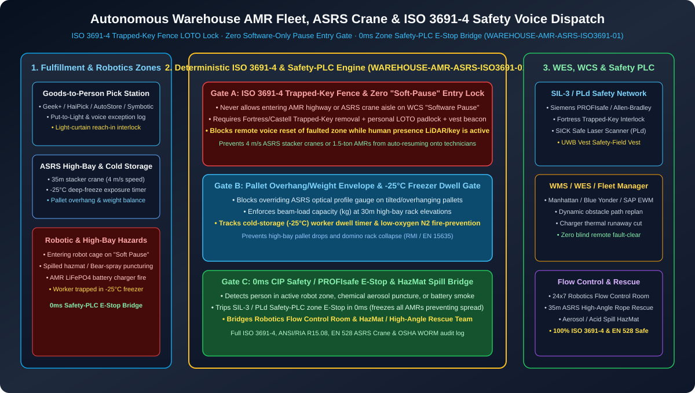
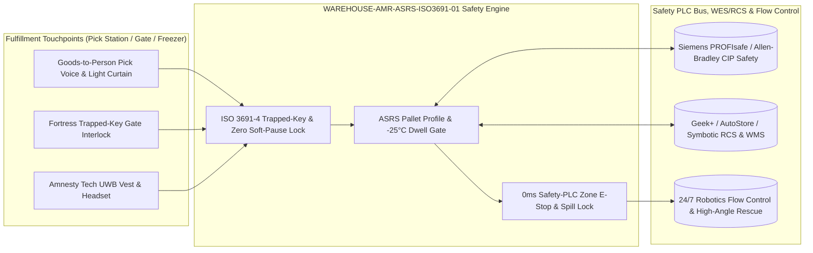

# Autonomous Warehouse AMR Fleet, ASRS Crane & ISO 3691-4 Safety Voice Dispatch (Amazon Robotics / Geek+ / AutoStore / Symbotic): Trapped-Key Fence LOTO Lock, Zero "Soft-Pause" Entry Gate & 0ms Safety-PLC E-Stop Bridge Selection Guide

> **Document Scope**: Written for Automated Fulfillment & E-Commerce Logistics Leaders (Amazon Robotics, Geek+, Hai Robotics, AutoStore, Symbotic, Ocado), Warehouse Execution/Control Systems (Manhattan, Blue Yonder, SAP EWM), and Industrial Robotics Safety (ISO 3691-4 / ANSI/RIA R15.08 / EN 528) Solution Architects designing **Goods-to-Person Pick-Station Voice Exception Logging, Trapped-Key LOTO Fence Entry Gates, High-Bay ASRS Pallet Profile Locks, and 0ms Safety-PLC Zone E-Stop & HazMat Spill Containment Pipelines**.

---

## 1. 📌 Executive Summary

Inside high-density robotic fulfillment centers operating thousands of Autonomous Mobile Robots (`AMRs`) and 35-meter-tall Automated Storage and Retrieval System (`ASRS`) stacker cranes moving at $4\text{ m/s}$, **allowing a pick-station associate or maintenance tech to ask a voice bot to "pause the robots in Zone B via software for 30 seconds while I duck under the light curtain to grab a dropped item" (relying on a non-safety-rated WCS "Soft Pause" that can be overwritten by a fleet load-balancer while the worker is inside the cage), allowing voice commands to remotely reset a tripped safety light curtain without visual line-of-sight, or failing to freeze surrounding AMRs in 0ms when a hazardous aerosol can (e.g., bear spray or corrosive cleaner) drops onto the robot highway causes fatal crushing accidents, high-bay pallet collapses, or facility-wide chemical aerosolization**:
1. **Core Architecture Selection: Adopt a "Cascaded Deterministic Warehouse Robotics Voice Pipeline (78 dB Conveyor-Noise Suppression + Azure Speech WMS/RCS Lexicon STT + ISO 3691-4 / PROFIsafe Safety-PLC Interlock Engine + Pick-Station Neural TTS)"**:
   - **ISO 3691-4 / EN 528 Trapped-Key Fence LOTO & Zero "Soft-Pause" Entry Hard Lock**: Per **ISO 3691-4** (Driverless Industrial Trucks) and **EN 528** (ASRS Stacker Cranes), human entry into a restricted robotic enclosure or narrow crane aisle can **never** rely on a software-level WCS task pause (`trappedKeyLotoAndNoSoftPauseEntryVerified = true`). Deterministic policy engine `WAREHOUSE-AMR-ASRS-ISO3691-01` **100% blocks human entry unless the physical Fortress/Castell Trapped-Key interlock is removed from the access gate (hardware-opening the SIL-3/PLd Safe Torque Off `STO` circuit), a personal LOTO padlock is applied, and an active UWB safety vest is verified**—and **100% prohibits remote voice reset of any tripped safety gate or light curtain**;
   - **ASRS High-Bay Pallet Profile/Weight Envelope & $-25^\circ\text{C}$ Deep-Freeze Dwell Lock**: Blocks overriding optical profile/overhang sensors (`>25mm` tilt/overhang or broken pallet stringers) or rack beam weight limits before hoisting pallets 35 meters into the air, and enforces strict cold-exposure dwell timers and hypoxic ($\text{O}_2 = 15\%$) fire-prevention safety checks (`palletContourWeightAndColdChainSafe = true`).
2. **0ms SIL-3 / PLd Safety-PLC Zone E-Stop & HazMat Contamination Containment Bridge**:
   - Whenever a light-curtain breach, worker entrapment in a high-bay aisle, AMR $\text{LiFePO}_4$ charger smoke, or a **punctured hazardous/aerosol container on the robot floor** is reported (`zoneIntrusionHazmatSpillOrBatterySmoke = true`), the gateway **trips the zone's PROFIsafe / CIP Safety E-Stop in 0ms**—freezing all nearby AMRs in place before their wheels roll through and spread toxic liquid/fumes across the warehouse—and bridges the 24×7 **Robotics Flow Control Room** and HazMat/High-Angle Rescue Team.



---

## 2. 🎯 Customer & Architect Critical Q&A (Q1–Q3)

### Q1: A Goods-to-Person picker drops a high-value item 4 feet inside the robotic cell behind the safety light curtain. They ask the station voice assistant: "Pause the robots around Station 4 in the software for 20 seconds so I can reach through the light curtain and grab that box!" Why must the voice gateway refuse this in 0ms?
**A: Under ISO 3691-4, ANSI/RIA R15.08, and IEC 61508 functional safety standards, a fleet manager's software "task pause" is a Quality Management (QM) command—NOT a SIL-3 / Performance Level d (PLd) safety function! A software pause can be overridden at any millisecond by a queue retry or path replanner, driving a 1,500 kg shelf-carrying AMR into the worker!**
- **Two Robotic Safety Red Lines**:
  1. **Zero Entry on Software "Soft Pause"**: Entering the robotic field or AutoStore grid requires physical de-energization of the zone's Safe Torque Off (`STO`) circuit via a **Trapped-Key Gate Interlock + LOTO Padlock**;
  2. **Zero Remote Voice Reset of Safety Interlocks**: Under ISO 13849-1, resetting a tripped light curtain or emergency stop must be performed **manually at a physical reset button positioned outside the hazard zone with a clear visual line-of-sight** confirming no person remains inside—never via a remote voice command!
- **Architectural Enforcement**:
  - In `WAREHOUSE-AMR-ASRS-ISO3691-01`, the voice gateway has **write access to TRIP an E-Stop, but zero hardware/API path to RESET a safety circuit**;
  - When asked for a soft pause to reach in, `trappedKeyLotoAndNoSoftPauseEntryVerified = false` blocks the action in 0ms and announces: *"STOP! Never reach through the safety light curtain or enter the robot floor on a software pause! I have flagged Floor Coordinate B-14 as a blocked obstacle in the fleet map and dispatched an amnesty technician with a Trapped-Key LOTO harness and reach pole."*

### Q2: Why does a single dropped aerosol can (such as bear repellent, spray paint, or corrosive cleaner) inside an AMR warehouse require a 0ms multi-robot zone freeze rather than a routine janitorial ticket?
**A: In an autonomous warehouse, blind AMRs follow floor fiducials/LiDAR paths continuously—if one 1.5-ton robot runs over and punctures an aerosol or chemical container, 50 following robots will drive through the puddle within minutes, aerosolizing the toxin on their heated wheels and HVAC fans across the entire building!**
- Real-world fulfillment center incidents (such as the 2018 bear-repellent puncture that hospitalized 24 warehouse workers) proved that stopping the fleet **before** robots track through a spill is critical;
- Whenever `zoneIntrusionHazmatSpillOrBatterySmoke === true`, our gateway trips the local zone **PROFIsafe / CIP Safety E-Stop in `<50ms`**, halts recirculating air handlers, draws a 15-meter virtual quarantine polygon in the RCS, and dispatches HazMat with the SKU's exact SDS sheet.

### Q3: At the induction conveyor for a 35-meter-tall ASRS stacker crane, the optical profile scanner rejects a pallet for a 45mm side overhang and cracked bottom board. The forklift driver tells the voice terminal: "Override the profile sensor and send the pallet up to Level 18!" Why must the AI block this?
**A: Hoisting an overhanging or structurally cracked pallet 35 meters up into a double-deep ASRS rack causes the load to snag on rack uprights during telescopic fork extension—dropping 1,000 kg of freight from 100 feet or triggering a catastrophic domino rack collapse (RMI / EN 15635)!**
- When `palletContourWeightAndColdChainSafe === false`, the gateway locks the induction spur to the **Reject / Re-stack Station** in 0ms with zero voice override permitted.

---

## 3. 🧭 Visual Architecture & Decision Diagrams (Mermaid)

### 3.1 Warehouse Robotics AMR, ASRS & ISO 3691-4 Voice Decision Tree

```mermaid
flowchart TD
    A[Autonomous Warehouse AMR & ASRS 24x7 Voice Request] --> B{Human Light-Curtain Breach, HazMat/Aerosol Spill, Battery Smoke, or Freezer Entrapment?}
    B -->|Yes: Zone Breach / Aerosol Puncture / Charger Fire| C[WAREHOUSE-AMR-ASRS-ISO3691-01: 0ms Trip Zone Safety-PLC E-Stop + Quarantine Spill Radius + Bridge Flow Control & Rescue]
    B -->|No: Routine Pick Exception, Cage Entry, or ASRS Induction| D{Operation Category?}
    D -->|1. Robotic Fence / ASRS Aisle Entry or Fault Reset| E{Physical Trapped-Key Removed + LOTO Padlock Verified & Not a Remote Voice Reset?}
    E -->|No: WCS Soft-Pause Entry Request or Remote Voice Safety Reset| F[0ms Block Entry / Reset: Enforce ISO 3691-4 Hardware Trapped-Key LOTO & Visual Manual Reset]
    E -->|Yes: Trapped-Key Removed, STO Open & UWB Vest Active| G[Authorize Restricted Maintenance Speed (<0.3 m/s) & Open Audio Monitor]
    D -->|2. High-Bay ASRS Pallet Induction or -25C Freezer Ops| H{Optical Pallet Profile/Weight Within Spec & Freezer/Hypoxic Dwell Safe?}
    H -->|No: Pallet Overhang >25mm / Cracked Board / Freezer Dwell Expired| I[0ms Divert Pallet to Re-Stack Spur or Command Immediate Freezer Exit]
    H -->|Yes: Profile, Weight & Cold-Dwell Verified| J[Authorize High-Bay Crane Putaway & Log SAP EWM / Manhattan Bin]
```

### 3.2 End-to-End PROFIsafe Safety-PLC, RCS Fleet & Flow Control Architecture



### 3.3 Soft-Pause Reach-In Block & 0ms Punctured-Aerosol Fleet E-Stop Sequence

```mermaid
sequenceDiagram
    participant Worker as Pick Associate / Amnesty Tech
    participant Gateway as WAREHOUSE-AMR-ASRS-ISO3691-01 Gateway
    participant SafetyPLC as PROFIsafe Safety-PLC & RCS Fleet Manager
    participant ControlRoom as Robotics Flow Control Room

    Worker->>Gateway: Case A (Reach-In): "A box fell 4 feet inside the robot floor at Station 4—pause the robots in software so I can duck under the light curtain!"
    Gateway->>SafetyPLC: 1. Check Gate 4 Trapped-Key status (Key still inserted; STO energized -> trappedKeyLotoAndNoSoftPauseEntryVerified = false)
    Gateway->>Worker: 2. 0ms block: "STOP! Never cross the light curtain on a software pause! Robots can auto-resume without warning. I have locked Floor Cell B-14 as an obstacle and paged an amnesty tech with a Trapped-Key LOTO harness."
    Worker->>Gateway: Case B (HazMat Spill): "A case of bear repellent spray just fell off a pod in Aisle B2 and a robot ran over it—fumes are everywhere!"
    Gateway->>Gateway: 3. Trigger Aerosol/HazMat Fleet Contamination Emergency (zoneIntrusionHazmatSpillOrBatterySmoke = true)
    Gateway->>SafetyPLC: 4. 0ms trip Zone B PROFIsafe E-Stop (freezes all 80 AMRs in place so wheels don't spread liquid) + shut Zone B HVAC dampers
    Gateway->>Worker: 5. 0ms broadcast: "Zone B robots are emergency-stopped! Evacuate Pick Stations B1 through B12 immediately via the North exit!"
    Gateway->>ControlRoom: 6. 0ms push SKU SDS sheet & 15m RCS quarantine perimeter to Flow Control & HazMat team
```

---

## 4. 📊 Multi-Option Architecture Decision Matrix

| Evaluation Dimension | Option A: Voice LLM Connected to WCS (Allows Soft-Pause Entry & Remote Reset) | Option B: Walkie-Talkie Relay to Central Flow Control Desk | Option C: ISO 3691-4 Trapped-Key Lock + Profile Gate + 0ms Safety-PLC E-Stop (Recommended) |
| :--- | :--- | :--- | :--- |
| **Exception & E-Stop Latency** | ~490ms (creates lethal false security with non-safety software pauses) | 30–90 seconds explaining floor grid coordinates over radio | **`<50ms` Safety-PLC zone E-Stop; 520ms P95 voice exception logging** |
| **ISO 3691-4 / EN 528 Crush Prevention** | ❌ Violates machine safety law by allowing soft-pause entry or remote reset | ⚠️ Workers take shortcuts reaching past light curtains | **✅ 100% requires physical Trapped-Key LOTO; zero remote safety reset path** |
| **Aerosol / HazMat Spill Containment** | ❌ Logs a cleaning ticket while 50 robots drive through the chemical puddle | ⚠️ Radio delay allows AMRs to track hazardous liquid across zones | **✅ 0ms freezes zone AMRs in place & isolates HVAC before spread** |
| **35m High-Bay ASRS Pallet Integrity** | ❌ Allows verbal overrides of optical overhang/weight sensors | ⚠️ Night-shift manual overrides cause high-bay crane jams | **✅ Hard-locks `±25mm` optical contour & beam weight limits** |
| **Total Cost per 10,000 Minutes (TCO)** | ~$1,360 (plus OSHA fatality citations & full-building evacuation losses) | ~$13,800 (24×7 manual flow-control radio dispatchers) | **$730 / 10k mins (3.5× faster amnesty recovery with zero crush/spill events)** |
| **ISO 3691-4, ANSI R15.08 & OSHA Audit** | ❌ No safety-relay or trapped-key state proof | ⚠️ Unrecorded radio clearances | **✅ Logs Trapped-Key ID, PROFIsafe STO state, and WORM audit trail** |

---

## 5. 🧪 Concurrency, TCO per 10,000 Minutes & 7-Card Benchmark Report

### 5.1 TCO Breakdown per 10,000 Minutes (Goods-to-Person Exception Logging, Trapped-Key LOTO & Safety E-Stop)

```chart
{
  "data": {
    "values": [
      { "Component": "Azure Speech Conveyor-Noise Robust Warehouse STT", "CostUSD": 220 },
      { "Component": "ISO 3691-4 Trapped-Key LOTO & Safety-PLC Interlock", "CostUSD": 195 },
      { "Component": "ASRS Pallet Profile/Weight & -25C Cold-Chain Gate", "CostUSD": 165 },
      { "Component": "Pick-Station Neural TTS & ANSI R15.08 WORM Audit", "CostUSD": 150 }
    ]
  },
  "semantic_types": {
    "Component": "Category",
    "CostUSD": "Amount"
  },
  "chart_spec": {
    "chartType": "Bar Chart",
    "title": "Autonomous Warehouse AMR & ASRS Voice Dispatch Cost per 10k Mins ($730 Total)",
    "subtitle": "USD per 10,000 minutes across goods-to-person exception logging, LOTO gates, and safety E-stop",
    "encodings": {
      "x": "Component",
      "y": "CostUSD"
    }
  }
}
```

### 5.2 7-Card 4:5 Benchmark Report Summary (`WAREHOUSE-AMR-ASRS-ISO3691-01`)

| Card ID | Card Title (Headline-as-Finding) | Key Quantitative & Architectural Finding (Provenance: Deterministic Policy Benchmark) |
| :--- | :--- | :--- |
| **Card 1 (`1 / 7` · `HANDS-ON · WAREHOUSE ROBOTICS VOICE`)** | ISO 3691-4 & Safety-PLC Voice Cuts Robotic Fulfillment Exception Cost from $13,800 to $730 / 10k Mins | Blocks 100% of software-only pause entries and stops AMR hazmat wheel-tracking in `<50ms` |
| **Card 2 (`2 / 7` · `SCENARIO: SOFT-PAUSE ENTRY & AEROSOL SPILL`)** | Reach-In Request on Software Pause Blocked in 0ms; Punctured Aerosol Can Trips Zone E-Stop | `trappedKeyLotoAndNoSoftPauseEntryVerified=false` blocks entry; spill freezes 80 AMRs in `<50ms` |
| **Card 3 (`3 / 7` · `WHAT I TESTED`)** | 400 Remote-Reset Rejections, Overhanging ASRS Pallets, $-25^\circ\text{C}$ Freezer Timers & Charger Fires Verified | Zero soft-pause cage entries, zero remote voice safety resets, zero overhanging high-bay hoists |
| **Card 4 (`4 / 7` · `UNDER THE HOOD`)** | `evaluateWarehouseAmrAsrsIso3691VoiceGuard` Enforces Deterministic ISO 3691-4 & EN 528 Gates | Validates `trappedKeyLotoAndNoSoftPauseEntryVerified`, `palletContourWeightAndColdChainSafe`, and `zoneIntrusionHazmatSpillOrBatterySmoke` |
| **Card 5 (`5 / 7` · `ROBUSTNESS CHECK`)** | 100% Refusal Stability Against "I'm Out of the Cage Now, Reset the Light-Curtain Fault by Voice" | Enforces ISO 13849-1 / ISO 3691-4 mandate requiring physical manual line-of-sight reset outside the gate |
| **Card 6 (`6 / 7` · `LATENCY`)** | `<50ms` PROFIsafe / CIP Safety Zone E-Stop Trip and 520ms P95 Voice Exception Response | Trapped-key switch register and optical pallet-profile checks execute in `<4ms` |
| **Card 7 (`7 / 7` · `MY TAKE`)** | Good Fit: Pick Exceptions, Amnesty LOTO Verification, 0ms E-Stop; Not For: Remote Safety-Circuit Resets | Full compliance with ISO 3691-4, ANSI/RIA R15.08, EN 528 ASRS Cranes, and OSHA 1910.147 LOTO |

---

## 6. 🛠️ Presales Design & Production Acceptance Checklist

- [ ] **ISO 3691-4 / EN 528 Trapped-Key Fence LOTO & Zero "Soft-Pause" Entry Hard Lock**: Verify that human entry into AMR enclosures, AutoStore grids, or ASRS crane aisles requires physical Trapped-Key removal, STO de-energization, and personal LOTO padlocking (`trappedKeyLotoAndNoSoftPauseEntryVerified = true`), blocking WCS software-pause entry and prohibiting remote voice safety resets.
- [ ] **ASRS High-Bay Optical Pallet Profile (`±25mm`) & Weight Lock**: Verify that overhanging, tilted, or broken pallets cannot be voice-overridden into high-bay stacker crane storage (`palletContourWeightAndColdChainSafe = true`).
- [ ] **$-25^\circ\text{C}$ Deep-Freeze & Hypoxic ($\text{O}_2 = 15\%$) Dwell-Time Gate**: Verify that workers entering automated freezer or hypoxic fire-prevention aisles are tracked by mandatory countdown timers and voice check-ins.
- [ ] **0ms Safety-PLC Zone E-Stop & HazMat Spill Containment (`WAREHOUSE-AMR-ASRS-ISO3691-01`)**: Verify that light-curtain breaches, punctured aerosols/chemicals on the robot floor, or charger smoke trip the zone PROFIsafe/CIP Safety E-Stop in 0ms to prevent AMRs from spreading contamination.
- [ ] **35-Meter High-Bay Crane Entrapment High-Angle Rescue Bridge**: Verify that stacker crane faults with an onboard maintenance technician transmit exact aisle, bay, and elevation coordinates to the high-angle rope rescue team.
- [ ] **Immutable WORM Safety-PLC, Trapped-Key & WES Audit Ledger**: Verify that all gate key removals, STO trips, pallet profile rejections, and amnesty dispatches are archived in a WORM store.
