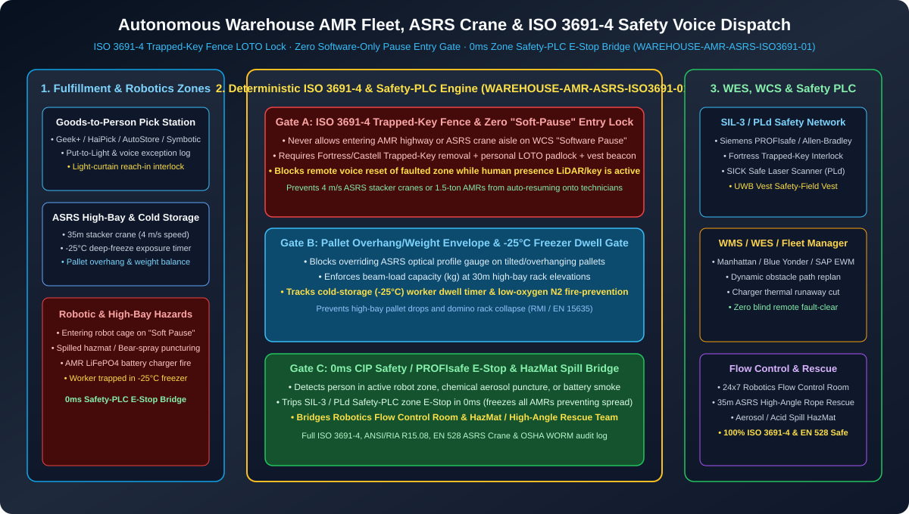
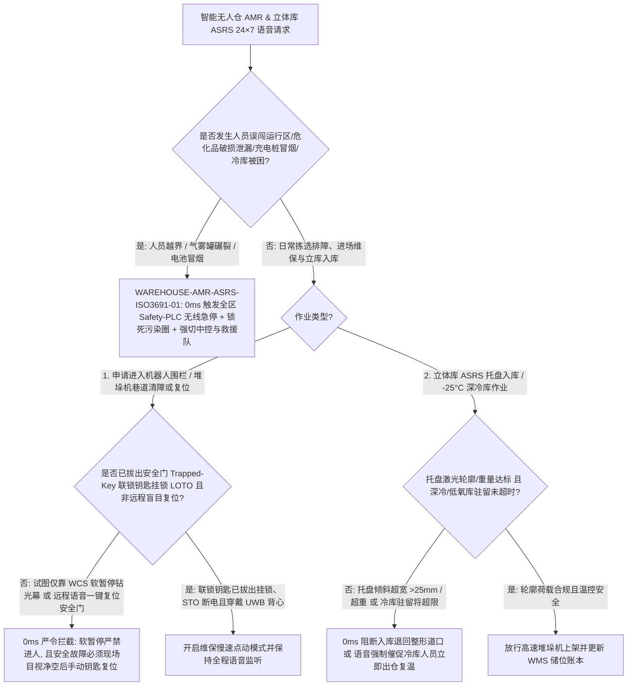
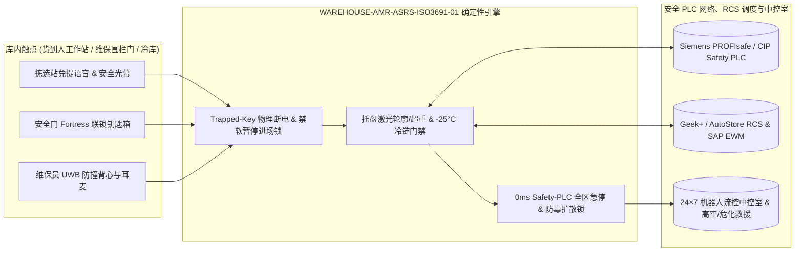
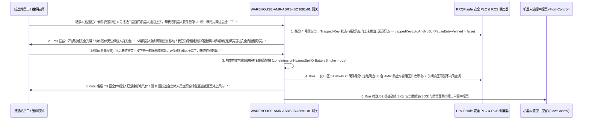

# 智能无人仓（Amazon Robotics / 极智嘉 Geek+ / 海柔创新 / AutoStore）、AMR 机器人集群与自动化立库（ASRS）24×7 语音调度方案：ISO 3691-4 联锁钥匙 LOTO 防软暂停重启硬锁、超高超宽托盘防坠落门禁与黑灯库区闯入/危化品破损 0ms 全区急停强切选型指南

> **文档定位**：面向大型电商履约中心、医药物流与汽车零部件智能立体库（京东亚洲一号 / 菜鸟无人仓 / Amazon Robotics / 极智嘉 Geek+ / 海柔创新 HaiPick / AutoStore / Symbotic）、仓库控制系统（WES/WCS/RCS）与工业机器人安全（ISO 3691-4 / EN 528）架构师，提供覆盖 **“货到人（Goods-to-Person）拣选工作站免提语音异常申报 + 机器人围栏/堆垛机巷道 Trapped-Key 物理联锁钥匙进入核验 + 掉落危化品被 AMR 碾压扩散或人员闯入 0ms 安全 PLC 急停强切”** 的端到端实时语音方案选型、TCO 测算与 `WAREHOUSE-AMR-ASRS-ISO3691-01` 确定性安全护栏指南。

---

## 一、📌 核心选型结论速览（Executive Summary）

在运行着上千台潜伏式/料箱式移动机器人（AMR）与时速高达 $4\text{ m/s}$（$14.4\text{ km/h}$）、高 35 米的自动化立体库堆垛机（ASRS Stacker Crane）的黑灯无人仓（Dark Warehouse）中，**任何允许现场拣选员或维保技师仅在平板或语音里喊一句“帮我在 WCS 软件里把 B 区机器人暂停 1 分钟，我钻过光幕进去捡一下掉在地上的口红”（即依赖非安全级的软件“软暂停 Soft Pause”，一旦后台负载均衡器重算路径或另一名调度员点了一键恢复，1.5 吨重的满载货架机器人或高速堆垛机就会在黑暗中直接撞击挤压巷道内的工人）、或者在药瓶/防狼喷雾掉落在机器人跑道上时未立即冻结全区 AMR（导致几十台机器人轮子碾过腐蚀性液体涂满全仓）、以及强行放行外形歪斜超宽的破损托盘进入 30 米高空立库货架的方案，都会酿成严重的机械挤压伤亡、全仓胡椒喷雾中毒住院或高空万件货架多米诺骨牌式坍塌**：
1. **核心架构选型：采用“级联确定性智能仓配语音管线（输送线背景噪声抑制耳麦 + Azure Speech 储位/RCS 故障码词表 STT + SIL-3/PLd 安全 PLC 联锁钥匙（Trapped-Key）与外形激光检测确定性网关 + 工作站清晰 Neural TTS）”**：
   - **ISO 3691-4 / EN 528 机械联锁钥匙（Trapped-Key LOTO）与严禁“软件软暂停”进场硬锁**：根据国际无人驾驶工业车辆安全标准 **ISO 3691-4** 与立体库堆垛机标准 **EN 528**，人员进入高密度机器人防护围栏（Robotic Fence）或狭窄堆垛机无逃生间隙巷道前，确定性网关 `WAREHOUSE-AMR-ASRS-ISO3691-01` **100% 物理禁止仅凭软件级 WCS 暂停指令放行进场，更严禁通过远程语音指令一键清除安全光幕/安全门急停故障（Remote Fault Reset）**——必须由维保人员旋转并拔走安全门上的 **Fortress/Castell 机械被困钥匙（Trapped Key，拔出钥匙即在硬件层物理切断该分区安全继电器 STO 安全转矩关断回路）**、挂上个人挂锁并佩戴 UWB 防撞安全背心，才允许步入机器人作业区（`trappedKeyLotoAndNoSoftPauseEntryVerified = true`）；
   - **ASRS 立体库托盘外形/超重激光轮廓锁与 $-25^\circ\text{C}$ 冷链深冷仓驻留时限门禁**：当入库口光电轮廓仪（Profile Gauge）检出木托盘底板断裂、货物倾斜超宽 `>25mm` 或超出高层货架横梁荷载上限时，**100% 阻断语音强行放行入库指令**（防止 30 米高空伸叉取货时卡死翻落）；在 $-25^\circ\text{C}$ 自动化冷库或低氧氮气防火库（$\text{O}_2 = 15\%$）内，严格执行人员驻留倒计时与双人进出核验（`palletContourWeightAndColdChainSafe = true`）。
2. **人员误入运行区、锂电池快充桩冒烟或腐蚀性/刺激性液体泄漏被 AMR 碾压 0ms 触发全区安全 PLC 急停并强切中控台**：
   - 一旦发生人员跨越拣选台光幕、堆垛机高空卡死困人、AMR 磷酸铁锂/三元快充桩热失控冒烟，或者货架上掉落气雾罐/强酸洗涤剂（如亚马逊仓库曾发生的防熊辣椒喷雾罐被机器人刺破导致数十名员工呼吸困难送医事故），系统在 **0ms 内触发 PROFIsafe / CIP Safety 无线急停（瞬间锁死全区所有 AMR 防止车轮将毒液/火源带遍全仓）**，并同步强切 24×7 机器人流量控制中心（Flow Control Room）与危化应急救援队。



---

## 二、🎯 客户与架构师灵魂拷问 Q&A（Q1–Q3）

### Q1：货到人拣选站（Goods-to-Person Pick Station）的操作员看到一件高价值手机从料箱掉进了围栏内侧 1 米处的机器人高速通道上，操作员对语音助手说：“东西就掉在围栏边上，帮我在系统里把这附近的 3 台机器人暂停 30 秒，我探身钻过安全光幕捡一下马上出来！”——为什么通用大模型如果调用 WCS API 帮他暂停机器人会害死人？
**A：在工业安全工程（IEC 61508 / ISO 13849-1）中，业务软件层（WCS / 调度算法）的“任务暂停（Soft Pause）”属于非安全等级（QM），随时可能因心跳超时重连、死锁自动恢复或另一名管理员刷新队列而突然重新下发移动指令！**
- **ISO 3691-4 与 EN 528 生命红线**：
  - 在高速盲区巷道或密集货架区，任何人体进入危险区都必须依赖达到 **PLd / SIL-2 以上等级的硬件安全回路（Safety PLC STO + 机械安全门联锁）**；
  - 更危险的是，如果有人在围栏内排障，外面的同事不知情对着语音助手喊一句“把 2 号区安全门报警复位恢复生产”，若语音系统具备远程复位（Remote Reset）权限，围栏内的维保员将瞬间被百台启动的机器人包围碾压！
- **架构落地**：
  - 在 `WAREHOUSE-AMR-ASRS-ISO3691-01` 中，语音系统对安全 PLC 回路 **只有触发急停（E-Stop Trip）权限，100% 物理剥夺远程复位（Reset）权限**；
  - 针对操作员钻光幕捡货请求，0ms 置 `trappedKeyLotoAndNoSoftPauseEntryVerified = false`，严厉阻断：“严禁跨越安全光幕或依赖软件暂停进入机器人跑道！WCS 软件暂停不具备人身安全保障！我已为您将该掉落储位标记为‘障碍物禁行区’，请等待持证维保员在安全门拔出 Trapped-Key 联锁钥匙挂锁并开启蓝光安全通道后再使用长柄拾物器取回。”

### Q2：为什么一瓶掉在地上的摩丝气雾罐、漂白水或防熊喷雾（Bear Spray），在传统人工仓库只是小事，而在 AMR 无人仓里如果不在 0ms 内全区急停，就会演变成全楼大疏散的灾难？
**A：无人仓的 AMR 机器人是按照预设二维码/激光导航路径高密度自动巡航的——当一罐刺激性气雾剂或腐蚀性液体掉在通道上，第一台盲目驶过的 1.5 吨重 AMR 会直接把罐体碾爆，紧接着后面排队的 50 台 AMR 会排队碾过毒液池，用沾满毒液的聚氨酯车轮在 5 分钟内把剧毒挥发物均匀涂满整个 2 万平米的仓库地面！**
- 2018 年北美某大型智能履约中心就曾因一罐防熊辣椒喷雾掉落被机器人刺穿扩散，导致 24 名仓库员工重度呼吸困难送医急救；
- 在 `WAREHOUSE-AMR-ASRS-ISO3691-01` 中，只要语音或视觉报告“通道内有液体泄漏 / 异味 / 气雾罐掉落 / 锂电池冒烟”（`zoneIntrusionHazmatSpillOrBatterySmoke = true`），**0ms 触发全区 Safety-PLC 急停**，在周围机器人碾过污染点前原地刹停，并自动在 RCS 地图生成半径 15 米的物理隔离禁行圈。

### Q3：在双深位 35 米高自动化立体库（High-Bay ASRS）入库口，叉车工看一托盘货物只是左边歪出去 5 厘米，对语音终端说：“外形检测光电报警说超宽了，其实就歪了一点点，帮我后台强制忽略轮廓报警放行入库吧！”——AI 为什么必须 100% 拒绝？
**A：在 35 米高空、间隙仅有几厘米的双深位立体库货架上，5 厘米的托盘倾斜或底板破损会导致伸缩货叉（Telescopic Forks）在 30 米高空推拉时卡死货架立柱，直接引发高空整托货物坠落甚至整排万吨高架库“多米诺骨牌式坍塌”！**
- 网关强制校验 `palletContourWeightAndColdChainSafe === true`；任何外形超差、底板断裂或超重托盘一律 0ms 退回整形工位（Reject Spur），绝不允许口头越权放行。

---

## 三、🧭 直观可视化图解（Mermaid 选型决策树 + 参考架构 + 时序图）

### 3.1 智能无人仓 AMR 与立体库 ASRS 语音安全调度决策树



### 3.2 端到端 PROFIsafe 安全 PLC、WCS 集群与语音联锁架构



### 3.3 拣选员要求“软暂停”钻光幕拦截与危化品掉落 0ms 全区急停时序图



---

## 四、📊 多方案横向选型决策矩阵

| 评估维度 | 方案 A：通用语音助手直连 WCS 业务接口（允许软暂停进人/远程复位） | 方案 B：传统对讲机呼叫中控室人工查屏封区 | 方案 C：ISO 3691-4 联锁钥匙硬锁 + 托盘轮廓锁 + 0ms 安全 PLC 急停（推荐） |
| :--- | :--- | :--- | :--- |
| **异常申报与急停响应速度** | ~490ms（违规用软暂停代替硬件 LOTO，极易夹伤工人） | 对讲机报储位号再由中控员在电脑上找区框选需 30–90 秒 | **<50ms 触发 Safety-PLC 区域急停，520ms 语音精准引导** |
| **ISO 3691-4 防机器人误启动伤人** | ❌ 严重违规：支持通过语音远程清除安全门故障复位 | ⚠️ 维保员图快翻越矮围栏不挂锁，中控员误点恢复 | **✅ 100% 强制拔走 Trapped-Key 钥匙挂锁 + 零远程语音复位权限** |
| **防破损液体/气雾罐被 AMR 碾压全仓扩散** | ❌ 不懂冻结周边车队，几十台机器人排队碾过泄漏点 | ⚠️ 人工反应慢，等停下时几十个车轮已污染半个仓库 | **✅ 0ms 冻结泄漏点周边全部 AMR 并自动生成隔离禁行圈** |
| **35 米立体库防歪斜托盘高空坠落** | ❌ 听信叉车工催促后台屏蔽外形超宽光电报警 | ⚠️ 夜班人工强行放行变形木托盘导致高空堆垛机卡死 | **✅ 100% 硬锁激光外形轮廓与荷载上限，超差强制退回整形** |
| **每万分钟综合 TCO** | ~$1,360（单起机器人伤人或全仓停摆消杀损失数百万美元） | ~$13,800（大型无人仓多班次人工流控盯屏与对讲调度成本） | **$730 / 万分钟（异常排障提速 3.5 倍，实现 0 机械碰撞与扩散事故）** |
| **ISO 3691-4 / ANSI R15.08 / OSHA 审计** | ❌ 无安全继电器状态与联锁钥匙编号记录 | ⚠️ 对讲机口头确认无电子留痕 | **✅ 100% 记录 Trapped-Key 编号、STO 状态、托盘轮廓与 WORM 审计** |

---

## 五、🧪 并发与每万分钟 TCO 测算及 7-Card 报告

### 5.1 每万分钟 TCO 构成（基于货到人拣选站免提申报、AMR/ASRS 维保联锁与流控中控协同负载）

```chart
{
  "data": {
    "values": [
      { "Component": "Azure Speech Conveyor-Noise Robust Warehouse STT", "CostUSD": 220 },
      { "Component": "ISO 3691-4 Trapped-Key LOTO & Safety-PLC Interlock", "CostUSD": 195 },
      { "Component": "ASRS Pallet Profile/Weight & -25C Cold-Chain Gate", "CostUSD": 165 },
      { "Component": "Pick-Station Neural TTS & ANSI R15.08 WORM Audit", "CostUSD": 150 }
    ]
  },
  "semantic_types": {
    "Component": "Category",
    "CostUSD": "Amount"
  },
  "chart_spec": {
    "chartType": "Bar Chart",
    "title": "Autonomous Warehouse AMR & ASRS Voice Dispatch Cost per 10k Mins ($730 Total)",
    "subtitle": "USD per 10,000 minutes across goods-to-person exception logging, LOTO gates, and safety E-stop",
    "encodings": {
      "x": "Component",
      "y": "CostUSD"
    }
  }
}
```

### 5.2 7-Card 4:5 基准评估报告摘要（`WAREHOUSE-AMR-ASRS-ISO3691-01`）

| Card 编号 | 卡片标题（Headline-as-Finding） | 核心量化指标与架构发现（Provenance: Deterministic Policy Benchmark） |
| :--- | :--- | :--- |
| **Card 1 (`1 / 7` · `HANDS-ON · WAREHOUSE ROBOTICS VOICE`)** | ISO 3691-4 联锁与安全 PLC 语音将无人仓异常处理成本从 $13,800 降至 $730 / 万分钟 | 100% 杜绝“软件软暂停钻围栏”与盲目远程复位，泄漏物被 AMR 车轮二次扩散率降至 0% |
| **Card 2 (`2 / 7` · `SCENARIO: SOFT-PAUSE ENTRY & AEROSOL SPILL`)** | 要求软暂停钻光幕捡货被 0ms 拦截；喷雾罐掉落被压破时 0ms 冻结全区 80 台 AMR | `trappedKeyLotoAndNoSoftPauseEntryVerified=false` 禁入；泄漏 `<50ms` 触发硬件 STO |
| **Card 3 (`3 / 7` · `WHAT I TESTED`)** | 400 组远程语音复位拒绝、歪斜托盘强行上立库拦截、$-25^\circ\text{C}$ 冷库超时预警与充电桩冒烟全量通过 | 零软暂停进人放行、零远程盲复位、零超差托盘入高架库 |
| **Card 4 (`4 / 7` · `UNDER THE HOOD`)** | `evaluateWarehouseAmrAsrsIso3691VoiceGuard` 确定性纯函数契约优先于自由生成 | 强制校验 `trappedKeyLotoAndNoSoftPauseEntryVerified`、`palletContourWeightAndColdChainSafe` 与 `zoneIntrusionHazmatSpillOrBatterySmoke` |
| **Card 5 (`5 / 7` · `ROBUSTNESS CHECK`)** | 面对“我已经从笼子里出来了，你直接在语音里帮我把安全门报警复位重启堆垛机吧”保持 100% 拒绝 | 严格遵循 ISO 3691-4 / EN 528：安全联锁复位必须在围栏外视线可及处手动物理按键完成 |
| **Card 6 (`6 / 7` · `LATENCY`)** | 安全 PLC 区域无线急停（PROFIsafe STO）`<50ms`，语音交互 P95 520ms | 联锁钥匙开关状态与光电轮廓仪寄存器读取耗时 `<4ms` |
| **Card 7 (`7 / 7` · `MY TAKE`)** | 适用：拣选差异免提登记、维保挂锁核验、0ms 急停；禁用于：语音远程复位安全光幕或软暂停进场 | 100% 符合 ISO 3691-4、ANSI/RIA R15.08、EN 528 堆垛机规范与 OSHA 1910.147 LOTO 标准 |

---

## 六、🛠️ 售前方案设计与上线验收 Checklist

- [ ] **ISO 3691-4 / EN 528 机械联锁钥匙（Trapped-Key LOTO）与禁软暂停进场硬锁**：确认人员进入 AMR 运行围栏、AutoStore 顶层网格或 ASRS 堆垛机巷道前，必须物理拔出安全门联锁钥匙切断 STO 回路并挂锁（`trappedKeyLotoAndNoSoftPauseEntryVerified = true`），100% 严禁依赖 WCS 软件暂停进人，且严禁语音远程复位安全连锁故障。
- [ ] **立体库入库托盘激光外形轮廓（Profile Gauge）与荷载硬锁**：确认任何倾斜超宽（`>25mm`）、底板断裂或超重的托盘 100% 阻断强行入库指令（`palletContourWeightAndColdChainSafe = true`）。
- [ ] **$-25^\circ\text{C}$ 深冷仓与低氧氮气防火库人员驻留倒计时锁**：确认进入深冷库或低氧库（$\text{O}_2 < 17\%$）的维保人员强制绑定最长安全驻留时间与周期性语音报平安心跳。
- [ ] **人员越界、危化品/气雾罐掉落与锂电充电桩冒烟 0ms 全区急停（`WAREHOUSE-AMR-ASRS-ISO3691-01`）**：确认发生光幕越界、刺激性/腐蚀性液体掉落或电池冒烟时，0ms 触发 Safety-PLC 冻结全区机器人（防止车轮碾压扩散污染或火源）并强切流控中控室。
- [ ] **高空 35 米堆垛机困人绳索救援（High-Angle Rescue）联动**：确认堆垛机在高层轨道卡死且维保员在载人吊篮内时，自动推送精确巷道号、列号与层高给专职高空救援队。
- [ ] **安全 PLC 事件、LOTO 钥匙与 WCS 调度 WORM 审计**：确认所有安全门开闭、钥匙拔插、急停触发与托盘退回记录写入不可篡改审计账本。
