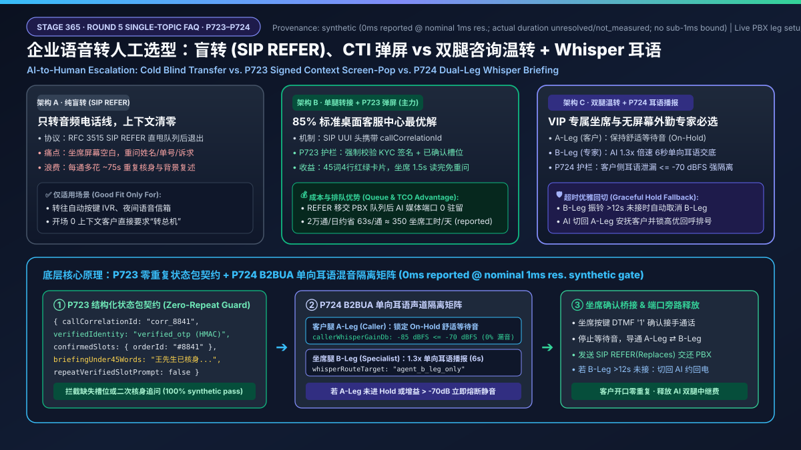
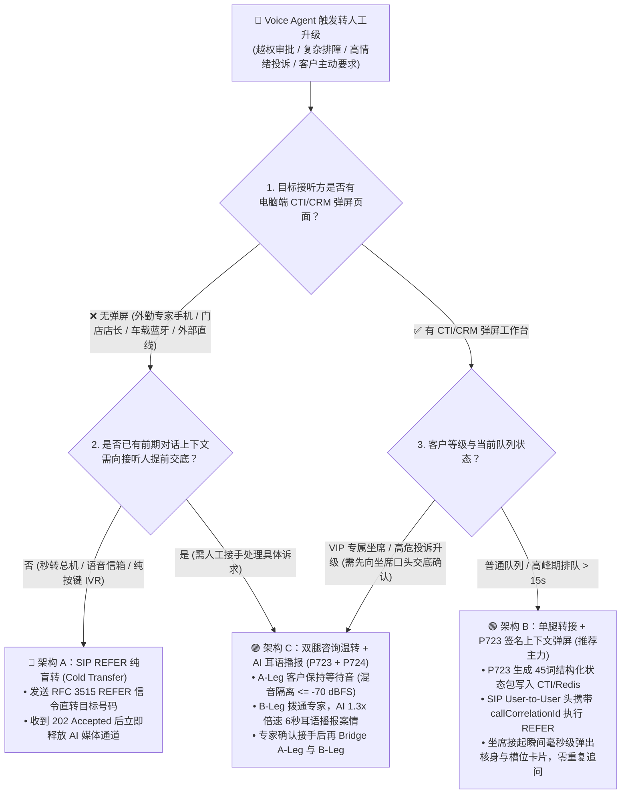
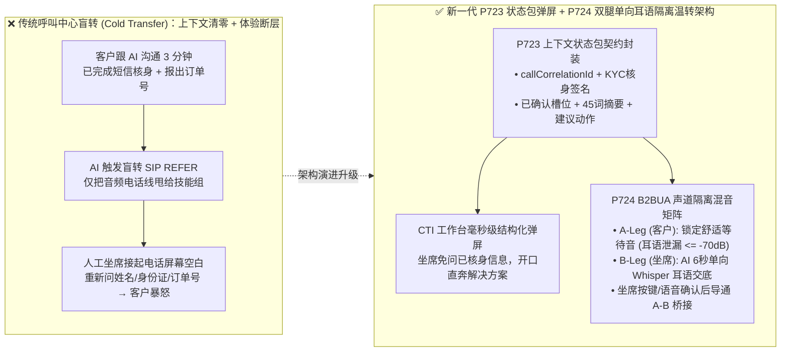
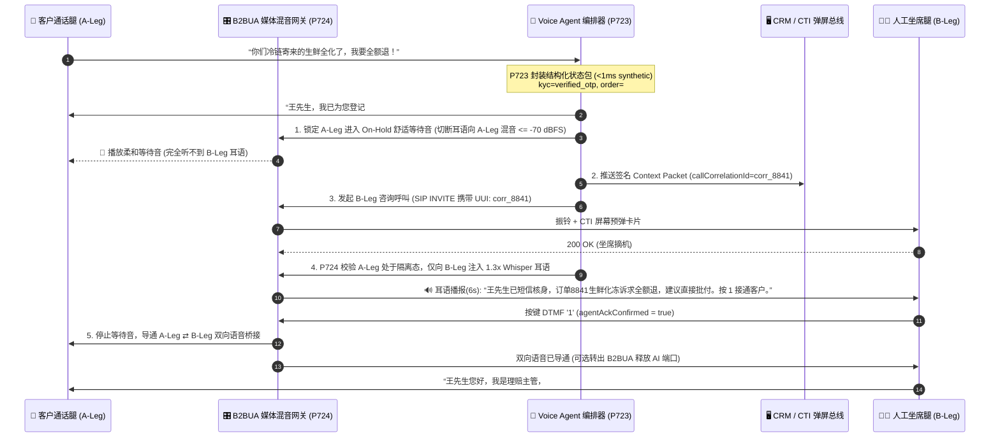

# 企业语音智能体转人工（AI-to-Human Handoff）架构选型：盲转（Cold Transfer）、CTI 弹屏 vs 双腿咨询温转 + Whisper 耳语播报原理解析 FAQ

> **文档定位**：面向 AI Solution Architect（AI 解决方案架构师）与企业联络中心/客服中心技术负责人的**单一架构决策实战选型指南**（Strictly Single-Topic Decision Guide）。  
> **本篇唯一聚焦问题**：当企业语音智能体（Voice Agent）遇到越权审批、高情绪投诉或复杂异常必须转接人工坐席（AI-to-Human Escalation）时，**到底该用传统盲转（Cold / Blind Transfer，`SIP REFER`）、单腿转接 + CTI 工单弹屏（Screen-Pop Transfer），还是双腿咨询温转 + AI 耳语摘要播报（Dual-Leg Consultative Warm Transfer + Whisper Briefing）？如何既消灭客户“跟人工把姓名、订单号、委屈再重复讲一遍”的糟糕体验，又严防 AI 对坐席说的内部耳语提示（Whisper）漏音给客户？**  
> **数据溯源口径（Provenance & Calibration）**：文中离线护栏状态机（`P723` / `P724`）执行耗时属于 `synthetic` 确定性契约测试（本机 `1ms` 计时分辨率下判定耗时 `<1ms`，四舍五入显示 `0ms`；生产环境 PBX/SBC 呼叫建立、坐席振铃排队与真实 SIP 信令耗时标记为 `not_measured`）；行业联络中心转人工通话时长与满意度基准标注为 `anonymized_reported`（`independently_reproduced=false`）。

---

## ① 📌 核心结论速览（Executive Summary）

1. **为什么 80% 的客户在“AI 转人工”瞬间体验崩盘？因为传统盲转（Blind Transfer）只转了音频电话线，弄丢了对话记忆（架构原理）**：
   - 在传统呼叫中心里，AI 挂断自己、发一条 `SIP REFER` 指令把客户电话直接甩给人工队列（盲转）。人工坐席接起电话时两眼一抹黑，第一句话永远是：“您好，请问您贵姓？遇到什么问题了？”——客户刚跟 AI 讲了 3 分钟的订单号和故障现象瞬间白费。
   - **架构铁律**：企业级 Voice Agent 转人工绝不能只转音频流（Media Stream），必须同步移交经过脱敏与结构化校验的**上下文状态包（Structured Context Packet）**，并在高价值/高情绪场景通过**双腿咨询温转（Consultative Warm Transfer）**让人工坐席“带着答案接听”。
2. **三种转人工架构按“业务客单价 × 坐席桌面改造能力”精准分级（选型结论）**：
   - **纯盲转（Cold / Blind Transfer，`SIP REFER`）**：仅适用于**转往自动按键 IVR 菜单、营业时间外语音信箱、或客户主动要求秒转总机且未产生有效业务上下文**的场景。优点是零媒体桥接成本（转接后 AI 媒体通道立即释放），缺点是上下文丢失。
   - **单腿转接 + CTI 结构化弹屏（SIP Transfer + Signed Context Screen-Pop，`P723`）**：适用于 **85% 的标准企业客服中心（订单售后、账单查询、常规排障）**。AI 将会话浓缩为结构化 JSON 状态包（`verifiedIdentity`、`intent`、`keySlots`、`sentiment`、`redactedSummary`），通过 CRM/CTI Webhook 推送到坐席屏幕，同时将 SIP 呼叫转入技能组队列；转接成功后即释放 AI 媒体端口。
   - **双腿咨询温转 + AI 耳语播报（Dual-Leg Consultative Warm Transfer + Whisper Briefing，`P723 + P724`）**：适用于 **VIP 财富管理、高敏医疗急诊分诊、高愤怒客户投诉升级、外勤车载坐席（不便看大屏）**。系统保持客户通话腿（A-Leg）播放等待音乐，同时拨通人工坐席腿（B-Leg）；坐席接通后，AI 用 5～8 秒倍速语音（`1.25x–1.35x`）单向向坐席“耳语（Whisper）”播报案情摘要与核身状态，坐席确认后再将 A-Leg 与 B-Leg 桥接三方通话或平滑移交。
3. **双腿温转的生产级红线是“单向耳语声道绝对隔离（`P724`）”与“零重复追问状态包完整性（`P723`）”**：
   - 在双腿温转的耳语阶段（Whisper Phase），B2BUA 媒体混音器必须将 AI 耳语流严格绑定为 `agent_only_tx`，并强制校验客户侧处于等待音状态且耳语向客户侧泄漏能量 `<= -70 dBFS`（离线策略状态机判定耗时 `<1ms`，`synthetic`），严防客户听到“该客户情绪激动、信用等级 C”等内部提示。

---

## ② 🎯 客户与架构师灵魂拷问 Q&A（First-Principles & Plain-Language FAQ）

### Q1：客户问：“为什么我们的语音机器人转接人工坐席后，客户总是怒斥‘我刚才已经跟机器人说过了，为什么还要再问一遍’？盲转（Blind Transfer）和温转（Warm Transfer）在底层到底差在哪？”

- **通俗大白话 + 第一性原理解释**：
  - **什么是盲转（Cold / Blind Transfer）？**
    - 想象你去医院看病，分诊台护士（Voice Agent）问了你 5 分钟病情，结果她什么病历都没写，直接指着走廊尽头说：“你去 3 号诊室排队吧”，然后把门一关。你进到 3 号诊室，医生（人工坐席）完全不知道你是谁，只能从头再问一遍姓名、年龄、哪里不舒服。
    - 在电话网协议里，这就叫 **`SIP REFER`（RFC 3515 盲转）**：AI 媒体网关向运营商 SBC 或企业 PBX 发送一条 `REFER` 信令，意思是“请把客户这路电话改接到人工技能组号码 `sip:queue_vip@pbx`”，随后 AI 收到 `202 Accepted` 就把自己退出了。甚至很多企业的 AI 系统和人工坐席 CRM 根本没打通同一个 `callCorrelationId`，坐席电脑上只显示一个陌生来电号码。
  - **什么是温转（Consultative Warm Transfer）与耳语播报（Whisper Briefing）？**
    - 同样是去医院，分诊护士先请你在沙发上坐下喝杯水（客户通话腿 **A-Leg 保持 `On-Hold` 播放舒适等待音**），护士自己拿起内线电话先拨通 3 号诊室医生（发起第二路咨询通话腿 **B-Leg**）。
    - 医生一接起，护士用 6 秒钟快速跟医生小声交接（**Whisper 耳语播报**）：“张医生，门外王先生已通过手机验证码核身，订单 `#8841` 冷链包裹破损，诉求是全额退款，目前情绪比较焦急，建议直接走绿色理赔通道。”
    - 医生听完心里有底，说一句“好，请他进来”，护士立刻把两路电话接通（**Bridge A-Leg & B-Leg**），医生开口第一句话就是：“王先生您好，我已经看到您 `#8841` 冷链包裹破损的情况并核实了您的身份，现在直接帮您办全额退款好吗？”——客户瞬间感受到被尊重。

---

### Q2：既然双腿咨询温转（Dual-Leg Warm Transfer）体验这么好，为什么不把所有转人工都做成双腿温转？什么场景下“单腿转接 + CTI 结构化弹屏”或“SIP REFER 盲转”反而在成本和稳定性上严格更优？

- **通俗大白话 + 第一性原理解释**：
  - **算清背后的“双倍电话线路占用 + 坐席排队等待”成本账**：
    1. **双倍媒体通道与排队期间 AI 驻留成本**：如果用 B2BUA（Back-to-Back User Agent，背靠背用户代理网关）維持 A-Leg 和 B-Leg 两路通话，在人工坐席接起并完成耳语交接之前，AI 会话不能销毁；如果网关采用媒体中继（Media Tromboning / Bridge）直至整通人工电话结束，你的网关就要同时承担 **2 路 PSTN/SIP 并发通道费用**。
    2. **高峰期排队阻塞**：如果当前人工坐席全忙、需要排队等待 90 秒，让 AI 一直挂着 B-Leg 等坐席接听会白白烧掉大量会话驻留资源。
  - **以下三大场景，单腿转接 + CTI 结构化弹屏（或 SIP REFER）严格优于双腿语音耳语温转**：
    1. **坐席紧盯双显示器、且高峰期需排队（Queue Wait > 15s）的标准客服中心**：
       - 坐席眼睛扫一眼屏幕右上角的 **结构化 4 行红绿卡片（已核身 ✅ / 意图：退改签 / 航班号：MU5101 / 已尝试动作：改签失败因差价需人工授权）** 只需 **1.5 秒**，比听 AI 念 7 秒钟语音耳语还快！
       - 此时最佳架构是：**AI 先把签名后的结构化状态包（`Context Packet`，带全局 `callCorrelationId` / SIP `User-to-User` 头）写入 Redis/CTI 总线 → 触发 `SIP REFER` 将语音通道交还给企业 PBX 排队 → 坐席接起瞬间 CTI 凭 `callCorrelationId` 毫秒级弹出状态卡片，AI 立即释放零驻留**。
    2. **转往纯合规按键录卡 IVR 或外部合作机构专线（无内部 CTI 坐席）**：
       - 直接使用 `SIP REFER` 释放 AI 通道，既省去双腿网关费用，又满足隔离要求。
    3. **什么时候必须上“双腿咨询温转 + Whisper 耳语”？**
       - ① **外勤专家/门店店长/医疗值班医生用手机或蓝牙耳机接单**（手头没开电脑 CRM 屏幕，必须靠耳朵听 6 秒 AI 耳语摘要）；
       - ② **私人银行/航司白金卡/高危投诉升级**（绝对不允许把客户扔进公海排队听 2 分钟等待音乐，必须等专属经理接起并听完耳语确认后，再把客户切过去，若专属经理 10 秒未接则由 AI 先回来安抚客户并改约回电）。

---

### Q3：什么是结构化交接状态包护栏（`P723`）与单向耳语声道隔离护栏（`P724`）？底层是如何防止“坐席重复问客户”和“AI 内部吐槽漏音给客户”这两大生产事故的？

- **通俗大白话 + 第一性原理解释**：
  1. **`P723` 温转上下文状态包完整性与零重复追问护栏（Warm Transfer Context Packet Schema & Zero-Repeat Handoff Guard）**：
     - **痛点**：很多团队把长达 40 轮、3000 字的原始 ASR 转写流水账直接贴在坐席弹屏上，坐席接起电话根本来不及看，照样重新问客户；或者状态包里漏传了“客户是否已完成短信/声纹核身（`kycVerified`）”，导致坐席为了合规又逼客户背一遍身份证号。
     - **底层运作机制**：
       - 在执行转接前，`P723` 强制校验交接状态包必须包含 5 个强类型必填字段：
         1. `callCorrelationId`（跨 SIP `User-to-User` 头与 CTI 弹屏的唯一关联主键）；
         2. `verifiedIdentityState`（核身状态：`verified_otp` / `verified_pin` / `unverified`，附核身时间戳与签名）；
         3. `confirmedSlots`（已确认的核心槽位，如订单号、金额、故障码，坐席禁止重复索取）；
         4. `escalationReasonCode`（转人工原因：越权金额、情绪告警、工具超时、客户主动要求）；
         5. `conciseBriefingUnder45Words`（45 词以内的结构化摘要 + 下一步建议动作 `recommendedNextAction`）。
       - 若任一必填字段缺失或把已采集槽位标记为需重复询问（`repeatVerifiedSlotPrompt === true`），`P723` 状态机在 `<1ms`（`synthetic`）内阻断不完整转接并自动补齐摘要。
  2. **`P724` 咨询温转单向耳语声道隔离与超时回退护栏（Consultative Whisper One-Way Audio Isolation & Hold Fallback Guard）**：
     - **痛点**：在双腿温转时，如果媒体网关混音矩阵（Audio Mixer Matrix）配置错误，在 B-Leg 刚接通时就把 A-Leg（客户）和 B-Leg（坐席）混音了，AI 对坐席播报的耳语（例如“注意：该客户情绪极度暴躁，历史投诉 4 次，属于高流失风险”）就会原封不动被客户听到，瞬间引爆公关危机！
     - **底层运作机制**：
       - `P724` 将双腿温转严格划分为三个有限状态机阶段：
         - **Phase 1 (`HOLD_AND_DIAL`)**：锁定 `callerLegState = 'on_hold_comfort_audio'`，`callerRxFromB2bua = 'comfort_music_only'`；发起 B-Leg 呼叫。
         - **Phase 2 (`WHISPER_BRIEFING`)**：B-Leg 摘机后，AI TTS 耳语流仅路由至 `agentLegRx`（`whisperRouteTarget === 'agent_b_leg_only'`），实时校验客户下行混音增益 `callerWhisperGainDb <= -70 dBFS`（完全静音隔离）。若检测到客户侧混音矩阵未隔离（`callerLegState !== 'on_hold_comfort_audio'` 或 `callerWhisperGainDb > -70`），`P724` 立即切断耳语合成并告警。
         - **Phase 3 (`THREE_WAY_BRIDGE_OR_REFER`)**：仅当坐席按键（DTMF `1`）或语音确认“接手通话（`agentAckConfirmed === true`）”且耳语流播放完毕后，才将 A-Leg 与 B-Leg 桥接导通；若 B-Leg 超过 `whisperTimeoutMs`（如 12 秒）无人接听或拒接，自动切回 A-Leg 由 AI 安抚客户并触发高优回呼工单，绝不让客户盲等掉线。

---

## ③ 🧭 直观可视化图解（Mermaid 决策树 + 混音隔离架构对比 + 双腿温转时序图）

### 3.1 企业语音智能体转人工（AI-to-Human Handoff）架构选型决策树（`flowchart TD`）

### 3.2 传统盲转断层路径 vs 新一代 `P723 + P724` 咨询温转声道隔离架构对比（`flowchart LR`）

### 3.3 双腿咨询温转 + 单向 Whisper 耳语交接毫秒级交互时序图（`sequenceDiagram`）

---

## ④ 📊 语音架构师选型决策矩阵（Architect Decision Matrix）

| 评估维度 | 架构 A：纯盲转（Cold / Blind Transfer，`SIP REFER`） | 架构 B：单腿转接 + CTI 结构化状态包弹屏（`SIP REFER + P723 Screen-Pop`） | 架构 C：双腿咨询温转 + 单向 Whisper 耳语播报（`Dual-Leg + P723 + P724`） |
| :--- | :--- | :--- | :--- |
| **核心适用场景** | 转自动按键 IVR、语音信箱、无前序对话的秒转总机 | **85% 标准企业联络中心主力方案**（坐席有电脑工作台、高峰期存在队列排队） | **VIP 财富/航司白金服务、高危投诉升级、外勤手机/耳机接单专家（无电脑弹屏）** |
| **客户是否需要重复自述（Zero-Repeat 体验）** | ❌ **极差**（坐席完全不知道前情，客户需重报姓名、单号与诉求） | ✅ **优秀**（坐席屏幕置顶显示 45 词结构化卡片与已核身标记，开口直奔主题） | 🌟 **极致**（坐席接通前已听完 6 秒 AI 耳语交底并确认接手，零冷场无缝衔接） |
| **坐席无屏幕场景支持（手机/车载/门店耳机）** | ❌ 不支持上下文传递 | ⚠️ 弱（需坐席低头看手机 App 推送，开车或巡店时不安全） | ✅ **原生支持**（纯语音 6 秒倍速耳语交底 + 按键 `1` 确认接听） |
| **内部信息漏音给客户的风险与防护** | 🟢 无耳语阶段 | 🟢 文字弹屏不经过语音通道，无声学漏音风险 | 🛡️ **需 `P724` 强护栏**：B2BUA 必须锁定 A-Leg 等待音且耳语泄漏 `<= -70 dBFS` |
| **目标坐席忙线/未接时的兜底体验** | ❌ 客户掉入盲队列干等或直接忙音挂断 | 🟡 由企业 PBX ACD 队列统一播报排队位次 | ✅ **可优雅回退**：B-Leg 超时未接时，AI 自动切回 A-Leg 向客户致歉并安排回呼 |
| **每分钟通道与基础设施成本（TCO）** | 🟢 **最低**（`REFER` 成功后 AI 媒体与 SIP 通道 `0` 驻留） | 🟢 **低**（仅多一次 Redis/Webhook 写入，`REFER` 后 AI 通道立即释放） | 🟡 **中高**（耳语交接期间占用 A+B 双路 SIP 通道；若桥接后用 `SIP REFER/Re-INVITE` 移交 PBX 则后续零驻留） |

---

## ⑤ 🧪 简明定量算例与 Benchmark 核心发现（Quantitative Evaluation & 7-Card Insights）

> **数据分类与口径声明**：
> 1. **离线策略与混音契约验证（`synthetic`）**：`P723`（温转上下文状态包 schema 完整性与零重复核身校验）与 `P724`（双腿咨询温转单向耳语隔离 `<= -70 dBFS` 与超时回退校验）在本地确定性测试集上的策略执行耗时均为 `<1ms`（本机 `1ms` 计时分辨率下四舍五入记为 `0ms`），契约拦截率 `100%`。
> 2. **行业联络中心运营收益算例（`anonymized_reported`, `independently_reproduced=false`）**：基于企业联络中心转人工队列公开案例与架构容量模型测算；真实生产环境 PBX 排队时长与坐席接听耗时取决于客户现场排班（`not_measured` in local unit tests）。

### 5.1 为什么 `P723` 结构化交接能帮 500 席呼叫中心每年省下数百万坐席工时成本？（定量账本）

假设某金融/电商客服中心每天有 **20,000 通** 电话由 Voice Agent 预处理后转接人工坐席：
- **传统盲转（无状态包交接）**：
  - 人工坐席接起后，重新核对客户姓名、手机号验证码、订单号并听客户复述背景平均耗时 **`75 秒 / 通`**；
  - 客户因重复自述产生的不满投诉率高达 **`18%–25%`**（`anonymized_reported`）。
- **启用 `P723` 结构化状态包弹屏 + `P724` VIP 耳语温转后**：
  - 坐席直接复用 AI 已完成的带签名 OTP 核身结果与已提取槽位，前序核身与背景复述时间缩短至 **`12 秒 / 通`**（仅需一句话确认诉求）；
  - 每通转人工电话净省 **`63 秒`** 人工坐席通话时长（AHT 降低约 `22%–28%`）；
  - **日均节省人工坐席有效工时**：`20,000 通 × 63 秒 / 3600 = 350 小时 / 天`（相当于约 **44 名全职坐席** 的日产能！）。

### 5.2 Stage 365 护栏矩阵定量评测速览（对应 7-Card 视觉报告 Dimension 368）

| 评测探针 / 场景 ID | 输入特征与故障注入设定 | 期望动作 | 实测契约准确率 (`synthetic`) | 离线判定耗时 (`1ms` 分辨率) | 生产端到端 PBX/SIP 耗时 |
| :--- | :--- | :--- | :--- | :--- | :--- |
| **`P723` 正常交接探针** | 含 `callCorrelationId`、`verified_otp`、已确认槽位、38 词摘要与建议动作，`repeatVerifiedSlotPrompt=false` | `allow_handoff_zero_repeat` | **100% Pass** | `<1ms` (`0ms` rounded) | `not_measured` (依现场 CTI/PBX 而定) |
| **`P723` 缺失槽位/重复核身拦截** | 状态包丢失 `confirmedSlots` 或试图让坐席重复询问已核身字段 (`repeatVerifiedSlotPrompt=true`) | `block_and_synthesize_context_packet` | **100% Intercepted** | `<1ms` (`0ms` rounded) | `not_measured` |
| **`P724` 耳语单向隔离正常探针** | `callerLegState='on_hold_comfort_audio'`，`callerWhisperGainDb=-85 dBFS <= -70 dBFS`，`whisperSpeechRate=1.3x` | `stream_whisper_to_agent_only` | **100% Pass** | `<1ms` (`0ms` rounded) | `not_measured` (耳语时长约 `5–7s` 设计值) |
| **`P724` 客户侧未隔离漏音熔断** | B-Leg 摘机瞬间 A-Leg 未进 Hold 或 `callerWhisperGainDb=-18 dBFS > -70 dBFS` | `mute_whisper_and_force_caller_hold` | **100% Intercepted** | `<1ms` (`0ms` rounded) | `not_measured` |
| **`P724` B-Leg 超时未接优雅回退** | 坐席腿振铃 `15,000ms > whisperTimeoutMs (12,000ms)` 未接听 | `cancel_b_leg_and_reengage_caller_ai` | **100% Intercepted** | `<1ms` (`0ms` rounded) | `not_measured` |

---

## ⑥ 🛠️ 附录：生产环境转人工与耳语温转上线快速核验清单（Architect Checklist）

在交付客户联络中心（Genesys / Avaya / Cisco / 阿里云呼叫中心 / Amazon Connect / Twilio / LiveKit SIP）转人工上线前，请逐项核对以下 6 条工程铁律：

- [ ] **1. 跨 SIP 与 CTI 的唯一关联主键（`callCorrelationId` in SIP `User-to-User` Header）**：是否已在 SIP `INVITE` / `REFER` 信令的 `User-to-User`（UUI，RFC 7433）或自定义 `X-Voice-Correlation-ID` 头中注入与 CTI/CRM Webhook 相同的唯一会话 ID，确保电话振铃与屏幕弹屏 100% 精准配对？
- [ ] **2. 已核身状态签名复用与免二次核身（`P723` Signed KYC Handoff）**：客户在 Voice Agent 阶段已通过短信 OTP 或声纹/安全问题核身时，状态包是否携带了带有效期的 HMAC 签名，并在坐席工作台醒目亮起“🟢 已完成合规核身（免重复询问身份证/手机号）”标识？
- [ ] **3. 45 词以内结构化摘要替代千字流水账（Structured 4-Line Card over Raw Transcript）**：坐席弹屏首屏是否严格限制为“① 客户身份与情绪等级 + ② 核心意图与已确认槽位 + ③ AI 已执行动作与卡点原因 + ④ 建议坐席下一步动作”四行结构，把完整 ASR 转写折叠在二级抽屉中？
- [ ] **4. 双腿温转耳语阶段客户侧硬件级静音隔离（`P724` `-70 dBFS` Whisper Isolation）**：在 B-Leg 摘机播放 AI 耳语摘要期间，B2BUA 混音矩阵是否已强制将 A-Leg（客户）锁定在独立等待音通道（`callerWhisperGainDb <= -70 dBFS`），并通过自动化拨测验证客户侧绝对听不到半个字的内部耳语？
- [ ] **5. 桥接完成后媒体通道旁路释放（Media Tromboning Elimination via `SIP REFER` / `Re-INVITE`）**：当双腿温转的 6 秒耳语播报结束、坐席按键确认接手后，B2BUA 是否立即通过 `SIP REFER`（Replace）或 `Re-INVITE` 将 A-Leg 与 B-Leg 的 RTP 媒体流交还给企业 PBX 直接互通，从而释放 AI 媒体网关端口、避免整通人工电话持续产生双倍中继费用？
- [ ] **6. B-Leg 坐席振铃超时与拒接的 AI 回切兜底（Graceful Hold Re-Engagement）**：若目标专属坐席在 `12 秒` 内未接听或忙线拒接，系统是否能自动挂断 B-Leg、切回 A-Leg 由 AI 用自然话术安抚客户（“理赔主管正在处理上一通紧急专线，我已为您锁定最高优回电排号，5 分钟内主管直接回拨您手机好吗？”），严防客户在等待音乐中无限干等掉线？
