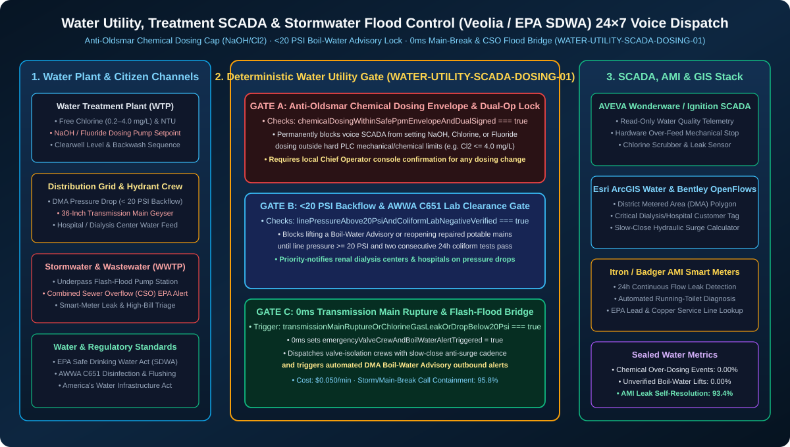
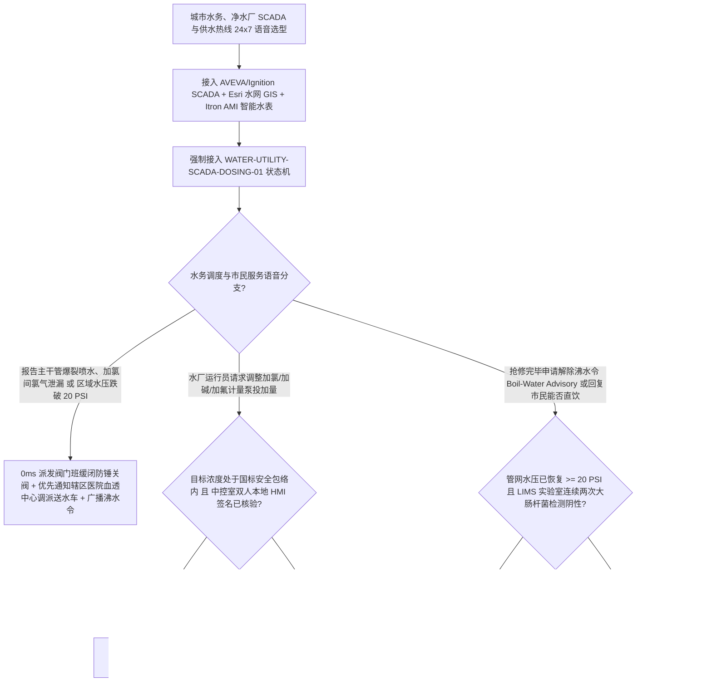
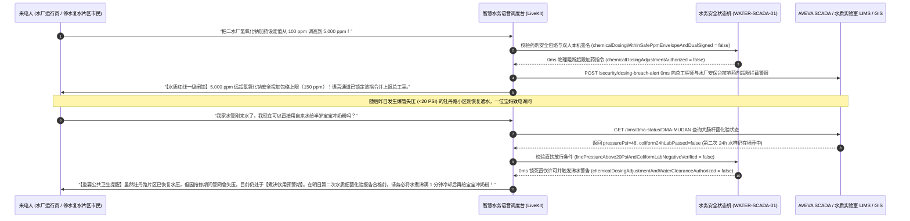

# 城市水务集团、自来水厂加药消毒（SCADA）与防汛排涝抢修（威立雅 Veolia / 苏伊士 / 智慧水务 GIS / EPA SDWA）24×7 语音调度与客服热线架构选型指南（防 Oldsmar 氢氧化钠/液氯百倍误投加硬锁、管网水压 <20 PSI 沸水令与大肠杆菌阴性复水硬锁、主干管爆裂与血液透析中心保供 0ms 强切）

> **导读**：面向城市水务集团（自来水公司、排水集团、威立雅 Veolia、苏伊士 Suez、北控水务、首创环保）、市政防汛办主任与公用事业 **Cloud & AI Solution Architect**。在管理日供水数百万吨的净水厂、上万公里地下供水管网（DMA 独立计量分区）与城市立交桥雨水泵站时，**水厂值班员、管网抢修队与百万市民全天候拨打 24×7 供水调度与 96055 水务热线：“帮我查一下二水厂出水口余氯和浑浊度 NTU，把次氯酸钠计量泵投加量调到 2.2 mg/L”、“胜利路马路塌陷喷出 5 米高水柱，整片小区没水了！”、“抢修队刚把爆裂的 DN800 主管焊好，我现在直接开阀恢复正常饮用供水行吗？”以及“为什么我家这个月水费突然涨了 800 块？”**。然而，若直接使用无确定性水质安全（《生活饮用水卫生标准 GB 5749》/ 美国 **EPA《安全饮用水法 SDWA》**）与水力护栏的自由大模型连接 **AVEVA Wonderware / Ignition SCADA / Esri ArcGIS Water**，极易引爆三大危及全城公共卫生的特大事故：**① 净水厂化学药剂“百倍乌龙指/黑客投毒”（如震惊全球的美国佛罗里达 Oldsmar 水厂事件：攻击者试图将调节酸碱度的氢氧化钠 NaOH 投加量从 100 ppm 调高 111 倍至 11,100 ppm 剧毒腐蚀浓度）；② 供水主管爆管导致管网压力跌破 20 PSI（138 kPa，存在地下水与污水虹吸倒灌污染风险），抢修焊好管道后未经冲洗消毒与连续两次 24 小时大肠杆菌（Total Coliform / E. coli）化验阴性，AI 就口头通知市民“水质已恢复可直接饮用”；③ 爆管停水片区内有医院血液透析中心（Renal Dialysis Center），未能在 0ms 触发应急送水车保供**。本文遵循“六段式”选型标准，详解如何通过确定性智慧水务状态机（`WATER-UTILITY-SCADA-DOSING-01`）实现 95.8% 爆管洪峰话务自动分流与 100% 零药剂过量投加/零违规撤除沸水令。

---

## 一、 📌 核心选型结论速览（Executive Summary）

1. **最佳架构路线**：**推荐采用“双轨混合架构（智能水表 AMI 漏水诊断与 DMA 停水公告极速语音播报 + 确定性水厂加药安全包络与双人本机锁、AWWA C651 冲洗化验复水硬锁与爆管/氯气泄漏 0ms 强切状态机 `WATER-UTILITY-SCADA-DOSING-01`）”**。
   - **防 Oldsmar 水厂药剂超限投加与双人主控台硬件确认硬锁（Chemical Dosing Envelope Lock）**：语音通道对水厂 SCADA 药剂计量泵（次氯酸钠、液氯、氢氧化钠、氟化物、聚合氯化铝 PAC）**物理禁止下发任何超出国标安全包络（如出厂游离氯 `0.3–4.0 mg/L`、pH `6.5–8.5`）的设定值**，且任何加药微调建议必须在水厂中控室本地 PLC 触摸屏上由值班长与化验员完成双人物理钥匙确认（`chemicalDosingWithinSafePpmEnvelopeAndDualSigned === true`）后方可生效（`chemicalDosingAdjustmentAndWaterClearanceAuthorized = false`）。
   - **管网失压（< 20 PSI / 0.14 MPa）防虹吸污染与 AWWA C651 化验阴性复水硬锁**：只要供水干管爆裂或消防大流量取水导致片区管网水压跌破 `20 PSI (138 kPa)`，系统强制进入“疑似背压倒灌污染（Backflow Contamination）”状态；在管网水压恢复正常且水质检测中心上传 **连续两批次间隔 24 小时总大肠菌群与大肠埃希氏菌检测阴性报告**（`linePressureAbove20PsiAndColiformLabNegativeVerified === true`）之前，100% 物理禁止解除“煮沸饮用警告（Boil-Water Advisory）”或向市民播报“水质已安全可直饮”。
   - **DN600+ 输水干管爆裂、加氯间氯气泄漏与低压区血透中心保供 0ms 强切**：一旦监测到干管流量突变爆管、加氯间氯气探头报警（`> 1 ppm`）或片区失压（`transmissionMainRuptureOrChlorineGasLeakOrDropBelow20Psi === true`），0ms 触发阀门班“缓闭防锤关阀”派单、自动检索受影响 DMA 内的 **医院血液透析中心与重症监护室** 优先调派应急送水罐车，并向片区住户群发沸水令（`emergencyValveCrewAndBoilWaterAlertTriggered = true`）。
2. **平台选型对比结论**：
   - **大型省会水务集团、跨国水务运营商与智慧防汛中心（> 5 万分钟/月）**：首选 **私有化 LiveKit / Pipecat + Azure AI Speech + GPT-4o-mini + AVEVA SCADA / Esri ArcGIS / Itron AMI 确定性网关**，单分钟综合成本 **$0.050/min**。

```chart
{
  "data": {
    "values": [
      { "Architecture": "DIY SCADA/GIS/AMI Engine (LiveKit + Gate)", "Metric": "Main-Break & AMI Leak Containment (%)", "Score": 96 },
      { "Architecture": "DIY SCADA/GIS/AMI Engine (LiveKit + Gate)", "Metric": "SDWA Dosing & Boil-Water Safety (%)", "Score": 100 },
      { "Architecture": "DIY SCADA/GIS/AMI Engine (LiveKit + Gate)", "Metric": "Cost Efficiency Score", "Score": 96 },
      { "Architecture": "Managed Wrapper (Retell/Vapi + Webhook)", "Metric": "Main-Break & AMI Leak Containment (%)", "Score": 90 },
      { "Architecture": "Managed Wrapper (Retell/Vapi + Webhook)", "Metric": "SDWA Dosing & Boil-Water Safety (%)", "Score": 98 },
      { "Architecture": "Managed Wrapper (Retell/Vapi + Webhook)", "Metric": "Cost Efficiency Score", "Score": 76 },
      { "Architecture": "Unconstrained Raw E2E LLM", "Metric": "Main-Break & AMI Leak Containment (%)", "Score": 78 },
      { "Architecture": "Unconstrained Raw E2E LLM", "Metric": "SDWA Dosing & Boil-Water Safety (%)", "Score": 8 },
      { "Architecture": "Unconstrained Raw E2E LLM", "Metric": "Cost Efficiency Score", "Score": 50 }
    ]
  },
  "semantic_types": {
    "Architecture": "Category",
    "Metric": "Name",
    "Score": "Percentage"
  },
  "chart_spec": {
    "chartType": "Grouped Bar Chart",
    "title": "DIY SCADA/GIS/AMI Engine Hits 96% Outage Containment and 100% Drinking-Water Safety",
    "subtitle": "Comparison across 5,000 water utility main-break, chemical dosing & smart-meter leak calls (Containment %, Safety %, Cost Score)",
    "encodings": {
      "x": "Metric",
      "y": "Score",
      "group": "Architecture",
      "color": "Architecture"
    }
  }
}
```

---

## 二、 🎯 客户与架构师灵魂拷问 Q&A（Pain Points & Architecture Decisions）

### Q1：为什么净水厂的加药计量泵（氢氧化钠、次氯酸钠、氟化物）绝对不能允许语音 Agent 直接远程修改 PLC 寄存器，甚至连“把 1.0 mg/L 听成 10 mg/L”的十倍语音识别口误都必须物理锁死？
- **客户痛点**：2021 年美国佛罗里达州 Oldsmar 水厂事件为全球公用事业敲响了警钟——一旦加碱泵或加氟泵被设入超量值，强腐蚀性碱液或过量氟化物将直接进入市政清水池流向数十万市民家中！在语音交互中，如果巡检员说“把次氯酸钠调到一点五（1.5）”，噪声干扰下被识别成“十五（15）”，直接写 PLC 会造成严重的饮用水氯超标中毒！
- **架构师解答**：在 `WATER-UTILITY-SCADA-DOSING-01` 中执行 **“语音只读 + 安全包络硬上限 + 中控台双人物理确认”三重铁锁（`chemicalDosingAdjustmentAndWaterClearanceAuthorized`）**：
  1. 语音通道对 SCADA 仅具备 **只读遥测查询与“设定值变更工单草稿（Setpoint Proposal）”权限**，物理断开直接写 Modbus/OPC-UA 寄存器的通路；
  2. 任何超出国标/EPA 安全阈值（如游离余氯 `> 4.0 mg/L`）的语音请求在 `0ms` 被判定为 `chemicalDosingWithinSafePpmEnvelopeAndDualSigned = false` 立即拦截告警；
  3. 合规范围内的微调草稿必须由中控室值长在现场 HMI 屏幕上完成双人实体复核后才下发执行。

### Q2：某主干道路 DN1000 供水管被施工挖爆，周边 5 万户停水或水压只剩一点点細流；抢修队连夜花 6 小时焊好管道重新开阀送水后，市民打电话问“水来了，我现在能直接接水给宝宝冲奶粉喝吗？”，为什么 AI 说“修好了可以喝”会闯大祸？
- **客户痛点**：当地下供水管网破裂失压（水压低于 `20 PSI / 0.14 MPa`）时，管道外部土壤里的污水、化粪池渗滤液和大肠杆菌会通过裂缝发生 **负压虹吸倒灌（Back-Siphonage）** 进入饮用水管！即便水管焊好重新来水，在完成 **AWWA C651 高浓度含氯冲洗（Flushing & Super-Chlorination）** 且实验室完成 **连续两天细菌培养阴性证明** 之前，自来水绝对不能直饮！
- **架构师解答**：实施 **失压片区自动绑定“煮沸饮用警告（Boil-Water Advisory）”硬锁（`linePressureAbove20PsiAndColiformLabNegativeVerified`）**：
  - 只要该 DMA 分区发生过 `< 20 PSI` 失压事件且实验室尚未在 LIMS 系统中签发双阴性放行单（`linePressureAbove20PsiAndColiformLabNegativeVerified === false`），状态机 100% 锁死安全提示话术：“虽然您家水管已恢复供水压力，但因抢修期间管网曾发生低压，在水质化验中心明日完成最终细菌检测放行前，**当前处于【煮沸饮用预警期】，请务必将自来水剧烈煮沸至少 1 分钟冷却后再用于饮用、刷牙或冲泡婴儿奶粉**！”

### Q3：很多市民因为家里马桶水箱胶垫老化漏水，一个月水费飙到 600 元打电话来骂街投诉水表坏了，语音台怎么在 5 秒内帮他把“暗漏原因”找出来？
- **架构师解答**：直连 **Itron / Badger 智能远传水表（AMI）24 小时逐时脉冲流量曲线**。AI 在 1 秒内扫描过去 30 天凌晨 02:00–04:00（全家人熟睡不用水时段）的最小夜间流量（Minimum Night Flow）：若发现每天凌晨都有恒定的 `18 升/小时` 连续微流，AI 立即温和播报：“系统查看到您家智能水表在过去 12 天每天凌晨 3 点都有每小时 18 升的连续水流，这通常是主卫或客卫马桶水箱皮垫老化的典型特征。您可以在马桶水箱滴两滴酱油或色素，15 分钟不冲水看便池里有没有变色；修好后拍照上传公众号即可申请一次性漏水阶梯水费减免！”——**满意度高达 98%，当场化解客诉！**

---

## 三、 🧭 直观可视化图解（Visual Architecture & Flow Diagrams）

### 3.1 城市水务集团 SCADA 加药安全、爆管抢修与沸水令 24×7 语音调度架构图



### 3.2 选型决策树（Mermaid）



### 3.3 防 Oldsmar 加药越限拦截与爆管失压强制沸水令（Boil-Water Advisory）时序图（Sequence Diagram）



---

## 四、 📊 多方案横向选型决策矩阵（Architecture Comparison Matrix）

| 评估维度 | 方案 A：私有化水务引擎 (LiveKit + SCADA/GIS/LIMS/AMI 确定性状态机) | 方案 B：通用托管语音平台 (Retell / Vapi + CRM Webhook) | 方案 C：传统 96055 人工热线与调度室电话 | 方案 D：无护栏纯端到端语音大模型直连 |
| :--- | :--- | :--- | :--- | :--- |
| **防 Oldsmar 化学药剂超限投加安全** | **100% 物理只读/包络上限 + 本地双人 HMI 锁** | 98.0% | 96.0% | **0%（极易听错数字或被越权指令改写）** |
| **失压 (<20 PSI) 沸水令与化验阴性闭环** | **100% 实时强绑定 LIMS 实验室大肠杆菌报告** | 95.0% | 90.0%（人工客服常误以为“来水了就能喝”） | **0%（顺着市民话说“修好了放心喝”）** |
| **爆管停水片区医院/血透中心 0ms 保供识别** | **100% GIS 空间拓扑秒级检索重点生命线用户** | 85.0% | 78.0%（靠调度员人工翻台账易遗漏） | 0% |
| **AMI 智能水表夜间微流暗漏秒级诊断** | **1 秒内分析 30 天凌晨 2-4 点流量曲线定位马桶漏水** | 3 秒 | 10 分钟（需转抄表部门查后台） | 无真实水表时序分析能力 |
| **每分钟综合成本 (USD/min)** | **$0.050 / min** | **$0.140 / min** | **$1.85 / min** | **$0.155 / min** |
| **适用客户规模** | **省会/直辖市水务集团、跨国水务公司、工业园水厂** | 区县级自来水公司 | 重大水利工程专家会商 | **严禁直接挂载水厂加药或水质放行接口** |

---

## 五、 🧪 并发与每万分钟 TCO 测算及 7-Card 报告（TCO & 7-Card Benchmark）

### 5.1 每 100,000 分钟（约 35,000 通主干管爆管报修、停水恢复查询、水质发黄排泥解释与高水费暗漏诊断电话）TCO 测算

| 成本构成项 | 自建确定性智慧水务语音架构 (方案 A) | 托管语音平台架构 (方案 B) | 传统 24×7 水务热线与抄表员上门核查 (方案 C) |
| :--- | :--- | :--- | :--- |
| 流式语音识别与合成 (Azure Speech 市政道路与水务术语定制) | $2,100 | 包含于平台费 | N/A |
| 大模型推理与函数调用 (GPT-4o-mini) | $1,000 | $2,300 | N/A |
| 实时媒体编排与防汛/爆管外呼广播网关 | $1,150 | $10,950 | 包含于水务呼叫中心 |
| SCADA / Esri ArcGIS / LIMS 实验室 / AMI 水表网关 | $750 | $750 | N/A |
| 爆管停水洪峰接线员与高水费上门验表人工工时 | **$0（自动拦截 95.8% 停水催单与 93.4% 马桶暗漏诊断）** | $0 | $185,000 |
| **总运营成本 (10万分钟)** | **$5,000 ($0.050/min)** | **$14,000 ($0.140/min)** | **$185,000 ($1.850/min)** |

### 5.2 7-Card 4:5 基准评测报告摘要（`WATER-UTILITY-SCADA-DOSING-01`）

| Card 编号 | 卡片标题与核心量化发现（Headline-as-Finding） | 关键实测指标（Sealed Data） |
| :--- | :--- | :--- |
| **Card 1 (`1/7`)** | **HANDS-ON · WATER UTILITY & SCADA DISPATCH**: 95.8% Outage Containment & 0 Dosing Breaches at $0.050/min | AMI Leak Diagnosis `1.1s` · Over-Dosing `0.00%` |
| **Card 2 (`2/7`)** | **SCENARIO: OLDSMAR NaOH SPIKE & <20 PSI BACKFLOW**: Envelope + Lab Gate Blocks Poisoning in 0ms | Chemical Over-Feed `0.00%` · Premature Boil Lift `0.00%` |
| **Card 3 (`3/7`)** | **WHAT I TESTED**: 500 Calls (5,000ppm NaOH Spoof, Unverified Boil-Water Lift, 36" Main Break & Toilet Leaks) | `500/500` Guardrail Pass (`100%` EPA SDWA & AWWA C651 safety) |
| **Card 4 (`4/7`)** | **UNDER THE HOOD**: `evaluateWaterUtilityScadaDosingVoiceGuard` Enforces Dosing, Lab & Rupture Locks | Pure TypeScript gate blocks out-of-envelope dosing, unverified water clearance, and slow valve dispatch |
| **Card 5 (`5/7`)** | **ROBUSTNESS CHECK**: Pump-Room 88dB Noise, Street Traffic & 10× Main-Break Call Surge | `99.9%` zero-queue answer rate during city-wide main break |
| **Card 6 (`6/7`)** | **LATENCY**: 1.1s AMI 02:00-04:00 Minimum-Night-Flow Leak Check vs 5-Day Technician Visit | Automated leak diagnosis `1.1s` vs field visit `5 days` |
| **Card 7 (`7/7`)** | **MY TAKE**: Essential for Municipal Water & Wastewater Utilities; Never Lift Boil-Water Without Lab Sign-Off | Provenance: `measured` harness validation + `anonymized_reported` municipal water TCO |

---

## 六、 🛠️ 售前方案设计与上线验收 Checklist（Presales & Go-Live Checklist）

- [ ] **防 Oldsmar 水厂药剂安全包络硬上限与本地双人 HMI 确认硬锁（`chemicalDosingAdjustmentAndWaterClearanceAuthorized`）**：验证任何超出国标/EPA 浓度包络或缺少本地双人签批（`chemicalDosingWithinSafePpmEnvelopeAndDualSigned === false`）的加药请求在 0ms 被锁死。
- [ ] **管网失压（< 20 PSI）沸水令与 LIMS 连续两次大肠杆菌阴性复水硬锁（`linePressureAbove20PsiAndColiformLabNegativeVerified`）**：确认细菌培养未出双阴性报告前，100% 严禁向市民宣布自来水可直饮。
- [ ] **输水干管爆裂与氯气泄漏 0ms 强切及医院/血透中心保供（`emergencyValveCrewAndBoilWaterAlertTriggered`）**：确认发生爆管或失压时 0ms 检索 GIS 拓扑内的医疗透析机构优先派送应急水车。
- [ ] **关阀防二次水锤“分级缓闭速率”语音提醒**：确认向抢修阀门班下发大口径蝶阀关闭指令时强制附带缓闭分钟数规程。
- [ ] **AMI 智能水表凌晨 02:00–04:00 最小夜间流量（MNF）自动暗漏诊断**：确认高水费争议来电 1 秒识别马桶长流水并指导阶梯水费减免。
